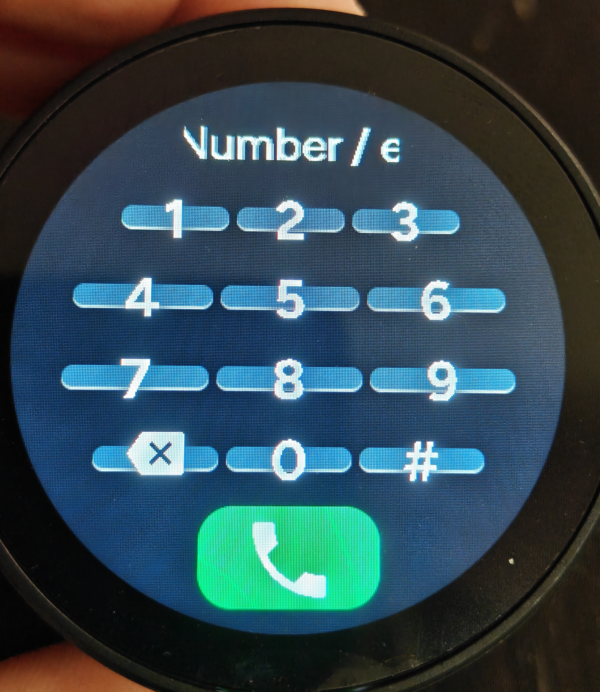
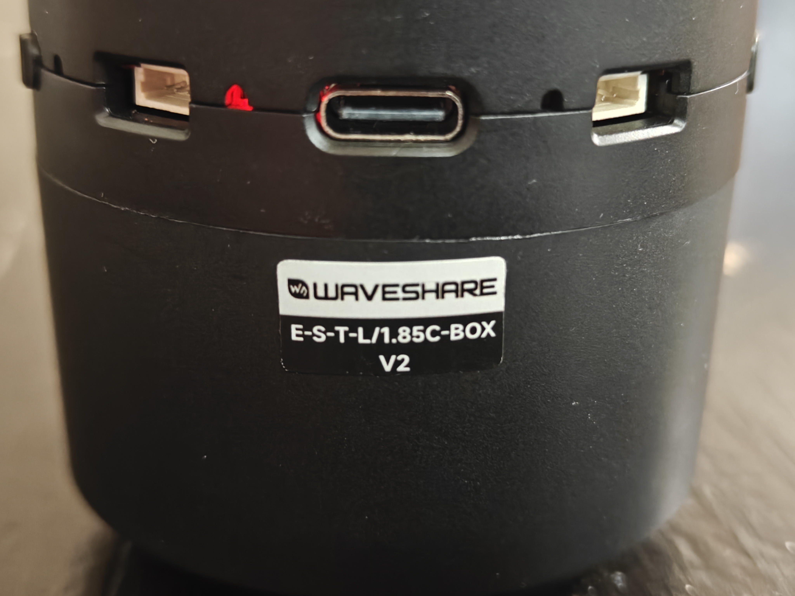
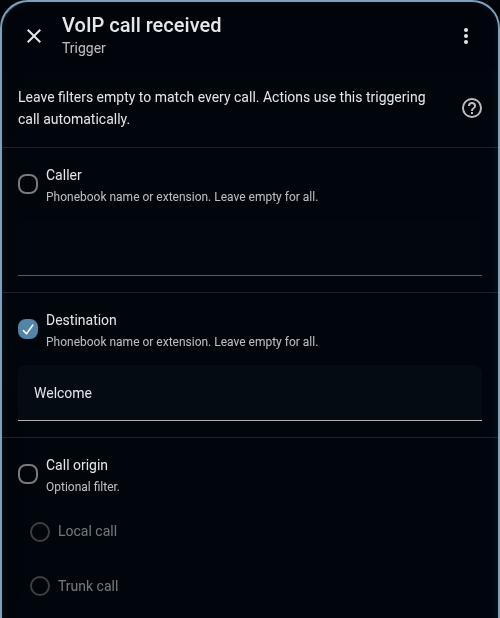
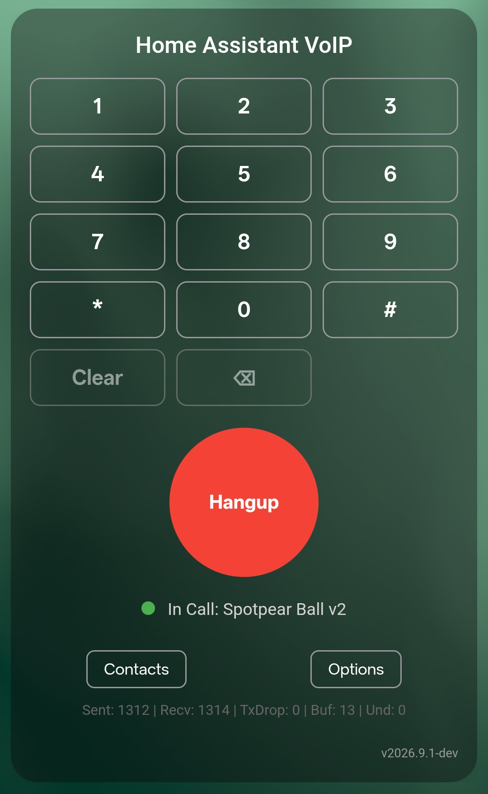

# Changelog

## 2026.12.0-dev

- Public firmware profiles target ESPHome 2026.11.0. The shared packages load
  the selected voice and playback backports when the profile uses those features.
- Choose a device by its Home Assistant name and icon when assigning a desk
  phone line or BLF key. Single-position profiles such as the Snom 360 show
  both selections directly in the form. An automatically generated key label
  fits the phone's display, even when the device name is longer.
- An existing Home Assistant softphone named `Casa` becomes a SIP account
  with the username `Casa` on upgrade. Its extension and dashboard references
  stay on the same record. A newly assigned login omits spaces in the
  softphone name. Existing SIP credentials are preserved.
- Managed ESP phones have a SIP account device in VoIP Stack. Open it to see
  registration and call state. The ESPHome hardware device retains its audio
  controls, sensors and existing dashboard references.
- A [new managed ESP phone](docs/ESP_REGISTRATION.md#how-the-esp-gets-its-sip-username)
  uses its ESPHome friendly name, falling back to the node name. With MAC
  suffixes enabled, it uses the node name already suffixed by ESPHome.
  Previously enrolled ESP phones keep their saved login and password.

- Configure a discovered desk phone with an optional first SIP account. A
  DHCP change leaves the manual address field empty. The physical device's
  configuration link lets administrators copy the complete provisioning URL.
- Deliver the model's correct file or directory through SIP PnP or DHCP.
  A confirmed DHCP discovery can now reach its first file download after HA
  restarts. Add DHCP detection for 26 documented Yealink models. Document
  [how switch port timing can affect provisioning at boot](docs/PHONE_PROVISIONING.md#phone-discovered-but-still-waiting-for-its-file-after-boot)
  using a verified Snom 360 case.
- Distinguish a file waiting on the PBX, a download and a registration from
  the physical phone. The updated Snom 360 profile supports configuration
  refresh, alongside the existing Fanvil X3U Pro application method.

- Offer Snom 360 handsets already known to Home Assistant's DHCP discovery,
  including on networks where the phone's SIP multicast is not delivered.
  DHCP and SIP use one discovery card and require explicit adoption.

- Keep the caller's card and dashboard in outgoing progress while a local
  application or remote destination rings. Incoming answer controls, popups
  and automatic answer follow the offer for the selected account.
- Allow an administrator to choose existing paging groups in the phone card's
  options. Both editors update the same group records, including empty groups.
- Run the dashboard snapshot check against the shipped JavaScript modules.
  Verify that each queue offer ends on the same attempt that started it,
  including when a browser and a SIP handset share an account.
- Fix conference shutdown when the last participants hang up together and the
  mixer is finishing its last tick. The hangup actions complete and free the
  accounts for the next call. Reported in [#166](https://github.com/n-IA-hane/esphome-intercom/issues/166).

- Discover SIP phones independently of provisioning. An unadopted handset
  appears in Home Assistant without receiving a configuration URL. Recognize
  the percent-encoded MAC announced by Snom 360 firmware.

- Show the parties in completed call activity for the PBX and its SIP accounts.
  Enable Home Assistant debug logging to follow number normalization, routing
  decisions, phone policies, queue offers and fallbacks by Call-ID.
- Refresh the portrait Companion screenshot using Frosted Glass Dark and
  clean up the print texture of the illustrated doorbell call flow.

- Validate the desk-phone provisioning address when enabling provisioning.
  When the automatic address is unavailable, the form and phone status explain
  how to configure HTTPS or allow HTTP on a trusted LAN.
- Use consistent Italian call controls in the compact card, popup and
  dashboard. Keypad buttons retain keyboard focus, and voicemail actions
  identify the caller and date for screen readers.
- Document the HA upgrade and backup restore paths, the matching ESPHome
  preview builder, and optional G.722 on compatible ESP phones.

### Official component alignment and independent rendering

- Offer an experimental [adaptive speaker volume switch](docs/ESP_ENTITY_SURFACE.md#optional-adaptive-volume)
  in the YAML profiles that include the shared Audio Stack controls.
- Opt in to the experimental **Stop** command to silence a ringing timer on ESP profiles with
  local wake-word detection and timers. Active calls and Assist keep their
  normal behavior. [Setup and recognition results](docs/DEPLOYMENT_GUIDE.md#stop-a-ringing-timer-by-voice)
- Declare ESPHome 2026.12 as the minimum for the coordinated Intercom recipes,
  using the shared platform owners. Retain the exact official Core 373 preview
  for qualification without raising unrelated standalone-component minimums.
- Align the remaining wake-word, Voice Assistant and playback providers with
  one complete official ESPHome revision. Keep only the documented lifecycle
  corrections until their upstream replacements are qualified.
- Publish the focused HTTP completion proposal as
  [PR22787](https://github.com/esphome/esphome/pull/22787) and contribute the
  broader player error/replacement policy to
  [existing PR22118](https://github.com/esphome/esphome/pull/22118#issuecomment-6914576261).
  MWW [PR22781](https://github.com/esphome/esphome/pull/22781) and Voice Assistant
  [PR22782](https://github.com/esphome/esphome/pull/22782) remain separate proposals;
  publication does not mean integration or a qualified official replacement.
- Record the selected H.264 candidate fork at `176cda6`, on official `08a0b658`,
  with one default-off Kconfig DB-buffer preference and allocation diagnostic.
  On the qualified P4 it recovers about 240 KB of internal memory and restores
  audio-task creation and networking. Duplex H.264 data was verified; the
  optional vendor Unity case is compiled but not presented as hardware-executed.
  Propose the narrow allocation option in [Espressif PR28](https://github.com/espressif/esp-h264-component/pull/28).
- Select the official Espressif GMF provider while retaining ESP-SR 2.6.0.
  Record renderer and screenshot repositories in the shared qualification
  catalog and identify development ESPHome installations by their Git commit.
- Follow ESPHome's recommended P4 SDK without a source pin. Apply the official
  PPA and SDMMC fixes to checksummed build-local sources for the exact supported
  5.5.6 and 6.0.3 tags, preserving the installed SDK and original build targets.
  Keep the official CSI correction in the camera dependency.
- Apply Espressif's rotated DMA block fix to the P4 display driver. A small
  rotated redraw, such as the Hang Up button during a video call, can otherwise
  stall the display and trigger a watchdog reset. In one repeat on an ESP32-P4,
  the same button ended a minute-long two-way JPEG call and returned to idle.
- Declare P4 PSRAM execution through the official framework option so the
  display and camera drivers share the correct interrupt memory policy.
- Capture P4's composed UI/video through the display owner's public readback,
  selected automatically from `lvgl_id` without a forced redraw. Preserve S3
  LVGL capture, legacy selectors, native actions and one additional output rotation.
- Move P4 rendering into the independent renderer repository and create the
  VoIP adapter from the ordinary sink reference. The renderer no longer owns
  telephone formats, negotiation or transport lifecycle.
- Retain a minimal upstream-aligned MIPI display adaptation as the single
  owner of RGB/YUV transforms, framebuffer writes and UI/video serialization.
  P4 uses its public pixel transaction; S3 retains LVGL image presentation.
  Propose the generic display API in [PR22789](https://github.com/esphome/esphome/pull/22789)
  with its [developer documentation](https://github.com/esphome/developers.esphome.io/pull/348).
- Record default-SDK receive-video windows of 9.696 and 9.941 FPS. Preserve the
  repeat's strict browser failure with 24 startup audio-playout drops. A matching
  true-SDK 6.0.3 call measured 9.824 FPS, with strict browser audio passing and
  no RTP loss. Restore the recommended-SDK candidate after that forward check;
  physical white flashes and acoustic quality remain unverified.

### Home Assistant configuration and lifecycle

- Wait for the actual browser audio device clock before starting a call or
  answering, and retain the prepared microphone graph through media setup.
  The original Casa-to-WS3 path now has zero startup playout drops, with the
  transmitted tone and received PCM verified independently. No buffer, jitter
  target, DSP setting or ESP firmware change is required for this correction.
- Follow only the relevant ESPHome entity changes through HA's indexed state
  listeners. Preserve device and entity identity during registry changes.
- Remove entry-owned persistent Stores only when the integration is deleted;
  ordinary reloads preserve their data and pending saves cannot recreate
  deleted storage.
- Use shared native HA form controls in the card editors. Persist VoIP section
  strategy account selections so configured cards remain callable with every
  browser closed.
- Keep native physical-phone forms readable: named model choices and account
  name/extension summaries replace raw configuration references. Existing
  canonical associations are unchanged. Refresh actual native form screenshots.
- Retain an explicit December stable-release checkpoint for the newer Repair
  ownership and Assist processing APIs. Qualify development Core separately;
  do not require a household Core development installation.


### Preview camera sources and documentation

- Distinguish stable and preview setup instructions using their actual account
  and card labels. Document physical-phone provisioning as an available preview
  feature, and align BOX V2 profile headers with the existing ESPHome 2026.12
  minimum.
- Include the real Chromium decoder-recovery regression in the browser CI
  catalog, so the browser job executes it alongside the other media checks.
- Build Dev P4 camera profiles and coordinated CI from the project camera fork,
  including shared admission before hardware JPEG processing. Camera
  [upstream PR9](https://github.com/Psix-anp/esphome-esp-video-camera/pull/9) is
  ready for review with 99 local software checks; those checks do not establish
  a physical frame-rate gain. Main/stable keep
  the upstream camera source. The C++ already used by the qualified private P4
  firmware is now selected by public Dev profiles as well.
- Keep queue operator controls available in a standalone ESP mirror card, using
  the existing shared phone-state subscription. Changing to a passive phonebook
  or removing the card releases its observer without adding another runtime.
- Add a portrait VoIP Dashboard capture from the official Companion app with
  illustrative call states. Refresh account/queue documentation and current
  option screenshots, while retaining labelled historical captures.

### Consistent transfer targets and administrative updates

- Transfer an enabled offline SIP account through the PBX, allowing its normal
  always/unavailable forwarding policy to run. Disabled and ambiguous targets
  remain rejected. Resolve built-in parking destinations through the configured
  parking parser before constructing REFER, including custom access codes.
- Settle an already-dispatched phone update when only its administrator
  credentials change. The existing worker tracks its active application task;
  an orphaned requesting state can be recovered by an explicit administrator
  retry without automatically repeating a command with an uncertain result.
- Enforce current account read/control permission on audio and video attachment,
  including reconnects. Access changes retire only the affected media owners,
  using the existing lease cleanup and keeping other participants connected.
- Report rejected ESPHome renames with the existing device Repair. Preserve the
  issue across unrelated directory refreshes and clear it after a successful
  correction or device removal.
- Reuse the display-control descriptors for refresh actions as well as widgets
  and callbacks. Expanded configuration and generated runtime code are unchanged.

### Call and provisioning lifecycle

- Route transfers to queues, ring groups and paging through the PBX listener,
  using the same destination resolution as ordinary calls. Preserve restrictions
  on delegated transfers and share the reduction of failed call attempts.
- Revoke existing account-state subscriptions when their user loses read access.
  Cards and popups retract the private call data, while unrelated subscriptions
  and calls keep running. Control-only changes preserve authorized observation.
- Resume deferred phone updates from the HA event loop. A single cancellable
  60-second check exists only while an unsent update waits for an idle phone,
  including calls on a line that this PBX does not manage.
- Track a provisioning command once it may have reached the phone. A call or
  configuration change after dispatch cannot silently replay that revision;
  an uncertain response is reported for an explicit administrator retry.
- Request Fanvil updates through its documented, authenticated `AutoP` command.
  Keep native identity and idle checks, and avoid relying on a GUI login session
  for configuration writes. Suppress automatic HTTP retries for this command,
  including the client's normal retry of a GET after a connection failure.
- Isolate conflicting ESPHome phone names and report the affected device through
  HA Repairs, allowing other phones and directory updates to continue.
- Surface supported diagnostic codes, including incompatible LDAP transport,
  on the provisioning sensor without exposing arbitrary exception details.
- End the camera fallback reader when its selected video track ends, releasing
  pending reads and browser resources through the existing sender cleanup.
- Require the native MasterVolume integration tests against a pinned Audio Stack
  checkout in CI. Share compatible on-device Switch controls at configuration
  generation time while retaining their existing owners and behavior.

### Browser camera frame sources

- Supply camera frames through a muted video element when the current browser
  context has no `MediaStreamTrackProcessor`. Preserve the existing encoder and
  media ownership paths. Thanks to [Cybul3000](https://github.com/n-IA-hane/esphome-intercom/pull/163)
  for the contribution and Safari, iOS and Firefox checks.
- Detect camera encoders that greatly exceed their requested bitrate and try
  the supported software configuration without changing the negotiated codec.
  Thanks to [Matt Sullivan](https://github.com/n-IA-hane/esphome-intercom/pull/158)
  for the contribution and Android tablet measurements.
- Keep fallback camera timestamps monotonic, preserve image proportions during
  rotation, and cancel pending playback when its sender is retired. Capture
  callbacks run only while the encoder is waiting for a frame.

### Account controls

- Update existing HA phones to shared SIP accounts in place, preserving their
  extensions, dashboards, devices, entity names, preferences and credentials.
  New records use native HA subentry identities; migration validates the full
  namespace and reports conflicting saved identities through Repairs.
- Validate account edits before saving and persist only the requested fields.
  Concurrent preference changes no longer restore stale extensions or groups.
  An account name retained by a terminating call cannot be recreated until its
  aliases are released, without leaving an unusable saved account behind.
- Preserve the account's no-answer policy and ringing deadline when SIP phones
  and HA clients share it, including forwarding and late browser answers.
  A busy SIP terminal no longer ends the whole queue offer while HA can answer;
  queue outcomes, missed responses and automatic pause follow the account result.
- Keep the preferred HA account out of unrelated trunk calls, so an outgoing
  call does not make another extension appear busy.
- Keep DND feature subscriptions synchronized when a phone addresses its
  account by extension instead of its SIP username.
- Accept opaque CSTA device references, including the terminal MAC sent by
  Fanvil DND controls. Keep authorization on the authenticated SIP account and
  addressed endpoint, with explicit foreign SIP references still rejected.
- Finish resolving the latest popup account after an older pending lookup,
  without requiring a page reload or a second selection.
- Share the initial account snapshot through the existing page subscription,
  removing duplicate startup requests. Read-only cards receive their control
  capability and do not probe microphones or automatically answer calls.
- Keep an unrelated trunk's last SIP failure out of another account's status.
  Reuse native device/entity lookup and removal, and update configured HA
  associations from configuration changes rather than rescanning on call events.

### Managed desk phones

- Adopt a discovered or manually entered physical phone in one native HA form,
  with an optional existing SIP account. Advanced properties, line assignments
  and key ordering have separate controls; account and physical-phone entries
  are labelled distinctly.
- Choose associated phone lines from the selected model's real capabilities.
  Reorder keys through their explicit physical positions, preserving unmanaged
  slots. Share the key-function contract between resolution and rendering,
  including the action that parks the current call without a BLF subscription.
- Prepare and request configuration application through the existing worker
  for qualified profiles with administrator credentials and an idle phone.
  Preparation, file delivery and an accepted application request remain
  separate observations. Unqualified models retain their manual application
  path. Idle systems do not poll phone configuration; the pending-only busy
  check is described above.
- Qualify automatic configuration application for Fanvil X3U Pro firmware
  2.12.20, including physical BLF key reordering without a manual provisioning
  command or reboot. Existing phones need the updated pinned catalog profile.
- Expose the application request status and safe error codes on the existing
  provisioning sensor, without treating an accepted request as device adoption.
- Label native HA configuration rows explicitly and show readable phone and
  PBX models while preserving customized account and device names.
- Preserve LDAP transport mode in provisioning and reject modes the selected
  model cannot configure. Reuse verified cached profiles without rewriting
  them and publish new cache files through unique atomic temporary files.
- Keep provisioning optional: editing an account while it is disabled does
  not download phone profiles. Redact administrative credentials and private
  provisioning tokens from diagnostic exports.

### On-device settings

- Show the microphone, AEC-reference and call-transmission gain controls that
  the selected profile actually provides. The display and Home Assistant use
  the same controls, including their fractional steps and hardware limits.
- Share supported audio controls and camera JPEG quality with the P4
  VoIP-only Options screen. Profiles without a JPEG camera do not present a
  camera encoding control.
- Keep display updates event-driven and avoid rewriting unchanged control
  values. On-device changes require rebuilding the corresponding firmware.

### Coordinated ESP firmware

- Correct DC-filter overflow, idle master-volume alias updates and packed
  PCM sample alignment in the coordinated Audio and VoIP components.
- Compact queued Runtime Controller updates and use fixed circular queues
  while preserving event order, reentrancy limits and feature gates.
  These device changes require rebuilding and uploading ESP firmware;
  updating the HA integration alone does not install them.

### Generic I2S microphone wiring

- Expose `audio_mic_channel: left/right` consistently in the generic single-bus,
  dual-bus and native-I2S microphone profiles. Preserve each profile's existing
  default and select the same input for Voice Assistant, wake word and VoIP.
  Thanks to [apaneiro](https://github.com/n-IA-hane/esphome-intercom/issues/162)
  for the report.

Rolling development preview, recovered incrementally from stable `2026.11.0`.
Existing PBX functions, including parking, pickup, voicemail,
BLF and MWI, retain their normal owners and interfaces.

- Add optional global incoming-call popups for an existing HA browser phone,
  configured per browser or Companion app. X, Esc and Back minimize the same
  call; the small caller/timer bar reopens it. Restore that bar when an audio
  call resumes after parking or pickup. Companion uses its existing WebView.
- Integrate the VoIP Dashboard with shared extension status, contacts and the
  selected HA or ESP phone's controls. Keep actions visible in portrait layouts
  and when a video view hides its embedded toolbar. The compact card retains
  its HA softphone, ESP mirror and phonebook modes.
- Keep enabled logical HA phones reachable without an open card, and retain
  browser media through dashboard changes. Browser audio and auto-answer still
  need a running receiving frontend and media permissions. Scope notification
  Answer and Decline to the original phone and Call-ID.
- Restore the canonical shared directory and standard LDAP delivery from
  existing phone owners. Preserve SIP presence composition, authenticated
  subscription lifecycles and owned TCP notification retries. Recover managed
  ESP accounts through the existing private ESPHome API.
- Preserve negotiated directional audio, receive-packet capacity, per-Contact
  capabilities and bound RTP socket ownership through routing and media
  changes. Keep optional browser camera intent separate from receiving video,
  and recover decoding when a video client reconnects.
- Include the standard mono 16 kHz PCM, 20 ms alternative in both directions
  of WS3 Audio FULL, preserving its preferred HA formats. Qualify this offer
  against the resolved device profile, separately from calls translated by HA.
- Integrate the maintained S3 JPEG receive profile, preserve source aspect and
  receiver geometry, and align P4 camera frame rate with the selected profile.
  P4 display rotation is composed by the declared display owner. Add optional
  LVGL coordinate-tap diagnostics through the existing device action path.
- Keep coordinated preview component references and the browser, HA and media
  regression witnesses in CI. Document the explicit
  [preview firmware overrides](docs/DEPLOYMENT_GUIDE.md#development-preview-firmware).

Physical checks cover the exercised S3 and P4 profiles and call routes,
including P4 popup video and S3 audio parking/pickup. They do not establish
universal hardware, codec or acoustic qualification. Active-video endpoint
retargeting on ESP is outside this preview's added contract. See the
[qualification rules](docs/voip_test_matrix.md#incremental-recovery-from-2026110).

## 2026.11.0

> **VoIP Stack for Home Assistant does not require ESPHome or ESP devices.** You can use the integration with browser softphones and standard SIP phones.
>
> **For ESP firmware builds only: ESPHome 2026.10.0 or newer is required.**
>
> Audio Stack, ESP VoIP Stack, Runtime Controller and the maintained device YAMLs now follow ESPHome 2026.10's audio interfaces. Upgrade your ESPHome builder before compiling this firmware; older builder versions are no longer supported.
>
> ESPHome 2026.10 includes substantial audio improvements and several of our accepted contributions. Thank you to the ESPHome team for your work, reviews and accepted PRs! <3

> **Recommended: update your ESP firmware too.** Rebuild and upload the current
> board YAML with the coordinated components for all device-side
> features and fixes. Updating the HA integration through HACS does not update
> the firmware running on an ESP.


Changes since stable 2026.10.1.

### ESP32-S3 camera video calls

- ESP32-S3 devices can transmit native ESPHome JPEG camera video during SIP
  calls, including devices without a display. Rendering the remote video on
  an S3 screen is not yet supported.
- ESP32-P4 retains bidirectional video, sending its camera stream and displaying
  the remote caller. Devices with a microphone and speaker retain bidirectional
  audio on both S3 and P4.
- Add generic FULL and standalone VoIP-only camera entrypoints, with board
  memory, microphone/amplifier pins and camera settings exposed at the top.
  The standalone profile uses VoIP Stack callbacks without Runtime Controller.
  Thanks to [jayfan0](https://github.com/n-IA-hane/esphome-voip-stack/pull/6) for
  the native camera contribution and S3 hardware checks.

### Round display settings and package startup

- Share a scrollable Options page with audio controls and an optional VoIP
  section. Spotpear and BOX V2 FULL displays navigate through Assist, Contacts,
  Keypad and Options vertically, stopping at each end and omitting unavailable pages.
- Update visible controls from entity notifications instead of periodic
  settings refreshes, and consume navigation gestures before they can become
  clicks on the previous screen. Ordinary button taps remain available.
- Preserve all startup automations when packages merge, restoring device
  initialization and Options-page registration.
- Allow a board-specific full-charge voltage reference for the BOX V2 battery
  percentage. Document the new package migration and separate FULL and
  standalone phone entrypoints in the breaking changes.
- Keep audio and video packet counters separate in the host diagnostic reader.

### SIP registration compatibility

- Accept ordinary Linphone registrations carrying `+sip.instance` without
  `reg-id`, including when the client advertises Outbound support. Preserve
  GRUU identity through the existing registration path. Thanks to
  [Charlyo](https://github.com/n-IA-hane/esphome-intercom/issues/141) for the
  report and proposed correction.

### Official ESPHome audio providers

- Maintained profiles use the official ESPHome audio, mixer, resampler,
  `speaker_source`, Voice Assistant, Micro Wake Word, microphone, speaker and
  OTA providers. Retire their local copies and the MIME, Sendspin-source and
  DSP-placement adapters; keep Audio Stack/AEC/AFE, VoIP and Runtime Controller
  in their existing owners. The P4 display adaptation and GMF vendor pin remain
  separate.
- Preserve board wiring, dual-microphone BSS/downmix choices, gain/reference
  calibration, PCM formats, UI, media sources and cleanup composition. Custom
  configurations must remove the retired external-provider names and their
  private scheduling/timeout options. Start from the current board YAML.
- Tie Audio Stack playback completion to the emitted DMA descriptor and
  generation. Advance software reference through partial frames and silence,
  preserve valid explicit DMA geometry, and separate AFE acquisition epochs.

### Maintenance and native component cleanup

- Restore camera startup on pre-v3 ESP32-P4 boards with the default ESPHome
  2026.10 SDK. A video-only build adaptation corrects esp_video's CSI/ISP
  format boundary for IDF 5.5.6 without changing the external camera source.
  Synchronize DMA-written pixels before optional framebuffer diagnostics.
  See [P4 hardware and media](docs/P4_HARDWARE_AND_MEDIA.md#esphome-202610-physical-check).

- Return the mixer runtime to upstream playback counters and stop/start handling,
  removing the extra contribution queue, output-callback mutex and metadata
  backpressure. Use the native ESPHome 2026.10 automation bindings.

- Stop playback resampler and mixer inputs before closing shared audio hardware
  during maintenance. Source completion and Stop now follow the official
  player. The shared maintenance script restores readiness after an interrupted
  update without a second media owner.

- Returning from Options through Contacts/Keypad now reveals the selected view
  on browser phones, ESP mirror cards and the transfer view. The call controls
  and layout remain the same.
- Remove the local speaker fork and its legacy player. Maintained profiles use
  the native ESPHome speaker base; the Spotpear phone-only ringtone now uses
  `speaker_source` too. Custom configurations need the
  [speaker migration](docs/BREAKING_CHANGES.md#development-firmware-retired-speaker-fork).
- Browser startup, media-device selection and FFmpeg regressions have explicit
  CI ownership. Test results are retained per suite, and missing/skipped
  mandatory checks cannot silently produce a successful validation gate.

### Firmware configuration migration

The maintained firmware now requires **ESPHome 2026.10.0 or newer**. Upgrade the
builder before rebuilding. The 2026.9 core compatibility branches are removed.
Sendspin moves to the native 0.9.3 protocol client; upgrade Music Assistant to
**2.10.7 or newer**, then open the speaker's **Setup** in Music Assistant.
Choose PIN pairing, press **Sendspin Confirm Pairing** in the device's HA
controls, and enter its temporary **Sendspin Pairing Code**. Existing server
pairings survive a normal reboot. See the [pairing guide](packages/README.md#pair-sendspin-with-music-assistant).


**When adopting the reorganized firmware packages, start from the updated YAML
for your exact board and bring over your settings.** Each profile now includes
one device package and a `firmware_features` list. Selecting voice, calls, music,
Sendspin, timers or supported presentation also selects their matching controls
and callbacks, so removing a feature no longer requires chasing its fragments
across several files.

Keep your device name, secrets, network/authentication settings, custom pins and
wanted behavior. Do not paste the old FULL preset or whole player/mixer blocks
over the new device package. Legacy leaf includes remain for custom builds, but
mixing both complete compositions can duplicate components and callbacks.
Follow the [migration checklist](docs/BREAKING_CHANGES.md#development-firmware-new-device-packages)
and the [simple-to-advanced examples](packages/README.md#work-through-a-full-profile).

This applies when rebuilding ESP firmware with the coordinated package update;
a HACS update alone does not replace a device's firmware. Use the matching `dev` package and component sources for this preview. Generic
Full Lite keeps Sendspin out of its default 4 MB selection. Choose the hardware
and AFE/AEC/native profile separately from its application features.

### Coordinated audio and runtime refresh

- Integrate the validated GMF AI Audio 1.1.1 source, with ESP-SR 2.6.0 explicitly
  selected by Audio Stack. Retain immediate processed-PCM delivery and use the
  upstream feed/fetch stack placement and suspend/abort shutdown ordering.
- Use the libraries selected by official ESPHome 2026.10.0: esp-audio-libs
  4.0.1, micro-FLAC 0.3.0 and Sendspin 0.9.3 with its native pairing controls.
  Include the certificate bundle for HTTPS playback.
- Use native player Stop and EOF draining. Audio Stack rejects writes during
  its pending reset and honors the caller's wait budget while cleanup completes,
  preserving producer ownership of unaccepted PCM.
- Use one shared OTA entry/recovery script for the selected sources and display.
  Stop the speaker adapter before its hardware, cancel pending idle waits on
  recovery, and restore readiness after an interrupted update.
- Explain Runtime Controller decisions with progressive examples and optional
  debug reports of the activity that selected each policy. Preserve existing
  audio/SIP owners and the common resolver.
- Keep the 4 MB Full Lite default free of Sendspin. Validate its composed default
  while preserving voice, wake word, calls, music and announcement playback.

### PBX applications available by default

- Remove global parking and voicemail enable switches. Keep resource settings in
  separate reconfiguration panels; initial setup does not require a TTS provider.
- Preserve configured mailboxes and media through migration. Message deposits can
  use their greeting/tone without TTS; spoken menus require a configured voice.
- Protect existing routes from default feature-code collisions and report them in
  HA Repairs. Update parking settings without restarting SIP or ending calls.
- Release the shared card activity subscription when no cards or owned calls use
  it. Idle availability does not open an unused media archive or run hold audio.

### Call card presentation corrections

- Preserve the existing translucent bottom call bar and keypad layout. Show
  Park call as an icon alongside the existing controls, and reserve their
  measured width so they do not overlap the call duration.
- Close the dialing keypad when starting or answering a call without clearing
  the entered number. Opening it explicitly during a call still enables DTMF.
- Let the video-call keypad scroll within the available space above the bar,
  including mouse-wheel and touch scrolling, while the bar remains fixed.
  Observe keypad/control size changes as well as the card itself so opening
  the keypad recalculates its available height even when the card size is fixed.
- Disable Park during an active browser video call and report the audio-only
  parking limitation before checking audio handoff readiness. Audio-call parking
  remains available.
- Resolve the owner of an existing call explicitly when forwarding. A parked
  external caller no longer inherits the preferred browser phone as its owner,
  allowing that same phone to retrieve its parked call without a false
  self-forward error. The self-forward guard remains enabled.
- Tie video visibility to a frame rendered by the current receiver on the
  current canvas and to the current call identity. Previous-call frames and
  cumulative counters cannot expose an empty canvas after renegotiation or
  remounting the card. Negotiation alone does not display video.
- Add Chromium layout checks and real H.264 WebSocket decoding tests to CI.
  These validate browser presentation, not a particular remote PBX's media.

### Waveshare 1.85C-BOX V2 FULL AEC candidate

- Add a separate experimental FULL AEC profile after reports of poor wake-word
  recognition during playback on the FULL AFE profile. Standalone AEC processes
  one microphone and the hardware reference; MWW runs on core 0 and Audio Stack
  on core 1. Dual-microphone AFE speech enhancement is not part of this candidate.
- Retain the eight native-resolution animation poses and the existing UI,
  Assist, VoIP, HTTP playback and Sendspin configuration. ESPHome 2026.9.1 with
  ESP-IDF 5.5.5 compiled successfully: OTA image 7,527,328 bytes, 599,136 bytes
  of slot headroom, static DIRAM 170,383 bytes. Runtime responsiveness and
  barge-in remain untested; the maintained AFE profile is unchanged.

### ESP camera interoperability coverage

- Document the difference between a Home Assistant camera preview and SIP/RTP
  video. Extend JPEG receive-only offer tests with a UDP peer, hangup and redial.
  Community S3-originated video is confirmed; the reverse hardware direction
  still needs a retest with the HA integration version recorded.

### Home Assistant entity renaming

- Keep phone lookups and permission checks correct after an entity ID changes,
  using the Core 2026.11 rename callback while retaining compatibility with
  earlier supported versions. Remove the old ID from the endpoint index.
- Resolve the shared phonebook and call-event entities by registry identity,
  so renaming them does not break routing, automatic card discovery or access
  checks. ESPHome entities retain their existing device ownership.
- Addresses [#145](https://github.com/n-IA-hane/esphome-intercom/issues/145),
  reported with a detailed lifecycle analysis by Erik Montnemery.

### 🔧 Storage and configuration corrections

- Keep edited ringing-timeout fields visible until the updated phonebook state
  confirms the save. Label the outcome and destination separately as
  **After timeout**, **Mailbox** or **Forward to**.

- Keep the voicemail language default inside the supported menu languages,
  including providers whose own default language is outside that set.
- Release completed recording resources even when the final disk-usage scan
  fails. Keep saved messages accessible and reconcile the storage quota before
  accepting a new recording.
- Make **Enable mailbox** control the existence of one phone's mailbox.
  Disabling it deletes its messages, files, PIN and mailbox settings; enabling
  it again creates an empty mailbox. Other mailboxes and call recordings remain.
- Transfer RTP port-release ownership inside the existing relay splice and
  restore the original relays if reservation preparation fails.
- Bind outgoing Automation RTP before sending INVITE and hand the same socket
  to the media application after answer. This prevents another socket from
  taking the advertised port while the call is being established.
- Correct outdated single-trunk, PCM-only and REGISTER requirements in current
  guides. Add Python lint checks to CI and clarify fixture imports.

### Czech localization

- Add Czech integration strings and Assist commands contributed by
  [hruba202 in #140](https://github.com/n-IA-hane/esphome-intercom/pull/140).
  Adapt the strings to the named-trunk and PBX configuration, and use the shared
  localized response templates so Czech commands receive Czech responses.

### Configuration migration: named SIP trunks

Trunks are now added through the integration menu with **Add SIP trunk**, then
edited individually. The former enabled single-trunk configuration migrates
automatically. See [migration instructions](docs/BREAKING_CHANGES.md#pbx-development-branch-separate-sip-trunk-entries).

### ☎️ Phone defaults and multiple SIP lines

- Configure optional forwarding, busy/unavailable destinations and ringing
  timeouts per phone. Native HA automation actions can override a default for
  their own call; a notification-only automation does not interrupt routing.
- Retain the original caller when another destination is tried, including SIP
  phones, browser phones and no-answer routes to voicemail. Final SIP answers
  win over no-answer timers while audio is being prepared.
- Add independent named trunks. Choose a line per call or phone, with a global
  default. ESP action overrides use a correlated native API request rather than
  changing the phone's preference or affecting its next unrelated call.

### 📬 Voicemail

- Enable a mailbox per phone, choose a HA TTS voice for its telephone menus, and
  access it using the same SIP call and DTMF commands from a handset or HA phone.
- Publish standard message-waiting notifications. The card shows messages and
  uses the shared voicemail menu for listening and deletion.
- Expose the original recordings through HA Media and native actions. Optional
  transcription and delivery belong in HA automations. Removing a phone also
  removes its mailbox and associated recordings.

### 🔀 Transfer, parking and pickup

- Support SIP consultation and attended transfer with REFER/Replaces while
  retaining ownership of each participating call and cleaning up losing legs.
- Park an audio call in a numbered slot, retrieve it from another phone, or
  return it after a configured timeout. Optional hold audio uses HA Media.
- Pick up an individual ringing phone with `pickup.<phone>` or `*8<extension>`.
  The caller keeps its original call, and a simultaneous accepted answer wins.
- Publish dialog subscriptions for SIP busy-lamp indications on phones and slots.

### 🎙️ Optional conversation recording

- Start and stop recording through HA actions or an optional card control.
  Capture follows the existing media owner and stores one mixed WAV in Media.
- Bound disk queues and storage use. A recording failure stops recording while
  the ordinary conversation continues; transfers finish the previous recording.

### 📚 Guides and qualification

- Add phone routing, voicemail, parking/pickup and recording guides, keeping
  Home Assistant calling first and ESP hardware optional in the overview.
- Generate a searchable documentation site from the same maintained Markdown.
- Exercise real SIP/RTP and decoded audio with baresip, and browser calls with
  Chromium. CI builds the pinned peer and required modules independently.


### Android audio and call-state corrections

- Prepare capture before playback so Android chooses communication output and
  does not mute the initial IVR greeting during its route change. Reuse prepared
  audio resources and load processors before dialing.
- Retain the negotiated audio contract during video changes and wake video NAT
  maintenance when a new media description is committed.
- Preserve the backend's complete call identity when the Call action returns its
  acknowledgement. Report duplicate numeric extensions through HA Repairs.
- Close shared TCP dialog owners and their transports in the correct order.

### ESP firmware with a conventional PBX

- Document static ESP extensions without REGISTER for Asterisk and FreeSWITCH,
  calls from normal SIP phones, a reproducible baresip example and Asterisk
  16 kHz microphone / 48 kHz receive settings. The ESP component's standard SDP
  receive mapping and PCM handling were validated with Asterisk and Spotpear.
  FreeSWITCH configuration is source-checked, not hardware-qualified.

### Voice PE call controls

- The experimental Voice PE center button now ends an active call or cancels
  an outgoing call, while retaining answer-on-press and idle Assist gestures.
  Call-control press/release events do not reach the stock Assist click handler.
- Calls pause wake word and stop an active Assist interaction. At idle, wake word
  resumes only if it was previously running and HA is connected. Gain and the
  official audio pipeline are unchanged. Ringtone ownership and low-volume
  hardware diagnosis remain open in #97.


### Simpler outgoing announcements

- Call, Speak to the caller, Play audio and Hang up can now run sequentially
  without `response_variable`, `call_id` or `expected_generation`. Actions select
  the outgoing Automation call belonging to their own HA execution. Concurrent
  executions stay separate; several live calls in one execution require an
  explicit selection. A selectorless Hang up no longer falls back to a preferred
  phone when the execution has no call.

### Recorded audio in Automation calls

- Add `voip_stack.play_media` for [#138](https://github.com/n-IA-hane/esphome-intercom/issues/138).
  Select a file with Home Assistant's Media picker or provide an HTTP(S) audio
  URL. HA sends the recording through the existing VoIP call, without a browser.
  Combine Call, Play audio and Hang up for recorded reminders, notifications or
  sound effects. Playback waits for transmission to complete before the next
  action and shares the TTS call ownership, timeout and cancellation handling.


Changes since stable **2026.10.1**.

- Add opt-in native HA response templates for VoIP voice commands, preserving
  existing custom sentences. English, Italian and German examples include
  resolved contact names and localized errors. Based on
  [#137](https://github.com/n-IA-hane/esphome-intercom/pull/137).
- Reconcile every mixer source when forced shared-output stop discards accepted
  audio, and wait for the mixer writer to exit before stopping that output.
  Together with the Audio Stack pending-reset admission fix, this addresses two
  reproduced playback-stall paths from the investigation of
  [#129](https://github.com/n-IA-hane/esphome-intercom/issues/129). Three targeted
  Spotpear cycles passed; long-uptime validation remains open.


- Add an explicit Dahua symmetric-audio mode: after validated incoming audio,
  transmit with the same codec only when negotiated in that direction. Keep
  browser/application PCM stable, use the answer's TX payload mapping and
  preserve DTMF across changes. RTP clock changes use a new source identity.
  This provides a targeted hardware test for the remaining one-way audio in
  [#115](https://github.com/n-IA-hane/esphome-intercom/issues/115), without
  changing the default policy for other devices.

- Expose Dahua compatibility and audio-offer choices in contact creation,
  editing and `add_contact`. Static Dahua contacts use common 20 ms audio and
  the existing receive-only H.264 profile without pretending to be registered.
  An explicitly profiled destination retains that behavior through a trunk;
  ordinary trunk destinations remain unchanged. Includes a controlled PCM-offer
  comparison for the remaining transmit-audio report in
  [#115](https://github.com/n-IA-hane/esphome-intercom/issues/115). Physical
  confirmation remains pending; no blanket transmit-audio fix is claimed.

- Let ordinary HA automations originate backend audio calls from an Automation
  contact, wait for answer, speak through the existing TTS action and hang up
  using an execution-bound call reference. No browser or physical source phone
  is required. Includes a weekday wake-up example for
  [#136](https://github.com/n-IA-hane/esphome-intercom/issues/136).
- Resolve SIP transfers to local Automation contacts through HA's reachable
  listener and the contact's extension, rather than the remote phone's host.
  Explicit SIP/SIPS targets retain their existing behavior.

- Fix negotiated receive audio being restricted to the preferred transmit codec
  when a SIP answer accepts multiple codecs. Keep the receive payload mappings
  from the local offer, decode accepted alternatives into the existing PCM
  contract, and preserve compatible RTP passthrough. Covers Dahua PCM/16000
  received while HA transmits PCMU, reported in
  [#115](https://github.com/n-IA-hane/esphome-intercom/issues/115). Re-INVITE
  updates preserve a bounded transition window and reject conflicting payload
  reassignment before committing media. No ESP firmware update is required.

- Add **Set external call access** (`voip_stack.set_external_call_access`) to
  persistently allow or block new trunk calls per phone. All phones are allowed
  by default. Restrictions follow stable identity and apply to HA routing,
  forwards and transfers. Incoming/internal and established calls continue.
  Requested in [#119](https://github.com/n-IA-hane/esphome-intercom/issues/119).

- Add **Wait without answering** (`voip_stack.wait_unanswered`) for Automation
  contacts. Keep SIP ringing without accepting the call or starting media,
  then continue the automation or end unanswered at its completion. Caller
  cancellation stops the wait. Includes a provider no-answer routing recipe
  for [#117](https://github.com/n-IA-hane/esphome-intercom/issues/117).

- Add an experimental ESP32-S3-BOX-3 Full AFE profile using both ES7210
  microphones through standard I2S and a software echo reference. Reuses the
  existing dual-mic backend and includes per-slot level diagnostics. Firmware
  compilation passed; physical qualification is pending in
  [#116](https://github.com/n-IA-hane/esphome-intercom/issues/116).

- Fix outgoing browser calls to recognized Dahua SIP peers with the local
  camera off: offer receive-only H.264 mode 0 when SIP video is enabled, so a
  VTO response with video and no H.264 format parameters can establish audio
  and incoming video. Camera capture, other peer offers and strict SDP media
  ordering remain unchanged. Covers the reported negotiation in
  [#115](https://github.com/n-IA-hane/esphome-intercom/issues/115); physical
  device confirmation is still pending.
- Archive the experimental native Companion calling and dashboard-menu
  composer. Remove their runtime/API/UI code and migrate away their virtual
  phone subentries. Official mobile_app registrations and ordinary browser,
  SIP and ESPHome phones are preserved. Historical source and design notes
  remain on the dedicated archive branch.

## 2026.10.1

Changes since stable **2026.10.0**.

### Home Assistant backend and dashboard card

- Fix phonebook delivery to remote ESPHome devices. A remote test exposed an
  unnecessary lookup using the ESP's advertised IP address, which could differ
  from the address configured in HA. Delivery now uses the resolved ESPHome
  service identity and the existing API connection. This requires an integration
  update and HA restart, with no ESP firmware update.
- Keep audio calls established when a SIP peer answers a one-way video offer
  with the same one-way direction. The effective video direction is bounded by
  both peers, becoming inactive when neither can supply the requested stream;
  a later video change can restore it on the same call.
- Retry the original UDP route when a size-triggered TCP connection attempt is
  explicitly rejected before sending the INVITE. This allows large offers to
  reach UDP-only peers without overriding explicit TCP/TLS configuration.
- Add Call-ID, transport, destination, elapsed time and OS error details to
  outbound connection diagnostics, including failures absent from SIP captures.
- Fix direct inbound trunk routing: resolve the called phonebook destination
  before using the fallback, and preserve the original called number for routing
  automations. An Assist/group fallback no longer bypasses the automation window.
- Add a **Register the trunk** choice. Static trunks can place and receive calls
  without REGISTER, using an explicit list of permitted incoming SIP source IPs
  or CIDR networks. Credentials are optional in this mode; INVITE digest remains
  available when required by the peer.
- Show source-IP settings only for static trunks and registration expiry only
  for registered trunks. Diagnostics distinguish registration from route availability.
- Let circular call buttons grow to fit longer translated labels while preserving
  their shape and placement.

Static-trunk qualification covers real baresip calls over UDP and TCP, measured
bidirectional audio, termination from both sides, repeated calls, SIP captures
without REGISTER, and rejection of an untrusted source attempting external routing.
Tests against the requesting user's gateway and carrier-specific deployments are
still requested. Setup: [SIP trunk guide](docs/SIP_TRUNK.md#static-trunk-without-register).

### ESPHome configuration

#### Experimental FULL support: Waveshare 1.85C-BOX V2

Add a FULL profile for **Waveshare ESP32-S3-Touch-LCD-1.85C-BOX V2
(SKU 30684)**, combining dual-microphone AFE/AEC, micro wake word, Home Assistant
Voice Assistant, bidirectional VoIP, HTTP media, Sendspin and the circular
360x360 touch interface with animated avatar, contacts and dialpad.

It was a tough one, but the S3 BOX FULL is finally in testing!

Getting the complete workload running together required a temporary micro wake
word fork with explicit CPU core affinity. We plan to propose that option to
ESPHome; no upstream PR for it has been submitted yet. The profile separates
wake word inference from dual-microphone AFE processing and places audio tasks
deliberately across the two cores.

Audio work also uncovered processed samples waiting inside GMF for another input
iteration. The updated Audio Stack receives them directly from the existing AFE
fetch task. This path adds no task or audio buffer. Profiling then guided placement
of selected FFT and dot-product functions in internal instruction RAM, at a measured
cost of 1,556 internal bytes. QIO flash access and cache settings complete this
board's configuration. CPU scheduling and memory placement were measured with the
full workload rather than dropping microphones or other features to make it fit.

**Display performance:** animations can look uneven and show tearing, as also
observed with the supplied factory firmware. This is a rendering performance
limitation of this board with the FULL profile, rather than an outstanding bug
scheduled for correction. The complete profile remains experimental.

Hardware testing covered calls in both directions with the WS3 Audio, music
playing during calls, AEC switching during a call, and Assist/call transitions.
Support starts as experimental while broader everyday-use feedback is collected.
This profile targets the Waveshare V2 hardware specifically; the V1 and
Espressif ESP32-S3-BOX-3 require different configurations.

[FULL YAML](yamls/full-experience/single-bus/waveshare-s3-touch-lcd-1.85c-box-v2-full-afe.yaml)

| Avatar and status display | Touch dialpad |
| --- | --- |
|  |  |



#### Other ESPHome changes

- Backport [ESPHome's mixer restart fix](https://github.com/esphome/esphome/pull/19368): a start request received while
  the previous worker is stopping survives cleanup. No new worker or buffer is added.
- Playback queue-full errors now include queue and source/speaker state snapshots
  to help investigate persistent audio stalls. Long-uptime validation for #129
  remains in progress; updating HACS alone does not update an ESP firmware.

Use existing Audio Stack actions and conditions without fixed IDs. Headless
profiles also use automatic VoIP and runtime-observer binding. Replace simple
VoIP state lambdas with component conditions, preserving active-versus-idle
semantics. Display rendering keeps explicit IDs where it reads phone data.

## 2026.10.0: build call flows with Home Assistant automations

Changes since stable **2026.9.2**.

### Home Assistant backend and dashboard card

- **Greetings in the browser phone:** the card now signals when audio playback
  is ready, allowing an automation greeting to wait for the browser before starting.
- **Audio recovery in the card:** after a brief shortage of incoming audio, playback
  can resume with the samples needed for recovery instead of waiting for the full
  initial buffering target again. This reduces unnecessarily long recovery pauses.
- **External calls from registered SIP phones:** phones registered to HA and
  calls forwarded by automations now reuse the trunk's established signaling
  connection, extending the behavior previously used by the dashboard phone.
- **Duplicate contact names:** conflicting phonebook names now produce an error
  and a persistent HA notification. The message makes the naming problem visible
  instead of leaving users to diagnose an ambiguous call destination.
- **Calling Assist:** the advanced call-details option now controls whether an
  opening message containing caller information is sent to the assistant.
  Disable it to start listening without that introduction. The HA configuration
  also accepts longer extensions.
- **Adding or changing video during a call:** fixes address frozen or missing
  P4 video when a SIP peer enables video after answering, switches its source
  or changes camera direction. Turning off **Send video** stops the local camera
  transmission while allowing incoming video to continue.

### Automations as dialplan

You can now decide what happens to a call using Home Assistant's automation
editor: play a greeting, ask the caller to press a key, ring a selected phone,
forward to Assist or choose another destination when nobody answers.

Create an **Automation contact**, such as `Welcome`, with an optional extension.
Calling that contact starts your automation without creating another phone device.

- Choose VoIP call triggers, conditions and actions directly in the editor.
  Filter a trigger by destination, caller or call origin, instead of writing a
  generic event trigger followed by extra filtering conditions.
- Use **Speak to the caller** to choose a TTS provider and enter a message.
  Playback completes before the next action runs, so you can forward immediately
  after the greeting without adding an arbitrary delay.
- Forward by contact name or extension. Actions started by a native call trigger
  keep their association with that call across delays and scripts the automation
  waits for;
  you do not need to copy a changing Call-ID into the automation.
- Build an IVR, a spoken menu where the caller presses a DTMF key to choose a
  destination. Configure the choices, waiting time and what happens when no
  valid key is entered.
- Handle unanswered calls with another destination, a greeting or Assist.

These rules override phonebook routing for the calls they handle. The
[illustrated automation cookbook](https://github.com/n-IA-hane/esphome-intercom/blob/main/docs/AUTOMATION_DIALPLAN.md)
walks through the editor and provides examples for greetings, opening hours,
keypad menus, transfers and door controls.



### Update Home Assistant

Requires **Home Assistant 2026.7.0 or newer**.

HA and ESP firmware do not need matching version numbers for this release.
Updating the HACS integration does not itself require reflashing your ESPs.

Update VoIP Stack through HACS, restart Home Assistant, then reload the dashboard
or clear the Companion app's frontend cache so the updated card is loaded.

When replacing an old event-based automation with a native VoIP trigger,
disable the old rule to avoid handling the same call twice. Follow the
[cookbook migration steps](https://github.com/n-IA-hane/esphome-intercom/blob/main/docs/AUTOMATION_DIALPLAN.md#move-existing-automations-gradually).

### ESP firmware: Generic validation and device improvements

- **Simpler YAML examples:** redundant `esp_audio_stack_id` and `voip_stack_id`
  references are omitted. Each component supports one instance per ESP, and its
  child platforms already resolve that instance automatically.
- **Simpler phone setup:** HA discovery, phonebook reception and call controls
  are built into the ESP VoIP component. Separate VoIP HA packages are retired;
  see the migration steps below.
- **P4 display:** received JPEG video uses more of the screen. The call screen
  shows **Direct** or **HA transcoding** below the call heading, and a subsequent
  audio-only call no longer inherits the video screen.
- **Generic S3 audio:** testing exposed CPU contention between microphone/AEC
  processing and VoIP work. Generic VoIP-only and single-bus Full/Full Lite
  profiles put capture and echo cancellation on core 1, separate from VoIP
  tasks on core 0. VoIP-only profiles also reduce the AEC filter length from 8 to 4. This addresses microphone
  audio falling behind and being discarded during bidirectional calls.
- **New Generic Full Lite for ESP32-S3 boards with 4 MB of flash:** leaving
  Sendspin out makes room for a voice and intercom profile that includes Voice
  Assistant, wake word, AEC, VoIP, TTS, HTTP music and timers. The single-bus Lite
  YAML disables Sendspin and uses compiler size optimization to fit the standard
  4 MB OTA layout. **PSRAM is still required.** The profile is experimental, with
  limited room for extra features; the full 8 MB profile includes Sendspin.
- **Voice and playback:** replies can finish correctly while music remains
  paused. Interrupted announcements report completion, and playback shutdown
  handles unrelated task notifications correctly.
- **Modular runtime packages:** voice controls, call buttons, media, Sendspin,
  timers and presentation can be selected separately. The updated controller
  excludes unused observer, LED and VoIP support, including their optional
  stored state.
- **Easier troubleshooting:** shared controls add Audio and VoIP diagnostic
  buttons for collecting the current device state without enabling packet tracing.
- **Upstream components:** maintained YAMLs now use ESPHome's SPI and HTTP audio
  components, and P4 profiles obtain the camera component from Psix-anp's repository.
- **Experimental Voice PE profile:** updated VoIP packet timing and center-button
  handling for answering incoming calls.

The Generic single-bus reference board was retested with VoIP-only, Full AEC
and Full Lite configurations. The checks included real calls, calls with music
playing, announcements over paused music, HA card audio capture and calls between
the Generic Lite and Waveshare S3 in both directions. The assistant's announcement
completion was also checked through HA, including its return to idle.

The Generic single-bus Full and Lite examples now set Wi-Fi transmit power to
15 dB and document how to adjust it or restore the ESP-IDF default. See the
[deployment guide](https://github.com/n-IA-hane/esphome-intercom/blob/main/docs/DEPLOYMENT_GUIDE.md#generic-s3-full-and-full-lite).

### Update ESP firmware

**We recommend rebuilding your ESP firmware from an updated maintained YAML,**
especially on Generic S3 devices, to receive the scheduling fixes and revised
package setup. This recommendation is separate from updating HA.

Use **ESPHome 2026.9.0 or newer**. The updated firmware packages use ESP VoIP
Stack **2026.10.0**, Runtime Controller **2026.10.0** and Audio Stack **2026.10.1**.
When adopting these packages, update their component sources together.

Start from an updated
[maintained YAML](https://github.com/n-IA-hane/esphome-intercom/tree/main/yamls)
and reapply your board settings and customizations.

**Alternatively, update your existing YAML:**

- Comment out or remove package entries for `voip/ha_phone.yaml`,
  `voip/ha_integration.yaml`, `voip/ha_actions.yaml`, `voip/ha_api.yaml` and
  `voip/phonebook_subscribe.yaml`. Leaving them enabled fails validation.
- In full profiles, replace `voip/ha_api_runtime.yaml` with
  `runtime/ha_connectivity.yaml`. Add `diagnostics/runtime.yaml` separately if
  you want its diagnostic API actions.
- Add `custom_services: true` to the existing `api:` block. Keep `voip_stack:`
  and your hardware, audio, display and ringtone packages.
- Remove `spi` and `audio_http` from external-component lists that point to
  this repository. Read the migration instructions for the replacement settings.

[Complete breaking changes](https://github.com/n-IA-hane/esphome-intercom/blob/main/docs/BREAKING_CHANGES.md)
| [ESP phone migration](https://github.com/n-IA-hane/esphome-intercom/blob/main/docs/ESP_ENTITY_SURFACE.md)
| [Modular package guide](https://github.com/n-IA-hane/esphome-intercom/blob/main/packages/README.md)

### Diagnostics and useful bug reports

Collect the information for the part of the system that is failing. **If you
use only VoIP Stack on HA, a browser card or SIP equipment without an ESP, skip
the ESP instructions below.** No ESP firmware or Audio Stack is required to
report an HA problem.

For HA issues, attach the integration diagnostics and HA logs. For a card issue,
also include the browser or Companion app version and any relevant console
errors. Use the built-in SIP capture when the failing call's SIP signaling
passes through HA.

1. Describe how to reproduce the fault, what you expected and what happened.
   Include HA and integration versions, caller, destination and SIP transport.
   For ESP-related faults, also include ESPHome/component versions, the exact
   board and relevant firmware YAML with credentials removed.
2. Download the VoIP Stack integration diagnostics from HA and include the HA
   logs around the failure. For an ESP, include its boot log and complete
   **VoIP Diagnostics** output during the fault and after hangup. Include
   **Audio Diagnostics** too if the device uses Audio Stack.
3. For call setup, hangup or video negotiation problems handled by HA, start
   this capture in **Developer Tools > Actions** before reproducing the issue:

```yaml
action: voip_stack.capture_sip
data:
  operation: start
  duration: 120
```

After the test, run the action with `operation: stop`. Download the PCAP using
`download_url` from the response and attach the file, not the temporary link.
This captures SIP signaling handled by HA, not RTP audio/video or direct
ESP-to-ESP signaling. The
[diagnostic guide](https://github.com/n-IA-hane/esphome-intercom/blob/main/docs/troubleshooting.md)
explains the limits and additional information to collect.

**Only if the problem involves an ESP device, run its diagnostic dumps:**

Open the device's ESPHome logs with `logger` at INFO or a more verbose level.
While the problem is present, press **VoIP Diagnostics** and, if the firmware
uses Audio Stack, **Audio Diagnostics**. Repeat after hangup and attach the
complete output from `BEGIN v=1` through `END v=1` for each component, plus the
boot log.

In Home Assistant, these are device buttons. You can press them on the device
page, or open **Developer Tools > Actions**, select **Button: Press**
(`button.press`) and choose the diagnostic button entities for that ESP.
The output appears in the **ESPHome device logs**, not in the HA action response.

Updated maintained profiles already include the applicable buttons. If they are
missing from a custom YAML, add the relevant definitions below, then rebuild and
upload with the updated components:

```yaml
button:
  - platform: template
    name: VoIP Diagnostics
    entity_category: diagnostic
    on_press:
      - voip_stack.dump_diagnostics:
          id: phone

  - platform: template
    name: Audio Diagnostics
    entity_category: diagnostic
    on_press:
      - esp_audio_stack.dump_diagnostics:
          id: audio_stack
```

Replace `phone` and `audio_stack` with your actual component IDs. Omit the Audio
Diagnostics button if the device does not use Audio Stack. Do not add duplicate
buttons when your packages already provide them. The two `dump_diagnostics`
entries are **ESPHome firmware actions**, not HA services to paste directly into
HA's Actions editor. These dumps do not require verbose audio tracing.

**Example report, replace the details with your own:**

```text
Title: ESP receives audio but the browser caller hears silence

Versions: [HA], [VoIP Stack HA], [ESPHome], [ESP VoIP Stack], [Audio Stack if used]
Hardware: [exact ESP board, microphone, speaker and codec]
Call path: HA browser card -> Generic S3, through HA, SIP UDP
Steps: call the ESP, answer, speak into each microphone, then hang up from HA
Expected: audio in both directions; both endpoints return to idle after hangup
Actual: the ESP plays browser audio, but the browser hears silence; hangup works
Frequency: reproduced in 3 consecutive calls after reboot
Test time and timezone: [when the call was made]
Attachments: sanitized YAML, HA diagnostics, HA/ESP logs,
             complete VoIP/Audio diagnostic blocks, SIP capture
```

Review attachments for passwords, tokens, authentication data and other private
information before sharing them.

If you ignore these instructions and open an "it does not work" issue without
reproduction details or supporting logs, I'll get pissed off like there's no
tomorrow and close it as incomplete.

Thanks to everyone who donated to support the project.

---

## 2026.9.2: more reliable calls, audio fixes and built-in SIP capture

This stable release brings together call reliability fixes, improved ESP audio support, P4 display improvements and built-in SIP troubleshooting. Existing working configurations remain supported.

### Home Assistant calls

- **Forwarding and connecting calls:** improved cleanup when a call ends or fails while its audio/video connection is being prepared. This helps prevent an interrupted call from leaving resources occupied for the next one.
- **Hangup compatibility:** added support for providers that request authentication when ending an established call. The Swisscom capture confirmed this missing authentication retry; final confirmation on the affected account is still pending.
- **Repeated controls:** pressing Hangup or Decline again after a call has ended no longer produces an incorrect ownership error.
- **Phone menus:** the in-call keypad lets you interact with an IVR, for example to enter an extension or choose a department. It does not create a spoken IVR inside Home Assistant.

### Capture SIP directly from HA, including HA OS

The new **VoIP Stack: Capture SIP signaling** action helps diagnose calls without installing tcpdump or using SSH.

In **Developer Tools > Actions**, start a capture before the test call:

```yaml
action: voip_stack.capture_sip
data:
  operation: start
  duration: 120
```

After reproducing the problem, run the same action with `operation: stop`. Its response contains a complete `download_url`: copy it into your browser to download `voip-stack-sip.pcap` for Wireshark or a support report. If the link expires, `operation: status` provides a fresh one while the capture is retained.

The capture records this integration's SIP signaling, not conversation audio or all network traffic. Authentication header values are hidden, but phone numbers and network addresses can remain. Review the file before sharing it publicly. Recording stops automatically at the time or size limit; data is held in RAM and deleted 15 minutes after stopping, or immediately with `operation: clear`.

### ESP audio, firmware and P4 display

**ESP-side changes require rebuilding and uploading firmware. A HACS update alone does not update an ESP.**

- **P4 volume:** full landscape and VoIP-only profiles no longer force Master Volume to 1% on every boot. The saved setting can now be restored normally.
- **P4 date and time:** the full landscape display abbreviates the date when space is limited, keeping the complete clock on one line.
- **Announcements:** HTTP playback profiles include MP3 and WAV alongside FLAC. WAV announcements served without a filename extension are recognized, including the `audio/vnd.wave` content type.
- **Early microphone startup:** capture requested before component setup no longer depends on a semaphore that has not yet been created.
- **Microphone-only calls:** calls no longer time out simply because the device transmits audio without receiving it. Microphone gain controls also work without requiring a dummy speaker configuration.
- **Speaker playback:** incoming call audio can restart a speaker that has become idle.
- **Firmware updates:** shared OTA handling supports the larger Full images. The I2S interrupt fix addresses a P4 failure during flash writes that could cause an update to roll back.
- **Audio negotiation:** two-way calls select a compatible format. Explicit directional negotiation retains separate transmit and receive rates; no automatic PCM/Opus fallback has been added.

### Optional dual-microphone features

Standard I2S can feed two microphone slots into the existing dual-microphone processing path. Optional I2S left/right slot-level sensors can support sound-direction automations. The microphone output presented to applications remains mono.

Dual-microphone AFE configurations honor the requested VAD setting and can use optional output gain normalization when the underlying pipeline does not apply AGC. These features are optional and do not enable themselves in existing profiles. Changing AGC can rebuild the processing pipeline and briefly interrupt audio.

### Retesting and updating

Provider and board-specific reports, including Swisscom and some experimental ESP configurations, remain under investigation. These remaining reports are not declared resolved by this release. Original ESP32/A1S support and native locked-screen mobile calling have not been added.

1. Open VoIP Stack in HACS, choose **Redownload**, and select **2026.9.2**.
2. Restart Home Assistant.
3. Reload the browser or Companion app to load the matching card.
4. For ESP fixes, rebuild and upload the current `main` profile/components for your device.

When reporting a retest, include the integration version, board/profile and call direction. Check audio in both directions, hangup from both ends and a second call. Remove passwords and keys from shared configuration or logs.

### Thanks to the community

Thanks to @jharris4 for the P4 I2S interrupt fix ([Audio Stack PR #12](https://github.com/n-IA-hane/esphome-audio-stack/pull/12)), @benklop for standard I2S dual-microphone support ([PR #11](https://github.com/n-IA-hane/esphome-audio-stack/pull/11)), and @jyoushiki for the VAD/AGC contribution ([PR #8](https://github.com/n-IA-hane/esphome-audio-stack/pull/8)). Their authorship is retained in the incorporated changes.

Thanks also to @rvdv01, @MakaronaiVLN, @TheEris, @catthetech, @Frohnert59, @DunklerPhoenix and everyone providing configurations, captures and retest results.


---

## 2026.9.1: use automated phone menus, clearer controls and smoother calls

This release adds a keypad you can use during calls, improves audio playback,
and makes the phone controls easier to use.

### Use automated menus and extensions during a call

You can now interact with **IVRs, the automated phone menus that ask you to
"press 1 for support" or "enter an extension"**, directly from the Home Assistant
phone card.

Call the service or switchboard, open the keypad, and press the requested
numbers. The card sends the keypad signals, also called DTMF tones, to the
other phone system. This lets you choose a department or enter an extension
without leaving the call, when the receiving system supports those signals.

Before a call, the keypad still lets you enter the number you want to dial.
During a call, it controls the menu at the other end. The Hangup button remains
available while the keypad is open.

<p align="center">
  
</p>

### Easier controls on the Home Assistant card

- **Video calls:** open the keypad using the small icon beside Options. The two
  icons sit close together and no longer cover the call timer.
- **Incoming calls:** Answer and Decline appear even if you left the keypad or
  Options open during the previous call.
- **Send Camera:** the checkbox now reflects your selection correctly.
- **Turning video on later:** in calls between browser phones, you can enable
  the camera after starting with audio only, and the other person receives it.
- **Calling Assist:** fixed an issue that could stop the call while its audio
  was being set up.

### The same dialer on Spotpear Full and VoIP-only

Spotpear VoIP-only now has the same dialer layout as the Full profile, fitted
to its round screen. The delete key shows the correct icon. The clock and
status icons hide while the dialer is open, so they do not overlap the call
button, and return when you leave it.

This is the device's dialer for entering a destination. The in-call keypad for
interacting with automated menus described above is on the Home Assistant card.

### Smoother audio and more reliable call endings

Browser audio playback handles uneven delivery more smoothly, reducing
crackling and short gaps. Audio processing on ESP devices also preserves
samples that could previously be dropped, and stopping or restarting audio
is more reliable, including during firmware updates.

Cancelling a call before the other person answers now fully releases the
resources it was using. This prevents repeated unanswered calls from gradually
leaving fewer resources available for new calls.

Call controls also handle interrupted connections to Home Assistant more
reliably. Ending one call should not leave its screen or background work
interfering with the next call.

### Better compatibility with other SIP phones and switchboards

ESPHome phones now tell Home Assistant which audio formats they actually
support. Compatible devices can call each other directly. When two phones need
different audio formats, Home Assistant can convert the audio between them;
this conversion is called transcoding.

Connection and sign-in fixes improve compatibility with some door stations,
SIP phones and switchboards. Calls, forwarding and groups also handle SIP
addresses without an explicitly specified port correctly. These changes improve
interoperability, but do not mean every phone or provider has been tested.

### Opus on supported VoIP-only devices; PCM on Full profiles and P4

Opus and PCM are the two supported audio formats:

- **Spotpear and WS3 VoIP-only profiles use Opus by default.** These profiles
  focus on phone calls and have more resources available for audio compression.
- **Full profiles and P4 keep PCM.** This leaves resources available for features
  such as the voice assistant, wake word detection, music playback and video.

Each firmware uses the format selected in its configuration. If the other phone
cannot use that format, the call needs Home Assistant to convert the audio;
the ESP does not silently switch between Opus and PCM.

Use the maintained YAML for your device and profile so its component versions
and audio settings stay together. No manual change to a different speaker
component is required for these profiles.

### Starfleet: optional assistant theme

Give your assistant a Starfleet-inspired look, with an animated home screen
and matching listening, thinking, error and other assistant screens.

Choose it in your own configuration with `ai_avatar: starfleet`. It is entirely
optional: the maintained YAMLs keep their current default theme. A matching
ringtone is also available separately; choosing the avatar does not change
your ringtone automatically.

<p align="center">
  
</p>

See the [theme preview and instructions](https://github.com/n-IA-hane/esphome-intercom/blob/v2026.9.1/assets/images/assistant/starfleet/README.md).

### Other improvements

- Improved discovery of devices with larger audio/video configurations,
  including P4 profiles.
- Reduced blocking work during Home Assistant setup.
- Updated ESP component integration and memory use for the maintained profiles.
- A clearer warning when the Home Assistant integration and ESP component
  versions do not match.

### Compatibility notes

Compatibility can vary between Android phones and external switchboards.
Not every device or combination of simultaneous features has been tested.

JPEG and H.264 remain separate video profiles. Camera speed depends on the
resolution, device and other features running at the same time; a configured
frame rate is a maximum, not a guaranteed result.

On the **OnePlus Nord 5**, the current workaround is to use the display's
**60 Hz mode**. Higher refresh rates can still affect calls in the Companion
app and are not yet fully validated.

### Community credits

Thank you to **[@rvdv01](https://github.com/rvdv01)** for creating and sharing
the Starfleet assistant artwork and optional ringtone in
[discussion #110](https://github.com/n-IA-hane/esphome-intercom/discussions/110).
It is great to see the shared avatar format used for a community contribution!

### Updating

1. In HACS, open VoIP Stack and install the **2026.9.1** update.
2. Restart Home Assistant, then reload the browser or Companion app so it loads
   the updated card. Clear its cache if the old controls still appear.
3. For ESP firmware updates, use the maintained stable YAML for your
   device. The YAMLs reference the matching `@main` components.

Updating the Home Assistant integration does not flash your ESP devices.

If something goes wrong, include the device models, who called whom, whether
video was enabled, and what you expected to happen. If you attach logs, remove
passwords and other private information first.

For setup instructions and technical details, see the
[user guide](https://github.com/n-IA-hane/esphome-intercom/blob/v2026.9.1/docs/USER_GUIDE.md)
and [P4 configuration guide](https://github.com/n-IA-hane/esphome-intercom/blob/v2026.9.1/docs/P4_HARDWARE_AND_MEDIA.md).
