# VoIP Stack for Home Assistant and ESPHome

**An open-source SIP PBX integrated with Home Assistant.**

Make and receive audio and video calls from your Home Assistant dashboard.
Connect SIP phones, ESP32 intercoms and a provider or PBX trunk. Use ordinary
Home Assistant automations to decide which phones ring, play spoken messages,
handle keypad input and forward unanswered calls.

- **Home Assistant:** browser phones, video calls, a shared phonebook, ring
  groups and conferences.
- **Automations as dialplan:** build your own call handling with native
  triggers, conditions and actions.
- **Optional ESPHome endpoints:** turn supported ESP32 devices into SIP phones,
  intercoms or complete voice satellites.

ESP hardware is optional. Start with two dashboard phones or your existing SIP
phones, then add the features you need. The ESP firmware also works with
[conventional PBXs](#use-esp-firmware-with-an-existing-pbx).

**[Start with the basic concepts](docs/CONCEPTS.md) · [Install VoIP Stack](#installation) · [Choose an ESPHome device](#supported-hardware) · [Build call automations](docs/AUTOMATION_DIALPLAN.md)**

*Developed and maintained by n-IA-hane, with community contributions and support. [❤️ Sponsor the project](https://github.com/sponsors/n-IA-hane)*

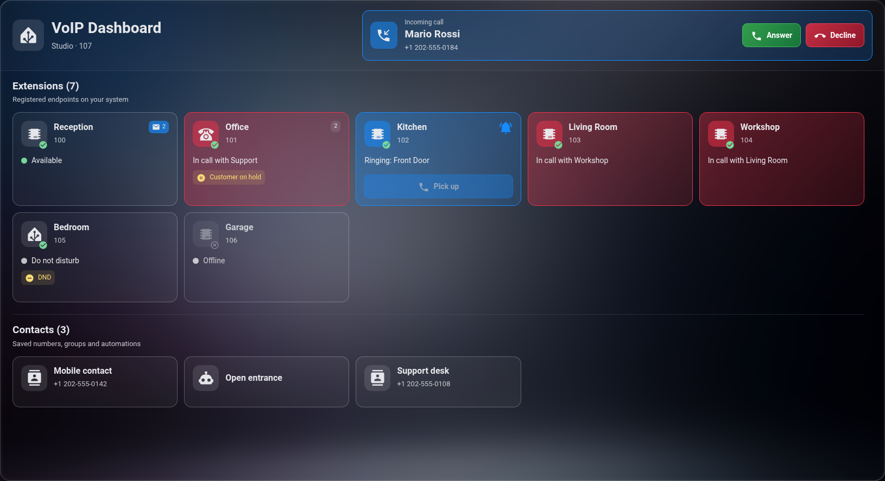

_The VoIP Dashboard is already working on `dev` and will ship with the next
release. The phone cards below remain available alongside it._

<table>
  <tr>
    <td align="center">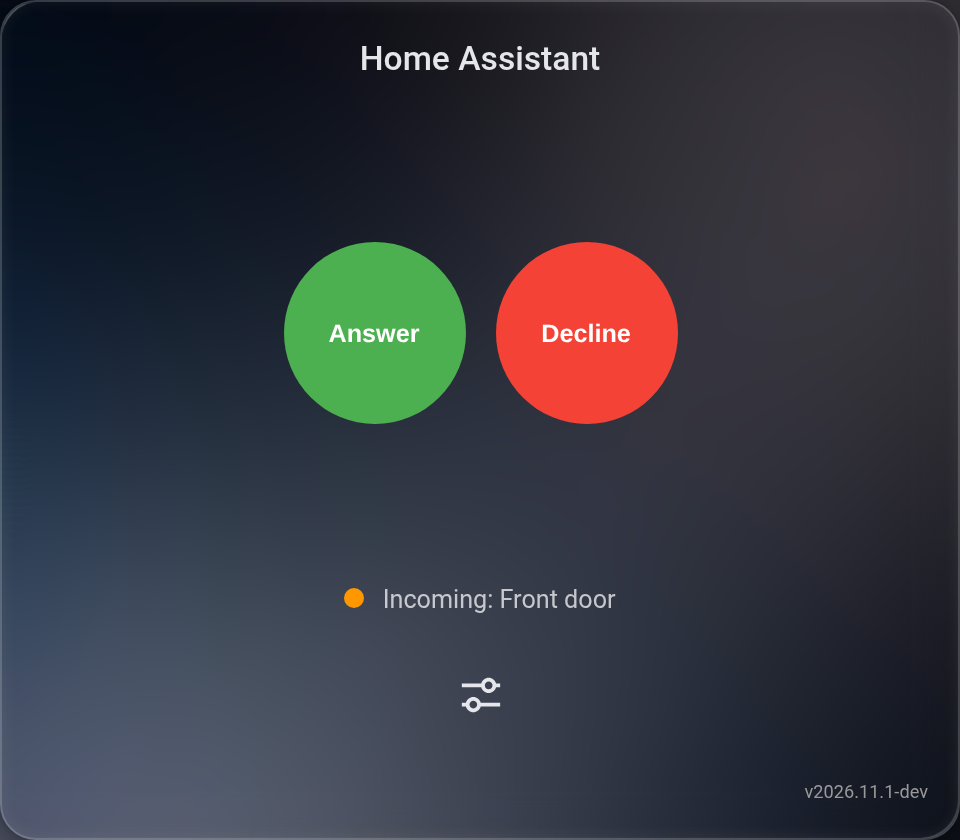<br/><b>Incoming call</b></td>
    <td align="center">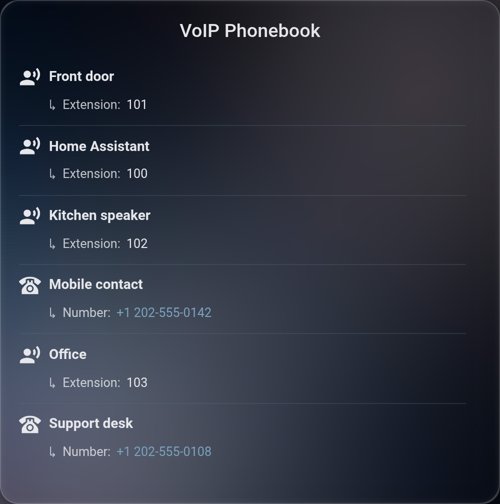<br/><b>Shared phonebook</b></td>
    <td align="center">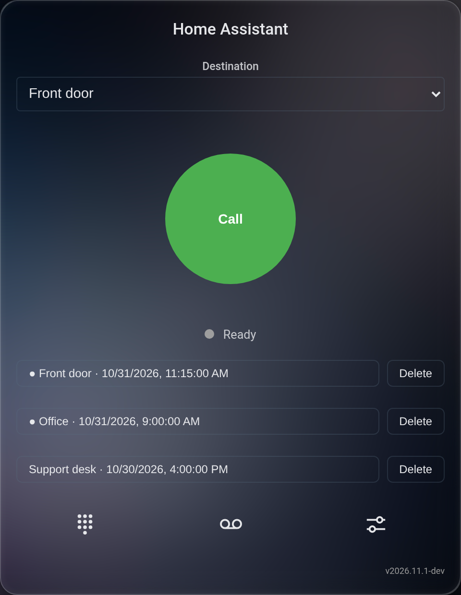<br/><b>Voicemail</b></td>
  </tr>
</table>

_Current Home Assistant cards in the Frosted Glass Dark theme, captured with
demo contacts and illustrative call states. Each card controls the phone selected
in its editor._

Stable release: [2026.11.0](https://github.com/n-IA-hane/esphome-intercom/releases/tag/v2026.11.0).
Development preview: [2026.11.1-dev changes](docs/WHATS_NEW_2026_11_1_DEV.md),
including the new VoIP Dashboard.
Requires Home Assistant **2026.7.0 or newer**. The maintained firmware
requires ESPHome **2026.10.0 or newer**.

The 2026.11.0 firmware profiles use ESP VoIP Stack **2026.11.0**, Runtime Controller
**2026.11.0**, and Audio Stack **2026.11.0** from their `main` branches. HA and ESP
firmware do not need matching version numbers. Rebuilding ESP firmware is
recommended to receive the updated AFE delivery and playback fixes; it is separate
from updating HA through HACS.

The profiles below use coordinated `main` sources. See the
[2026.11.0 changes](CHANGELOG.md), and follow the
[current device-package migration](docs/BREAKING_CHANGES.md#development-firmware-new-device-packages)
when updating existing firmware.

[](#supported-hardware)
[](https://www.home-assistant.io)
[](https://esphome.io)

<table>
  <tr>
    <td align="center">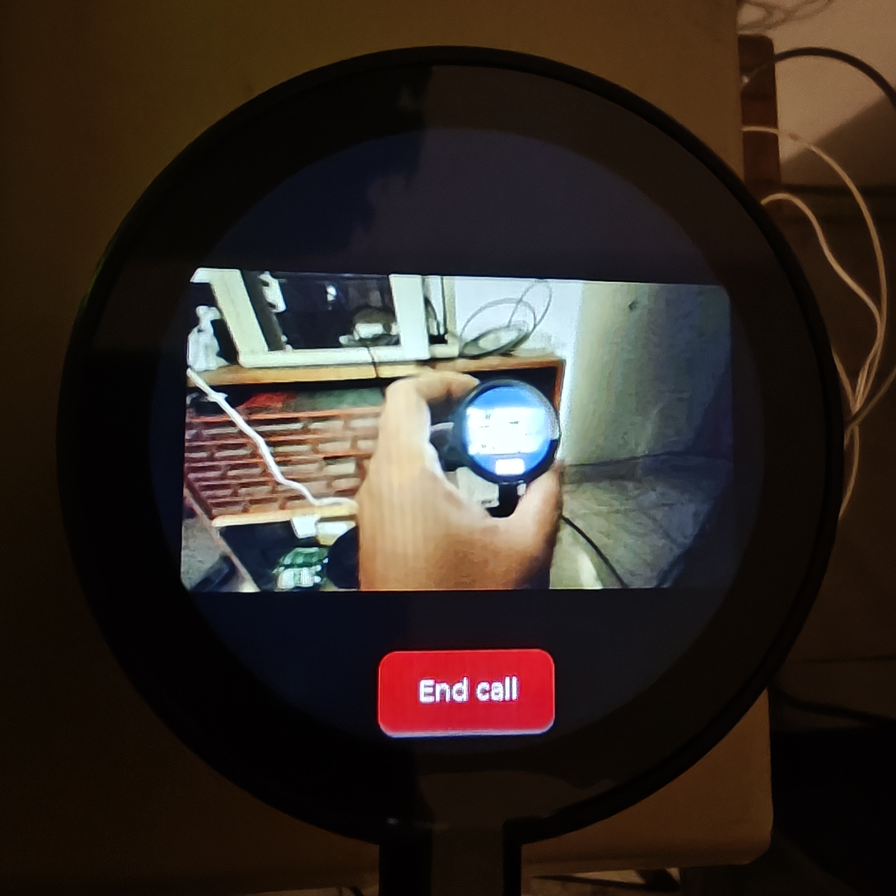<br/><b>SIP video on an S3 display</b></td>
    <td align="center">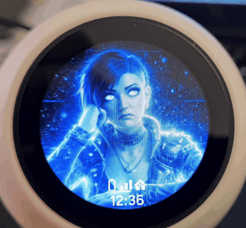<br/><b>ESP Voice Assistant</b></td>
  </tr>
</table>

_Photographs of real ESP displays. The S3 receives remote video while its call
audio runs in both directions; the assistant animation is a separate recording._

See the [video guide](docs/SIP_VIDEO.md) for S3 and P4 profiles and the
[earlier real MOBOTIX call](https://raw.githubusercontent.com/n-IA-hane/esphome-intercom/2968f029b1cc5806e1512d749c5791385274f446/docs/images/pbx-mobotix-video-green.png)
for the published door-station video example.


_A real browser-to-browser video call in the current VoIP Dashboard. The camera
source is a synthetic Starfleet test feed; the MOBOTIX link above shows the
earlier door-station call._

Maintained ESP firmware profiles require **ESPHome 2026.10.0 or newer**.
See the [firmware migration notes](docs/BREAKING_CHANGES.md#development-firmware-new-device-packages)
when updating copied YAMLs. This does not force an immediate firmware update
when installing the Home Assistant integration alone.

## Preview: standard phone services

The coordinated **2026.11.1-dev** preview adds automatic ESP SIP accounts,
a shared LDAP directory, live BLF contact lists and SIP message waiting.
Home Assistant supplies one credential through the existing ESPHome API.
Display phones gain a scrolling contact list and a mailbox shortcut that calls
the PBX's spoken menu. The in-call keypad sends DTMF. Directory, BLF and MWI
can each be selected in YAML, including on VoIP-only profiles.

<p>
  
  
  
</p>

_Real on-device LVGL screenshots captured with
[`esp_screenshot`](docs/ESP_SCREENSHOT.md), using demo directory entries.
The animated contact menu shows numbers, contact types and live BLF states;
options and the in-call keypad are shown separately._

See [standard services for ESP phones](docs/ESP_PHONE_SERVICES.md) for setup,
traditional phone access, migration and memory limits. These additions are
available on the coordinated `dev` branches.

## PBX additions in 2026.11.0

The [2026.11.0 release](https://github.com/n-IA-hane/esphome-intercom/releases/tag/v2026.11.0)
adds **multiple named SIP trunks, phone forwarding rules, call transfers,
voicemail, call parking, directed pickup and conversation recording**. These additions are available in
this release; 2026.10.1 did not include them.

Start with the [illustrated PBX walkthrough](docs/PBX_WORKFLOWS.md). It explains
which controls to use, what callers experience and how automations interact
with phone settings. Each phone keeps its own card; routing and messages belong
to the backend.

**Configuration change:** trunks are now separate named entries. Open the
integration's **three-dot menu > Add SIP trunk**, then configure each line
independently. Existing enabled single-trunk settings are migrated automatically.
Read the [migration instructions](docs/BREAKING_CHANGES.md#pbx-development-branch-separate-sip-trunk-entries)
before upgrading.


- **[Phone routing defaults](docs/PHONE_ROUTING.md):** optional forwarding, busy/unavailable destinations
  and a ringing timeout. An accepted automation action can override the default
  for its own call. Settings belong to the phone, not to an open card.
- **[Voicemail](docs/VOICEMAIL.md):** an ordinary SIP access menu, interruptible
  spoken prompts, message indicators and a message list in the phone card.
  Home Assistant Media exposes the original recordings; automations can
  transcribe or deliver them through installed services.
- **[Named trunks](docs/SIP_TRUNK.md):** independent provider connections, with
  an explicit line choice per action, a phone preference and a default line.
- **[Parking and pickup](docs/CALL_PARKING.md):** leave a caller on a parking
  slot and retrieve the call elsewhere, or answer a phone that is still ringing.
- **[Call transfers](docs/USER_GUIDE.md#forward-or-transfer-a-call):** send an
  answered call to another contact from the card, or consult the destination
  first using an attended-transfer-capable SIP handset. The card's Transfer
  button performs a blind transfer.
- **[Conversation recording](docs/CALL_RECORDING.md):** optional recording from
  the existing audio path, controlled by HA actions or a card shortcut.

## What can you build?

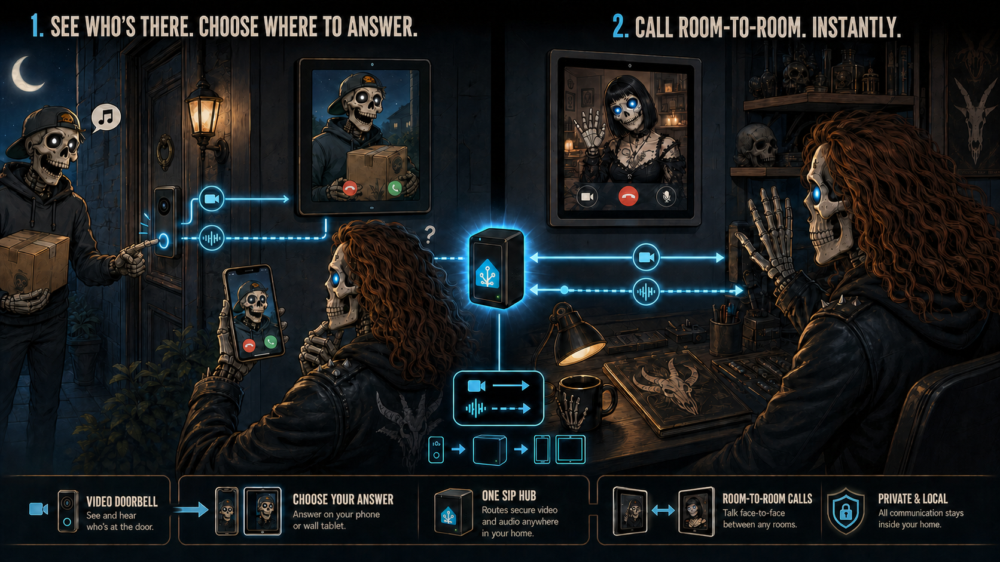

| Goal | What VoIP Stack provides | Start here |
|---|---|---|
| Video doorbell | A SIP video door station can ring a browser phone in a dashboard or Companion app. Video-configured S3 profiles can send camera video or display the remote caller; P4 videophone profiles combine both directions. | [SIP video](docs/SIP_VIDEO.md) · [door-station recipe](#door-station-and-unanswered-calls) |
| Room-to-room calls | Create a logical HA phone and dedicated dashboard view for each kiosk or tablet. Calls may be private audio or video. | [Logical phones](#logical-home-assistant-phones) |
| ESP room phones | Flash one maintained VoIP YAML per room. ESPs can call names and extensions from the shared phonebook. | [Deployment guide](docs/DEPLOYMENT_GUIDE.md) |
| Full ESP voice device | Flash a maintained full-experience YAML to combine a local Voice Assistant, Micro Wake Word, media, TTS, optional Sendspin and VoIP on one device. | [Full ESP experience](#full-esp-voice-experience) |
| Existing SIP equipment | Register Zoiper, Linphone, baresip, an IP phone or an ATA directly to HA. | [Local accounts](docs/SERVICES.md#local-sip-endpoint-account-services) |
| Ring groups | Ring several eligible endpoints; the first answer wins and the losing branches are cancelled. | [Groups](docs/GROUPS.md#ring-group) |
| Audio conferences | Host a local audio conference in HA and optionally ring its members. | [Groups](docs/GROUPS.md#conference-group) |
| Callable Assist | Give a native Assist pipeline an extension and talk to it from ESP, SIP or trunk callers. | [Assist calls](#assist-as-a-phone-extension) |
| External calls | Connect an optional provider/PBX trunk using registration or source-IP authorization. | [SIP trunk](docs/SIP_TRUNK.md) |
| Contextual routing | Use native HA entities, conditions and services for presence, schedules, no-answer forwarding and in-call DTMF. | [Automation cookbook](docs/AUTOMATION_DIALPLAN.md) |

## Fastest start

1. Install **VoIP Stack** from HACS and restart Home Assistant.
2. Add **VoIP Stack** from **Settings → Devices & services**.
3. Keep SIP `5060` and RTP base `40000` unless they conflict with your network.
4. Use the Home Assistant phone created during setup and add a second browser
   phone from the integration's phone configuration.
5. Add a VoIP Stack card for each phone. Select its Phone in the visual editor;
   you do not need to copy an internal device ID into YAML.
6. Open the phones in separate browser tabs or devices, allow microphone access,
   and call the other phone from the shared phonebook. Use HTTPS for browser audio.

That first call requires Home Assistant and the cards. To connect a desk phone,
softphone or ATA, [create a local SIP account](docs/SERVICES.md#local-sip-endpoint-account-services).
Groups, Assist, automations and a provider trunk can be added independently.

### Grow your setup one step at a time

Start with the smallest setup that solves your problem. These steps build on a
working call; you can stop at any of them. An existing SIP door station can join
at step 2 without an ESP or a local Voice Assistant.

| Step | Practical example | Add next | What to check |
| --- | --- | --- | --- |
| 1. Two phones | Call the kitchen dashboard from the study | Two browser phones and their cards, as above | Answer, speak in both directions, hang up and call again |
| 2. A physical endpoint | Answer a door station or an ESP room phone | [A local SIP account](docs/USER_GUIDE.md) or [a maintained ESP YAML](yamls/README.md#how-to-use) | Call to and from that endpoint; video needs a video-capable endpoint and route |
| 3. A voice and music device | Use the same ESP for Assist, music and calls | [A FULL profile and its feature selection](packages/README.md#work-through-a-full-profile) | Try each feature alone, then a call during playback and recovery after hangup |
| 4. Several rooms | Ring the kitchen and study for the doorbell | [A ring group](docs/GROUPS.md#ring-group) | Either room can answer; the other stops ringing |
| 5. Call handling | Forward an unanswered call, use voicemail, transfer or park a call | [The PBX walkthrough](docs/PBX_WORKFLOWS.md) | Test both the answer and no-answer paths; check which features your installed release includes |
| 6. Automation and external lines | Route by presence, play an announcement or call through another PBX | [Native HA actions and triggers](docs/AUTOMATION_DIALPLAN.md), then [a trunk](docs/SIP_TRUNK.md) if needed | Verify the selected destination and line, then the busy/unavailable outcome |

Firmware configuration follows its own short progression: use the board's YAML,
edit its feature list, then customize individual settings. Board wiring and
runtime policies are advanced topics, not prerequisites for the first call.

### Add an ESP phone when you need one

1. Choose the YAML for your exact board from the
   [device guide](yamls/README.md). Keep its supplied wiring; change GPIOs only
   when your physical wiring differs or you use a generic profile.
2. Add the flashed device through the normal ESPHome integration.
3. Call its phonebook name from another endpoint. An optional ESP mirror card
   controls that physical phone.

The full ESP experience is a separate firmware choice that adds local voice
and media features to an ESP endpoint.

| Device goal | Maintained starting point |
|---|---|
| ESP VoIP only | [`yamls/voip-only/`](yamls/voip-only/) |
| Local Voice Assistant + MWW + media + TTS + optional Sendspin + VoIP | [`yamls/full-experience/`](yamls/full-experience/) |
| Native ESPHome mic/speaker paths | [`yamls/voip-only/esphome-native/`](yamls/voip-only/esphome-native/) |
| New or unqualified hardware | [`yamls/experimental/`](yamls/experimental/) |

The reorganized firmware profiles select one device package and one
`firmware_features` list. Follow the [progressive package examples](packages/README.md#work-through-a-full-profile)
to remove Sendspin, build a voice-only device, or combine voice, calls and music.
This layout is included in 2026.11.0; use its coordinated `main`
package and component sources. The current preview uses the official ESPHome
audio, mixer, resampler, player, Voice Assistant, wake-word and OTA providers,
with our Audio Stack/AEC/AFE, VoIP Stack and Runtime Controller. Follow the
[native provider migration](docs/BREAKING_CHANGES.md#development-firmware-native-audio-providers)
when carrying over old external-component lists. For an older copied configuration, follow the
[firmware migration](docs/BREAKING_CHANGES.md#development-firmware-new-device-packages)
instead of stacking new packages on top of the old preset.

The [user guide](docs/USER_GUIDE.md) continues from installation through cards,
calls, SIP accounts, groups, Assist, trunks and diagnostics. The
[deployment guide](docs/DEPLOYMENT_GUIDE.md) explains how to choose between
single-bus, dual-bus, lightweight AEC and full AFE profiles.

## How it works

Home Assistant runs the PBX: phone identities, SIP registration, call routing,
media bridges, groups, conferences and automation services. Dashboard phones
and standard SIP equipment connect to that backend.

ESP devices become standards-based SIP phones, with audio on every maintained
VoIP profile and optional video through S3 camera/display or P4 videophone
profiles. Home Assistant
can be a SIP video softphone, call router, RTP bridge, local registrar,
conference focus, callable Assist destination and optional trunk endpoint.
Browser phones, wall tablets, ESP room stations, standard SIP clients and an
external PBX can share one phonebook without requiring a separate Asterisk or
FreeSWITCH server for the normal home use case.

VoIP is only one part of the project. The optional full-experience ESP YAMLs
also provide an independent on-device Voice Assistant, Micro Wake Word, media
playback, TTS, Sendspin support, runtime audio controls and touch interfaces.
That local assistant is not created or controlled by calling Assist over SIP.

The project therefore has three cooperating, independently useful surfaces:

| Surface | Runs on | Purpose |
|---|---|---|
| Home Assistant VoIP Stack | Home Assistant | Browser phones, PBX routing, registrar, bridges, groups, conferences, callable Assist and an optional trunk. |
| ESP VoIP endpoint | ESPHome device | A standards-based SIP/RTP phone for VoIP Stack or another PBX, with audio and optional S3 JPEG or P4 videophone capabilities. |
| Full ESP experience | ESPHome device | A local voice satellite with wake word, Voice Assistant, media, TTS, optional Sendspin, runtime UI and VoIP. |

Install only the surfaces you need. A VoIP-only ESP does not require the local
Voice Assistant, and a full-experience ESP keeps its local assistant even when
no SIP Assist extension is configured.

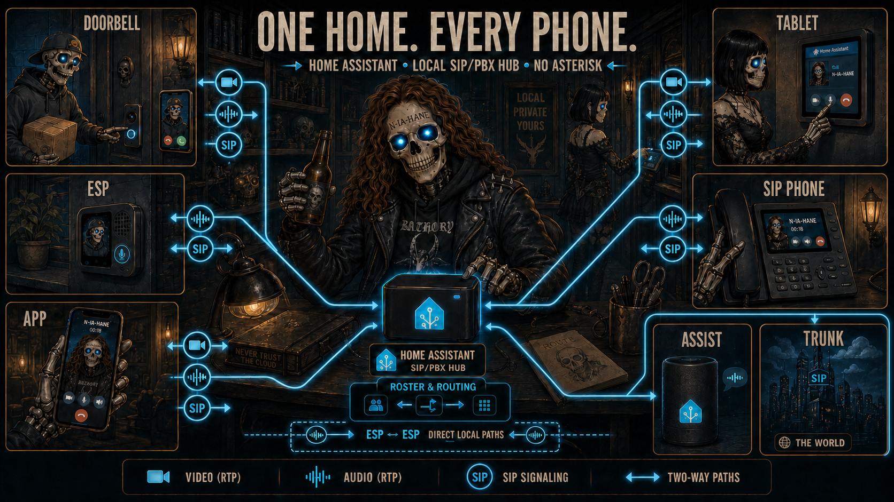

The system has one call model and four main surfaces:

- **ESP endpoint:** A lightweight SIP/SDP/RTP phone with a microphone,
  speaker or both.
- **Home Assistant runtime:** Logical browser phones, routing, media bridges,
  groups, local registration, Assist and the optional trunk.
- **Central phonebook:** Names, extensions, groups, registered clients,
  routable SIP endpoints and external numbers.
- **Lovelace card:** A UI bound to one phone Device; it projects backend state
  and invokes normal HA services instead of running a second call controller.

SIP dialogs, transactions and transports have separate lifecycles. Logical
phones share the listener and RTP pool, so creating another room phone does not
open another SIP server. Browser and ESP phones handle one active call at a
time. Registered SIP phones can also hold a call and start a consultation for
an attended transfer. Their occupied state remains set until all their calls
end; calls to different phones remain independent.

The detailed ownership and media model is in
[`docs/ARCHITECTURE.md`](docs/ARCHITECTURE.md). Complete peer-to-peer and
HA-bridged sequences are in [`docs/CALL_FLOWS.md`](docs/CALL_FLOWS.md).

## Logical Home Assistant phones

The integration creates one ordinary Home Assistant browser phone on first
setup, named from Home Assistant's location. Add or remove phones
from:

**Settings → Devices & services → VoIP Stack → Add phone → Home Assistant
browser phone**

Give every real place its own name and optional extension: `Kitchen`,
`Reception`, `Garage`, `201`, and so on. Each logical phone is represented by a
native HA Device with entities for call state, connectivity, DND, extension,
groups, auto answer, camera transmission settings and call events.

Bind the card to that Device:

```yaml
type: custom:voip-stack-card
mode: ha_softphone
device_id: <phone_device_id>
```

`device_id` answers "which local phone owns this card or action?".
`destination` answers "who should this phone call?". The central phonebook
resolves the destination, so a normal call does not require the destination's
Device ID:

```yaml
action: voip_stack.call
data:
  device_id: <kitchen_phone_device_id>
  destination: Garage
```

Omit `device_id` only when a preferred phone is configured or exactly one
compatible phone exists. Otherwise the action asks you to select the local
phone explicitly.

The card's idle `Options` panel includes a `Microphone anti-alias filter`.
It is enabled by default and stored per browser and logical phone. The setting
takes effect when the next call opens the microphone and only adds processing
when the negotiated transmit rate is lower than the browser capture rate.

The same panel selects the browser microphone, speaker and camera. These
preferences belong to the browser or Companion App session, are shared by all
VoIP Stack cards in that session and remain unchanged when no device is
selected. During a call, the tune button beside Hangup opens the same controls,
so a headset or camera can be changed without ending the call. Unsupported
speaker routing remains under operating-system control.

Each room-to-room media endpoint needs a distinct browser or Companion session.
Two cards in one browser tab can display two phones, but one tab still owns one
physical microphone, speaker and camera pipeline.

## ESP endpoints and media roles

ESP media roles are derived from the configured components; they are not a
separate user mode.

| Derived role | Media | Typical use |
|---|---|---|
| `full_duplex` | microphone TX + speaker RX | Room phone, door station, wall panel |
| `mic_only` | microphone TX | Monitor or capture endpoint |
| `speaker_only` | speaker RX | Paging or announcement target |

An endpoint needs at least one media direction. Firmware selects its audio
codecs and rates; SIP/SDP negotiates each call. JPEG camera transmission and
software JPEG rendering are available on supported ESP32-S3 configurations.
ESP32-P4 videophone profiles select JPEG or H.264 with their hardware renderer.
HA can convert formats when a routed call requires it.

Audio component details live in the companion projects:

- [`esp_audio_stack`](https://github.com/n-IA-hane/esphome-audio-stack)
- [`esp_aec`](https://github.com/n-IA-hane/esphome-audio-stack/tree/main/esphome/components/esp_aec)
- [`esp_afe`](https://github.com/n-IA-hane/esphome-audio-stack/tree/main/esphome/components/esp_afe)
- [`voip_stack`](https://github.com/n-IA-hane/esphome-voip-stack)
- [`runtime_controller`](https://github.com/n-IA-hane/esphome-runtime-controller)

## Full ESP voice experience

The [`yamls/full-experience/`](yamls/full-experience/) profiles are complete
ESPHome voice devices, not merely larger SIP configurations. They combine the
VoIP endpoint with an independent local Voice Assistant stack and coordinate
all realtime consumers through one audio and runtime ownership model.

The underlying audio stack is also reusable without VoIP. Custom ESPHome voice
devices can use it to share codec or I2S ownership, speaker reference, AEC/AFE
processing and a cleaned microphone stream between their own consumers.

The [illustrated microphone wiring guide](https://github.com/n-IA-hane/esphome-audio-stack/blob/main/README.md#microphone-wiring-and-delivery-illustrated)
shows single-mic, stereo L/R, TDM and codec layouts, with YAML for independent
AFE/BSS inputs or the new optional mono downmix before AEC/AFE.

<table>
  <tr>
    <td align="center"><br/><b>Animated assistant</b></td>
    <td align="center"><br/><b>Assistant response</b></td>
    <td align="center"><br/><b>Runtime audio controls</b></td>
    <td align="center"><br/><b>Call end reason</b></td>
  </tr>
  <tr>
    <td align="center"><br/><b>Positive mood</b></td>
    <td align="center"><br/><b>Neutral mood</b></td>
    <td align="center"><br/><b>Negative mood</b></td>
    <td align="center">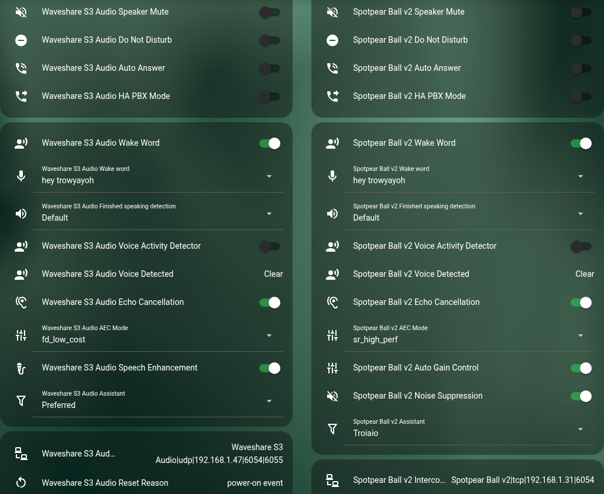<br/><b>AFE controls in HA</b></td>
  </tr>
</table>

<table>
  <tr>
    <td align="center"><br/><b>P4 weather, Voice Assistant and VoIP controls</b></td>
  </tr>
</table>

The full profiles provide:

- continuous Micro Wake Word on the cleaned post-AEC microphone stream;
- a native ESPHome Voice Assistant started by wake word or touch;
- media playback, announcements, TTS, ringtones and optional Sendspin through
  one shared speaker path;
- ducking and barge-in, including interruption of a current assistant reply;
- VoIP calls that coexist with the assistant instead of creating a second
  microphone or speaker owner;
- AEC or AFE processing, with runtime controls and diagnostics where supported;
- coordinated LEDs, display pages, timers, call state and media activity
  through `runtime_controller`;
- headless operation on audio boards, plus full LVGL interfaces on supported
  displays;
- optional animated and mood-aware assistant artwork on display profiles.

The shared pipeline matters because Micro Wake Word, Voice Assistant and VoIP
all need the same cleaned user speech while music, TTS or a ringtone may still
be playing. Speaker output also supplies the phase-coherent reference used by
AEC instead of letting each feature open its own audio path.

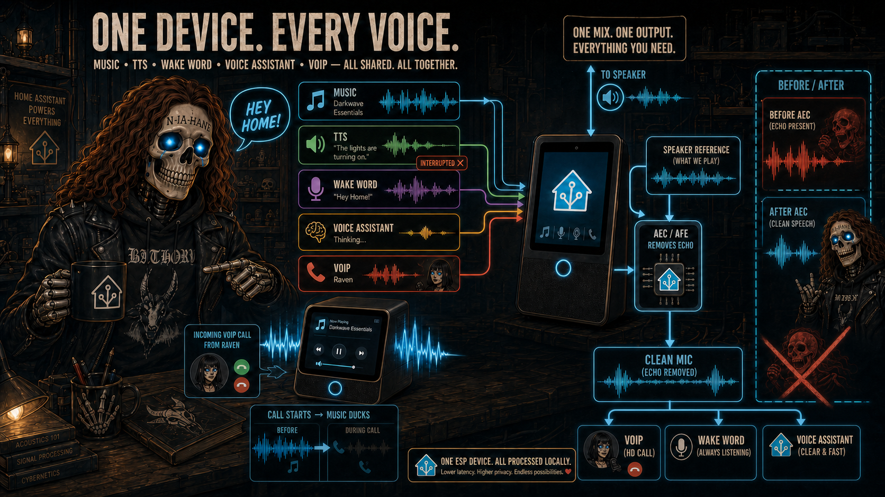

### Assistant artwork and avatars

Display profiles can select an assistant avatar with the `ai_avatar`
substitution. Each avatar directory may provide idle animation frames plus
listening, thinking, loading, error, timer and mood images. The selected assets
are resized for the target display during the build.

```yaml
substitutions:
  ai_avatar: my_assistant
```

An optional community theme is also included: **`starfleet`**, contributed by
[rvdv01](https://github.com/rvdv01) in
[discussion #110](https://github.com/n-IA-hane/esphome-intercom/discussions/110).
Set `ai_avatar: starfleet` in your own configuration to use it. Maintained YAMLs
keep their current default. See the [theme preview and optional ringtone](assets/images/assistant/starfleet/README.md).

This artwork represents the ESP device's own Voice Assistant state. It is
unrelated to the optional HA Assist pipeline that SIP callers can dial as an
extension.

See the [deployment guide](docs/DEPLOYMENT_GUIDE.md) for profile selection and
the companion [audio stack documentation](https://github.com/n-IA-hane/esphome-audio-stack)
for AEC, AFE, I2S and codec topology details.

## Home Assistant as a SIP video phone

Video is available to compatible browser phones in current browsers and the
Home Assistant Companion app. Standard SIP video door stations, video phones,
softphones and PBX/trunk legs can negotiate H.264, VP8 or RTP/JPEG. An optional
bounded FFmpeg path can receive selected legacy codecs and bridge incompatible
H.264/JPEG SIP legs when direct encoded relay is impossible.

Receiving video does not require camera permission. Sending the browser camera
is a separate persisted phone setting and still requires browser permission.
Audio remains usable when video is unavailable or deliberately disabled.

Audio-only ESP endpoints and audio conferences remain audio-only. Qualified
ESP32-P4 videophone profiles can negotiate RTP/JPEG or H.264 directly, while
the full P4 profile supports bidirectional RTP/JPEG. These are complete display
endpoints, not camera-only devices: the P4 can transmit its camera, receive the
remote RTP video stream, decode it through the selected JPEG or H.264 path and
present the other party on its own MIPI DSI panel while bidirectional audio
remains active. After video is removed or the call ends, the normal LVGL
interface is restored.

Video compatibility depends on the actual offer/answer, packetization and
decoder contract, not only on a codec name printed on a product page. See the
video guide for the separate outgoing camera path, incoming decode and panel
presentation path, initial-video and audio-first re-INVITE behavior, and the
JPEG/H.264 compile-time profiles.

See the [capability matrix, privacy controls and limits](docs/SIP_VIDEO.md).

## VoIP dashboard

The **VoIP Dashboard** card puts the phone system in one responsive operator
view: live extension tiles, callers, conversations on hold, mailbox counters
and saved contacts. Select its calling phone in the card editor. Incoming
calls for that phone appear in the header with Answer and Decline controls;
ringing tiles offer directed pickup when the backend makes it available.

The glass surfaces follow your Home Assistant theme. Tiles update through a
shared WebSocket subscription to the PBX state observer, which also supplies
SIP busy lamps. Browser and ESP phones can control calls from the dashboard;
registered SIP phones can be monitored and called.

Add **VoIP Dashboard** from the card picker, or use
`type: custom:voip-stack-dashboard-card` and select the phone in its visual
editor. See the [dashboard guide](docs/USER_GUIDE.md#use-the-voip-dashboard).

## Phonebook and routing

Home Assistant publishes the shared roster through
`sensor.voip_phonebook`. It combines:

- online ESPHome VoIP endpoints;
- logical Home Assistant phones;
- registered local SIP accounts;
- manual contacts;
- Assist destinations;
- dynamic ring/conference groups;
- optional trunk-routed numbers.

A name is the contact identity. An `extension` is an internal alias for that
same destination; a `number` is normally routed through the trunk. The resolver
can also handle canonical SIP URIs.

Phonebook names must be unique across phones, contacts and Assist pipelines,
even when their extensions differ. Duplicate names produce an error log and
a persistent Home Assistant notification identifying the conflicting entries.
Rename one destination; the notification clears when the phonebook updates.

SIP routing identity and presentation identity remain separate. ESPHome node
names and account usernames provide stable URI users, while friendly names are
sent as standard SIP display names with spaces preserved. Incoming caller text
comes from the peer's `From` header, and the answering endpoint can publish its
resolved name through RFC 4916 connected identity.

Use the card, voice intents or `voip_stack.call` with a phonebook name or
extension. Do not copy endpoint addresses into automations unless you
deliberately need a raw SIP route.

- [Resolver rules](docs/DIALPLAN_RESOLVER.md)
- [Phonebook protocol](docs/PHONEBOOK_PROTOCOL.md)
- [Services](docs/SERVICES.md)
- [ESP discovery/entity surface](docs/ESP_ENTITY_SURFACE.md)

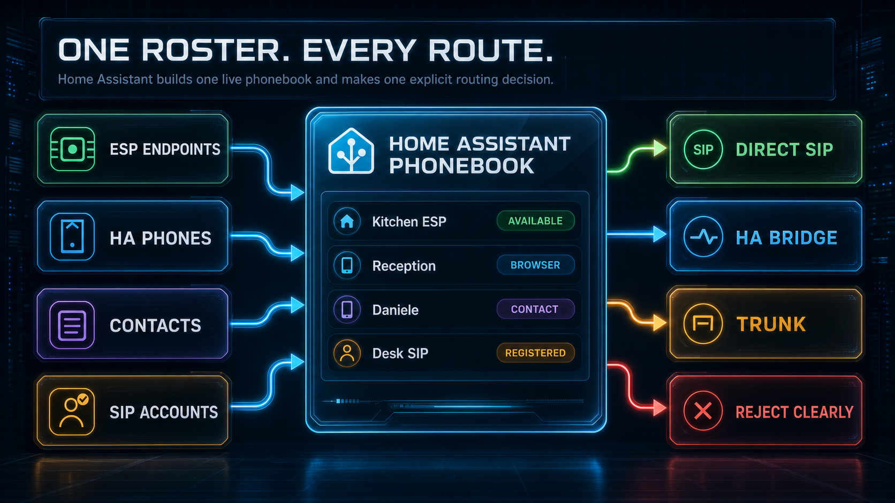

## Groups

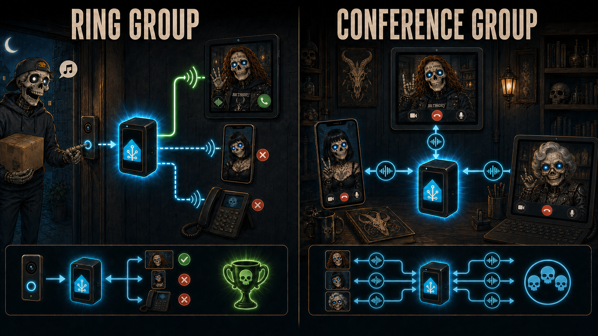

A **ring group** forks one call to all eligible members. DND, disabled and busy
members are excluded; the caller is excluded if it belongs to the target
group. The first successful answer wins and every losing leg is cancelled.

An **audio conference group** joins answered members to one HA-hosted mixer.
`conference_ring` optionally rings the declared members when somebody joins.
Auto answer is a per-phone policy: enabling it on several group members means
several endpoints may join or compete immediately, which is the configured
behavior.

Membership declared by a phone becomes visible in HA dynamically. A group
disappears when no current endpoint declares it. See
[`docs/GROUPS.md`](docs/GROUPS.md) for declaration and collision rules.

## Assist as a phone extension

There are two separate Assist-related features:

| Feature | Where it runs | How it starts |
|---|---|---|
| ESP Voice Assistant | On a full-experience ESP device | Local wake word, touch control or an ESPHome action. |
| Callable HA Assist | In Home Assistant through VoIP Stack | A SIP caller dials its phonebook name or extension. |

Enable **Include voice assistant** while configuring VoIP Stack, choose the
pipeline and assign an extension. ESPs, registered SIP phones, browser phones
and trunk callers can then call that Assist pipeline like any other contact.

This is a Home Assistant PBX feature. The SIP caller talks to the selected HA
Assist pipeline over the call. It does not start, replace or change the local
Voice Assistant running on a full-experience ESP device.

VoIP Stack sends one initial user message such as
`Incoming SIP call from "Daniele".` and then streams the selected pipeline's
STT, conversation and TTS over the same call. It does not inject a second
persistent personality prompt. Put behavioral instructions in the conversation
agent itself.

Optional advanced call context appends caller ID, phonebook match, ingress and
called extension once. Treat those fields as untrusted call metadata, not
authentication.

Voice intents may also resolve commands such as "Call Kitchen", "Answer" and
"Hang up" against the live phonebook and the satellite's selected phone.

## Door station and unanswered calls

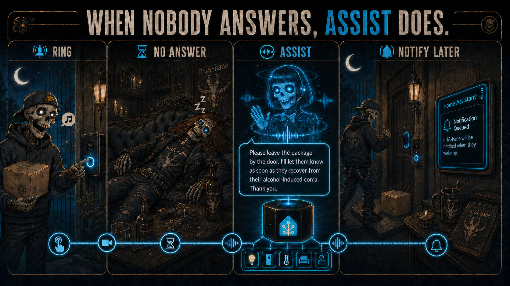

A typical path is:

1. a door station calls `Front door`;
2. a ring group alerts selected browser, SIP and ESP phones;
3. the first endpoint to answer owns the call;
4. if nobody answers, a native HA automation forwards the still-live call to
   another phone or Assist;
5. call events can trigger a mobile notification or another HA action.

Copyable, current recipes:

- [route a trunk caller to a ring group](docs/AUTOMATION_DIALPLAN.md#route-only-providerpbx-trunk-calls-to-a-ring-group)
- [forward an unanswered phone to Assist](docs/AUTOMATION_DIALPLAN.md#forward-an-unanswered-ha-call-to-assist)
- [forward an unanswered phone to a mobile number](docs/AUTOMATION_DIALPLAN.md#forward-an-unanswered-call-to-a-mobile-number)
- [route a known caller according to presence](docs/AUTOMATION_DIALPLAN.md#route-a-known-caller-according-to-presence)
- [send an actionable mobile notification](docs/AUTOMATION_DIALPLAN.md#actionable-doorbell-notification)
- [notify a no-answer timeout](docs/AUTOMATION_DIALPLAN.md#notify-a-no-answer-timeout)

The assistant's personality is entirely up to your prompt. Professional
receptionist and verbally abusive domestic secretary are both technically
valid configurations.

## Automations as dialplan

**Automations as dialplan** lets you define call behavior in Home Assistant's
normal automation editor. Create an Automation contact, then build a sequence:
**greeting, then forward to a phone or voice assistant**. Add a keypad
menu, presence condition or office-hours rule when you need it.

**Phonebook as dialplan** remains the default when no routing automation overrides it.
Native VoIP triggers select the
call for the actions automatically, including across waits and synchronous
scripts. No blueprint, generic event filter or Call-ID template is needed for
the common examples. A destination can be its phonebook name or extension.

Start with the [step-by-step greeting](docs/AUTOMATION_DIALPLAN.md#create-your-first-greeting-in-the-editor),
then add a [forward after the greeting](docs/AUTOMATION_DIALPLAN.md#forward-after-the-greeting).
These native automation features are included in 2026.10.0; they are not part of 2026.9.2.

- [Route calls during office hours](docs/AUTOMATION_DIALPLAN.md#route-to-reception-during-office-hours).
- [Forward only when a phone does not answer](docs/AUTOMATION_DIALPLAN.md#forward-an-unanswered-ha-call-to-assist).
- [Build a keypad menu](docs/AUTOMATION_DIALPLAN.md#build-a-small-keypad-menu).
- [Show received keys in HA notifications](docs/AUTOMATION_DIALPLAN.md#see-received-digits-in-persistent-notifications).
- [Run a gate action from in-call DTMF](docs/AUTOMATION_DIALPLAN.md#open-a-gate-with-in-call-dtmf).

Explicit extension digits entered during the trunk's initial DTMF menu retain
precedence over a generic routing override. With no applicable automation
selection, the configured phonebook route continues. Existing Event Entity
and state automations remain available; see the
[migration guide](docs/AUTOMATION_DIALPLAN.md#move-existing-automations-gradually).

The full [Automations as dialplan cookbook](docs/AUTOMATION_DIALPLAN.md) explains
call completion, fallback, time limits, concurrent callers and troubleshooting.

## Use ESP firmware with an existing PBX

An ESP can use direct SIP, register one or more accounts with an existing
PBX, or combine an HA-managed account with other PBX lines. Direct calling
remains the generic component default. The coordinated development packages
also configure the HA account automatically through ESPHome.

Choose the outgoing account explicitly when needed; incoming calls follow the
selected account and direct-call acceptance policy. LDAP phonebooks, BLF and
MWI use standard services offered by the selected system. Mailbox listening
uses an ordinary SIP call and its DTMF keypad.

[Set up an ESP with a classic PBX](docs/CLASSIC_PBX.md) covers direct peers and
existing media paths. The [ESP VoIP Stack examples](https://github.com/n-IA-hane/esphome-voip-stack/tree/dev/examples)
cover registered and mixed-account firmware. See
[standard phone services](docs/ESP_PHONE_SERVICES.md) for automatic HA setup.

## Optional SIP trunk

Local calls need no trunk. Add a named line to connect HA to a provider or another
PBX. Use the integration's **Add SIP trunk** menu
and edit each line separately. Keep **Register the trunk** enabled for account
registration, or disable it for a static trunk and configure its allowed
incoming SIP source IPs.

Inbound mode can route immediately or collect an internal extension through
negotiated RTP `telephone-event`/compatible SIP INFO DTMF. Outbound contacts
with public numbers use the selected outgoing line. Explicit digits, no-digit fallback and
automation overrides have distinct, documented precedence.

Use **Set external call access** to allow or block trunk calls per phone.
See the [automation editor walkthrough](docs/AUTOMATION_DIALPLAN.md#control-external-calls-per-phone).

See [`docs/SIP_TRUNK.md`](docs/SIP_TRUNK.md) before exposing the listener beyond
a trusted network.

## Installation

### Home Assistant through HACS

1. Search for **VoIP Stack** in HACS.
2. Open the integration and select **Download**.
3. Restart Home Assistant.
4. Open **Settings → Devices & services → Add integration**.
5. Select **VoIP Stack** and complete the config flow.

To update an existing installation, open VoIP
Stack in HACS, choose **Redownload** from its menu and select **2026.11.0**.
Download, restart HA and reload
the dashboard. HACS updates the HA integration and card, not ESP firmware.

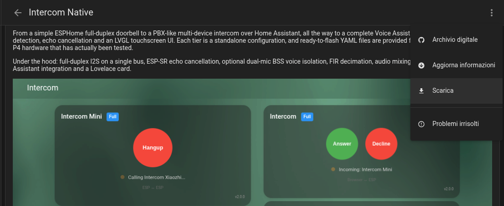

The card is registered automatically. A normal LAN can keep SIP `5060` and RTP
base `40000`. Container, LXC, VPN and multi-subnet installs may need an explicit
reachable **Advertise host** and host networking.

Manual source and release-archive installation, port requirements and network
topologies are documented in the
[deployment guide](docs/DEPLOYMENT_GUIDE.md#home-assistant).

### ESPHome components

Use the maintained YAML whenever possible. For the coordinated
firmware described here, a minimal custom external-component declaration is:

```yaml
external_components:
  - source: github://n-IA-hane/esphome-voip-stack@main
    components: [voip_stack]
  - source: github://n-IA-hane/esphome-audio-stack@main
    components: [esp_audio_stack, esp_aec]
```

Replace `esp_aec` with `esp_afe` only when the profile actually uses the full
AFE pipeline. The maintained profiles use coordinated `main` sources. Keep the
sources supplied with the selected profile rather than mixing release generations.

After a major ESPHome or component upgrade, clear that device's ESPHome build
cache before compiling. The [deployment guide](docs/DEPLOYMENT_GUIDE.md)
contains the complete component and cache instructions.

## Upgrading

1. Read the target release notes and follow any migration instructions that
   apply to your installed version.
2. Update the integration through HACS and restart Home Assistant.
3. When the card changes, reload the dashboard. Reset the frontend cache if the
   browser or Companion app continues to show the previous card.
4. Rebuild and upload ESPHome firmware when adopting firmware-side changes.
   Follow the release's component references and clean-build instructions where
   specified. Updating HA through HACS does not flash the ESP devices.

Reconfiguration and edits to existing automations or YAMLs are needed only when
the release instructions identify a relevant change.

## Previous release: 2026.10.1

Static SIP trunks can now operate without registration, with explicit allowed
incoming source IPs. Remote ESP phonebooks reuse HA's connected ESPHome service
identity. SIP interoperability fixes preserve audio through one-way video direction
conflicts, and translated card buttons grow to fit their labels.

The Waveshare 1.85C-BOX V2 gained a FULL profile with dual microphones,
AFE/AEC, voice features, calls, media and the circular touch UI. The coordinated
Audio Stack update delivers processed AFE samples without waiting for another
input iteration. Playback also includes the upstream mixer restart correction
and additional queue diagnostics.

See the [release notes](https://github.com/n-IA-hane/esphome-intercom/releases/tag/v2026.10.1)
for photographs, validation details and update instructions.

## Previous release: 2026.10.0

- Native call triggers, conditions and actions make greetings, forwarding,
  unanswered-call rules and DTMF menus available in HA's normal automation editor.
- ESP phones receive their HA controls and phonebook through the VoIP component,
  without the retired VoIP HA packages.
- Modular full profiles preserve paused music and handle interrupted replies,
  ringtones and overlapping voice/media activity more consistently.
- P4 video changes during calls preserve the negotiated media path; on-device
  labels distinguish Direct from HA transcoding.
- Audio and VoIP diagnostic actions help capture a useful issue report without
  enabling verbose audio tracing.

See the [complete changelog](CHANGELOG.md) for this release and earlier releases,
and the [breaking changes](docs/BREAKING_CHANGES.md) before updating custom YAMLs.
A HACS update changes HA and the card; ESP improvements require a firmware rebuild.

## Supported hardware

Ready profiles are examples of complete pin, codec and resource choices; they
are not a claim that every board with the same chip has the same wiring.

| Device/profile | Configuration | Status |
|---|---|---|
| Spotpear Ball v2 | [`spotpear-ball-v2-full-afe.yaml`](yamls/full-experience/single-bus/spotpear-ball-v2-full-afe.yaml) | Field tested |
| Waveshare ESP32-S3 Audio Board | [`waveshare-s3-full-afe.yaml`](yamls/full-experience/single-bus/waveshare-s3-full-afe.yaml) | Field tested |
| Waveshare ESP32-S3 Touch LCD 1.85C-BOX V2 | [`waveshare-s3-touch-lcd-1.85c-box-v2-full.yaml`](yamls/full-experience/single-bus/waveshare-s3-touch-lcd-1.85c-box-v2-full.yaml) | Supported FULL AEC/downmix or dual-microphone AFE |
| Waveshare ESP32-P4 Touch LCD, full JPEG videophone | [`waveshare-p4-touch-full-afe-landscape-videophone-jpeg.yaml`](yamls/full-experience/single-bus/waveshare-p4-touch-full-afe-landscape-videophone-jpeg.yaml) | Field tested |
| Waveshare ESP32-P4 Touch LCD, portrait | [`waveshare-p4-touch-full-afe-portrait.yaml`](yamls/full-experience/single-bus/waveshare-p4-touch-full-afe-portrait.yaml) | Experimental layout |
| Generic ESP32-S3, single bus | [`generic-s3-full-aec.yaml`](yamls/full-experience/single-bus/generic-s3-full-aec.yaml) | Reference profile |
| Generic ESP32-S3 with DVP JPEG camera | [`generic-s3-full-aec-camera.yaml`](yamls/full-experience/single-bus/generic-s3-full-aec-camera.yaml) | Reference wiring for Freenove FNK0085 N8R8; camera transmission |
| Generic ESP32-S3, single bus, 4 MB flash | [`generic-s3-full-lite-aec.yaml`](yamls/full-experience/single-bus/generic-s3-full-lite-aec.yaml) | Experimental; limited OTA headroom |
| Generic ESP32-S3, dual bus | [`generic-s3-full-aec.yaml`](yamls/full-experience/dual-bus/generic-s3-full-aec.yaml) | Reference profile |
| Native ESPHome mic/speaker | [`generic-s3-full-esphome-native.yaml`](yamls/full-experience/esphome-native/generic-s3-full-esphome-native.yaml) | Reference profile |

The complete hardware, memory and C6 firmware notes are in the
[deployment guide](docs/DEPLOYMENT_GUIDE.md#esp-devices).

S3 camera profiles transmit JPEG video during calls. The optional S3 JPEG
renderer also displays remote video through LVGL; the two directions have been
tested on separate S3 boards. Supported P4 profiles transmit their camera and
display remote video on the same board. Devices with both a microphone and a
speaker keep bidirectional audio on either platform. See the
[SIP video guide](docs/SIP_VIDEO.md#esp32-s3-camera-preview-and-sip-video).

FULL profiles using `esp_aec` or `esp_afe` start in `sr_high_perf` and offer
`sr_low_cost` as the lower-memory alternative. The processor and mode selector
use the same initial-mode setting. VoIP-only profiles retain their separate
FD/VoIP choices and standalone callbacks; the native ESPHome profile adds no
external DSP mode. These defaults do not change microphone calibration or
wake-word gain. Where mode restoration is enabled, the restored SR choice is
applied before the processor starts, so the selector matches the running DSP.

The Generic Full Lite AEC profile keeps Voice Assistant, wake word, software
AEC, VoIP, HTTP playback, TTS, timers and the runtime controller. It uses size
optimization and leaves Sendspin disabled. PSRAM is still required. Keep its
companion [partition CSV](yamls/full-experience/single-bus/partitions_4mb_lite_dual_ota.csv)
beside the main YAML: the dedicated 4 MB table provides two `0x1e0000`-byte OTA
slots and 192 KiB NVS. Existing stock-layout devices need the
[serial flash-layout migration](docs/BREAKING_CHANGES.md#2026111-preview-4-mb-lite-flash-layout),
which resets stored preferences. Check the build size after adding components
or updating dependencies. The full 8 MB profile retains Sendspin and more flash
headroom.

## Documentation

For custom firmware composition, see [Modular device packages](packages/README.md).

Start with the practical [user guide](docs/USER_GUIDE.md) for normal setup and
daily operation. Use the [automation cookbook](docs/AUTOMATION_DIALPLAN.md) for
redirect, fallback, DTMF and guarded concurrent routing, and the
[SIP feature reference](docs/WHATS_NEW_2026_8_1.md) for the established SIP and PBX
capabilities.

| Topic | Document |
|---|---|
| Choose and install a profile | [Deployment guide](docs/DEPLOYMENT_GUIDE.md) |
| Upgrade safely | [Breaking changes](docs/BREAKING_CHANGES.md) |
| Services, selectors and side effects | [Home Assistant services](docs/SERVICES.md) |
| Automations and contextual routing | [Automation cookbook](docs/AUTOMATION_DIALPLAN.md) |
| Ring and conference groups | [Groups](docs/GROUPS.md) |
| Phone mailboxes, MWI and message automations | [Voicemail](docs/VOICEMAIL.md) |
| SIP video codecs and browser privacy | [SIP video](docs/SIP_VIDEO.md) |
| Provider/PBX registration | [SIP trunk](docs/SIP_TRUNK.md) |
| Optional FreeSWITCH/FusionPBX audio and video setup | [FreeSWITCH](docs/FREESWITCH.md) |
| Dahua registered or static door station | [Dahua setup and audio comparison](docs/DAHUA.md) |
| Names, extensions and route precedence | [Dial-plan resolver](docs/DIALPLAN_RESOLVER.md) |
| ESP/HA phonebook representation | [Phonebook protocol](docs/PHONEBOOK_PROTOCOL.md) |
| Expected signaling and media paths | [Call flows](docs/CALL_FLOWS.md) |
| Runtime ownership and architecture | [Architecture](docs/ARCHITECTURE.md) |
| Every option, trigger and condition | [Reference](docs/reference.md) |
| Logs, captures and qualification | [Testing and debug](docs/TESTING_AND_DEBUG.md) |
| Common failures | [Troubleshooting](docs/troubleshooting.md) |
| All documentation | [Documentation index](docs/README.md) |

## Testing

The repository maintains more than 1,100 automated tests plus real SIP, RTP,
browser, trunk and hardware qualification tools. A green unit suite is not
treated as proof of a complete call: release qualification also checks media
in both directions, remote/local hangup and final resource cleanup.

Developer commands and capture locations are in
[`docs/TESTING_AND_DEBUG.md`](docs/TESTING_AND_DEBUG.md).

## Troubleshooting

Start with [`docs/troubleshooting.md`](docs/troubleshooting.md). It covers:

- an ESP or browser phone that does not ring;
- unknown callers or route failures;
- `488 media_incompatible`;
- missing or one-way audio;
- SIP registration/trunk failures;
- hold, UPDATE and re-INVITE;
- stale card state or frontend cache.

For SIP call setup or hangup problems, the **`voip_stack.capture_sip`** action
can produce a Wireshark-readable trace directly from HA, including HA OS,
without SSH or tcpdump. Start it, reproduce the problem, then stop and download
the PCAP from the action response. See the
[step-by-step SIP capture guide](docs/troubleshooting.md#capture-sip-signaling-from-home-assistant-including-ha-os)
for examples, memory limits and what the trace can diagnose. Requires a release
containing this action.

## Before opening an issue

**Report the parts you actually use.** If the issue involves only HA, browser
cards or SIP equipment without an ESP, provide the HA-side information below
and skip the ESP requirements. ESP dumps apply only to ESP-related faults;
Audio Diagnostics additionally requires Audio Stack on that device.

Reproduce the issue with the current maintained release/profile and report the
exact versions actually running, including ESP firmware when an ESP is involved.
An updated YAML
on your computer does not update a device until it is rebuilt and uploaded.

Include:

- Steps to reproduce, expected behavior, actual behavior and how often it happens.
- HA and VoIP Stack versions; for ESP devices, ESPHome and component tags/commits.
- Exact board, microphone/speaker and codec models, relevant YAML and custom wiring.
- The call path: who calls whom, directly or through HA, SIP UDP/TCP, and PBX or
  peer software/version. Include negotiated codecs and `ptime` if known.
- HA integration diagnostics and logs around the failure, plus the ESP boot log.
- For an updated ESP profile, complete **VoIP Diagnostics** log output during the
  fault and after hangup. Add **Audio Diagnostics** when using Audio Stack.
  Open the ESPHome logs before pressing the buttons, use INFO or a more verbose
  logger level, and include whole diagnostic blocks, not only the last line.
- A [SIP capture](docs/troubleshooting.md#capture-sip-signaling-from-home-assistant-including-ha-os)
  for HA-handled signaling problems. It does not capture RTP media or SIP exchanged
  directly between ESP devices. Further captures may be needed for those paths.

To request an ESP dump from HA, open **Developer Tools > Actions**, select
**Button: Press** (`button.press`) and choose that device's **VoIP Diagnostics**
or **Audio Diagnostics** button. Open the ESPHome device logs first: the dump is
printed there, not returned by the HA action. For missing buttons in custom
firmware, use the [YAML definitions](docs/troubleshooting.md#collect-a-runtime-snapshot-from-an-esp)
and rebuild/upload. The `voip_stack.dump_diagnostics` and
`esp_audio_stack.dump_diagnostics` names are ESPHome actions, not HA services.

For audio faults, state which direction is silent or distorted. For video faults,
state whether the call began with video or video was enabled later. For custom
Audio Stack hardware, include whether the problem persists with AEC/AFE disabled
and whether the bus is shared or split, if you can test those cases.

Use this structure, replacing the example details with what you observed:

```text
Title: ESP receives audio but the browser caller hears silence
Versions: [exact installed HA, integration, ESPHome and component versions]
Hardware: [board, microphone, speaker, codec and relevant wiring]
Call path: HA browser card -> Generic S3, through HA, SIP UDP
Steps: call, answer, speak in both directions, hang up from HA
Expected: bidirectional audio and both endpoints idle after hangup
Actual: ESP plays audio; browser hears silence; hangup works
Frequency and test time: [repetitions, timestamp and timezone]
Attachments: sanitized YAML, HA diagnostics, HA/ESP logs, full diagnostic blocks,
             and a SIP capture when relevant
```

Never publish SIP passwords, authentication data, API keys or tokens. Review
configuration files, logs and captures before attaching them.

If you ignore these instructions and open an "it does not work" issue without
reproduction details or supporting logs, I'll get pissed off like there's no
tomorrow and close it as incomplete.

## Support the project

If VoIP Stack is useful to you, [consider sponsoring development](https://github.com/sponsors/n-IA-hane). Community support helps cover development tools and test hardware. The project remains free and open source.

For bug reports and hardware feedback, follow the
[issue-reporting instructions](#before-opening-an-issue) above.

## Contributing

Contributions should preserve standards-based SIP/SDP/RTP behavior and the
single authoritative call lifecycle. Avoid endpoint-specific timing
workarounds when a transaction, dialog, media or ownership invariant can solve
the underlying problem.

Before submitting a change, run the repository test environment documented in
[`docs/TESTING_AND_DEBUG.md`](docs/TESTING_AND_DEBUG.md).

### AI-assisted contributions

Vibe coding is welcome here. I support AI-assisted development and consider it
an invaluable tool, provided it is used thoughtfully.

Asking an AI to "add this feature" or "fix this bug" and submitting the result
is not enough. A change may solve the immediate problem while introducing
regressions elsewhere, especially in a project where audio, video and call
handling share limited resources.

Understand the proposed changes, review their wider effects, and test the
affected functionality before opening a pull request. Explain what you tested
and what remains unverified. AI can help write the code, but careful review
and testing remain the contributor's responsibility.

## License

Project-owned code is licensed under the MIT License; see
[`LICENSE`](LICENSE).

External Espressif components and optional system codecs keep their own
licenses. They are consumed as upstream dependencies and are not copied into
the project license.

> [!NOTE]
> VoIP Stack is designed for trusted local networks. It is not an emergency
> telephone service.
