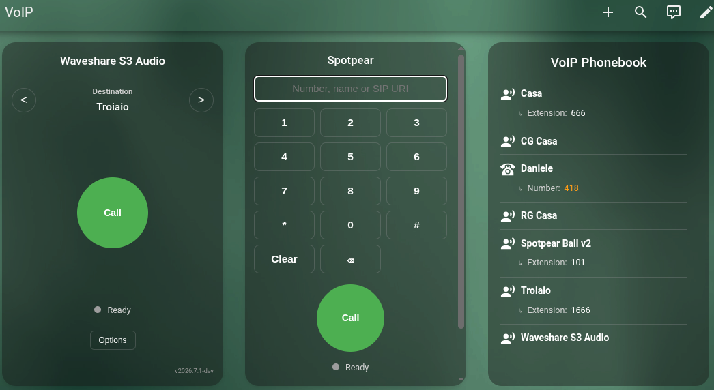
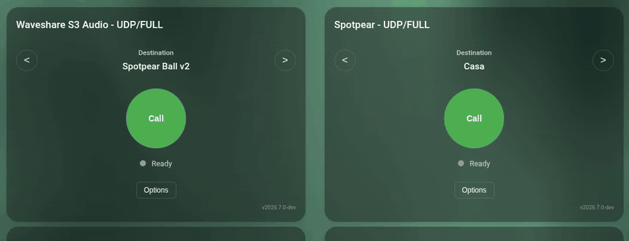
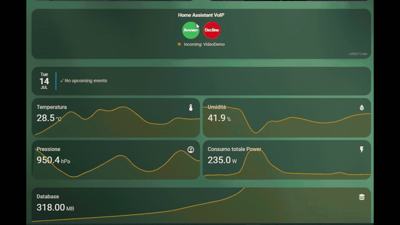
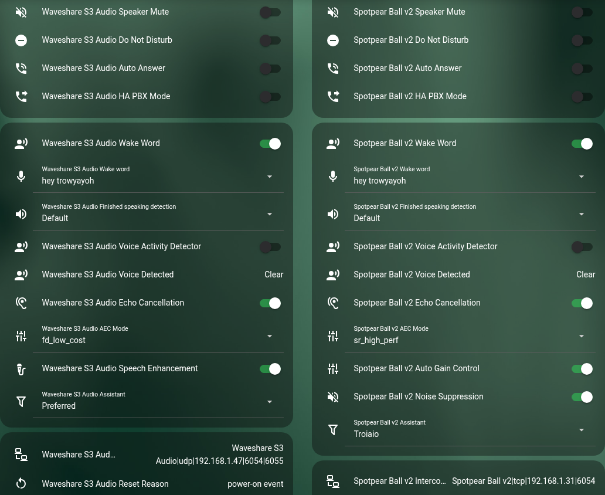

# VoIP Stack for Home Assistant and ESPHome

**An independent, open-source SIP PBX inside Home Assistant, installable through HACS.**

Answer your SIP video doorbell from a Home Assistant dashboard or Companion
app, call between rooms, and use ordinary SIP desk phones or softphones.
VoIP Stack provides the phones, shared phonebook and call handling inside
Home Assistant. Connect a provider trunk when you also want external calls.

Build a small intercom or a complete local telephone system: ring several
phones, forward unanswered calls, take voicemail, transfer a conversation or
route a caller according to your Home Assistant entities and automations.

**[Install](#installation) · [Make your first call](#fastest-start) · [Understand phones and cards](docs/CONCEPTS.md) · [PBX walkthrough](docs/PBX_WORKFLOWS.md) · [Automation recipes](docs/AUTOMATION_DIALPLAN.md)**

*Developed and maintained by n-IA-hane, with community contributions and support. [❤️ Sponsor the project](https://github.com/sponsors/n-IA-hane)*

[](https://www.home-assistant.io)
[](#supported-hardware)
[](https://esphome.io)


_A real SIP door-station call in the Home Assistant phone card. The browser
receives the door camera while its own camera stays off. [Phone controls](docs/USER_GUIDE.md#read-the-phone-card) · [SIP video guide](docs/SIP_VIDEO.md)._

## What can you build?


| Goal | How it works | Start here |
| --- | --- | --- |
| Answer a SIP doorbell | The door station calls a Home Assistant phone or ring group. Answer with audio and supported video from a dashboard, Companion app or SIP phone. | [Door-station example](#door-station-and-unanswered-calls) · [Video compatibility](docs/SIP_VIDEO.md) |
| Call between rooms | Give each tablet, kiosk or browser phone its own name and extension, then call another room from the phonebook. | [Logical Home Assistant phones](#logical-home-assistant-phones) |
| Use existing telephones | Register a desk phone, ATA, Zoiper, Linphone or another SIP client directly with Home Assistant. | [SIP phones and softphones](#sip-phones-and-softphones) |
| Ring several phones | Call a ring group; the first answer wins and the other phones stop ringing. | [Groups](#groups) |
| Hold an audio meeting | Call an HA-hosted conference group and talk with the other participants. | [Conference groups](docs/GROUPS.md#conference-group) |
| Handle unanswered calls | Apply phone routing defaults, send the caller to voicemail or forward to another destination. | [PBX functions](#pbx-functions) |
| Make external calls | Connect a named provider or PBX trunk and choose which phones can use it. | [SIP trunks](#optional-sip-trunk) |
| Build an IVR or contextual route | Play a greeting, collect keypad input and select a destination using native HA triggers, conditions and actions. | [Automations as dialplan](#automations-as-dialplan) |
| Speak to Assist by telephone | Assign a Home Assistant Assist pipeline a callable name or extension. | [Assist extension](#assist-as-a-phone-extension) |
| Add a physical ESP room station | Choose a maintained phone profile, or combine calls with a local voice assistant and media playback. | [ESPHome devices](#esphome-devices) |

## Phones, cards and the PBX

A **phone** owns its name, extension, call state and settings. A **card** is the
interface for one phone. A **contact** identifies a destination in the shared
phonebook, and a **trunk** connects the PBX to an external line.

Home Assistant runs the registrar, routing and media services. You can use it
with browser phones, standard SIP equipment, or both. Add one logical HA phone
for each room or app session that should make and receive its own calls.



The supplied VoIP Stack card has three modes:

| Card mode | Where you speak and listen | Use it for |
| --- | --- | --- |
| Home Assistant phone | That browser or Companion WebView's microphone, speaker and optional camera | A tablet, kiosk, desktop or app acting as a phone |
| ESP mirror | The selected physical ESP device's microphone and speaker | Controlling that device's calls from HA |
| Phonebook | No separate media owner | Browsing shared contacts and placing calls through an existing phone |

Select the phone by name in the card's visual editor. Several cards can show
the same phone; the browser that answers an HA phone's call owns its media.
For independent room-to-room media, use separate browser or Companion
sessions. Two cards in one tab still share that tab's physical media devices.

Browser and Companion calls require a running HA frontend with the receiving
phone card loaded and media permissions granted. The Companion app uses its
WebView; it does not add an operating-system telephone channel. Closing or
suspending that frontend prevents it from supplying audio or answering calls.



Read the [basic concepts](docs/CONCEPTS.md) and
[illustrated user guide](docs/USER_GUIDE.md) for phone selection, everyday
controls, media permissions and phone settings.

## Fastest start

1. [Install VoIP Stack through HACS](#home-assistant-through-hacs), restart HA
   and add the integration from **Settings > Devices & services**.
2. Keep SIP port `5060` and RTP base port `40000` unless they conflict with an
   existing service. Complete setup to create the first Home Assistant phone.
3. Add a second **Home Assistant browser phone** from the integration's
   **Add phone** flow. Give both phones recognizable names.
4. Add a **VoIP Stack card** for each phone. Choose **Home Assistant phone**
   mode and select the desired phone in the visual editor.
5. Open them in separate browser or Companion sessions over HTTPS and allow
   microphone access. Camera permission is needed only to send local video.
6. Call the other phone from the shared phonebook, answer, check audio in both
   directions, hang up and call again.

You now have a local intercom. Connect a SIP door station or desk phone using
[a local account](#sip-phones-and-softphones), then add groups, routing or an
external line as your setup grows.

### Grow your setup one step at a time

| Add next | Practical example | Guide |
| --- | --- | --- |
| A SIP door station or handset | Answer the front door or call a desk phone | [Local SIP accounts](docs/SERVICES.md#local-sip-endpoint-account-services) |
| More rooms | Ring the kitchen and study together | [Ring groups](docs/GROUPS.md#ring-group) |
| Unanswered-call handling | Ring for a while, then forward or take a message | [Phone routing](docs/PHONE_ROUTING.md) · [Voicemail](docs/VOICEMAIL.md) |
| Automation | Route by presence, play a greeting or react to in-call keys | [Automation cookbook](docs/AUTOMATION_DIALPLAN.md) |
| An external line | Receive provider calls and allow selected phones to call out | [SIP trunk](docs/SIP_TRUNK.md) |
| An ESP room device | Add a physical phone, or voice assistant, music and calls | [Device profiles](yamls/README.md#how-to-use) |

## SIP phones and softphones

Home Assistant can act as the local SIP registrar for ordinary IP phones,
ATAs, software phones and compatible door stations. Create a local SIP account,
then enter its account details and HA's reachable SIP address in that client.
These are phone accounts; provider trunks are configured separately.

The [local account services](docs/SERVICES.md#local-sip-endpoint-account-services)
cover account creation, enable/disable, password rotation and removal. Follow
the [user guide](docs/USER_GUIDE.md) for normal setup and the
[Dahua guide](docs/DAHUA.md) for its registered or static door-station settings.

A client can call phonebook names or extensions and receive calls from HA
phones, other SIP clients or an HA-managed trunk. Audio and video compatibility
depend on the client's actual codecs and negotiation. Compatible SIP handsets
can also hold a call and make a consultation for an attended transfer.

<a id="pbx-additions-in-2026110"></a>

## PBX functions

Routing, messages and call applications run in Home Assistant. Phone settings
continue to apply when their card is closed. The
[illustrated PBX walkthrough](docs/PBX_WORKFLOWS.md) explains the controls and
what each caller experiences.

| Function | What you can do | Guide |
| --- | --- | --- |
| Phone routing | Forward all calls, handle busy/unavailable phones, or set a ringing timeout with a chosen outcome. A call-control automation can override the defaults for its call. | [Phone routing](docs/PHONE_ROUTING.md) |
| Voicemail | Enable a phone's mailbox, take messages, listen from its HA card or a SIP access menu, and use HA Media or automations with the recordings. | [Voicemail](docs/VOICEMAIL.md) |
| Message waiting | Compatible registered SIP phones can subscribe to `message-summary` for their own enabled mailbox. | [Voicemail](docs/VOICEMAIL.md) |
| Transfer | Send an answered call to another contact from the card. The card performs a blind transfer; a compatible SIP handset can consult first. | [Transfer controls](docs/USER_GUIDE.md#forward-or-transfer-a-call) |
| Park and retrieve | Leave an established audio call on a parking slot and continue it from another phone. | [Call parking](docs/CALL_PARKING.md) |
| Directed pickup | Answer another phone's still-ringing call. | [Pickup](docs/CALL_PARKING.md) |
| Conversation recording | Start or stop recording through HA actions or an enabled card shortcut. | [Recording](docs/CALL_RECORDING.md) |
| Named trunks | Configure independent provider/PBX lines, select an outgoing line and set per-phone external-call access. | [SIP trunks](docs/SIP_TRUNK.md) |

Choose and configure each feature independently. For example, enabling a
mailbox creates storage for that phone; its no-answer routing rule decides
when a caller is sent there.

## Logical Home Assistant phones

The integration creates one ordinary Home Assistant browser phone on first
setup, named from Home Assistant's location. Add or remove phones
from:

**Settings > Devices & services > VoIP Stack > Add phone > Home Assistant
browser phone**

Give every real place its own name and optional extension: `Kitchen`,
`Reception`, `Garage`, `201`, and so on. Each logical phone is represented by a
native HA Device with entities for call state, connectivity, DND, extension,
groups, auto answer, camera transmission settings and call events.

Bind the card to that Device:

```yaml
type: custom:voip-stack-card
mode: ha_softphone
device_id: <phone_device_id>
```

`device_id` answers "which local phone owns this card or action?".
`destination` answers "who should this phone call?". The central phonebook
resolves the destination, so a normal call does not require the destination's
Device ID:

```yaml
action: voip_stack.call
data:
  device_id: <kitchen_phone_device_id>
  destination: Garage
```

Omit `device_id` only when a preferred phone is configured or exactly one
compatible phone exists. Otherwise the action asks you to select the local
phone explicitly.

The card's idle `Options` panel includes a `Microphone anti-alias filter`.
It is enabled by default and stored per browser and logical phone. The setting
takes effect when the next call opens the microphone and only adds processing
when the negotiated transmit rate is lower than the browser capture rate.

The same panel selects the browser microphone, speaker and camera. These
preferences belong to the browser or Companion App session, are shared by all
VoIP Stack cards in that session and remain unchanged when no device is
selected. During a call, the tune button beside Hangup opens the same controls,
so a headset or camera can be changed without ending the call. Unsupported
speaker routing remains under operating-system control.

Use a distinct browser or Companion session for each independent media endpoint.
The [user guide](docs/USER_GUIDE.md) covers the visual phone picker and card setup.

## Home Assistant as a SIP video phone

Video is available to compatible browser phones in current browsers and the
Home Assistant Companion app. Standard SIP video door stations, video phones,
softphones and PBX/trunk legs can negotiate H.264, VP8 or RTP/JPEG. An optional
bounded FFmpeg path can receive selected legacy codecs and bridge incompatible
H.264/JPEG SIP legs when direct encoded relay is impossible.

Receiving video does not require camera permission. Sending the browser camera
is a separate persisted phone setting and still requires browser permission.
Audio remains usable when video is unavailable or deliberately disabled.

Audio conferences remain audio-only. The separate [ESP media section](#esp-endpoints-and-media-roles)
describes which firmware profiles send or display video.

Video compatibility depends on the actual offer/answer, packetization and
decoder contract. See the [capability matrix, privacy controls and limits](docs/SIP_VIDEO.md).



## Door station and unanswered calls


A typical path is:

1. a door station calls `Front door`;
2. a ring group alerts selected browser, SIP and ESP phones;
3. the first endpoint to answer owns the call;
4. if nobody answers, a native HA automation forwards the still-live call to
   another phone or Assist;
5. call events can trigger a mobile notification or another HA action.

Copyable, current recipes:

- [route a trunk caller to a ring group](docs/AUTOMATION_DIALPLAN.md#route-only-providerpbx-trunk-calls-to-a-ring-group)
- [forward an unanswered phone to Assist](docs/AUTOMATION_DIALPLAN.md#forward-an-unanswered-ha-call-to-assist)
- [forward an unanswered phone to a mobile number](docs/AUTOMATION_DIALPLAN.md#forward-an-unanswered-call-to-a-mobile-number)
- [route a known caller according to presence](docs/AUTOMATION_DIALPLAN.md#route-a-known-caller-according-to-presence)
- [send an actionable mobile notification](docs/AUTOMATION_DIALPLAN.md#actionable-doorbell-notification)
- [notify a no-answer timeout](docs/AUTOMATION_DIALPLAN.md#notify-a-no-answer-timeout)

The assistant's personality is entirely up to your prompt. Professional
receptionist and verbally abusive domestic secretary are both technically
valid configurations.

## Groups


A **ring group** forks one call to all eligible members. DND, disabled and busy
members are excluded; the caller is excluded if it belongs to the target
group. The first successful answer wins and every losing leg is cancelled.

An **audio conference group** joins answered members to one HA-hosted mixer.
`conference_ring` optionally rings the declared members when somebody joins.
Auto answer is a per-phone policy: enabling it on several group members means
several endpoints may join or compete immediately, which is the configured
behavior.

Membership declared by a phone becomes visible in HA dynamically. A group
disappears when no current endpoint declares it. See
[`docs/GROUPS.md`](docs/GROUPS.md) for declaration and collision rules.

## Phonebook and routing

Home Assistant publishes the shared roster through
`sensor.voip_phonebook`. It combines:

- online ESPHome VoIP endpoints;
- logical Home Assistant phones;
- registered local SIP accounts;
- manual contacts;
- Assist destinations;
- dynamic ring/conference groups;
- optional trunk-routed numbers.

A name is the contact identity. An `extension` is an internal alias for that
same destination; a `number` is normally routed through the trunk. The resolver
can also handle canonical SIP URIs.

Phonebook names must be unique across phones, contacts and Assist pipelines,
even when their extensions differ. Duplicate names produce an error log and
a persistent Home Assistant notification identifying the conflicting entries.
Rename one destination; the notification clears when the phonebook updates.

SIP account and endpoint identities remain separate from their displayed
friendly names. The shared phonebook resolves the destination before the PBX
selects the route.

Use the card, voice intents or `voip_stack.call` with a phonebook name or
extension. Do not copy endpoint addresses into automations unless you
deliberately need a raw SIP route.

- [Resolver rules](docs/DIALPLAN_RESOLVER.md)
- [Phonebook protocol](docs/PHONEBOOK_PROTOCOL.md)
- [Services](docs/SERVICES.md)
- [ESP discovery/entity surface](docs/ESP_ENTITY_SURFACE.md)


## Automations as dialplan

**Automations as dialplan** lets you define call behavior in Home Assistant's
normal automation editor. Create an Automation contact, then build a sequence:
**greeting, then forward to a phone or voice assistant**. Add a keypad
menu, presence condition or office-hours rule when you need it.

**Phonebook as dialplan** remains the default when no routing automation overrides it.
Native VoIP triggers select the
call for the actions automatically, including across waits and synchronous
scripts. No blueprint, generic event filter or Call-ID template is needed for
the common examples. A destination can be its phonebook name or extension.

Start with the [step-by-step greeting](docs/AUTOMATION_DIALPLAN.md#create-your-first-greeting-in-the-editor),
then add a [forward after the greeting](docs/AUTOMATION_DIALPLAN.md#forward-after-the-greeting).

- [Route calls during office hours](docs/AUTOMATION_DIALPLAN.md#route-to-reception-during-office-hours).
- [Forward only when a phone does not answer](docs/AUTOMATION_DIALPLAN.md#forward-an-unanswered-ha-call-to-assist).
- [Build a keypad menu](docs/AUTOMATION_DIALPLAN.md#build-a-small-keypad-menu).
- [Show received keys in HA notifications](docs/AUTOMATION_DIALPLAN.md#see-received-digits-in-persistent-notifications).
- [Run a gate action from in-call DTMF](docs/AUTOMATION_DIALPLAN.md#open-a-gate-with-in-call-dtmf).

Explicit extension digits entered during the trunk's initial DTMF menu retain
precedence over a generic routing override. With no applicable automation
selection, the configured phonebook route continues. Existing Event Entity
and state automations remain available; see the
[migration guide](docs/AUTOMATION_DIALPLAN.md#move-existing-automations-gradually).

The full [Automations as dialplan cookbook](docs/AUTOMATION_DIALPLAN.md) explains
call completion, fallback, time limits, concurrent callers and troubleshooting.

## Assist as a phone extension

Give a Home Assistant Assist pipeline a phonebook name and extension so
callers can speak to it over an ordinary call.

Enable **Include voice assistant** while configuring VoIP Stack, choose the
pipeline and assign an extension. ESPs, registered SIP phones, browser phones
and trunk callers can then call that Assist pipeline like any other contact.

The caller uses the selected HA pipeline's speech recognition, conversation
agent and speech output. This callable destination is independent of the local
wake-word Voice Assistant available in [full ESP firmware](#full-esp-voice-experience).

VoIP Stack sends one initial user message such as
`Incoming SIP call from "Daniele".` and then streams the selected pipeline's
STT, conversation and TTS over the same call. It does not inject a second
persistent personality prompt. Put behavioral instructions in the conversation
agent itself.

Optional advanced call context appends caller ID, phonebook match, ingress and
called extension once. Treat those fields as untrusted call metadata, not
authentication.

Voice intents may also resolve commands such as "Call Kitchen", "Answer" and
"Hang up" against the live phonebook and the satellite's selected phone.

## Optional SIP trunk

Local calls need no trunk. Add a named line to connect HA to a provider or another
PBX. Use the integration's **Add SIP trunk** menu
and edit each line separately. Keep **Register the trunk** enabled for account
registration, or disable it for a static trunk and configure its allowed
incoming SIP source IPs.

Inbound mode can route immediately or collect an internal extension through
negotiated RTP `telephone-event`/compatible SIP INFO DTMF. Outbound contacts
with public numbers use the selected outgoing line. Explicit digits, no-digit fallback and
automation overrides have distinct, documented precedence.

Use **Set external call access** to allow or block trunk calls per phone.
See the [automation editor walkthrough](docs/AUTOMATION_DIALPLAN.md#control-external-calls-per-phone).


See the [trunk configuration guide](docs/SIP_TRUNK.md) for registration,
source-IP authorization, incoming routing and network requirements.

## Installation

### Home Assistant through HACS

| Requirement | Stable setup |
| --- | --- |
| VoIP Stack | [2026.11.0](https://github.com/n-IA-hane/esphome-intercom/releases/tag/v2026.11.0) |
| Home Assistant | 2026.7.0 or newer |
| ESPHome, for optional device firmware | 2026.10.0 or newer |
| Coordinated ESP component sources | ESP VoIP Stack, Runtime Controller and Audio Stack 2026.11.0, using the profile's `main` references |

1. Search for **VoIP Stack** in HACS and select **Download**.
2. Restart Home Assistant.
3. Open **Settings > Devices & services > Add integration**.
4. Select **VoIP Stack** and complete the setup flow.
5. Add the supplied VoIP Stack card to a dashboard and select your phone.


The card is registered automatically. A normal LAN can keep SIP `5060` and RTP
base `40000`. For containers, LXC, VPNs or multiple subnets, check host
networking and a reachable **Advertise host**. Browser and Companion media
also require HTTPS and suitable device permissions.

For manual installation, release archives, ports and network layouts, follow
the [deployment guide](docs/DEPLOYMENT_GUIDE.md#home-assistant).

<a id="previous-release-2026101"></a>
<a id="previous-release-2026100"></a>

### Upgrading

Read the [changelog](CHANGELOG.md) and [migration notes](docs/BREAKING_CHANGES.md)
before updating. In HACS, use **Redownload**, select the intended release,
restart HA and reload the dashboard. Reset frontend caches if the browser or
Companion app still shows an older card.

HACS updates the HA integration and card. ESP firmware is a separate update:
rebuild and upload the selected maintained profile when adopting device-side
changes. HA and ESP firmware do not require matching version numbers.

## ESPHome devices

An ESP can be a physical SIP room phone, door station or speaker endpoint.
Choose a VoIP-only profile for calls, or a full-experience profile for calls,
a local Voice Assistant and media playback on the same device.

<table>
  <tr>
    <td align="center"><br/><b>ESP phone to Home Assistant</b></td>
    <td align="center"><br/><b>Local Voice Assistant</b></td>
    <td align="center"><br/><b>Runtime audio controls</b></td>
  </tr>
</table>

### Add an ESP phone when you need one

1. Choose your exact board from the [device guide](yamls/README.md). Keep its
   supplied wiring; change GPIOs only when the physical wiring differs.
2. Choose the feature set, add your local secrets and flash the device.
3. Add it through the normal ESPHome integration. Its phonebook entry becomes
   available to the HA phones, and an optional ESP mirror card controls its calls.
4. Call it by phonebook name or extension and verify both directions of audio.

| Device goal | Maintained starting point |
| --- | --- |
| ESP VoIP only | [`yamls/voip-only/`](yamls/voip-only/) |
| Local Voice Assistant, wake word, media, TTS, optional Sendspin and VoIP | [`yamls/full-experience/`](yamls/full-experience/) |
| Native ESPHome microphone/speaker paths | [`yamls/voip-only/esphome-native/`](yamls/voip-only/esphome-native/) |
| New or unqualified hardware | [`yamls/experimental/`](yamls/experimental/) |

Profiles select one device package and a `firmware_features` list. Start with
that profile, then [adjust its features](packages/README.md#work-through-a-full-profile)
when you want voice only, calls only, or a combined device. The
[deployment guide](docs/DEPLOYMENT_GUIDE.md) explains single-bus, dual-bus,
lightweight AEC and full AFE choices.

### ESPHome components

Keep the coordinated component sources supplied by your selected profile.
For a custom configuration, the VoIP and lightweight AEC components can be
loaded as follows:

```yaml
external_components:
  - source: github://n-IA-hane/esphome-voip-stack@main
    components: [voip_stack]
  - source: github://n-IA-hane/esphome-audio-stack@main
    components: [esp_audio_stack, esp_aec]
```

Use `esp_afe` instead of `esp_aec` only with the matching full AFE pipeline.
Follow the [device-package migration](docs/BREAKING_CHANGES.md#development-firmware-new-device-packages)
and [native provider migration](docs/BREAKING_CHANGES.md#development-firmware-native-audio-providers)
when updating a copied configuration. After a major ESPHome or component
upgrade, follow the deployment guide's clean-build instructions.

## ESP endpoints and media roles

ESP media roles are derived from the configured components; they are not a
separate user mode.

Supported ESP32-P4 videophone profiles provide two-way SIP audio and video:
they transmit the local camera and display the remote video on the device's
screen.

| Derived role | Media | Typical use |
|---|---|---|
| `full_duplex` | microphone TX + speaker RX | Room phone, door station, wall panel |
| `mic_only` | microphone TX | Monitor or capture endpoint |
| `speaker_only` | speaker RX | Paging or announcement target |

An endpoint must have at least one real media direction. ESP VoIP intentionally
uses uncompressed PCM for audio. Standard profiles are audio-only; qualified
ESP32-P4 videophone profiles compile exactly one video codec, JPEG or H.264.
HA performs format conversion when a standard SIP peer negotiates another
supported audio codec; ESP firmware is not downgraded to a telephone codec for
that purpose.

Audio component details live in the companion projects:

- [`esp_audio_stack`](https://github.com/n-IA-hane/esphome-audio-stack)
- [`esp_aec`](https://github.com/n-IA-hane/esphome-audio-stack/tree/main/esphome/components/esp_aec)
- [`esp_afe`](https://github.com/n-IA-hane/esphome-audio-stack/tree/main/esphome/components/esp_afe)
- [`voip_stack`](https://github.com/n-IA-hane/esphome-voip-stack)
- [`runtime_controller`](https://github.com/n-IA-hane/esphome-runtime-controller)

## Full ESP voice experience

The [`yamls/full-experience/`](yamls/full-experience/) profiles are complete
ESPHome voice devices, not merely larger SIP configurations. They combine the
VoIP endpoint with an independent local Voice Assistant stack and coordinate
all realtime consumers through one audio and runtime ownership model.

The underlying audio stack is also reusable without VoIP. Custom ESPHome voice
devices can use it to share codec or I2S ownership, speaker reference, AEC/AFE
processing and a cleaned microphone stream between their own consumers.

The [illustrated microphone wiring guide](https://github.com/n-IA-hane/esphome-audio-stack/blob/main/README.md#microphone-wiring-and-delivery-illustrated)
shows single-mic, stereo L/R, TDM and codec layouts, with YAML for independent
AFE/BSS inputs or optional mono downmix before AEC/AFE.

<table>
  <tr>
    <td align="center"><br/><b>Animated assistant</b></td>
    <td align="center"><br/><b>Assistant response</b></td>
    <td align="center"><br/><b>Runtime audio controls</b></td>
    <td align="center"><br/><b>Call end reason</b></td>
  </tr>
  <tr>
    <td align="center"><br/><b>Positive mood</b></td>
    <td align="center"><br/><b>Neutral mood</b></td>
    <td align="center"><br/><b>Negative mood</b></td>
    <td align="center"><br/><b>AFE controls in HA</b></td>
  </tr>
</table>

<table>
  <tr>
    <td align="center"><br/><b>P4 weather, Voice Assistant and VoIP controls</b></td>
    <td align="center"><br/><b>Ducking and barge-in</b></td>
  </tr>
</table>

The full profiles provide:

- continuous Micro Wake Word on the cleaned post-AEC microphone stream;
- a native ESPHome Voice Assistant started by wake word or touch;
- media playback, announcements, TTS, ringtones and optional Sendspin through
  one shared speaker path;
- ducking and barge-in, including interruption of a current assistant reply;
- VoIP calls that coexist with the assistant instead of creating a second
  microphone or speaker owner;
- AEC or AFE processing, with runtime controls and diagnostics where supported;
- coordinated LEDs, display pages, timers, call state and media activity
  through `runtime_controller`;
- headless operation on audio boards, plus full LVGL interfaces on supported
  displays;
- optional animated and mood-aware assistant artwork on display profiles.

The shared pipeline matters because Micro Wake Word, Voice Assistant and VoIP
all need the same cleaned user speech while music, TTS or a ringtone may still
be playing. Speaker output also supplies the phase-coherent reference used by
AEC instead of letting each feature open its own audio path.


### Assistant artwork and avatars

Display profiles can select an assistant avatar with the `ai_avatar`
substitution. Each avatar directory may provide idle animation frames plus
listening, thinking, loading, error, timer and mood images. The selected assets
are resized for the target display during the build.

```yaml
substitutions:
  ai_avatar: my_assistant
```

An optional community theme is also included: **`starfleet`**, contributed by
[rvdv01](https://github.com/rvdv01) in
[discussion #110](https://github.com/n-IA-hane/esphome-intercom/discussions/110).
Set `ai_avatar: starfleet` in your own configuration to use it. Maintained YAMLs
keep their current default. See the [theme preview and optional ringtone](assets/images/assistant/starfleet/README.md).

This artwork represents the ESP device's own Voice Assistant state. It is
unrelated to the optional HA Assist pipeline that SIP callers can dial as an
extension.

See the [deployment guide](docs/DEPLOYMENT_GUIDE.md) for profile selection and
the companion [audio stack documentation](https://github.com/n-IA-hane/esphome-audio-stack)
for AEC, AFE, I2S and codec topology details.

## Supported hardware

Ready profiles are examples of complete pin, codec and resource choices; they
are not a claim that every board with the same chip has the same wiring.

| Device/profile | Configuration | Status |
|---|---|---|
| Spotpear Ball v2 | [`spotpear-ball-v2-full-afe.yaml`](yamls/full-experience/single-bus/spotpear-ball-v2-full-afe.yaml) | Field tested |
| Waveshare ESP32-S3 Audio Board | [`waveshare-s3-full-afe.yaml`](yamls/full-experience/single-bus/waveshare-s3-full-afe.yaml) | Field tested |
| Waveshare ESP32-S3 Touch LCD 1.85C-BOX V2 | [`waveshare-s3-touch-lcd-1.85c-box-v2-full.yaml`](yamls/full-experience/single-bus/waveshare-s3-touch-lcd-1.85c-box-v2-full.yaml) | Supported FULL AEC/downmix or dual-microphone AFE |
| Waveshare ESP32-P4 Touch LCD, full JPEG videophone | [`waveshare-p4-touch-full-afe-landscape-videophone-jpeg.yaml`](yamls/full-experience/single-bus/waveshare-p4-touch-full-afe-landscape-videophone-jpeg.yaml) | Field tested |
| Waveshare ESP32-P4 Touch LCD, portrait | [`waveshare-p4-touch-full-afe-portrait.yaml`](yamls/full-experience/single-bus/waveshare-p4-touch-full-afe-portrait.yaml) | Experimental layout |
| Generic ESP32-S3, single bus | [`generic-s3-full-aec.yaml`](yamls/full-experience/single-bus/generic-s3-full-aec.yaml) | Reference profile |
| Generic ESP32-S3 with DVP JPEG camera | [`generic-s3-full-aec-camera.yaml`](yamls/full-experience/single-bus/generic-s3-full-aec-camera.yaml) | Reference wiring for Freenove FNK0085 N8R8; camera transmission |
| Generic ESP32-S3, single bus, 4 MB flash | [`generic-s3-full-lite-aec.yaml`](yamls/full-experience/single-bus/generic-s3-full-lite-aec.yaml) | Experimental; limited OTA headroom |
| Generic ESP32-S3, dual bus | [`generic-s3-full-aec.yaml`](yamls/full-experience/dual-bus/generic-s3-full-aec.yaml) | Reference profile |
| Native ESPHome mic/speaker | [`generic-s3-full-esphome-native.yaml`](yamls/full-experience/esphome-native/generic-s3-full-esphome-native.yaml) | Reference profile |

The complete hardware, memory and C6 firmware notes are in the
[deployment guide](docs/DEPLOYMENT_GUIDE.md#esp-devices).

S3 camera profiles transmit JPEG video during calls; displaying the remote
video on an S3 screen is not implemented. Supported P4 profiles transmit their
camera and display the remote video. Devices with both a microphone and a
speaker keep bidirectional audio on either platform. See the
[SIP video guide](docs/SIP_VIDEO.md#esp32-s3-camera-preview-and-sip-video).

FULL profiles using `esp_aec` or `esp_afe` start in `sr_high_perf` and offer
`sr_low_cost` as the lower-memory alternative. The processor and mode selector
use the same initial-mode setting. VoIP-only profiles retain their separate
FD/VoIP choices and standalone callbacks; the native ESPHome profile adds no
external DSP mode. These defaults do not change microphone calibration or
wake-word gain. Where mode restoration is enabled, the restored SR choice is
applied before the processor starts, so the selector matches the running DSP.

The Generic Full Lite AEC profile keeps Voice Assistant, wake word, software
AEC, VoIP, HTTP playback, TTS, timers and the runtime controller. It uses size
optimization and leaves Sendspin disabled. PSRAM is still required. Its measured
OTA image was about 1.78 MB in an earlier build, leaving roughly 59 KB in the
standard 4 MB flash layout. That is historical headroom; check the build size
again after adding components or updating
dependencies. The full 8 MB profile retains Sendspin and more flash headroom.

## Use ESP firmware with an existing PBX

An ESP running VoIP Stack can also be a SIP phone for a classic PBX. Configure
it as a static peer: the PBX knows the ESP's address, so no SIP REGISTER or
account credentials are needed on the firmware. A normal registered desk phone
or softphone can then dial the ESP's extension.

For example, reserve extension **1001** on the PBX and associate it with the
ESP's fixed address, such as `192.168.1.60:5060`. On Asterisk, a dialplan entry
then calls the configured static endpoint:

```ini
exten => 1001,1,Dial(PJSIP/esp-bedroom,30)
 same => n,Hangup()
```

The endpoint/AOR configuration is included in the guide below. Baresip is one
way to test the calls; it is not required.

For calls in the other direction, add a PBX destination to the firmware's
existing phonebook:

```yaml
voip_stack:
  static_contacts:
    - name: "700"
      ip: 192.168.1.20
      port: 5060
      transport: udp
```

This calls extension `700` on the PBX at `192.168.1.20`. The PBX must also have
a static endpoint for the ESP and compatible audio settings. The device can
retain its Assist and media features through ESPHome, or use a VoIP-only profile.

[Set up an ESP with a classic PBX](docs/CLASSIC_PBX.md) includes the firmware
settings, Asterisk and FreeSWITCH static-extension examples, ordinary SIP-phone
calls, and the measured Asterisk 16 kHz microphone / 48 kHz playback setup.

## How it works

Home Assistant owns logical phones, the central phonebook, SIP registration,
routing, media bridges and PBX applications. The cards display backend state
and use normal HA controls. Standard SIP phones connect through SIP/RTP; ESP
phones also use the existing ESPHome integration for controls and phonebook updates.


Logical phones share the listener and RTP pool. Browser and ESP phones handle
one active call at a time; compatible registered SIP phones can hold a call and
start a consultation. Calls to different phones remain independent.

ESPHome full-experience firmware combines its VoIP endpoint, local Voice
Assistant and media features through one audio/runtime ownership model. An
external PBX can also use an ESP as a static SIP endpoint.

Read the [architecture](docs/ARCHITECTURE.md), [call flows](docs/CALL_FLOWS.md)
and [SIP capability reference](docs/WHATS_NEW_2026_8_1.md) for protocol and media details.

## Documentation

For custom firmware composition, see [Modular device packages](packages/README.md).

Start with the practical [user guide](docs/USER_GUIDE.md) for normal setup and
daily operation. Use the [automation cookbook](docs/AUTOMATION_DIALPLAN.md) for
redirect, fallback, DTMF and guarded concurrent routing, and the
[PBX walkthrough](docs/PBX_WORKFLOWS.md) for everyday telephone features.

| Topic | Document |
|---|---|
| Choose and install a profile | [Deployment guide](docs/DEPLOYMENT_GUIDE.md) |
| Upgrade safely | [Breaking changes](docs/BREAKING_CHANGES.md) |
| Services, selectors and side effects | [Home Assistant services](docs/SERVICES.md) |
| Automations and contextual routing | [Automation cookbook](docs/AUTOMATION_DIALPLAN.md) |
| Ring and conference groups | [Groups](docs/GROUPS.md) |
| Phone mailboxes and message automations | [Voicemail](docs/VOICEMAIL.md) |
| SIP video codecs and browser privacy | [SIP video](docs/SIP_VIDEO.md) |
| Provider/PBX registration | [SIP trunk](docs/SIP_TRUNK.md) |
| Dahua registered or static door station | [Dahua setup and audio comparison](docs/DAHUA.md) |
| Names, extensions and route precedence | [Dial-plan resolver](docs/DIALPLAN_RESOLVER.md) |
| ESP/HA phonebook representation | [Phonebook protocol](docs/PHONEBOOK_PROTOCOL.md) |
| Expected signaling and media paths | [Call flows](docs/CALL_FLOWS.md) |
| Runtime ownership and architecture | [Architecture](docs/ARCHITECTURE.md) |
| Every option, trigger and condition | [Reference](docs/reference.md) |
| Logs, captures and qualification | [Testing and debug](docs/TESTING_AND_DEBUG.md) |
| Common failures | [Troubleshooting](docs/troubleshooting.md) |
| All documentation | [Documentation index](docs/README.md) |

## Testing

The repository includes automated suites and real SIP, RTP, browser, trunk
and hardware qualification tools. A green unit suite is not
treated as proof of a complete call: release qualification also checks media
in both directions, remote/local hangup and final resource cleanup.

Developer commands and capture locations are in
[`docs/TESTING_AND_DEBUG.md`](docs/TESTING_AND_DEBUG.md).

## Troubleshooting

Start with [`docs/troubleshooting.md`](docs/troubleshooting.md). It covers:

- an ESP or browser phone that does not ring;
- unknown callers or route failures;
- `488 media_incompatible`;
- missing or one-way audio;
- SIP registration/trunk failures;
- hold, UPDATE and re-INVITE;
- stale card state or frontend cache.

For SIP call setup or hangup problems, the **`voip_stack.capture_sip`** action
can produce a Wireshark-readable trace directly from HA, including HA OS,
without SSH or tcpdump. Start it, reproduce the problem, then stop and download
the PCAP from the action response. See the
[step-by-step SIP capture guide](docs/troubleshooting.md#capture-sip-signaling-from-home-assistant-including-ha-os)
for examples, memory limits and what the trace can diagnose.

## Before opening an issue

**Report the parts you actually use.** If the issue involves only HA, browser
cards or SIP equipment without an ESP, provide the HA-side information below
and skip the ESP requirements. ESP dumps apply only to ESP-related faults;
Audio Diagnostics additionally requires Audio Stack on that device.

Reproduce the issue with the current maintained release/profile and report the
exact versions actually running, including ESP firmware when an ESP is involved.
An updated YAML
on your computer does not update a device until it is rebuilt and uploaded.

Include:

- Steps to reproduce, expected behavior, actual behavior and how often it happens.
- HA and VoIP Stack versions; for ESP devices, ESPHome and component tags/commits.
- Exact board, microphone/speaker and codec models, relevant YAML and custom wiring.
- The call path: who calls whom, directly or through HA, SIP UDP/TCP, and PBX or
  peer software/version. Include negotiated codecs and `ptime` if known.
- HA integration diagnostics and logs around the failure, plus the ESP boot log.
- For an updated ESP profile, complete **VoIP Diagnostics** log output during the
  fault and after hangup. Add **Audio Diagnostics** when using Audio Stack.
  Open the ESPHome logs before pressing the buttons, use INFO or a more verbose
  logger level, and include whole diagnostic blocks, not only the last line.
- A [SIP capture](docs/troubleshooting.md#capture-sip-signaling-from-home-assistant-including-ha-os)
  for HA-handled signaling problems. It does not capture RTP media or SIP exchanged
  directly between ESP devices. Further captures may be needed for those paths.

To request an ESP dump from HA, open **Developer Tools > Actions**, select
**Button: Press** (`button.press`) and choose that device's **VoIP Diagnostics**
or **Audio Diagnostics** button. Open the ESPHome device logs first: the dump is
printed there, not returned by the HA action. For missing buttons in custom
firmware, use the [YAML definitions](docs/troubleshooting.md#collect-a-runtime-snapshot-from-an-esp)
and rebuild/upload. The `voip_stack.dump_diagnostics` and
`esp_audio_stack.dump_diagnostics` names are ESPHome actions, not HA services.

For audio faults, state which direction is silent or distorted. For video faults,
state whether the call began with video or video was enabled later. For custom
Audio Stack hardware, include whether the problem persists with AEC/AFE disabled
and whether the bus is shared or split, if you can test those cases.

Use this structure, replacing the example details with what you observed:

```text
Title: ESP receives audio but the browser caller hears silence
Versions: [exact installed HA, integration, ESPHome and component versions]
Hardware: [board, microphone, speaker, codec and relevant wiring]
Call path: HA browser card -> Generic S3, through HA, SIP UDP
Steps: call, answer, speak in both directions, hang up from HA
Expected: bidirectional audio and both endpoints idle after hangup
Actual: ESP plays audio; browser hears silence; hangup works
Frequency and test time: [repetitions, timestamp and timezone]
Attachments: sanitized YAML, HA diagnostics, HA/ESP logs, full diagnostic blocks,
             and a SIP capture when relevant
```

Never publish SIP passwords, authentication data, API keys or tokens. Review
configuration files, logs and captures before attaching them.

If you ignore these instructions and open an "it does not work" issue without
reproduction details or supporting logs, I'll get pissed off like there's no
tomorrow and close it as incomplete.

## Support the project

If VoIP Stack is useful to you, [consider sponsoring development](https://github.com/sponsors/n-IA-hane). Community support helps cover development tools and test hardware. The project remains free and open source.

For bug reports and hardware feedback, follow the
[issue-reporting instructions](#before-opening-an-issue) above.

## Contributing

Contributions should preserve standards-based SIP/SDP/RTP behavior and the
single authoritative call lifecycle. Avoid endpoint-specific timing
workarounds when a transaction, dialog, media or ownership invariant can solve
the underlying problem.

Before submitting a change, run the repository test environment documented in
[`docs/TESTING_AND_DEBUG.md`](docs/TESTING_AND_DEBUG.md).

### AI-assisted contributions

Vibe coding is welcome here. I support AI-assisted development and consider it
an invaluable tool, provided it is used thoughtfully.

Asking an AI to "add this feature" or "fix this bug" and submitting the result
is not enough. A change may solve the immediate problem while introducing
regressions elsewhere, especially in a project where audio, video and call
handling share limited resources.

Understand the proposed changes, review their wider effects, and test the
affected functionality before opening a pull request. Explain what you tested
and what remains unverified. AI can help write the code, but careful review
and testing remain the contributor's responsibility.

## License

Project-owned code is licensed under the MIT License; see
[`LICENSE`](LICENSE).

External Espressif components and optional system codecs keep their own
licenses. They are consumed as upstream dependencies and are not copied into
the project license.

> [!NOTE]
> VoIP Stack is designed for trusted local networks. It is not an emergency
> telephone service.
