# VoIP Stack for Home Assistant and ESPHome

**An independent, open-source SIP PBX running inside Home Assistant, installable through HACS.**

_Dashboard demo showing incoming, active and held calls, presence, voicemail and Do Not Disturb._

Receive audio and video calls from your SIP doorbell and answer from Home
Assistant cards, the Companion app or supported ESP32 videophones. Make and
receive calls between rooms, SIP phones and softphones through your own Home
Assistant PBX.

Give the kitchen tablet, office browser and wall phone their own names and
extensions. Bring existing SIP equipment into the same phone system, turn an
ESP32 into a real phone, and decide what happens when somebody calls. Answer,
transfer, ring several rooms, take a message or let Assist deal with the visitor.

**[The PBX](#one-home-every-phone) · [Doorbells and video](#answer-your-door-and-call-another-room) · [ESP phones and FULL experience](#esp-phones-and-full-voice-devices) · [Cards and popups](#cards-dashboard-and-call-popups) · [LDAP and BLF](#shared-contacts-and-live-phone-status-ldap-and-blf) · [Install](#installation)**

## One home, every phone

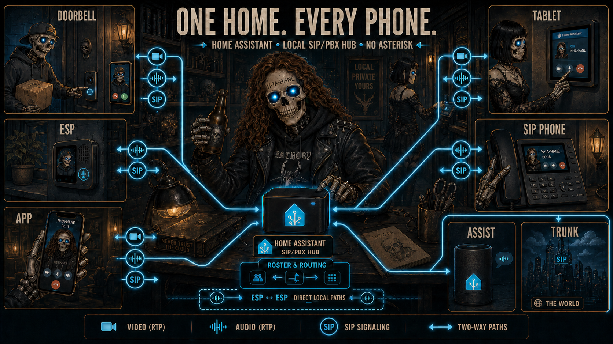

Home Assistant runs the telephone system. You can use browser phones in rooms,
SIP desk phones, desktop softphones, ATAs and compatible door stations together.
Create independent phone identities for tablets and Companion sessions, then
call by contact name or extension. ESP hardware and an external PBX are optional.

This is also where the ordinary PBX jobs live: forwarding, unanswered-call
rules, voicemail, transfers, parking, pickup, ring groups and audio conferences.
Connect a provider trunk when you want an outside line. Add native HA automations
when calls should follow presence, office hours, doorbell events or keypad input.

The house can transfer callers, take messages and keep someone waiting while
you move to another room. **A decent improvement over shouting "IT'S FOR YOU"
through three walls.**

The sections below show the system in use. The [user guide](docs/USER_GUIDE.md)
provides the complete controls and setup steps; the [release choices](#installation)
identify stable and preview features.

## Answer your door and call another room

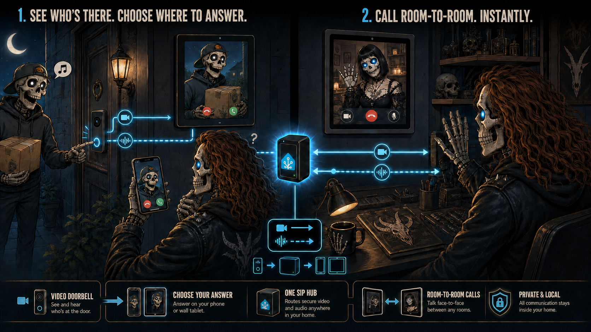

See the visitor and speak through the door station from a tablet, the Companion
app, a compatible SIP handset or a supported ESP videophone. Use the in-call
keypad for a configured door release. You can also make ordinary private audio
or video calls between rooms, instead of broadcasting every conversation through
the entire house.

A doorbell can ring one phone or a group. Answer in the kitchen, at a desk or
on a wall panel; no-answer rules decide where the call goes next. Video follows
the capabilities of the devices and route you choose. Audio conferences are
audio-only, and not every mixed SIP ring-group route preserves video.

_Dashboard doorbell-call demonstration using an illustrative gate-camera feed._

See the [recorded MOBOTIX door-station call](https://github.com/n-IA-hane/esphome-intercom/blob/ded4014ab83e1c73333b377e867490450afaa24b/docs/images/pbx-mobotix-video-green.png)
for a real door-station example. Its capture uses the earlier card theme.

Start with the [SIP video guide](docs/SIP_VIDEO.md) for compatible cameras,
codecs and receive/transmit directions. The [doorbell automation recipes](docs/AUTOMATION_DIALPLAN.md)
cover ringing, notifications, forwarding and what to do when nobody answers.

## ESP phones and full voice devices

Supported ESP32 boards become real SIP phones. Add the appropriate camera and
display paths and you have a videophone: send the local camera, see the remote
party and talk in both directions. Call Home Assistant, another ESP or standard
SIP equipment. A headless microphone/speaker board can instead be a room phone,
paging speaker or audio endpoint.

VoIP-only profiles provide the telephone. **FULL profiles are complete ESPHome
voice devices**, combining calls with local Assist, Micro Wake Word, music,
TTS, announcements, timers and optional Sendspin. On supported display boards,
contacts, dialing, settings, call feedback and an animated assistant share the
same device.

<table>
  <tr>
    <td align="center">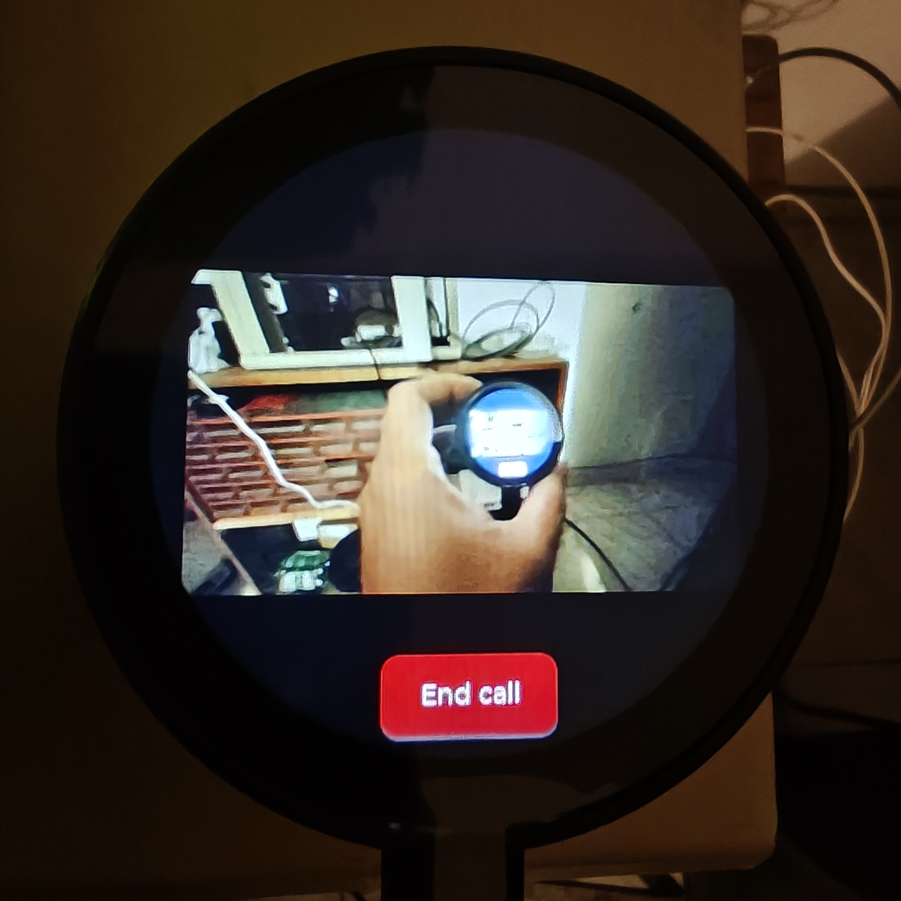 <b>SIP video on an S3 display</b></td>
    <td align="center"> <b>On-device controls</b></td>
    <td align="center"> <b>Call feedback</b></td>
  </tr>
</table>

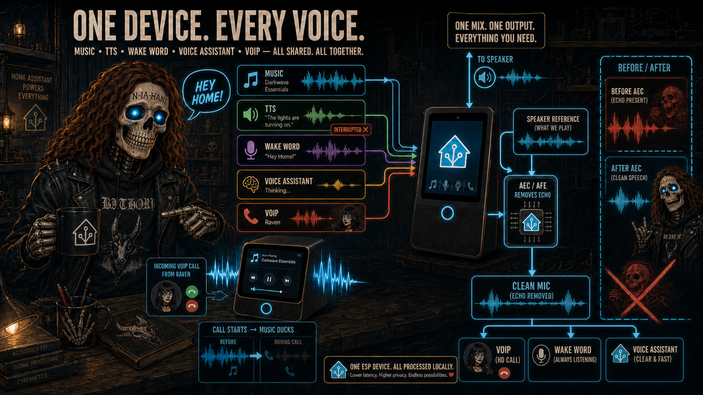

That means practical combinations: play music, lower it for a spoken reply,
interrupt the reply, take a call and return to the previous activity. AEC/AFE
and the selected audio profile support the shared microphone and speaker;
the available combination depends on the board, firmware and resources.
During negotiated video, maintained FULL profiles pause Micro Wake Word and
resume it afterward when enabled and ready.

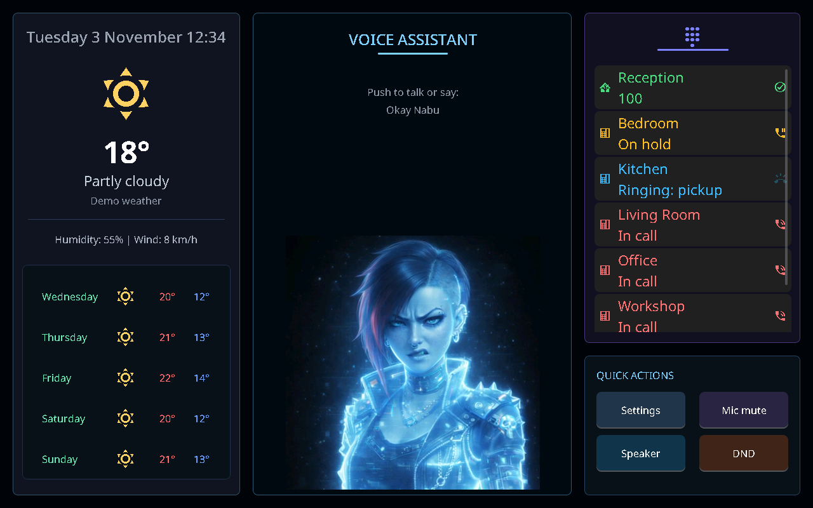

_P4 FULL interface demo: shared contacts, available, ringing, in call and on hold._

### An assistant with a face, and sometimes an attitude

Display profiles can use animated avatars and separate listening, thinking,
speaking, error, timer and mood artwork. Select an avatar for your device and
configure its conversation agent's personality. The interface can have character
without making every phone in the house look like an office desk terminal.

<table>
  <tr>
    <td align="center"> <b>Animated assistant</b></td>
    <td align="center"> <b>Spoken replies</b></td>
    <td align="center"> <b>Ducking and barge-in</b></td>
  </tr>
  <tr>
    <td align="center"> <b>Happy</b></td>
    <td align="center"> <b>Neutral</b></td>
    <td align="center"> <b>Apparently, not today.</b></td>
  </tr>
</table>

P4 videophone profiles provide camera and receive-display paths. S3 camera
transmission and JPEG receive display are separate capabilities: reception
requires the matching display/renderer package, and S3 does not decode H.264.
HA can convert a supported upstream video format when the selected route needs it.

Use the [device guide](yamls/README.md), [feature selection](packages/README.md)
and [supported hardware](#supported-hardware) to choose the exact board and
applications. The [FULL display guide](docs/DEPLOYMENT_GUIDE.md#full-display-examples)
and [audio guide](docs/ESPRESSIF_COMPONENTS.md) cover presentation and audio choices.

## Cards, dashboard and call popups

The phone is the identity you call; the card is how you control it. Choose the
phone by name in the visual editor. A browser phone uses that browser's
microphone, speaker and camera. An ESP mirror controls the physical phone,
which keeps using its own audio hardware.

There are **two Lovelace card types**. The compact card has three modes, while
the Dashboard combines the selected phone with the shared extension overview.
The optional popup presents an existing HA phone over other HA views.

| View | What it is for |
| --- | --- |
| Compact card, `ha_softphone` | Talk from a browser, tablet or Companion app using an existing HA phone. |
| Compact card, `esp_mirror` | Call, answer, hang up and select contacts on a physical ESP phone. |
| Compact card, `phonebook` | Browse shared contacts without adding another phone. |
| VoIP Dashboard | See extension activity, contacts and call controls for the selected HA or ESP phone. |
| Global call popup | Receive and control calls on an existing HA phone while using another HA view. |

The compact-card screenshots use the Frosted Glass Dark theme with demo
contacts and illustrative call states. The [card guide](docs/USER_GUIDE.md#choose-a-card-view)
covers configuration and controls.

### A Home Assistant softphone

A compact card gives one room or app session a dialer, contacts, answer/decline,
DTMF, call settings and the available in-call controls. Select microphone,
speaker and camera from its options; compatible browsers can change devices
during a call. Give each independent room its own logical phone.

<table>
  <tr>
    <td width="50%">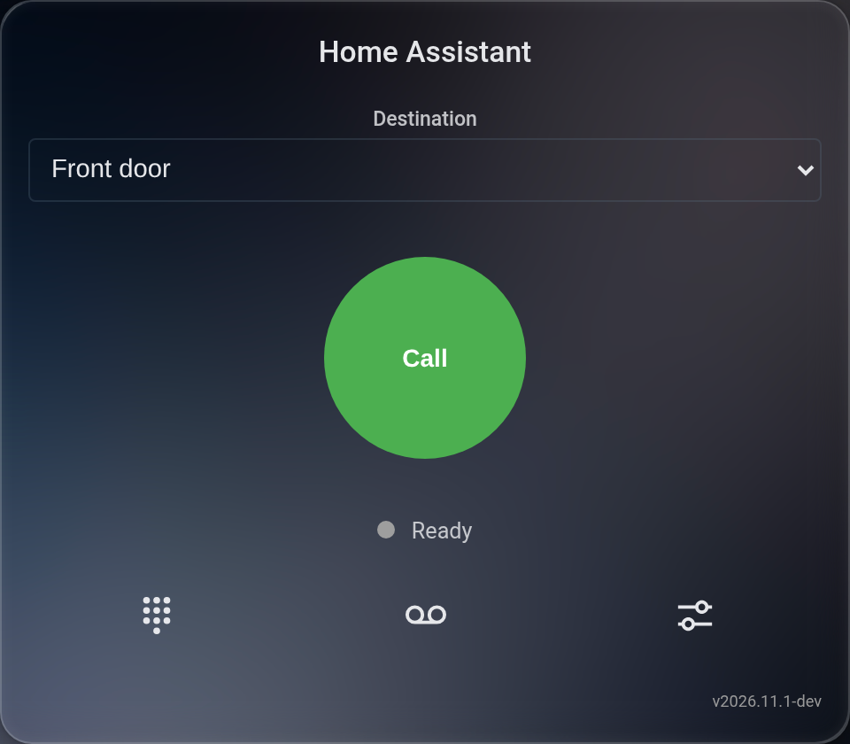 <b>Ready to call</b></td>
    <td width="50%">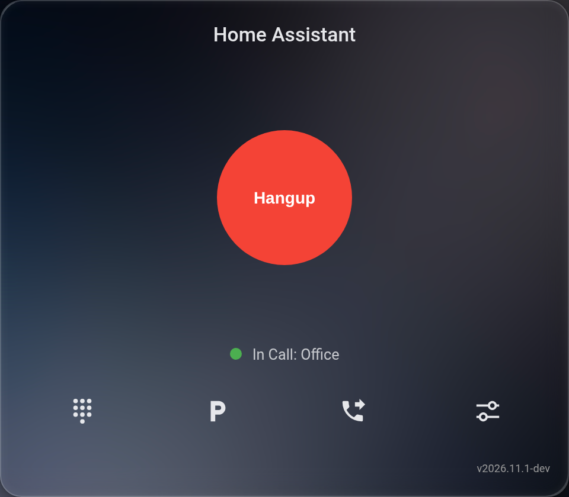 <b>In a call</b></td>
  </tr>
</table>

### Control an ESP phone

Put an ESP mirror on a dashboard to select that device's destination, place or
answer a call and hang up. The mirror is useful when you want the physical room
station to handle the conversation while HA provides its controls.

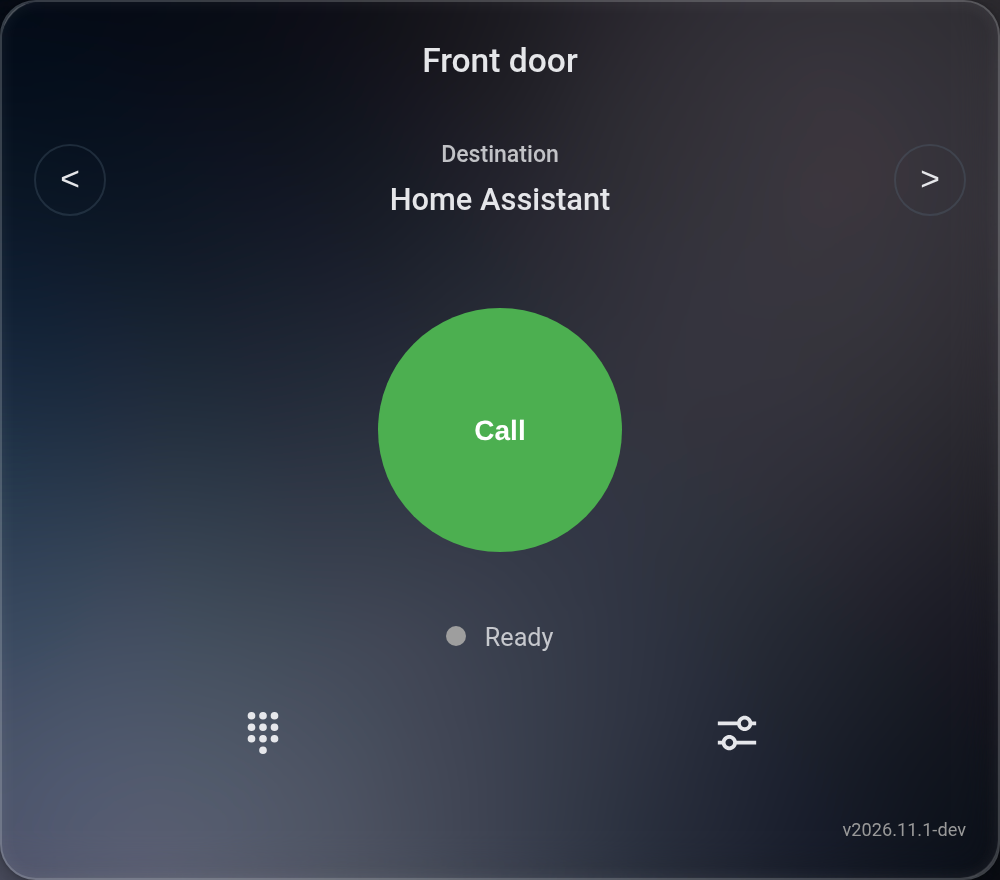

### Keep the shared phonebook in view

A phonebook card lists destinations from the shared directory. Use it beside
phone controls when you want a dedicated contact browser. It does not provision
another phone or require another microphone.

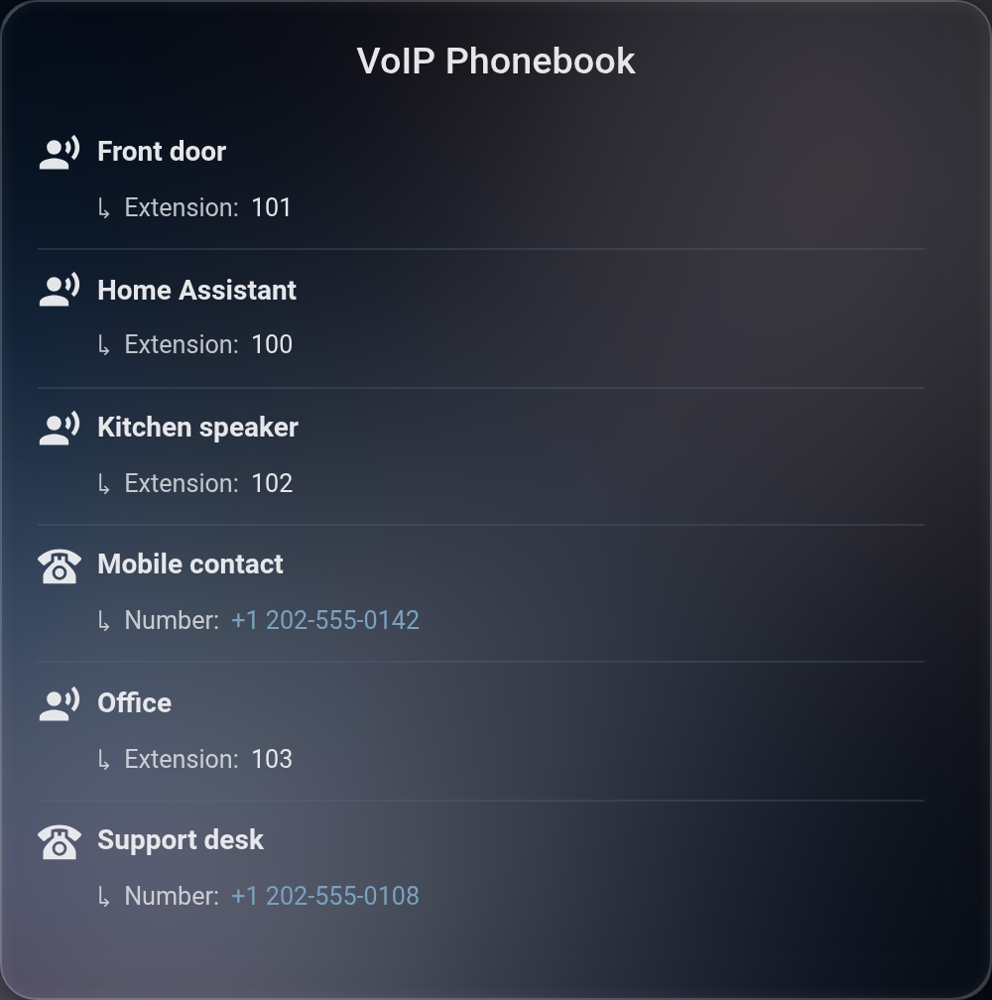

### Use the VoIP dashboard

The Dashboard brings the calling phone, extension activity and shared contacts
into one view. See who is ringing, busy, available or offline; inspect calls
and use the eligible pickup and call controls. Its visual editor asks for the
**Calling phone**, so the same view can serve a browser phone or an ESP.

See the [Dashboard demo at the top of this page](#voip-stack-for-home-assistant-and-esphome)
for incoming, active and held calls, presence, voicemail and Do Not Disturb.
The [card guide](docs/USER_GUIDE.md#choose-a-card-view) includes configuration
examples for both card types.

### Receive calls over another HA view

Enable call popups for an existing HA phone in the receiving browser or Companion
session. An incoming call can appear while you are looking at another HA view,
without a phone card on that view. The same phone can also have compact cards
or a Dashboard.

<table>
  <tr>
    <td width="50%">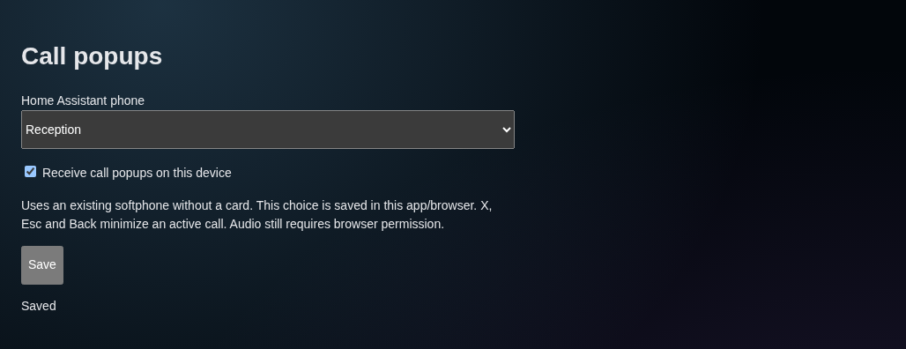 <b>Choose the receiving phone</b></td>
    <td width="50%">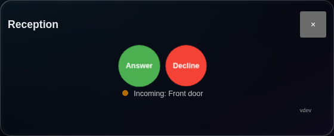 <b>Answer or decline</b></td>
  </tr>
</table>

Minimize a connected call to keep a small caller/timer bar, then reopen it when
needed. **Minimize keeps the call active; Hang up ends it.** You can receive
video in the popup too.

<table>
  <tr>
    <td width="65%">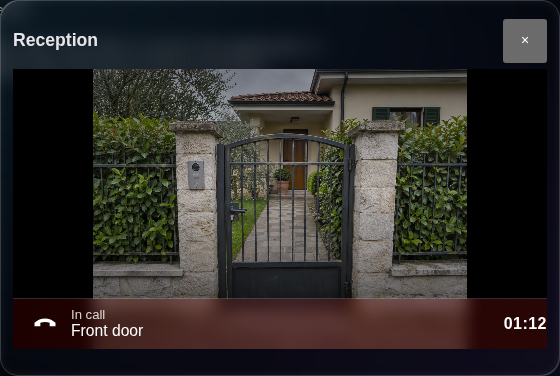 <em>Video popup demonstration with an illustrative camera feed.</em></td>
    <td align="center"> <b>Minimized call</b></td>
  </tr>
</table>

Browser and Companion media require a running HA frontend, a secure context and
media permissions. Mobile systems can suspend background clients. Enabled
logical HA phones retain their identity and no-answer rules without an open
card; actual browser audio and auto-answer need an active receiving client.
Companion uses its WebView, not a native operating-system telephone channel.
See [popup setup](docs/USER_GUIDE.md#receive-calls-over-other-home-assistant-views)
and [actionable notifications](docs/AUTOMATION_DIALPLAN.md#actionable-doorbell-notification).

## Shared contacts and live phone status (LDAP and BLF)

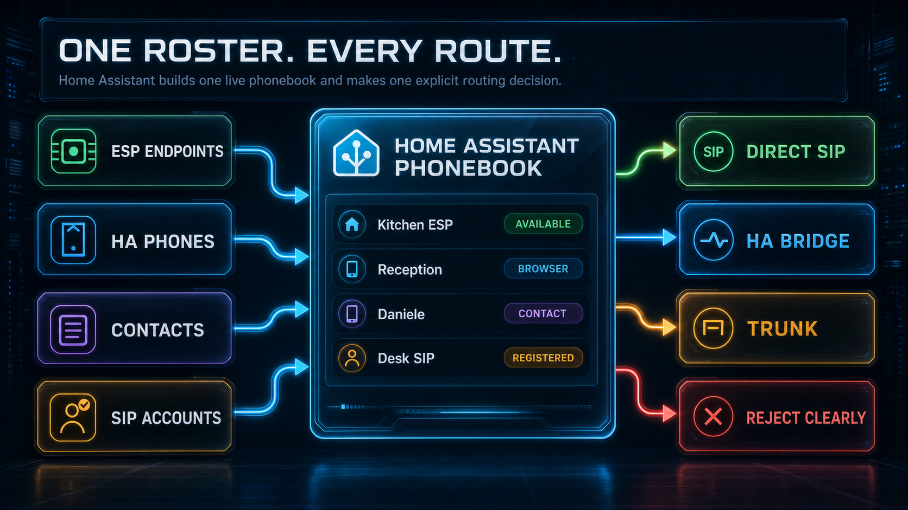

Maintain one directory for HA phones, managed ESP endpoints, registered SIP
accounts, contacts and callable services. Use recognizable names and extensions
on every phone. Managed ESP profiles receive their shared contacts through
LDAP; compatible SIP handsets can use the same directory.

**LDAP provides the contacts. BLF and SIP presence provide live status.** See
which extensions are ringing or busy before calling, and distinguish a phone
that is unavailable from a contact that still belongs in your directory.
The Dashboard and supported ESP contact lists show these states beside names.

**MWI provides per-account voicemail indicators**, including waiting-message
counts on compatible phones. It is separate from the address book and from
listening to the messages themselves.

Directory identities persist when a managed phone goes offline, so temporary
disconnection does not erase its name and extension. The [directory guide](docs/PHONEBOOK_PROTOCOL.md)
and [SIP busy-lamp setup](docs/USER_GUIDE.md#busy-lamps-on-sip-phones) explain
configuration, client compatibility and the three services.

## Transfer, park and pick up

### Put the caller through

Send an answered call to another contact from the card. The card's Transfer
control performs a blind transfer; a compatible SIP handset or softphone can
consult the other person first and complete an attended transfer.

"I'll put you through" is finally a feature, not just a threat.

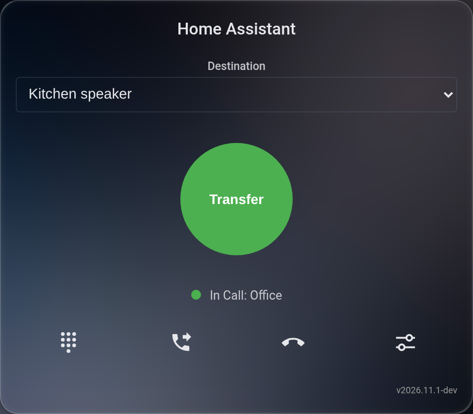

### Park here, continue over there

Park an established audio call, note the assigned slot and dial that slot from
another phone. The caller waits while you change rooms. Optional hold audio
comes from HA Media, and a parking timeout can return the call to a configured
phone.

The caller waits. You move. Nobody has to carry the wall-mounted kitchen tablet
upstairs.

<table>
  <tr>
    <td width="50%">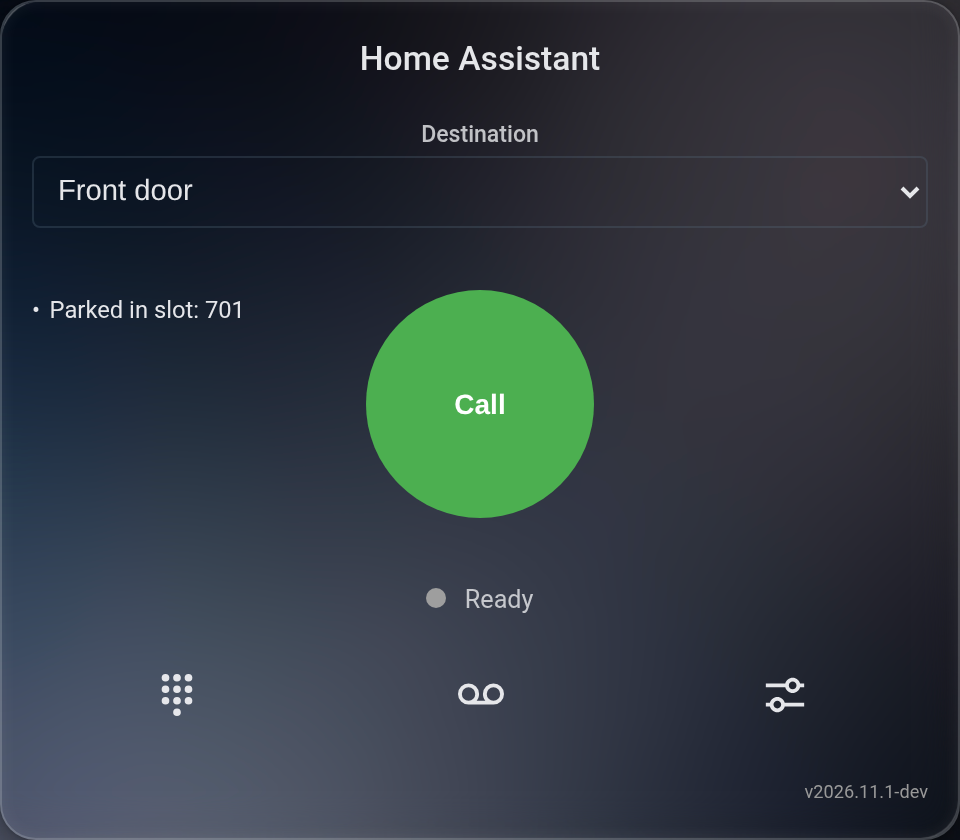 <b>Leave the caller on a slot</b></td>
    <td width="50%"> <b>Resume on another phone</b></td>
  </tr>
</table>

### Answer another ringing phone

Directed pickup lets your phone answer a call still ringing on another eligible
extension, including an audio ring-group member. Use the available Dashboard
control, native HA action or documented SIP feature code. A parking slot resumes
a parked conversation; pickup answers a phone that is still ringing.

See [transfer controls](docs/USER_GUIDE.md#forward-or-transfer-a-call) and
[parking and pickup](docs/CALL_PARKING.md) for the supported endpoint/media paths.

## Ring groups and audio conferences

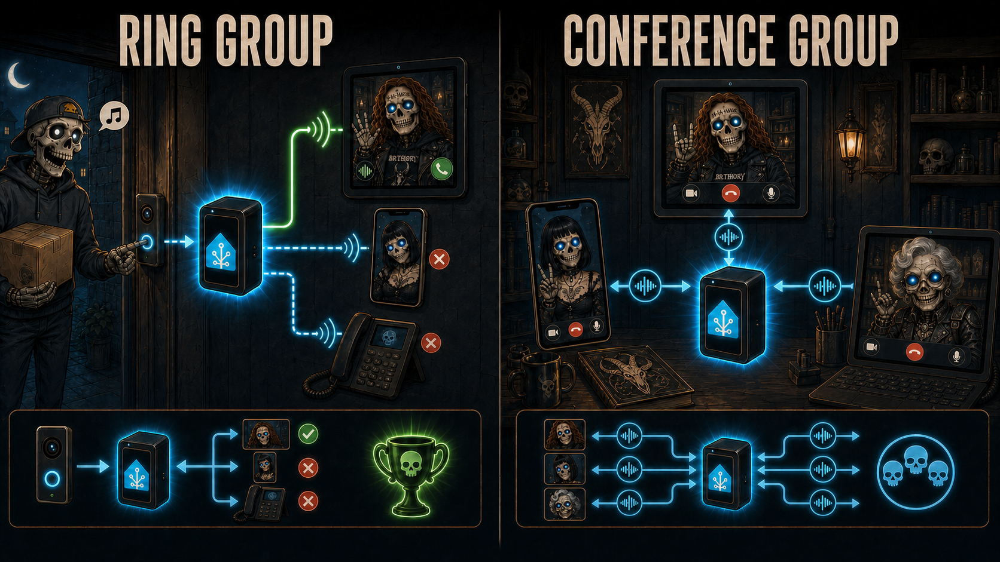

_Ring several phones, or bring participants together in an audio conference._

A **ring group** calls several eligible phones. The first answer wins and the
other phones stop ringing. Use it for the doorbell, a shared office extension
or several rooms. Busy, disabled and DND phones follow the group's eligibility
rules rather than competing indefinitely.

An **audio conference** joins participants in a room hosted by HA. Phones can
call the group, and optional conference ringing invites configured members.
Conferences are audio-only. Configure per-phone auto-answer deliberately when several
members should join without a manual answer.

[Group setup and membership](docs/GROUPS.md) covers ring groups, conferences
and who is invited. The [video guide](docs/SIP_VIDEO.md) identifies the routes
where video can be retained.

## Voicemail and conversation recordings

Give a phone its own mailbox, greeting and no-answer rule. A caller can leave
a message; you can listen, repeat or delete it from the phone card or the SIP
voicemail menu. Use DTMF from a compatible handset or ESP to navigate the menu,
and MWI to see whether that account has waiting messages.

<table>
  <tr>
    <td width="50%">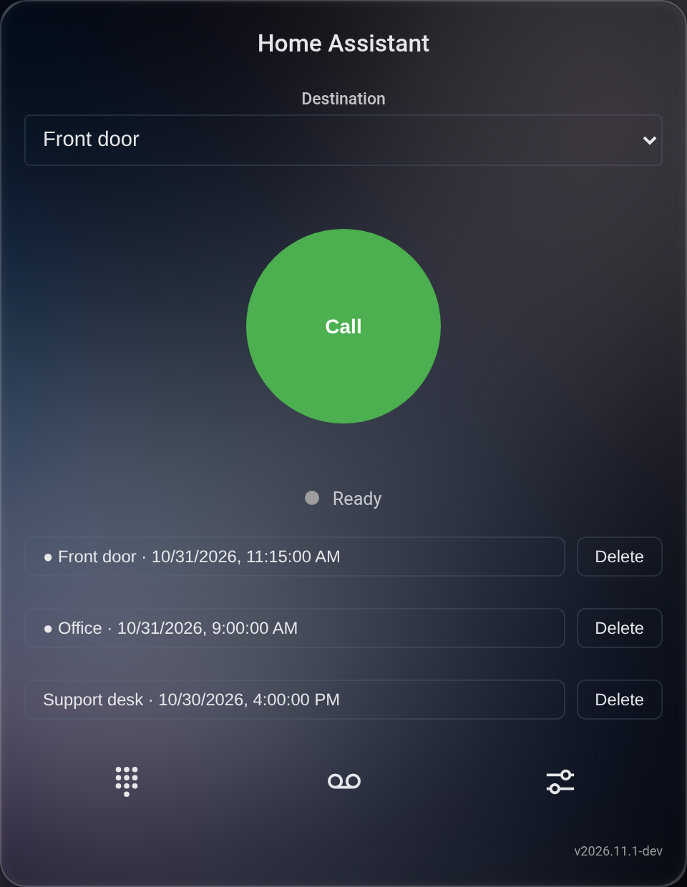 <b>Your phone's messages</b></td>
    <td width="50%">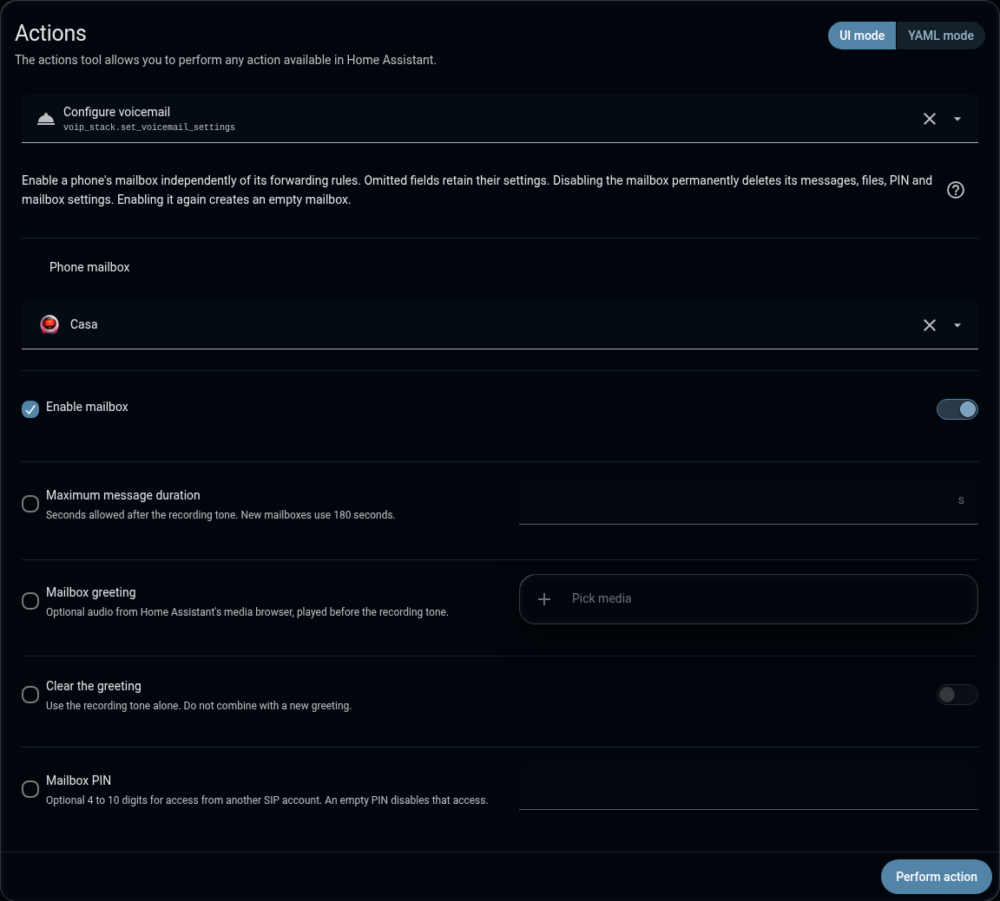 <b>Mailbox controls in HA</b></td>
  </tr>
</table>

Recordings appear in HA Media. Mailbox events and native actions let installed
HA services transcribe or deliver messages through your own automation. Enable
mailboxes only where needed; deposit, spoken navigation and forwarding are
separate choices, explained in the [voicemail guide](docs/VOICEMAIL.md).

**Conversation recording** captures a supported two-party audio call whose
media passes through HA. Start it explicitly from HA or the enabled card control;
hangup finishes the recording. Direct calls bypassing HA and conferences are
outside that recording scope. See [recording controls](docs/CALL_RECORDING.md).

## Let Home Assistant handle reception

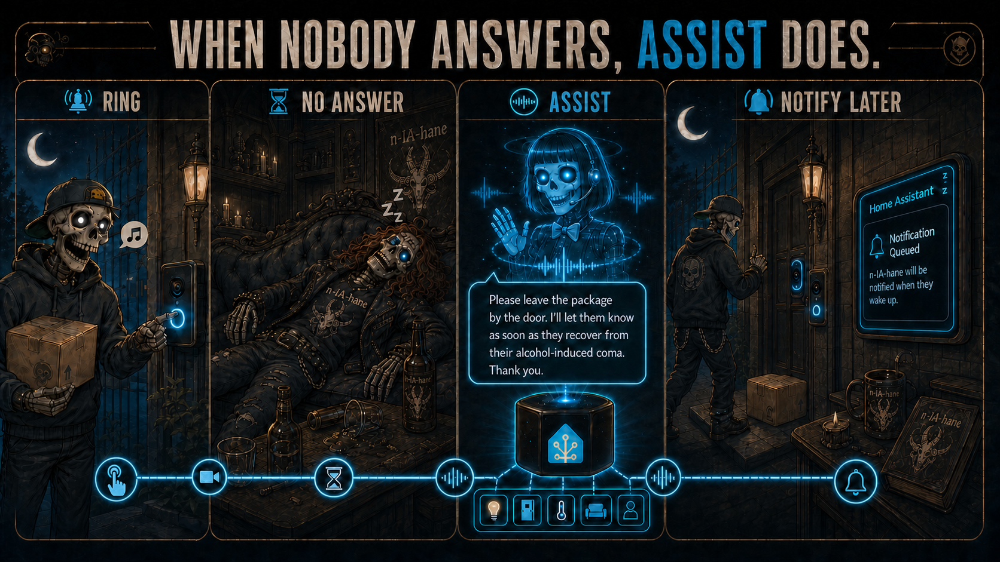

Route a call by presence, office hours or caller. Play a greeting, ask for a
keypad choice, ring a group, forward an unanswered call or send it to voicemail.
Build these steps with native HA triggers, conditions and actions in the normal
automation editor. Select phones and contacts by name.

Make an HA Assist pipeline callable as an extension. The caller can speak to
that pipeline, or an unanswered doorbell can be forwarded there. Its personality
comes from the conversation agent you configure. **Professional receptionist
and verbally abusive domestic secretary are both technically valid configurations.**

That callable HA pipeline is independent of the local wake-word Voice Assistant
on a FULL ESP. You can use both without making a phone call just to start the
satellite's normal assistant.

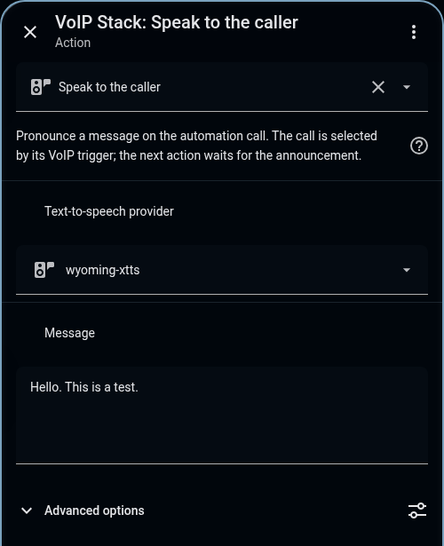

An **Automation contact** can also place a backend audio call to a reachable
ESP/SIP phone or external number through a selected trunk: wait for answer,
play TTS or HA Media, then hang up. Notifications can open the intended HA phone
and answer the identified call, or decline it with an explicit action.

Start with the [automation cookbook](docs/AUTOMATION_DIALPLAN.md),
[Assist voice commands](docs/ASSIST_INTENTS.md) and
[actionable doorbell notifications](docs/AUTOMATION_DIALPLAN.md#actionable-doorbell-notification).

## Standard SIP phones, accounts and outside lines

Register a desk phone, softphone or ATA directly with HA using its own account,
or configure a static SIP destination where appropriate. Phone names and
extensions let these devices call the same rooms, services and contacts used by
HA and ESP phones. SIP signaling supports UDP and TCP.

ESP phones can use multiple named SIP accounts and select the line for a call.
The normal HA integration can manage its account through the existing ESPHome
connection; manual registered accounts also let an ESP behave as an independent
phone with a compatible PBX. See [ESP accounts and lines](docs/ESP_REGISTRATION.md)
and [classic PBX compatibility](docs/CLASSIC_PBX.md). For PCM, G.722 and Opus
configuration, see [ESP audio codecs](docs/ESP_AUDIO_CODECS.md).

The classic-PBX guide includes Asterisk and FreeSWITCH examples for ESP
firmware alongside the normal HA-managed setup.

**Named trunks** connect providers or other PBXs. Configure multiple lines,
choose a phone's preferred outgoing line, select one for an action, and control
which phones may make external calls. Registered and static authorized trunks
have separate setup choices. Internal calling does not require a provider.

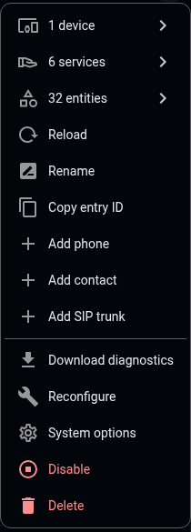

Media negotiation preserves compatible formats where possible. HA provides
supported conversion when peers need different formats, including optional
FFmpeg video conversion for otherwise incompatible routes. A JPEG ESP display
can therefore receive a supported H.264 upstream source through an appropriately
configured HA route; S3 does not need an H.264 decoder for that arrangement.

Use the [trunk guide](docs/SIP_TRUNK.md) for credentials, line selection and
external-call access, and the [video compatibility matrix](docs/SIP_VIDEO.md)
for codecs and endpoint limits.

## Installation

Requires **Home Assistant 2026.7.0 or newer**. Choose one channel:

| Channel | Version | Starting point |
| --- | --- | --- |
| [Stable](https://github.com/n-IA-hane/esphome-intercom/releases/tag/v2026.11.0) | **2026.11.0** | Stable PBX and phone cards, with matching firmware from `main`. |
| [Preview](https://github.com/n-IA-hane/esphome-intercom/releases/tag/v2026.11.1-dev) | **2026.11.1-dev** | The Dashboard, popups and current ESP/directory features presented here. |

The preview is updated under the same version. If HACS already shows
**2026.11.1-dev**, use **Redownload** to receive its current archive, then
restart HA and reload the frontend. A changed archive under the same version
does not produce a new-version update notification.

### Fastest start

1. Find **VoIP Stack** in HACS, choose **Download** and your version, then restart
   HA. For an existing installation, use **Redownload** to select the version.
2. Add **VoIP Stack** under **Settings > Devices & services > Add integration**.
3. Keep the HA phone created during setup, then use **Add phone** to create a
   second browser phone. Give each a recognizable name and optional extension.
4. Add a **VoIP Stack** card for each phone and select its Phone in the visual
   editor. The preview also offers the **VoIP Dashboard** card.
5. Open the phones on separate devices or browser sessions, allow microphone
   access and call the other phone from the shared phonebook. Answer, speak in
   both directions, hang up and call again.

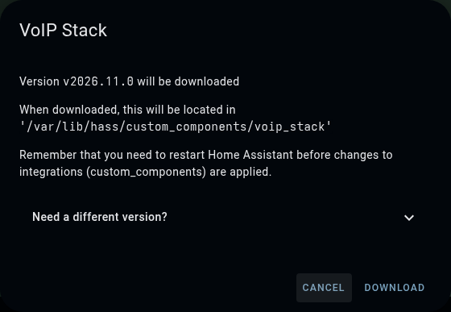

The cards register automatically. Keep the default network settings unless
another service conflicts; see the [deployment guide](docs/DEPLOYMENT_GUIDE.md)
for containers, advertised addresses and manual installation. To receive calls
over other HA views, enable [call popups](docs/USER_GUIDE.md#receive-calls-over-other-home-assistant-views)
for an existing HA phone in each receiving browser or Companion app.

An ESP joins through the normal ESPHome integration with its matching firmware.
HACS updates HA and the frontend; rebuilding and uploading ESP firmware is a
separate operation. Follow [migration notes](docs/BREAKING_CHANGES.md) when
updating a copied configuration.

## Supported hardware

Choose the exact profile, rather than a board with a similar chip name.
Statuses below retain the existing profile evidence; they do not certify every
silicon revision or workload. The [catalog](packages/DEVICE_CATALOG.md) also
lists VoIP-only and experimental choices.

| Device/profile | Support |
| --- | --- |
| [Spotpear Ball v2](yamls/full-experience/single-bus/spotpear-ball-v2-full-afe.yaml) | Field tested |
| [Waveshare ESP32-S3 Audio Board](yamls/full-experience/single-bus/waveshare-s3-full-afe.yaml) | Field tested |
| [Waveshare ESP32-S3 Touch LCD 1.85C-BOX V2](yamls/full-experience/single-bus/waveshare-s3-touch-lcd-1.85c-box-v2-full.yaml) | Supported FULL AEC/downmix or dual-microphone AFE |
| [Waveshare ESP32-P4 Touch LCD, full JPEG videophone](yamls/full-experience/single-bus/waveshare-p4-touch-full-afe-landscape-videophone-jpeg.yaml) | Field tested |
| [Waveshare ESP32-P4 Touch LCD, portrait](yamls/full-experience/single-bus/waveshare-p4-touch-full-afe-portrait.yaml) | Experimental layout |
| [Generic ESP32-S3, single bus](yamls/full-experience/single-bus/generic-s3-full-aec.yaml) | Reference profile |
| [Generic ESP32-S3 with DVP JPEG camera](yamls/full-experience/single-bus/generic-s3-full-aec-camera.yaml) | Reference wiring for Freenove FNK0085 N8R8; camera transmission |
| [Generic ESP32-S3, single bus, 4 MB flash](yamls/full-experience/single-bus/generic-s3-full-lite-aec.yaml) | Experimental; limited OTA headroom |
| [Generic ESP32-S3, dual bus](yamls/full-experience/dual-bus/generic-s3-full-aec.yaml) | Reference profile |
| [Native ESPHome mic/speaker](yamls/full-experience/esphome-native/generic-s3-full-esphome-native.yaml) | Reference profile |

For firmware compatibility with an existing PBX, ESP phones can use static
peers or manually configured registered accounts while keeping their other
ESPHome features. See [classic PBX setup](docs/CLASSIC_PBX.md) and
[registered ESP lines](docs/ESP_REGISTRATION.md).

## Find the task you need

| Task | Guide |
| --- | --- |
| Add phones, choose a card, answer or transfer | [User guide](docs/USER_GUIDE.md) |
| Configure voicemail, parking, pickup and recording | [PBX walkthrough](docs/PBX_WORKFLOWS.md) |
| Connect a door station or check video formats | [SIP video](docs/SIP_VIDEO.md) · [Dahua](docs/DAHUA.md) |
| Build greetings, routing or notifications | [Automation cookbook](docs/AUTOMATION_DIALPLAN.md) |
| Choose firmware features or customize hardware | [Device guide](yamls/README.md) · [Packages](packages/README.md) |
| Diagnose a failed call or report a problem | [Troubleshooting](docs/troubleshooting.md) · [Issue guidance](#before-opening-an-issue) |
| Explore the complete documentation | [Documentation index](docs/README.md) |

## Before opening an issue

For a report, include the installed versions, affected hardware, exact call
route, reproduction and relevant diagnostics with secrets removed. A passing
build is not proof of working audio or video; the
[testing guide](docs/TESTING_AND_DEBUG.md) explains useful evidence.

Developed and maintained by n-IA-hane, with community contributions.
[Development guidance](docs/TESTING_AND_DEBUG.md), [sponsorship](https://github.com/sponsors/n-IA-hane)
and useful bug reports help the project. Project code is [MIT licensed](LICENSE);
external components retain their own licenses.
