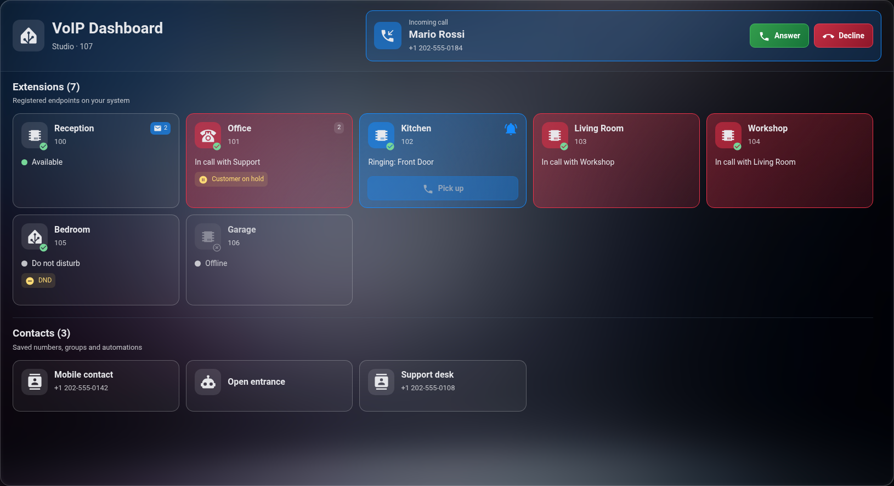
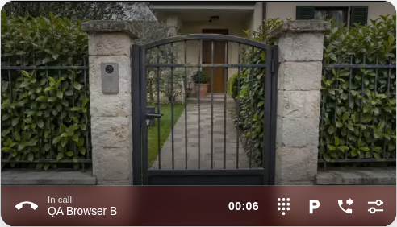
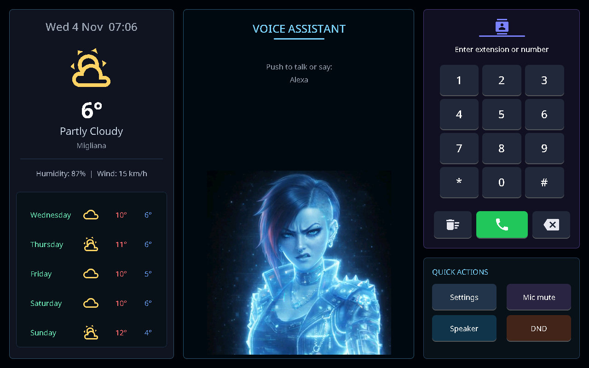
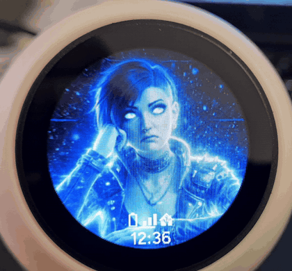

# VoIP Stack for Home Assistant and ESPHome

**An independent, open-source SIP PBX running inside Home Assistant, installable through HACS.**

_Dashboard demo showing incoming, active and held calls, presence, voicemail and Do Not Disturb._

Receive audio and video calls from your SIP doorbell and answer from Home
Assistant cards, the Companion app or supported ESP32 videophones. Make and
receive calls between rooms, SIP phones and softphones through your own Home
Assistant PBX.

Give the kitchen tablet, office browser and wall phone their own names and
extensions. Bring existing SIP equipment into the same directory, then decide
who rings, what happens when nobody answers and which Home Assistant actions
follow a call. Start with the phones you already have; ESP hardware is optional.

**[See the possibilities](#what-can-you-build) · [ESP phones](#esp-phones-and-full-voice-devices) · [Features](#the-phone-system) · [Install](#installation) · [Choose hardware](#supported-hardware)**

## What can you build?

### Answer your door from the right room

See the caller, speak through the door station and use the in-call keypad
to operate a configured door release. Answer on a tablet, in the Companion app or on a supported ESP
videophone.

<table>
  <tr>
    <td width="50%"></td>
    <td width="50%"></td>
  </tr>
  <tr>
    <td><em>A video call with a MOBOTIX door station in the VoIP Stack Home Assistant card.</em></td>
    <td><em>Dashboard doorbell-call demonstration using an illustrative gate-camera feed.</em></td>
  </tr>
</table>

### Run your home phone system

Call another room, ring several phones together, transfer a conversation or
park it and continue elsewhere. Let an unanswered caller leave a message.
Use one compact phone card per room, or the Dashboard to see extensions and
control the selected phone. Optional call popups can appear over other Home
Assistant views.

### Let Home Assistant handle reception

Route the doorbell according to presence or office hours, send an actionable
mobile notification, or forward an unanswered call to Assist. Call an Assist
pipeline by extension, play a greeting and build a keypad menu with native HA
automations. Your assistant can be a professional receptionist or a verbally
abusive domestic secretary. That part is your prompt's problem.

## ESP phones and full voice devices

Supported ESP32 boards become real SIP phones. A suitable camera-and-display
profile makes a videophone that sends its camera and displays the remote
party, with two-way audio. Call it from Home Assistant, another ESP or standard
SIP equipment.

FULL profiles combine that telephone with local Assist, Micro Wake Word, music,
TTS, timers and optional Sendspin. Keep a headless voice-and-music device, or
use a supported display for contacts, dialing, call controls and assistant
artwork. A local wake-word interaction and a SIP call to HA Assist are separate
features; choose either or both.

_P4 native screen: weather, Voice Assistant and VoIP._

<table>
  <tr>
    <td align="center"> <b>Local Voice Assistant</b></td>
    <td align="center"> <b>Music, replies and barge-in</b></td>
  </tr>
</table>

P4 videophone profiles provide camera and receive-display paths. S3 camera
transmission and JPEG receive display are separate capabilities: receiving
needs the matching display/renderer package, and S3 does not decode H.264.
During negotiated video, maintained FULL profiles pause Micro Wake Word and
resume it afterward when enabled and ready.

Use the [device guide](yamls/README.md) and [feature examples](packages/README.md)
for the exact board and applications you want. Building firmware requires
**ESPHome 2026.10.0 or newer**; installing the HA integration does not.

## Shared contacts and live phone status (LDAP and BLF)

Keep one shared phonebook across Home Assistant, managed ESP phones and
compatible SIP handsets. Standard LDAP supplies contact names and extensions,
so each phone can use the same directory.

See which extensions are ringing or busy before calling. BLF busy lamps and
SIP presence carry live call and availability updates; the Dashboard and
supported ESP contact lists show those states beside the names. Per-account
MWI indicators tell you when voicemail is waiting.

Use the [directory guide](docs/PHONEBOOK_PROTOCOL.md) and
[SIP busy-lamp setup](docs/USER_GUIDE.md#busy-lamps-on-sip-phones) for compatible
phones. Directory records, live status and voicemail indicators are separate
capabilities; each client must support the services it uses.

## The phone system

The current development preview offers these eight feature families. The
[release notes](CHANGELOG.md) identify differences from stable.

| Family | What it provides |
| --- | --- |
| **Calls and controls** | Named room/app phones, audio and video calls, compact HA phone and ESP mirror cards, a phonebook view, Dashboard, optional popups, DND, auto-answer, forwarding, audio-call parking/retrieval, blind transfer and consultation-based attended transfer on compatible SIP phones. |
| **Groups** | Ring groups with first-answer handling, directed pickup and HA-hosted audio conferences. |
| **Mailboxes and recordings** | Per-phone voicemail, greetings, SIP mailbox access, message playback and deletion, HA Media access, optional transcription/delivery through installed HA services, and conversation recording. |
| **Directory and indicators** | Share contacts and extensions through standard LDAP. Compatible phones can show busy lamps (BLF), availability and per-account voicemail message indicators (MWI). |
| **Registration and lines** | Local REGISTER accounts for standard SIP clients, multiple optional ESP account lines, UDP/TCP signaling, named provider trunks, explicit line selection and static source-IP trunk authorization. |
| **Assist and automation** | Callable HA Assist, native call triggers/actions, presence and schedule routing, announcements, unanswered-call handling, DTMF menus and in-call keypad actions. |
| **ESP firmware** | Standalone VoIP-only endpoints or FULL voice devices with independently selected applications, including supported camera and display paths. |
| **Media** | Keep compatible audio/video direct and convert between supported formats where needed. Optional FFmpeg video transcoding connects otherwise incompatible peers. |

Video depends on the selected endpoint and call route. Conferences are
audio-only, and ring groups do not preserve video across every SIP route.
See the [video matrix](docs/SIP_VIDEO.md) before choosing a camera or door station.

Browser and Companion audio need a running HA frontend, a secure context and
media permissions. Mobile systems can suspend background clients. Logical
ringing and no-answer rules continue without an open card; audible browser
calls and auto-answer need an active receiving client.

## Installation

Requires **Home Assistant 2026.7.0 or newer**. Choose one channel:

| Channel | Version | Starting point |
| --- | --- | --- |
| [Stable](https://github.com/n-IA-hane/esphome-intercom/releases/tag/v2026.11.0) | **2026.11.0** | Stable PBX and phone cards, with matching firmware from `main`. |
| [Preview](https://github.com/n-IA-hane/esphome-intercom/releases/tag/v2026.11.1-dev.1) | **2026.11.1-dev.1** | The Dashboard, popups and current ESP/directory features presented here. |

### Fastest start

1. Find **VoIP Stack** in HACS, choose **Download** and your version, then restart
   HA. For an existing installation, use **Redownload** to select the version.
2. Add **VoIP Stack** under **Settings > Devices & services > Add integration**.
3. Keep the HA phone created during setup, then use **Add phone** to create a
   second browser phone. Give each a recognizable name and optional extension.
4. Add a **VoIP Stack** card for each phone and select its Phone in the visual
   editor. The preview also offers the **VoIP Dashboard** card.
5. Open the phones on separate devices or browser sessions, allow microphone
   access and call the other phone from the shared phonebook. Answer, speak in
   both directions, hang up and call again.

The cards register automatically. Keep the default network settings unless
another service conflicts; see the [deployment guide](docs/DEPLOYMENT_GUIDE.md)
for containers, advertised addresses and manual installation. To receive calls
over other HA views, enable [call popups](docs/USER_GUIDE.md#receive-calls-over-other-home-assistant-views)
for an existing HA phone in each receiving browser or Companion app.

An ESP joins through the normal ESPHome integration with its matching firmware.
HACS updates HA and the frontend; rebuilding and uploading ESP firmware is a
separate operation. Follow [migration notes](docs/BREAKING_CHANGES.md) when
updating a copied configuration.

## Supported hardware

Choose the exact profile, rather than a board with a similar chip name.
Statuses below retain the existing profile evidence; they do not certify every
silicon revision or workload. The [catalog](packages/DEVICE_CATALOG.md) also
lists VoIP-only and experimental choices.

| Device/profile | Support |
| --- | --- |
| [Spotpear Ball v2](yamls/full-experience/single-bus/spotpear-ball-v2-full-afe.yaml) | Field tested |
| [Waveshare ESP32-S3 Audio Board](yamls/full-experience/single-bus/waveshare-s3-full-afe.yaml) | Field tested |
| [Waveshare ESP32-S3 Touch LCD 1.85C-BOX V2](yamls/full-experience/single-bus/waveshare-s3-touch-lcd-1.85c-box-v2-full.yaml) | Supported FULL AEC/downmix or dual-microphone AFE |
| [Waveshare ESP32-P4 Touch LCD, full JPEG videophone](yamls/full-experience/single-bus/waveshare-p4-touch-full-afe-landscape-videophone-jpeg.yaml) | Field tested |
| [Waveshare ESP32-P4 Touch LCD, portrait](yamls/full-experience/single-bus/waveshare-p4-touch-full-afe-portrait.yaml) | Experimental layout |
| [Generic ESP32-S3, single bus](yamls/full-experience/single-bus/generic-s3-full-aec.yaml) | Reference profile |
| [Generic ESP32-S3 with DVP JPEG camera](yamls/full-experience/single-bus/generic-s3-full-aec-camera.yaml) | Reference wiring for Freenove FNK0085 N8R8; camera transmission |
| [Generic ESP32-S3, single bus, 4 MB flash](yamls/full-experience/single-bus/generic-s3-full-lite-aec.yaml) | Experimental; limited OTA headroom |
| [Generic ESP32-S3, dual bus](yamls/full-experience/dual-bus/generic-s3-full-aec.yaml) | Reference profile |
| [Native ESPHome mic/speaker](yamls/full-experience/esphome-native/generic-s3-full-esphome-native.yaml) | Reference profile |

For firmware compatibility with an existing PBX, ESP phones can use static
peers or manually configured registered accounts while keeping their other
ESPHome features. See [classic PBX setup](docs/CLASSIC_PBX.md) and
[registered ESP lines](docs/ESP_REGISTRATION.md).

## Find the task you need

| Task | Guide |
| --- | --- |
| Add phones, choose a card, answer or transfer | [User guide](docs/USER_GUIDE.md) |
| Configure voicemail, parking, pickup and recording | [PBX walkthrough](docs/PBX_WORKFLOWS.md) |
| Connect a door station or check video formats | [SIP video](docs/SIP_VIDEO.md) · [Dahua](docs/DAHUA.md) |
| Build greetings, routing or notifications | [Automation cookbook](docs/AUTOMATION_DIALPLAN.md) |
| Choose firmware features or customize hardware | [Device guide](yamls/README.md) · [Packages](packages/README.md) |
| Diagnose a failed call or report a problem | [Troubleshooting](docs/troubleshooting.md) · [Issue guidance](#before-opening-an-issue) |
| Explore the complete documentation | [Documentation index](docs/README.md) |

## Before opening an issue

For a report, include the installed versions, affected hardware, exact call
route, reproduction and relevant diagnostics with secrets removed. A passing
build is not proof of working audio or video; the
[testing guide](docs/TESTING_AND_DEBUG.md) explains useful evidence.

Developed and maintained by n-IA-hane, with community contributions.
[Development guidance](docs/TESTING_AND_DEBUG.md), [sponsorship](https://github.com/sponsors/n-IA-hane)
and useful bug reports help the project. Project code is [MIT licensed](LICENSE);
external components retain their own licenses.
