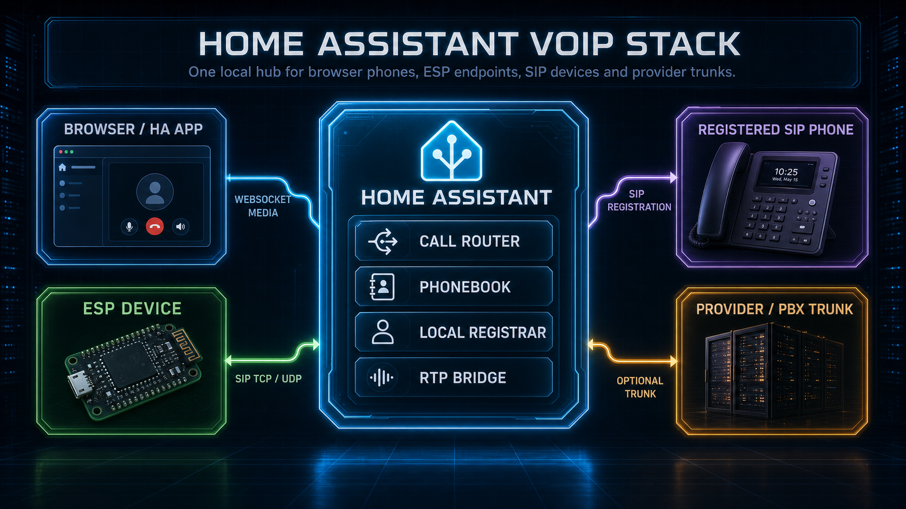

# SIP architecture

This document describes the active VoIP architecture. It intentionally does not
describe the retired proprietary intercom protocol except by omission: SIP,
SDP and RTP are the functional primitives.



## Product model

Every ESP running `voip_stack` is a SIP user agent:

- it can originate and receive SIP calls;
- it supports direct SIP and optional registered PBX accounts;
- registered accounts use Digest authentication; direct operation remains the
  generic default;
- it accepts compatible PCM SDP and rejects incompatible media with SIP status;
- it can run full-duplex, mic-only or speaker-only; signaling-only endpoints
  are rejected because every VoIP endpoint must expose real audio media.

Inbound reachability is deliberately independent of roster membership. The
phonebook is a dial plan, not a caller allowlist: a reachable compatible SIP
peer can call an ESP even when it is unknown to HA and has no registration.

Home Assistant is more than a card backend:

- HA is its own SIP softphone endpoint;
- HA is the central phonebook/dial-plan publisher;
- HA is a SIP router/B2BUA for logical names, numbers, bridge requests and
  transport boundaries;
- HA supports independently configured provider/PBX trunks, registered or static;
- HA can optionally act as a local registrar for standard SIP endpoints such as
  Zoiper, Linphone, baresip or pjsua;
- HA can optionally expose one native Assist pipeline as a local phonebook
  destination.

The default install needs no user dialplan. Direct ESP calls happen when the
phonebook has complete direct SIP endpoint data. Logical names, numeric targets
and external numbers go to HA, which decides whether to answer locally, forward
to a local endpoint, bridge, group-call, use the trunk or reject.

## Components

```text
ESP voip_stack
  SIP UA + optional REGISTER/MWI/BLF + SDP + RTP + bounded local phonebook
  optional LDAP directory and IMAP MediaSource clients

Home Assistant voip_stack
  HA softphone + SIP UDP/TCP endpoint + router/B2BUA + RTP relay/resampler
  + central phonebook + optional local registrar + optional trunk client
  + optional native Assist pipeline media consumer

Lovelace card
  ESP mirror mode: ESPHome entities and ESP buttons
  HA softphone mode: HA softphone snapshot, commands and browser audio socket
```

Component ownership:

- `voip_stack` owns ESP SIP signaling, RTP sockets, selected call formats and
  the public ESP call state.
- `esp_audio_stack`, native ESPHome microphone/speaker components, `esp_aec`
  and `esp_afe` own physical audio capture/playback and processing.
- `voip_stack` owns HA-side SIP dialogs, route decisions, trunk
  registration, local SIP endpoint registrations, HA softphone media sessions
  and the optional Assist call adapter.
- Cards never own the call FSM. They render state pushed by the owner and send
  user commands back to that owner.

Home Assistant actions and card configuration select the local phone only by
`device_id`. The backend also assigns an internal `endpoint_id` in a common
namespace covering browser phones, ESPHome phones and registered SIP accounts.
That identifier lets the protocol core correlate a logical phone, call leg and
media owner without depending on Home Assistant Device Registry APIs. It is
reported in runtime snapshots for diagnostics and correlation, but it is not a
second user-selectable identity and is never stored by new card configuration.

### HA runtime ownership model

The SIP dispatcher resolves each call through one dial plan. The PBX session
core owns its participants, media resources and termination.

- `SipEndpointRuntime` owns endpoint-wide components such as listeners,
  registrar, trunk and conference manager.
- `EndpointCallSession` is the authoritative owner of one logical call,
  including its generation, legs, tasks, media reservations and cleanup
  barrier.
- `CallLeg` represents one SIP, browser, ESP, trunk or Assist participant.
- `DialForkController` supplies the shared first-answer-wins primitive used by
  ring groups and other parallel dial attempts.
- `AnswerTransaction` implements prepare, final response and commit with
  rollback of ports, sockets and optional video resources.
- `ActiveMediaCall` resolves the one generation-current browser media session
  from `SipEndpointRuntime`. Audio and video WebSocket views
  subscribe to the same call-lifetime primitive instead of maintaining
  independent interpretations of when a call has ended.
- audio and video renegotiation commit the complete media contract before they
  increment its generation and wake attached WebSockets. Consumers therefore
  never observe a new generation with a partially updated RTP destination,
  direction or codec description.
- bridged audio and video peer changes are staged independently but preflighted
  together. A commit is rejected if either relay leg or the owning call
  generation changed while the SIP answer was in flight, so a late re-INVITE
  cannot leave audio and video on different peer revisions.
- public HA state observations follow an explicit call-phase transition graph.
  The intentional `connecting -> ringing` fallback remains valid, while a late
  provisional event cannot regress an established dialog back to `calling` or
  `ringing`.

### Committed state and read-only consumers

The runtime commits nested synchronous mutations as one operation and produces
an immutable `CallStateSnapshot`. The snapshot includes participant states and
the relevant media attributes read from their existing SIP owners. It is a
read model, not another session registry or signaling state machine.

The selected browser participant is updated by the same registry operation as
its call. Its state is not copied indiscriminately from the aggregate session:
an already answered caller can remain connected while a replacement destination
is still ringing. A SIP destination must not acquire a synthetic browser leg.
An existing, claimed browser participant also survives a change of application
owner, such as entering voicemail. Application ownership must not freeze that
participant in `calling`, reopen a released participant, or return an answered
caller to ringing while another route is being prepared.
Observing a phone's activity does not grant browser media ownership. The card's
view of the phone and the participant that actually sends or receives audio
remain distinct. Associating several registered devices with one extension is
not introduced by this consolidation and must preserve that distinction.

`PhoneStateObserver` consumes committed changes directly. BLF, phone-state
actions, conditions and phone-state triggers therefore do not need a card event
to discover an accepted transition. `CallStatePublisher` uses the existing HA
projection adapters for browser state delivery, with at most one pending loop
callback per generation. Explicit operation events retain their existing commit
points; automatic presentation updates are `state_changed` observations, not
new claims that an answer or transfer succeeded. Delivery bookkeeping is cleared
on termination and component shutdown.

Reading or publishing event fields does not mutate a materialised call. Internal
operations use a `CallPrecondition` containing the call identity, generation,
owner and committed sequence. Public `expected_state` and `expected_sequence`
arguments retain their names and are validated centrally; an explicitly selected
phone is checked against its own participant. Incoming `ringing` and outgoing
`remote_ringing` describe the two perspectives of the unanswered phase, not two
independent call states.

ESPHome sensor updates cannot release a PBX-owned endpoint or replace its control
context. For an HA-anchored call, an ESP observation retains the native value as
`reported_state`, while its public state follows the canonical participant and
its event type is `state_changed`. Answered and ended operations come from the
PBX owner. Direct ESP calls that bypass HA remain passive observations in the
same registry; observing them does not give HA ownership of their SIP dialogs.

`AnswerTransaction` defers state notifications until its commit or compensation
finishes. A rejected or exceptional state claim uses `SessionHandoff` to restore
the previous participants, routing artifacts and call identity before prepared
resources are released. The original resource objects keep their existing owners.
The architecture tests reject direct lifecycle writes outside those owners and
call mutations inside the event-publication functions.

Termination is generation-guarded, idempotent and cancellation-safe. The
session enters `terminating` synchronously, then waits for a shielded cleanup
barrier so late dial winners, media callbacks or duplicate BYE/CANCEL observers
cannot resurrect the call. A transport callback may claim that terminal state
before handing off a transport adapter, but only `EndpointCallSession` starts
and owns the cleanup barrier. `SipEndpointRuntime` records the bounded
tombstone needed to absorb delayed SIP observations and never starts a second
teardown.

Card commands use standard Home Assistant service actions. Outbound card calls
request the optional response from `voip_stack.call`; the backend returns the
authoritative endpoint snapshot instead of making the frontend infer a new
Call-ID or state. Integration-specific WebSocket subscriptions remain where
they carry live call/media presence rather than one-shot commands.

`endpoint_runtime.py` assembles the canonical dispatcher from the routing and
session primitives. New routing policy must enter that dispatcher and must not
create a parallel lifecycle or dial plan.

## Call control

All call control is SIP:

- outbound call: `INVITE`
- provisional ringing: `180 Ringing`
- answer: `200 OK` plus `ACK`
- caller cancellation before answer: `CANCEL` and `487 Request Terminated`
- established hangup: `BYE`
- busy/DND: `486 Busy Here`
- declined: `603 Decline`
- incompatible media: `488 Not Acceptable Here`
- registered ESP account challenges: Digest with the selected account;
- direct calls without account credentials: unsupported authentication is
  reported as `auth_required_unsupported`;
- optional HA trunk registration: a separate `REGISTER` toward its configured
  provider/PBX.

ESP accounts register directly with a compatible PBX, independently of HA's
own provider trunk. Maintained HA phone packages provision one managed account
through the existing ESPHome API. Generic firmware can retain direct SIP,
configure external accounts or combine both. See
[standard phone services](ESP_PHONE_SERVICES.md).

For outbound INVITE failures, HA sends the required ACK for non-2xx final
responses before surfacing the terminal reason. This keeps failed calls SIP
compliant rather than relying on retry side effects.

ESP endpoints accept compatible hold/resume direction changes while retaining
their prepared audio path. Unsupported changes receive `488 Not Acceptable
Here` without replacing or tearing down the original dialog.

HA-owned dialogs accept a compatible peer-initiated re-INVITE or UPDATE. The
new offer may change direction, RTP destination, payload type, packet duration
or another audio format already supported on that leg. An established video
stream may be held and resumed or move its RTP endpoint only while its codec
contract remains compatible. A direct HA-browser dialog may also add or remove
a compatible video stream. A SIP-to-SIP bridge can add video to an audio-only
call by sending a serialized re-INVITE on the destination dialog. HA answers
the source only after the destination accepts and a direct or transcoded relay
is ready. HA stages the replacement resources and commits only the current call
generation. Rejected or stale updates leave the original audio session usable,
and a later BYE still terminates it normally.

Confirmed dialogs retain the remote Contact and every Record-Route value. UAC
route sets reverse the response order, UAS route sets preserve request order,
and subsequent ACK/BYE requests follow RFC 3261 loose or strict routing instead
of bypassing an intervening proxy.

## Media

SDP offer/answer negotiates RTP. RTP media is always UDP, even when SIP
signaling uses TCP.

ESP firmware selects PCM or Opus at compile time. FULL and P4 profiles use
linear PCM with network byte order on RTP; maintained ESP32-S3 VoIP-only
profiles can use Opus. Unsupported media receives `488 Not Acceptable Here`
or the equivalent terminal reason. See the [ESP media profile](voip_profile.md#sdp-and-rtp).

HA can accept richer media on softphone/trunk legs when it has a bidirectional
converter for the selected codec. Optional codecs are capability-gated and are
not advertised when the runtime cannot encode and decode them. The goal is
best-quality-per-leg:

- a browser, phone or trunk leg can negotiate Opus, G.722, G.711 or high-rate
  PCM as its own capability permits;
- G.722 uses the RFC 3551 8 kHz RTP timestamp clock while decoding to 16 kHz
  mono PCM inside HA;
- an ESP speaker leg should receive 48 kHz PCM when its speaker path supports
  it;
- an ESP AFE/AEC mic leg can still transmit 16 kHz PCM because that is the
  processor output surface;
- the HA bridge converts between leg formats instead of forcing the whole call
  to the lowest common endpoint where a per-leg bridge is possible.

Direct ESP-to-ESP standard SIP calls use one common packet duration for the
dialog. TX and RX sample rate may differ when the endpoints and SDP negotiation
support it, but `ptime` must be coherent for the selected dialog. If no
compatible media shape exists, the call fails explicitly.

HA bridge owns two SIP dialogs and relays RTP between them. When both legs
negotiate different supported media shapes, HA decodes/converts/resamples and
reframes between the formats. If conversion is not possible, the bridge fails
with `media_incompatible`.

Inbound provider trunk calls are also two-leg calls. When SDP negotiates RTP
`telephone-event`, HA may collect RFC 4733 digits using provisional `183`
early media. When the offer has no named-event payload and legacy SIP INFO is
the available compatibility transport, HA confirms the dialog with `200 OK`
before collecting digits. It then originates a normal call to the selected HA
softphone or local phonebook target and bridges RTP with the same relay.

An Assist destination is local to the HA SIP endpoint, so it does not create a
second SIP dialog or listener. VoIP Stack decodes the negotiated incoming RTP,
feeds continuous 16 kHz mono PCM to HA's selected pipeline, and encodes streamed
TTS chunks back into the call's negotiated RTP format. The SIP Call-ID and HA
conversation ID remain stable across repeated listen/reply turns until hangup.

Current non-goals are SRTP, DTLS, ICE, STUN, TURN and SIP/TLS on ESP devices.
The supported ESP trust boundary is a local LAN/VPN plus Home Assistant and
ESPHome API security. HA SIP legs can use verified TLS and the media runtime
uses separate RTP/RTCP sockets where the negotiated profile requires them.
Codec-rich or encrypted signaling legs should terminate on Home Assistant,
where the bridge can convert and route them to lightweight ESP PCM endpoints.
Because local SIP/RTP is plaintext and inbound calls are not phonebook-gated,
deployments needing caller admission must enforce it at a firewall, VLAN, VPN
or SBC boundary.

### Telephone applications and voicemail

Automation and voicemail use
`LocalCallApplication` for answer and media setup. The existing
`EndpointCallSession` owns their tasks, RTP reservation and termination. Changing
from an announcement to voicemail transfers that application's control within
the same call; it does not originate a second call to record the first one.

Outgoing Automation calls bind their advertised RTP socket before sending the
INVITE. The SIP client owns that socket until the answered call transfers it to
`LocalCallMedia`, which adopts it without rebinding. Failed and cancelled
attempts release the socket through the existing call cleanup. This follows
the media-readiness requirement in [RFC 3264 section 5.1](https://www.rfc-editor.org/rfc/rfc3264.html#section-5.1).

```mermaid
flowchart TD
    caller[Calling phone] --> call[Existing SIP call and media session]
    policy[Phone fallback or HA automation] --> deposit[Voicemail deposit]
    call --> deposit
    deposit --> archive[One saved WAV in HA Media]
    archive --> event[Voicemail received trigger]
    archive --> counts[Mailbox counts and SIP MWI]
    phone[SIP phone or HA softphone] --> access[Call *97 and send DTMF]
    access --> menu[Shared voicemail menu]
    archive --> menu
    menu --> playback[Playback over the call's negotiated RTP]
    event --> actions[Optional HA transcription and notification actions]
```

The card reads message metadata and requests ordinary call and DTMF operations.
It does not own the mailbox or open a separate recording player. The same
telephone menu handles message selection and deletion for a SIP handset and an
HA softphone. Selection numbers are frozen for each menu call so deleting a
message concurrently cannot redirect another user's selection to a different
recording.

The recorder observes PCM already decoded by the call's media owner. Disk
writes run through a bounded queue and HA's executor. Completion publishes the
received event only after the recording is finalized. Message notification,
optional STT and attachments use the saved original in HA Media. Permanently
removing the phone revokes deposits in progress before deleting its mailbox;
temporary disconnection and integration reload preserve the files.

## State

The public contract is `SipPhoneState`, including:

- state
- call_id
- direction
- caller/callee
- local_uri/remote_uri/contact
- sip_transport
- sip_status_code
- terminal_reason
- selected_tx_format/selected_rx_format
- RTP packet and byte counters
- last_sip_event

The same state vocabulary is used on ESP and HA:

- `idle`
- `calling`
- `remote_ringing`
- `ringing`
- `connecting`
- `in_call`
- `terminating`
- terminal states such as `busy`, `declined`, `cancelled`,
  `media_incompatible`, `transport_unreachable`,
  `auth_required_unsupported`

Terminal reasons are backend-owned and may contain exact SIP/application
reasons. The frontend must display the supplied reason rather than mapping it
through a private parallel FSM.

HA runtime call ownership is centralized in `EndpointCallSession`, indexed by
the single `SipEndpointRuntime`. Pending
routes, pending INVITEs, pre-answered trunk legs, HA softphone media, SIP
clients, bridge clients, relays and watcher tasks are generation-bound to the
same logical session. Service handlers, inbound SIP callbacks, WebSocket media
and debug snapshots therefore observe one lifecycle. This avoids HA softphone
state being polluted by router-only bridges and makes bridge teardown propagate
BYE and cleanup through the same call session.

## Routing

Direct SIP targets are dialed as SIP URIs. Logical names are resolved through
the local ESP phonebook or the HA roster.

ESP-origin routing:

- explicit `sip:name@host[:port]` or `name@host[:port]`: direct SIP;
- known ESP with complete host/port/transport and no `ha_bridge`: direct SIP;
- known target without direct route data: HA bridge;
- unknown name: HA bridge;
- numeric target: HA bridge.

HA-router routing:

- HA target: ring HA softphone;
- Assist target: answer locally and run the configured native HA pipeline;
- ESP target: forward/bridge to the ESP SIP endpoint;
- registered local SIP endpoint: forward to its REGISTER Contact;
- external/public number: trunk if registered, otherwise reject
  `trunk_unavailable`;
- disabled entry: reject;
- unresolved explicit route hint: reject `route_not_found`.

The source caller need not be registered or present in the phonebook. HA still
applies the Request-URI dial plan, media checks, DND and busy policy. The local
registrar authenticates account registration and supplies a current Contact;
it is not a global INVITE allowlist.

The optional HA SIP trunk is used only when configured and available, either
through registration or its static peer settings. It never registers ESP
devices to the provider on their behalf. ESP devices remain SIP user agents;
HA maps provider-side numbers or DTMF extension digits to local SIP targets.

Inbound trunk calls use deterministic policy:

- no explicit route hint: resolve the configured inbound default target;
- explicit DTMF/SIP route hint that resolves: bridge to that target;
- explicit DTMF/SIP route hint that does not resolve: terminate
  `route_not_found`.

DTMF is a route-hint source for provider/trunk callers only. Internal ESP
routing uses SIP request context and the phonebook; it does not encode ESP
routing as DTMF.

## Phonebook

The central phonebook is a SIP dial plan. `name` is the only mandatory contact
field. Optional fields include:

- `extension`: local/internal alias;
- `number`: external/public number used through the optional trunk;
- `address`, `sip_uri`, and top-level `port`;
- `transport`: `udp` or `tcp`, plus `rtp_port` and media metadata;
- `ha_bridge`: force HA bridge routing.

Imported/discovered endpoint metadata may expose compatibility aliases such as
`sip_port` and `sip_transport`; user-authored HA service fields are `port` and
`transport`.

User-facing contacts are data-driven. Name-only contacts route through HA,
`extension` resolves local/internal targets, `number` resolves external trunk
targets, endpoint contacts expose `address` or `sip_uri`, and local SIP
accounts are published by the registrar.

`PhoneDirectory` owns the canonical HA routing records. LDAP, the HA sensor and
legacy JSON delivery read that same directory. Managed ESP phones use LDAP;
older firmware retains native JSON synchronization. Offline identities remain
until their owner is removed.

ESP phonebook storage accepts up to 64 normalized contacts. Each provider
replaces only its own snapshot, preserving manual overrides and stable IDs.
Larger directories must be filtered before import. BLF watches and IMAP pages
have independent configurable bounds and boot-owned buffers. Display rows use
a reusable widget pool rather than allocating a widget for every contact.

## SIP/TCP backpressure

Every SIP/TCP connection has one governed writer task. Producers enqueue SIP
messages through `SipTcpWriter`; the writer owns `StreamWriter.write()` and
`drain()`. Queue pressure is explicit and logged instead of spawning ad-hoc
drain tasks or writing from multiple call paths. Closing or reconnecting a TCP
flow first closes the governed writer and only then replaces the stream. A
confirmed dialog is not owned by that flow: Call-ID and local/remote tags keep
it addressable when an authenticated peer sends the next in-dialog request on
a replacement connection.

This applies to outbound SIP clients, the TCP SIP listener and trunk
registration/call legs. UDP signaling still sends datagrams directly.

## Frontend contract

Shared entity IDs are resolved from the HA entity registry using their stable
`unique_id`, rather than their initial object IDs. `voip_stack/list_devices`
retains its `devices` array and also returns `entity_ids`, with `call_event` and
`phonebook` keys (each an entity ID or `null`). Cards refresh this metadata when
the HA entity registry changes or their connection changes. Explicit card entity
selections remain user configuration.

Phone entity rename callbacks re-key the existing endpoint index. Older HA
versions use the same operation when re-adding the entity. Neither path changes
endpoint identity or call ownership. Authorization resolves the current global
event entity and never falls back to an unrelated entity using its old name.

Cards do not own call control state.

- The HA softphone card mirrors the HA softphone state pushed by
  `voip_stack`.
- ESP mirror cards use ESPHome entities and controls from the selected ESP.
- Frontend buttons issue commands such as call, answer, decline, hangup or
  contact navigation; they do not infer terminal SIP reasons or run a parallel
  call FSM.

ESP mirror cards are synchronized through ESPHome entities and buttons. Contact
left/right presses go to the ESP and the selected contact shown by the card is
the ESP selected contact. HA softphone cards are synchronized through
`voip_stack` snapshots and events. Browser audio belongs to the HA
softphone leg and is attached through `/api/voip_stack/ws`.

Browser capture runs inside an AudioWorklet. The worklet uses a small reusable
frame pool and posts fixed negotiated frames to the engine. The engine reuses a
single WebSocket send buffer for the negotiated frame size. Playback is paced by
the adaptive jitter buffer in the playback worklet, not by fixed UI-thread
timers. This keeps browser audio resilient across local LAN, HA app, SSL proxy
and remote WebSocket paths without tuning one set of magic delay constants.

## Observability

INFO logs describe user-level SIP progress: incoming call, ringing, answered,
bridged, hangup, trunk registered/unregistered and route decisions. DEBUG logs
carry SIP/SDP/RTP details useful for protocol investigation.

Snapshots expose listener readiness, active dialogs, pending transactions,
selected formats, RTP packet/byte counters, last SIP event/status and terminal
reason. Debug mode additionally exposes one bounded call-resource snapshot:
sessions, legs, routes, SIP clients, browser owners, active audio/video
sessions, media locks, transcoders and allocated RTP ports. A terminal lab test
must return `call_scoped_quiescent` to `true`; an idle card alone is not proof
that teardown completed.

## Negotiated audio receive formats

The codec selected for transmission and the set accepted for reception are
separate contracts. For an outgoing offer, HA keeps the codec-compatible
intersection of the offer and answer as receive formats, using the payload
numbers from its own offer. Transmit selection continues to use the answer.
A peer can therefore send PCM/16000 while HA transmits PCMU when both were
negotiated. A payload number alone never identifies a dynamic codec.

The shared RTP audio receiver validates each packet against its negotiated
mapping and uses the existing decoders and PCM converter. Browser, local
application, conference and bridge consumers retain their existing PCM format.
Compatible bridge packets pass through unchanged; another accepted codec is
converted when required. Unnegotiated payloads remain rejected.

On re-INVITE, receive mappings may overlap for up to 60 seconds, following
[RFC 3264 section 8.3.2](https://www.rfc-editor.org/rfc/rfc3264.html#section-8.3.2).
A valid newly introduced payload can end that overlap earlier. The dialog keeps
bounded payload identity history so a previously used payload cannot silently
become a different codec. Codec switches discard incomplete converted audio
from the previous format and preserve the destination RTP clock.

This changes HA media handling, not ESP firmware or codec preference lists.


## Phone state and call pickup

The call registry owns sessions, legs and generations; the endpoint registry
owns phone identity, availability and settings. `dialog_info.snapshot_all`
projects the call legs for SIP dialog notifications. `PhoneStateObserver`
shares that projection with WebSocket activity and native HA triggers, without
polling or maintaining another call registry. Mailbox counters come from the
same archive used by MWI.

A phone claim is an internal reservation, not a public ringing or answered
transition. Call events update the shared projection after their call context
has been published. Identity, availability and mailbox changes can update their
own fields without exposing a partially prepared call. Native trigger payloads
carry detached snapshots and, for call-related actions, the original call token.
A stale automation cannot control a later generation of the same phone.

HA actions and card commands enter the same backend operations. SIP requests
use those operations through their protocol adapters; the SIP transport does
not depend on an automation execution to progress its transactions. Conditions
read state and do not answer, route or allocate media. `get_phone_state` is a
read-only action; `pickup` explicitly names the recovering phone.

An individual pickup retains the original caller. A group pickup competes with
ordinary answers in `DialForkController`, including groups reached through a
forward. The existing session owns the prepared candidates and the answer gate.
Before selection, cancellation releases the prospective recovering leg. After
the arbiter accepts it, cancelling the action waiter cannot close a leg already
owned by the group. The committed media/answer owner emits the pickup event,
so the event does not depend on a browser or an automation waiting for a reply.

## SIP transactions, event usages and media replacement

An established outbound dialog has one transport reader. The dispatcher sends
responses to the matching transaction mailbox and routes requests to bounded
handlers. A transfer waits for its own subscription result rather than competing
with the call watcher to read the socket. Its deadline includes request
serialization, authentication and the final notification. Local BYE completion
also wakes the dialog observer; it does not depend on another incoming packet.

Responses to existing listener transactions do not consume an ordinary request
handler. Recognized dialog control has reserved capacity, including PRACK and
transfer NOTIFY. Unknown requests cannot obtain that capacity merely by naming
a control method. These rules also apply to messages received over TCP.

A REFER operation and its progress subscription have distinct lifetimes.
Rejecting the first NOTIFY does not cancel an already accepted transfer.
Notifications match the dialog, the REFER CSeq carried in the Event id, and the
remote notification sequence. Legacy peers may omit the id for the first REFER
in a dialog, but an ambiguous notification cannot complete a later transfer.
Terminating the INVITE usage does not discard an unfinished event usage.

When the peer provides a GRUU Contact, REFER creates a separate dialog and uses
Target-Dialog to identify the call. Without a GRUU, the legacy in-dialog path is
retained. Accepted REFER responses use 200; received 202 responses remain valid.
Referred-By and an associated MIME token are forwarded without treating them as
authorization credentials. The integration does not provide certificate or
signature validation for those tokens.

Application subscriptions share stable dialog routing and CSeq state. A refresh
can update Contact but cannot replace the initial route set. NOTIFY follows that
route set or Contact, rather than automatically returning to the SUBSCRIBE
source port. Presence, MWI and BLF keep one notification in flight and at most
one pending state update. A terminal update cannot be replaced by a later state
change. The application owner limits retained subscriptions and publications to
256 globally and 64 per account. Each successful PUBLISH produces a new ETag;
independent publications for the same address remain independent records.

Replaces waits for the source and destination dialogs' current media transitions
before preparing the handoff. The source media lock remains held through commit or rollback;
BYE processing does not wait for that lock. The destination preparation exposes
the exact pre-commit and post-commit dialog identities, including changes that
finished while waiting for offer serialization. Session generation, registry
membership, endpoint claims and the destination client are checked separately.

An accepted remote media change cannot be undone by freeing local reservations.
Rollback sends a compensating offer when the same dialog is still owned. It
does not overwrite a newer committed contract or stop video retained by that
contract. Old
video resources remain available until handoff finalization. Synchronous session
handoff restores registry resources and callbacks if a local operation fails.
The existing termination intent and cleanup barrier release the candidate;
they do not create a second call lifecycle or RTP receiver.

Protocol references: [RFC 3261](https://www.rfc-editor.org/rfc/rfc3261),
[RFC 3264](https://www.rfc-editor.org/rfc/rfc3264),
[RFC 3515](https://www.rfc-editor.org/rfc/rfc3515),
[RFC 3891](https://www.rfc-editor.org/rfc/rfc3891),
[RFC 3903](https://www.rfc-editor.org/rfc/rfc3903),
[RFC 4538](https://www.rfc-editor.org/rfc/rfc4538),
[RFC 5057](https://www.rfc-editor.org/rfc/rfc5057),
[RFC 5627](https://www.rfc-editor.org/rfc/rfc5627),
[RFC 6665](https://www.rfc-editor.org/rfc/rfc6665) and
[RFC 7647](https://www.rfc-editor.org/rfc/rfc7647).
