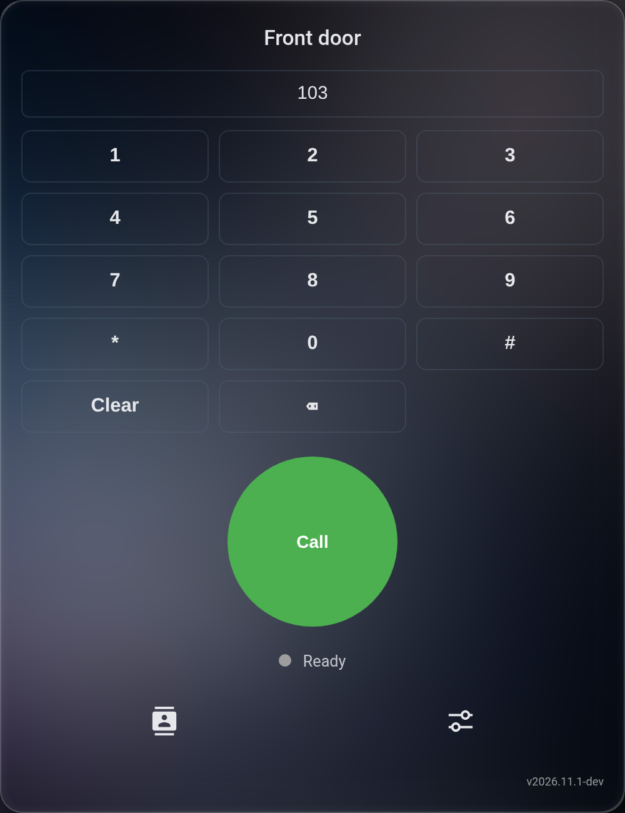
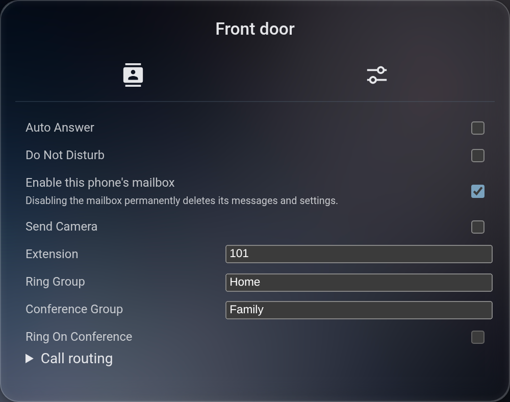

# ESP phones and Home Assistant

Starting with 2026.10.0, the VoIP component supplies its Home Assistant
interface directly. No VoIP HA package is required. Compile with **ESPHome
2026.10.0 or newer**.

Keep your board's network, microphone and/or speaker configuration. Add the
native API option below alongside any existing API encryption settings:

```yaml
api:
  custom_services: true

voip_stack:
  id: phone
  microphone_source:
    microphone: mic_main
    channels: [0]
  speaker: hw_speaker
```

`mic_main` and `hw_speaker` refer to your existing audio components. Mic-only
and speaker-only phones are supported: omit the direction you do not have.
This works with native ESPHome audio or Audio Stack. Voice Assistant, a display
and the runtime controller are not prerequisites.

## One stack per ESP

An ESP firmware currently supports one `voip_stack` instance. Its entity
platforms bind to it automatically; `voip_stack_id` is optional and omitted in
the maintained YAMLs. Headless profiles can also omit the stack declaration ID:
parameterless actions and conditions resolve it automatically, and the runtime
observer can use an empty `voip_stack:` binding. Display profiles still declare
`id: phone` where custom rendering lambdas read caller names, state or contacts. This simplification does not remove microphone/speaker
selection or the IDs needed to connect other components.

## What appears automatically

When the native API is present, `voip_stack` creates **VoIP State**,
**VoIP Caller**, **VoIP Destination**, **VoIP Last
Reason**, **VoIP Media Route** and **VoIP Contacts** entities. It also exposes
extension, ring/conference groups and the conference-ring switch.

The HA integration identifies a phone by the presence of `voip_state` on its
ESPHome device, including while offline. No long public **VoIP Endpoint** sensor
is generated. ESPHome DeviceInfo and the device registry supply identity;
authenticated SIP Contact bindings supply registered routes, and OPTIONS/SDP
supply codec, rate, packet-time and video capabilities. Current managed
profiles enable automatic enrollment: the existing private API provisions the
phone's named HA account and, when selected, its LDAP directory configuration.
LDAP then refreshes contacts. Standard SIP BLF/presence and MWI subscriptions
provide live phone and message state independently of those records.

The native `set_roster_json` action remains for compatibility with firmware
without managed LDAP. A managed LDAP provider disables that old roster provider
so the two deliveries do not compete. Call, answer, decline, hangup and manual
contact actions keep using the existing native API connection.
Entity names and action names remain compatible with the earlier packages.

Each responsibility has one owner:

- The ESP VoIP component owns calls and its local phonebook.
- Home Assistant owns the central directory and provisions its account/access
  settings privately; the selected LDAP provider commits contact updates.
- The native API adapter exposes the component's existing methods and states.
- Optional packages compose the display, ringtone and Full-profile activities.

No second SIP connection, audio pipeline or polling task is added for this
interface. ESPHome supplies retained entity states when an API client connects;
IP changes are reflected by the ESPHome owner and current SIP Contact bindings.

For a direct phone without REGISTER, configure its SIP listener explicitly in
an existing HA phonebook contact. Associate it with the ESPHome device using
`metadata.device_id` (the HA device ID), or `metadata.endpoint_id` equal to
`esphome:<device_id>`. For example, the existing `voip_stack.set_contacts`
action accepts this document in its `roster_json` field (replace the device ID
and retain the other contacts when replacing the manual contact list):

```json
{"contacts":[{"id":"phone_node","name":"Entrance","sip_uri":"sip:phone_node@192.0.2.10:5077;transport=tcp","metadata":{"device_id":"<HA device ID>"}}]}
```

The API address alone does not establish a SIP port or transport. A discovered
device without a Contact or explicit direct route remains visible but is not
advertised as a routable peer. RTP ports and actual formats come from the call's
SDP. Unknown capabilities stay unknown. HA retains the legacy endpoint reader
for older firmware, but that sensor is never a discovery prerequisite. Update
HA before the firmware, and preserve an old direct route as explicit contact
configuration before removing its legacy sensor.

An older ESPHome entity-registry entry can remain `unavailable` after updated
firmware stops advertising the endpoint sensor. VoIP Stack does not delete
entities owned by the ESPHome integration. Before any manual cleanup, verify
that the updated device's native API entity inventory omits the old endpoint
sensor and that discovery through `voip_state`, calling and contact delivery
work. In Home Assistant's **Settings > Devices & services > Entities**, locate
the obsolete entity by its exact ESPHome device and original unique ID
(`voip_endpoint` role), then use the supported UI removal if offered. Keep the
device's `voip_state` and the VoIP Stack integration's own entities. Canonical
`endpoint_id` values and the card's `voip_endpoint` URL parameter are phone
identifiers and must remain unchanged.

## Customize an entity

The generated entities accept their usual ESPHome options under
`voip_stack.ha_integration`. For example:

```yaml
voip_stack:
  ha_integration:
    media_route:
      on_value:
        - logger.log:
            format: "Call media route: %s"
            args: ['x.c_str()']
```

Use this location instead of declaring another `text_sensor` for a managed
role or extending an entity inside a retired package. Leave the default names
unless your HA discovery setup has been checked with custom names. Optional
buttons, volume controls and diagnostic sensors remain explicit declarations.

## Standalone SIP

Without `api:`, the HA adapter is omitted. With API enabled only for other
purposes, explicitly disable the phone's HA interface:

```yaml
voip_stack:
  ha_integration: false
```

Static contacts, direct SIP calling and manually configured registered
accounts remain available when compiled. Disabling this interface does not
disable SIP or RTP. Conversely, enabling it does not force
calls through HA: `use_ha_as_first_contact` remains a separate routing choice.

Current device packages select optional `directory`, `blf` and `mwi` features
separately. They require VoIP, while the basic native control interface does
not require all three. For manual account capacity, line selection and saved
overrides, see [registered ESP accounts](ESP_REGISTRATION.md).

For a standalone profile, also remove managed `directory`, `blf` and `mwi`
features when their HA account is not wanted. To use equivalent services on a
manual PBX account, configure their account/provider explicitly; disabling the
HA adapter alone does not reconfigure independent LDAP or SIP subscriptions.

## Migrating an existing phone

Start from an updated [maintained device YAML](../yamls) and reapply your board
settings, or migrate your existing configuration as follows.

Comment out or remove the package entries for `voip/ha_phone.yaml`, `voip/ha_integration.yaml`,
`voip/ha_actions.yaml`, `voip/ha_api.yaml` and
`voip/phonebook_subscribe.yaml`. These paths now fail validation with migration
instructions. Remove copied definitions of the native phone actions and managed
entities as well; duplicates are rejected before compilation.

Full profiles replace `voip/ha_api_runtime.yaml` with
`runtime/ha_connectivity.yaml` for their runtime connectivity events. Runtime
diagnostic API actions are selected separately with `diagnostics/runtime.yaml`.
This connectivity replacement is not needed by a basic phone.
Keep unrelated hardware, display, ringtone and audio packages.

Add `custom_services: true` to the existing `api:` block. If you previously
used `phonebook_subscribe.yaml` or `ha_phone.yaml` and want to preserve their
routing preference, keep `use_ha_as_first_contact: true` in `voip_stack`.
Maintained profiles already include these migration changes.

After upload, check the available **VoIP State**, delivery of contacts,
calling and hangup. Updating the HACS integration alone does not recompile the
firmware or migrate a custom device YAML.

## Dashboard controls

The ESP mirror card uses the same call state and native controls.




