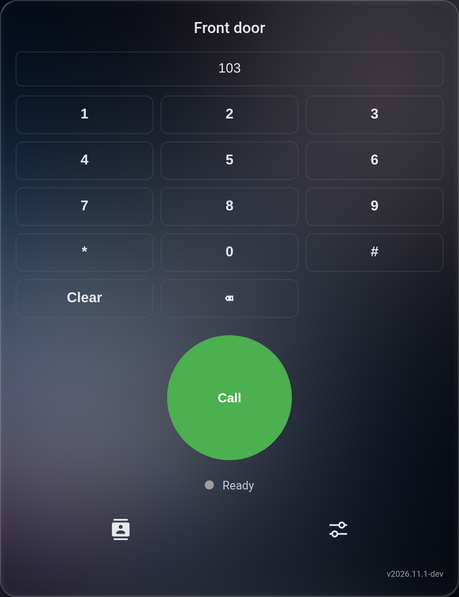
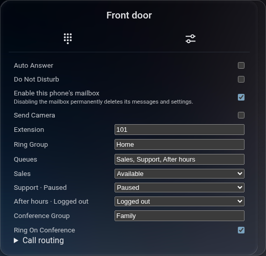

# ESP phones and Home Assistant

Starting with 2026.10.0, the VoIP component supplies its Home Assistant
interface directly. No VoIP HA package is required. Compile with **ESPHome
2026.10.0 or newer**.

Keep your board's network, microphone and/or speaker configuration. Add the
native API option below alongside any existing API encryption settings:

```yaml
api:
  custom_services: true

voip_stack:
  id: phone
  microphone_source:
    microphone: mic_main
    channels: [0]
  speaker: hw_speaker
```

`mic_main` and `hw_speaker` refer to your existing audio components. Mic-only
and speaker-only phones are supported: omit the direction you do not have.
This works with native ESPHome audio or Audio Stack. Voice Assistant, a display
and the runtime controller are not prerequisites.

## Optional adaptive volume

On profiles that include the shared Audio Stack controls (including Spotpear,
WS3 BOX V2 and P4 FULL), add this to the device YAML and install the firmware:

```yaml
substitutions:
  audio_adaptive_volume: true  # Experimental
```

The device gains an **Adaptive volume** switch in Home Assistant. Turn it on
to play more quietly at night. Sustained room noise raises playback towards
your chosen Master level. Master at 0% stays muted. The switch starts off on
first use. [Audio Stack settings](https://github.com/n-IA-hane/esphome-audio-stack/blob/dev/esphome/components/esp_audio_stack/README.md#adaptive-playback-volume)
describe threshold tuning for custom boards.

## One stack per ESP

An ESP firmware currently supports one `voip_stack` instance. Its entity
platforms bind to it automatically; `voip_stack_id` is optional and omitted in
the maintained YAMLs. Headless profiles can also omit the stack declaration ID:
parameterless actions and conditions resolve it automatically, and the runtime
observer can use an empty `voip_stack:` binding. Display profiles still declare
`id: phone` where custom rendering lambdas read caller names, state or contacts. This simplification does not remove microphone/speaker
selection or the IDs needed to connect other components.

## What appears automatically

When the native API is present, `voip_stack` creates **VoIP State**,
**VoIP Caller**, **VoIP Destination**, **VoIP Last
Reason** and **VoIP Contacts** entities. It also exposes
extension, ring/conference groups and the conference-ring switch.

The HA integration uses `voip_state` to discover the associated ESPHome hardware,
including while offline. The configured SIP account supplies phone identity;
hardware discovery alone does not create a callable route. Authenticated SIP
Contact bindings supply registered routes, and OPTIONS/SDP supply codec, rate,
packet-time and video capabilities. Managed profiles enable automatic enrollment:
the native API privately provisions the account credentials and, when selected,
its LDAP directory configuration. Native friendly name initializes the account
only during creation or a proven initial migration. Later hardware renaming
changes neither the account username nor its display name.
LDAP then refreshes contacts. Standard SIP BLF/presence and MWI subscriptions
provide live phone and message state independently of those records.

LDAP is the sole dynamic ESP directory provider. Call, answer, decline, hangup
and manual static-contact actions use the existing native API connection.
Rebuild and upload matching ESP firmware and update maintained HA packages
together: JSON roster push, roster cleanup actions and the media-route control
are removed. Negotiated TX/RX formats remain available in SIP diagnostics.

The native originate command is
`start_call_on_line(dest, line, send_video, receive_video)`; ESP creates Call-ID
and HA learns the call from the actual SIP INVITE. Both booleans false requests
audio only; receive-only video uses false and true without enabling the camera.
Actual source/sink capability and camera privacy still apply. `start_call`
retains configured native intent, and `hangup_call_if_id` targets the actual
current Call-ID. Auto-enrollment uses `register_ha_account()` without arguments.
Call identity and directional audio negotiation use standard SIP/SDP fields; no
private identity header or SDP feature attribute is required.

Each responsibility has one owner:

- The ESP VoIP component owns calls and its local phonebook.
- Home Assistant owns the central directory and provisions its account/access
  settings privately; the selected LDAP provider commits contact updates.
- The native API adapter exposes the component's existing methods and states.
- Optional packages compose the display, ringtone and Full-profile activities.

No second SIP connection, audio pipeline or polling task is added for this
interface. ESPHome supplies retained entity states when an API client connects;
IP changes are reflected by the ESPHome owner and current SIP Contact bindings.

A VoIP Stack account uses its literal SIP username. Its ESPHome hardware device
is an association for provisioning and native controls, not another SIP
identity. Hardware names do not rename the associated account after enrollment.

A phone registered only with another PBX remains an external SIP contact unless
an account is explicitly configured for it in VoIP Stack. For an explicit
contact, use its actual SIP URI. Optional `metadata.device_id` associates the
contact with native HA hardware for display and controls; it never becomes the
SIP user. The administrator `voip_stack.set_contacts` import accepts this document
in `roster_json` (retain the other contacts when replacing the manual list):

```json
{"contacts":[{"id":"entrance-contact","name":"Entrance","sip_uri":"sip:entrance@192.0.2.10:5077;transport=tcp","metadata":{"device_id":"<HA device ID>"}}]}
```

The native API address does not establish a SIP route, transport, RTP port or
media format. SIP registration or an explicit contact supplies the signaling
route; the actual call's SDP supplies its media contract. LDAP distributes the
phone directory, independently of the administrator import above.

## Customize an entity

Generated entities accept their normal ESPHome options under
`voip_stack.ha_integration`. For example:

```yaml
voip_stack:
  ha_integration:
    state:
      on_value:
        - logger.log:
            format: "Call state: %s"
            args: ['x.c_str()']
```

Optional buttons, volume controls and diagnostic sensors remain explicit
configuration. Keep the existing hardware and application owners for those
controls.

## Standalone SIP

Without `api:`, the HA adapter is omitted. With API enabled only for other
purposes, explicitly disable the phone's HA interface:

```yaml
voip_stack:
  ha_integration: false
```

Static contacts, direct SIP calling and manually configured registered
accounts remain available when compiled. Disabling this interface does not
disable SIP or RTP. Enabling it does not force calls through HA:
`use_ha_as_first_contact` remains a separate routing preference.

Device packages select optional `directory`, `blf` and `mwi` features separately.
For manual account capacity, line selection and saved overrides, see
[registered ESP accounts](ESP_REGISTRATION.md). Configure the LDAP and SIP
subscription providers explicitly when using another PBX; disabling the HA
adapter does not reconfigure those independent providers.

## Migrating an existing phone

Update the Home Assistant integration and rebuild the ESP with the coordinated
maintained firmware. Start from an updated [maintained device YAML](../yamls)
and retain the board, audio, display and ringtone configuration. Remove any
include of the deleted `voip/phonebook_subscribe.yaml` package.

Native phone controls require `custom_services: true` in the existing `api:`
block. Maintained profiles already select the native interface. Full-profile
runtime connectivity uses `runtime/ha_connectivity.yaml`; optional diagnostic
API actions use `diagnostics/runtime.yaml`.

After rebuilding and installing the coordinated firmware, verify the native
account association, SIP registration, LDAP contacts, calling and hangup.
Updating HACS alone does not rebuild or install ESP firmware.

## Dashboard controls

The ESP mirror card uses the same call state and native controls.




