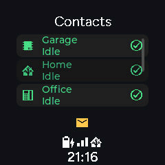
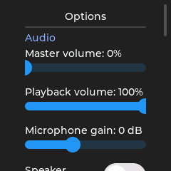
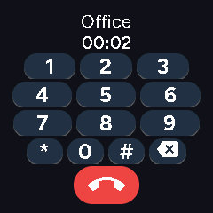

# Standard services for ESP phones

The 2026.11.1 development preview brings automatic SIP accounts, an LDAP
phonebook, SIP BLF and MWI to the coordinated ESP firmware.
Use matching `dev` components and the current device YAML when testing this
preview. The Home Assistant integration also serves ordinary SIP phones and
standard LDAP/IMAP clients.

## Select the services to compile

Edit the board YAML's existing `firmware_features` list:

```yaml
substitutions:
  firmware_features: [voip, directory, blf, mwi, display, diagnostics]
```

Each of the three service names requires `voip`, with no dependency on another
service. `[voip]` retains ordinary calls and manual static contacts. `directory`
adds LDAP; `blf` watches either those contacts or manual entries; `mwi` adds SIP
message notifications and mailbox calling.
The HA auto-registration option is separate. The components also support fixed
PBX and directory settings in custom YAML, as shown in the standalone
[ESP phone-service examples](https://github.com/n-IA-hane/esphome-voip-stack/blob/dev/docs/PHONE_SERVICES.md).

With `mwi`, the envelope calls the PBX address provided in the SIP
Message-Account field. The regular in-call keypad sends DTMF to the mailbox
menu. An explicit mailbox target can be configured for another PBX.

During a call, the dialpad icon above the contact opens that same keypad.
The display shows the connected party and elapsed call time; long names scroll
within the header. Its call button becomes the red hangup control. Outside a
call, the keypad composes a number normally. Returning to idle clears the
editable number, ready for a new call.

## The phone on its own display

These captures come from a real 240-pixel ESP display running the maintained
phone packages. The layout adapts to each supported screen; the services and
call controls are shared. The animation uses demo directory entries and type
assignments; the screen captures come from the real ESP display.

### Contacts, live BLF and voicemail



Drag the list vertically to browse the directory, then tap a contact to call.
The left icon identifies an ESP (chip), SIP phone (desk phone), browser phone
(Home Assistant logo), stored contact (cellphone), automation or Assist (robot),
or group. The name and destination come from the
shared phonebook. With BLF enabled, the right-hand icon and second line show
the contact's current call state.
The maintained 240- and 360-pixel round layouts show four complete contact rows,
or three when the voicemail envelope needs space. Both lines remain visible
within the circular screen.
The directory category comes from LDAP's standard `ou` field:

| `ou` value | Left icon |
| --- | --- |
| `esphome` | Electronic chip |
| `sip_account` | Desk phone |
| `browser` | Home Assistant logo |
| `contact` | Cellphone |
| `automation` | Robot, including the managed Assist destination |
| `group` | Group of people |

| Appearance | Meaning | Tap action |
| --- | --- | --- |
| Green, idle icon | Available and idle | Call the contact |
| Blue, outgoing-call icon | An outgoing call is being placed | Call the contact, subject to the PBX's busy policy |
| Blinking blue, ringing icon | An incoming call is ringing | Request directed pickup when offered |
| Red, call icon | In a call | Call the contact, subject to the PBX's busy policy |
| Amber, hold icon | A call is on hold | Call the contact, subject to the PBX's busy policy |
| Gray, unavailable or unknown icon | Closed presence or state unavailable | Attempt a call |

The text and right-hand icon explain the state as well as the color. The left
icon continues to identify the contact type. A PBX must authorize BLF and
pickup; a missing presence report remains unknown rather than implying idle.
Pickup requires a confirmed incoming ringing leg. A legacy BLF report without
direction can still show Ringing, with the normal call action instead of pickup.

A new-message notification lights the envelope above the idle view's status
indicators. Tap it to call the PBX's mailbox. SIP MWI supplies the waiting
state and mailbox address; the regular SIP/RTP call carries the spoken menu.
The ESP uses that menu instead of downloading a separate message catalog or
running a voicemail player.

### Adjust the phone's options



Scroll the options page to reach audio and voice controls, followed by the
telephone section. Available controls follow the features compiled into the
firmware. For example, a phone can expose volume, microphone gain, processing
mode, auto answer and Do Not Disturb. The screen controls the same entities
available through ESPHome.

On round displays, swipe down from the top of Options to return to the previous
screen, including when the gesture starts over the controls' background.
Gestures within the list scroll its contents. An upward gesture at the end of
the last page stays there. Sliders and dropdowns retain their own touch controls.

### Use the same keypad before and during a call



Open the dialpad from the call screen to interact with voicemail or another
IVR. While connected, each key sends a negotiated RTP telephone event; the
header shows the peer and elapsed time, and the red control ends the call.
Opening the keypad keeps the existing audio conversation active. Outside a
call, the normal dialing page composes a destination and offers the call
control instead. On round displays, the smaller call and hangup control leaves
more space for the number keys. After hangup, the editable number is empty;
Delete keeps it empty, and the next digit starts a new destination. The
call-ended notice retains the last peer separately.

### Connected names after pickup

If Casa calls Test and this phone picks up Test's ringing call, setup can show
Test's friendly name. When the PBX supplies Casa's connected identity, both the
call screen and in-call keypad update to Casa. Selecting another contact does
not change the name of the current conversation.

Custom displays can read `id(phone).get_active_peer_name()`. It returns an
owned string from the current call and becomes empty when that dialog is
released. Use the optional `on_peer_changed` callback to refresh labels when
the PBX refines the connected identity during setup or after answer.
Connection setup remains in `on_in_call`; an identity update does not replay
that callback. The hook is compiled only when configured. See the
[connected-peer callback example](https://github.com/n-IA-hane/esphome-voip-stack/blob/dev/docs/PHONE_SERVICES.md#connected-peer-names)
for custom YAML.

## One phone, one identity

Add the ESP through the usual ESPHome integration. The maintained telephone
packages enable `voip_stack.ha_integration.auto_register`. Home Assistant
creates one account and password, saves them, then configures the ESP through
its existing native ESPHome API connection. Encryption follows that connection's
configuration. No additional pairing protocol or provisioning server is needed.

```text
ESPHome device online
         │
         ▼
HA creates the phone account once
         │ existing ESPHome API actions
         ▼
ESP receives SIP and LDAP settings
         │
         ├──► SIP REGISTER, calls, BLF and MWI
         └──► LDAP contact searches
```

The technical device name is the SIP login. The friendly device name shown in
Home Assistant is the caller display name and directory label. Renaming that
label preserves the password and mailbox. A reconnect reuses the same account.
The ESP remains one endpoint and one dashboard tile.

Removing the originating ESPHome integration or its device permanently revokes
the managed account, ends its calls/subscriptions and removes its directory
record, mailbox, recordings and IMAP identifiers. Going offline, restarting
or reloading an integration preserves the account and messages.

## Directory and contact states

Home Assistant assembles its routing phonebook directly into the shared
`PhoneDirectory`. LDAP reads those records; it has no separate contact database.
Offline phones stay in the directory until their owner is removed.

Open **VoIP Stack > Reconfigure > Phone directory and mailboxes** to set:

| Setting | Default |
|---|---|
| LDAP listener | TCP 1389 |
| Directory base DN | `ou=phonebook,dc=voip` |
| Anonymous searches | Disabled |
| IMAP listener | TCP 1143 |
| TLS | Disabled, optional certificate/key configuration |

Use the phone's SIP username/password for authenticated LDAP searches. The bind
DN is `uid=USERNAME,ou=accounts,ou=phonebook,dc=voip` with the default base DN.
A convenient phone filter is `(|(telephoneNumber=*)(labeledURI=*))`; display `cn`
and dial `telephoneNumber` or `labeledURI` according to the phone's capabilities.
`uid` is stable, `cn` is the visible name, and `ou` distinguishes ESP phones,
registered accounts, browser phones, contacts, automations and groups. Adjust
the configurable search filter on a traditional desk phone to these attributes.
The service supports LDAPv3 searches, filters and paged results. It is read-only;
edit contacts through the existing VoIP Stack configuration.

The ESP's vertical contact list uses one small pool of reusable rows. Each row
shows a type icon, name and BLF call state. Tap a normal row to call. A row
labelled **Ringing: pickup** performs directed pickup through its SIP account.
A ringing indicator animates while that list is visible.

For a custom display, `phone_list_view.visible_rows` reserves the widget pool
at boot. Cover the viewport with its configured row height and two scroll
buffer rows. The portrait P4 package reserves 9 contact rows for its larger
viewport. This pool is separate from the BLF subscription limit.

BLF uses standard SIP `SUBSCRIBE`/`NOTIFY` with the `dialog` event package.
The optional standard `presence` subscription supplies reachability separately:
"Unavailable" means PIDF closed, "Idle" requires open presence, and an unknown
presence remains unknown. An active call retains its call-state indication.
Selecting `blf` reserves a pool of 16 contacts, with or without a display.
Omitting the feature removes that pool; custom YAML can increase
`voip_stack.blf.max_subscriptions` to 64 and place its buffers in PSRAM.
PBX pickup prefixes are configurable (`pickup.` on VoIP Stack, commonly `**`
on other systems). Access remains subject to the PBX's pickup policy.
The managed directory automatically watches phone endpoints. Saved contacts,
groups, automations and services remain callable without automatic SIP watches;
external LDAP mappings and explicit watches keep their existing behavior.

## Voicemail through SIP

Enable the phone's mailbox through the existing VoIP Stack voicemail settings.
Standard SIP MWI controls the envelope above the status indicators. It appears
for new messages on the idle Assist/telephone views and stays hidden during
calls, ringing, settings and video. Tap the envelope to make an ordinary call
to the mailbox address supplied by the PBX. Use the in-call keypad to navigate
the spoken menu. A custom PBX can provide a target explicitly through
`voip_stack.call_mailbox`.

The mailbox conversation uses the same SIP audio path, call lifecycle and DTMF
controls as any other call. A microphone-only or speaker-only profile retains
its declared direction and must be chosen accordingly for interactive menus.
Disabling and re-enabling a mailbox in HA retains the SIP account's MWI resource.
Removing the phone or SIP account retires that resource.

Home Assistant also serves standard IMAP for external phones and mail clients.
It exposes `INBOX`, persistent UID/UIDVALIDITY, flags, IDLE, partial audio
fetches and UIDPLUS. `Seen` and deletion update the original media archive.
WAV content is generated from the existing message, cached within a fixed
budget and streamed in pieces. Listing metadata does not read the recording.
The server provides the standard `Content-Duration` field when known.
The ESP's SIP menu and external IMAP clients share that canonical archive.

## Custom firmware and other PBX systems

The standalone ESP component keeps direct SIP as its generic default. Automatic
HA provisioning is explicit:

```yaml
api:
  custom_services: true

voip_stack:
  id: phone
  # Keep the existing microphone, speaker and SIP configuration here.
  ha_integration:
    auto_register: true
```

The maintained device packages already include the complete service binding.
For a custom phone, configure `ldap_directory` only when needed. The
[ESP VoIP Stack documentation](https://github.com/n-IA-hane/esphome-voip-stack/tree/dev)
contains complete direct, registered and mixed-account examples, independent
LDAP settings and memory/task controls.

Optional TLS requires `tls_support: true` in the ESP directory client at compile time.
Enable that firmware support before switching the HA listeners to TLS.
TLS uses the normal certificate trust configuration. A private CA can
be declared through the ESP client's `ca_certificate`; certificate validation
still applies. The Home Assistant services use manifest Python dependencies
and supported integration boundaries, including on Home Assistant OS.

## Memory and execution placement

Phone services reuse the existing task and memory controls. For a FULL device
with PSRAM, override these settings in its main YAML when needed:

```yaml
voip_stack:
  signaling_buffers_in_psram: true

ldap_directory:
  task_stack_in_psram: true
  buffer_in_psram: true
```

The maintained display packages already select external storage for the LDAP
worker. SIP signaling and contact storage are cold data; their
placement is separate from `voip_stack.buffers_in_psram`, which controls audio
staging. Preserve your board's validated audio and DSP settings.

LDAP receives and maps one directory entry at a time. A boot-allocated staging
table holds up to `max_entries` contacts until the complete search succeeds;
an interrupted or invalid search retains the preceding phonebook. On the
ESP32-S3 ABI with directory support and signaling PSRAM enabled, its records
use 160 bytes each: 2,560 bytes for 16 entries or 10,240 bytes for 64, excluding
string data. The signaling PSRAM option also
preallocates the canonical 64-contact table in external memory. The internal
storage path grows only to the required contact count and reuses its capacity.

LDAP refresh wakes its existing worker.
Worker stacks and network buffers remain allocated between operations, and
idle workers sleep on notifications or their protocol's blocking wait. BLF
uses the existing SIP worker. Its watch limit and the display row pool are
independent bounds that you can tune to the installation.

## Updating an existing installation

1. Update the integration and coordinated ESP components to this preview.
2. Start from the current maintained YAML for your board, preserving identity,
   wiring and calibration. Rebuild and upload to install native phone services.
3. Let the existing ESPHome API configure the phone automatically. Its friendly
   name remains the caller identity.
4. Enable voicemail for the endpoint when wanted, then test its contact list,
   pickup and mailbox controls.

New managed firmware gets its phonebook through LDAP and discovers media
capabilities through SIP OPTIONS/SDP. The long **VoIP Endpoint** text sensor and
its serialization budget are legacy opt-ins for older integrations. Older ESP
firmware retains its existing JSON phonebook delivery while it is migrated.
