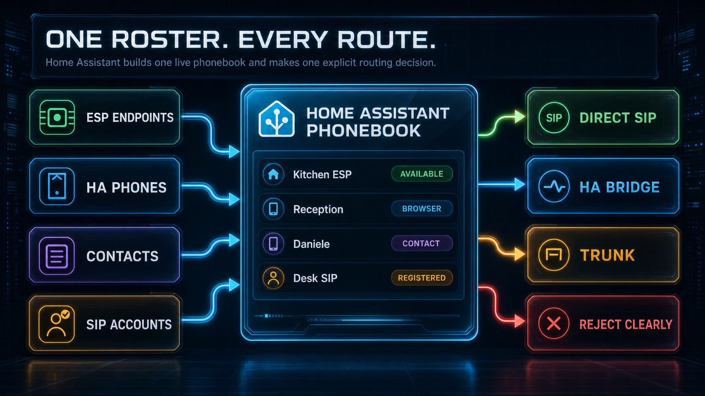

# SIP phonebook contract

The phonebook is the SIP dial plan shared by ESP devices, Home Assistant,
registered local SIP endpoints and the optional trunk. SIP is implicit everywhere:
`transport` only chooses SIP/TCP or SIP/UDP signaling, never a second
call-control protocol.

For behavior-level routing examples, see
[DIALPLAN_RESOLVER.md](DIALPLAN_RESOLVER.md). For signaling/media flows, see
[CALL_FLOWS.md](CALL_FLOWS.md). For service calls that mutate the roster, see
[SERVICES.md](SERVICES.md).

## If you only want to edit contacts

Use the integration's **Add contact** flow or the phonebook UI first. This page
is the wire-format reference for custom firmware and integrations, not a request
to replace your whole roster JSON by hand. See [basic concepts](CONCEPTS.md)
for the difference between a phone, contact, extension and external number.

## Standard LDAP directory

LDAP and the persistent managed-phone directory require **2026.11.1-dev**;
use matching preview firmware for managed ESP directory provisioning. SIP BLF,
presence and voicemail MWI are separate services already present in stable.

Home Assistant owns one persistent directory. The phonebook sensor, JSON
export and LDAP service are projections of the same contacts,
not separate contact databases. Managed phone identities remain listed while
offline; availability describes current reachability without deleting identity.
Native HA device and entity IDs survive explicit account edits. Hardware renaming
does not rename the associated SIP account.

Open **VoIP Stack > Reconfigure > LDAP directory** to configure the listener,
base DN, anonymous-search policy and certificate/key paths. The TLS option
selects implicit LDAPS; a certificate and key also permit StartTLS on the normal
listener. Simple bind without TLS exposes credentials on the network. Enabled
phone accounts authenticate independently of whether a SIP registration is
currently active; revoked or removed accounts lose access.

The defaults are TCP port `1389`, base DN `ou=phonebook,dc=voip` and anonymous
searches disabled. Configure a compatible SIP phone's LDAP client with the HA
host and the selected listener settings. This is a standard directory service,
not an alternative SIP registration or call-control channel.

Compatible managed ESP firmware receives its directory configuration privately
and refreshes after effective directory changes. A successful query replaces
the phone's LDAP snapshot atomically. A temporary connection/listener failure
retains its last valid snapshot; administrative disabling is a separate action.
HA Repairs reports listener or TLS setup failures.

Phone `uid` values are the literal SIP account username, up to 64 UTF-8 bytes.
Other entries use their public route identity, up to 1024 UTF-8 bytes. Their
encoded SIP URI is limited to 2048 bytes. HA device IDs associate provisioning
records; they are not SIP usernames or LDAP phone UIDs.

Entries retain their phone, group or service kind. Only eligible phone entries
are automatic BLF targets. LDAP contact records and public roster metadata do
not contain account passwords. SIP voicemail access and MWI are separate from
the directory service.

## ESP static contacts

Declare static local entries directly in `voip_stack` only when an ESP must
have contacts before HA sync, work offline, or keep a tiny fixed local roster:

```yaml
voip_stack:
  id: phone
  transport: udp  # SIP signaling transport only; audio is always RTP/UDP.
  static_contacts:
    - name: Kitchen
      ip: 192.168.1.42
      transport: udp
      port: 5060
      rtp_port: 40000
    - name: Gate
```

Runtime actions use the same model:

```yaml
on_press:
  - voip_stack.add_contact:
      name: Kitchen
      ip: 192.168.1.42
      port: 5060
      transport: udp
```

Rules:

- `name` is required.
- `ip`, `port`, `rtp_port`, and `transport` are optional on structured ESP
  static contacts and the ESP `add_contact` action.
- If `transport` is omitted for a direct address, SIP uses its default
  transport behavior for that context.
- Name-only entries are logical targets and can be resolved or bridged by HA.
- A numeric target from an ESP is routed to HA. HA resolves `extension` as an
  internal target and `number` as an external trunk target.
- LDAP is the standard shared phonebook for compatible managed ESP firmware.
  The sensor and JSON export remain available for HA clients and diagnostics.
  LDAP is the sole dynamic ESP provider. Static contacts remain local additions
  for offline or custom installations.

The ESP-local schema is intentionally smaller than the HA central-contact
schema. Fields such as `address`, `sip_uri`, `extension`, `number`, group
membership are authored on HA. Standard SIP/SDP supplies current media evidence.
The canonical directory projects public routes through LDAP.

The contact `name` is the only user-facing identity field required by an ESP
static contact. Users do not need to provide a second underscore-safe version
of the same name. SIP keeps routing and presentation separate on the wire:

- the URI user is encoded as a valid, stable SIP route;
- the quoted display name preserves spaces and is shown to the peer;
- an incoming caller display is read from the peer's `From` header, not
  replaced from the roster.

On a registered ESP line, the URI user is the literal account username.
Managed accounts default to ESPHome's effective `friendly_name`, or effective
node name when absent, including ESPHome's native MAC suffix when enabled. A
user-configured account username remains authoritative. The SIP display label
can differ from that username.

## HA roster



HA owns the central directory and its `sensor.voip_phonebook` projection. It
contains managed ESP identities, logical HA phones, configured local SIP
accounts, manual contacts, callable services, groups and configured external
targets. A saved identity does not require an active Contact binding. Routing
still checks the destination's actual availability and call policy.

Native SIP account subentries own usernames, credentials, labels, extensions and
call policy. Current registrar Contacts and standard SIP/SDP own signaling routes
and media capabilities. ESPHome DeviceInfo identifies associated hardware and API
controls; native camera entities remain available for previews. Hardware API
availability alone does not make an account callable.

The sensor keeps its existing entity ID, unique ID, count state and `roster_json`
attribute. Its diagnostic `phonebook` attribute uses six fields per entry:
`name|SIP username|host|SIP port|RTP port|transport`. RTP port `0` means that no
media endpoint has been negotiated. This attribute is never parsed for routing
or sent to ESP phones.

Roster entries use JSON fields:

- `id`
- `name`
- `address`
- `sip_uri`
- `extension`
- `number`
- `port`
- `ha_bridge`
- `metadata`, including `transport`, `sip_transport`, `sip_port`, `rtp_port`, and audio
  format metadata

Routing is data-driven:

- `address` or `sip_uri` describes a direct SIP endpoint;
- `extension` is a local/internal alias used by HA routing and inbound DTMF;
- `number` is an external/public number used through the optional trunk;
- registered SIP accounts become callable contacts while registered;
- Configured accounts remain represented when offline; current Contacts determine SIP reachability.
- Ring and queue entries project native group records and their ordered membership.

Manual contacts and service calls use the same minimum contract:

```yaml
service: voip_stack.add_contact
data:
  name: MobileOffice
  extension: "210"
```

`name` is the only required field. `extension` is an optional internal alias.
`number` is an optional external/public number.
`address`, `sip_uri`, `transport`, `port`, and `rtp_port` are optional
and come from configured contacts or current SIP account registrations.

Group membership uses the same roster metadata for every endpoint type:

- Native ring and queue subentries own one ordered `members` list. Phone settings
  and firmware membership controls project those records; they do not create a
  second authoritative member list.
- Conference membership remains account configuration. Manual contacts use their
  public route, and account services preserve existing membership on unrelated edits.
- HA clients use their associated SIP account identity. Their state entities are
  presentation and call-state projections, not a directory source.
- HA creates one name-only `ha_bridge` roster entry per group with
  `metadata.group_type` set to `conference` or `ring` and
  `metadata.members` containing the member names. Conference entries may also
  carry `metadata.ring_members`.
- A conference group is an HA-mixed SIP conference focus. Calling the group
  joins immediately. Other members can join manually by calling the same group.
  Members listed in `ring_members` are invited when the room starts; answered
  invitations join the room rather than winning a bridge.
- A ring group forks the call to all callable members except the caller. The
  first answer wins, the caller is bridged to that member, and the other early
  dialogs are cancelled.
- Group names must not collide with device or contact names. If the same name
  is declared as both ring and conference, conference wins.
- The Lovelace card consumes the same roster-derived softphone targets as ESP
  devices. It must not implement independent routing filters or group policy.
  The active browser owns HA softphone media; other cards mirror state only.

Central roster services:

- `voip_stack.add_contact`: add or replace one manual central
  contact. `name` is the only required field.
- `voip_stack.remove_contact`: remove one manual central contact
  through its required `name` input, which may match the contact name, stable
  ID, extension or number.
- `voip_stack.set_contacts`: replace manual contacts from a JSON
  roster document.
- `voip_stack.clear_contacts`: clear manual central contacts.
- `voip_stack.push_phonebook`: request a central directory rebuild and
  synchronization of any changed managed LDAP generation.
- `voip_stack.export_phonebook`: return the current roster privately in the
  administrator-only service response for diagnostics/backup.

ESPHome also exposes native API actions such as
`esphome.<slug>_add_contact`, `esphome.<slug>_remove_contact`,
`esphome.<slug>_set_contacts` and `esphome.<slug>_flush_contacts`. These are
local ESP actions for manual static entries. In HA-managed installs, prefer the central
`voip_stack.*` services above and let the directory coordinator deliver the
current directory generation through LDAP. `sensor.voip_phonebook` exposes the
same projection for diagnostics; disabling the sensor does not stop delivery.

HA refreshes the directory and delivers its canonical roster when the owning
account, device or configuration changes. Delivery also observes the native
ESPHome action inventory, so a device reconnect does not depend on sensor
publication order. `voip_stack.push_phonebook` requests a central rebuild for
diagnostics; `refresh_ldap_directory` on the phone requests an LDAP query.
Rebuild and upload matching ESP firmware when upgrading from the removed JSON
roster delivery, and update maintained HA packages together.

Local SIP accounts are created with `voip_stack.create_account`.
The `username` becomes the SIP username and central roster ID. If `password` is
omitted, HA generates one and returns it once in the administrator-only action
response. Registered clients publish a dynamic Contact into the roster so ESP
devices can call them by name.

After a routed call is answered, HA and compatible ESP endpoints can publish
the selected callee through an RFC 4916 connected-identity UPDATE. This lets a
caller that dialed an extension show the canonical destination name. Peers that
do not support the in-dialog UPDATE keep the original dialed identity without
affecting the call.

## Routing

- `sip:name@host[:port]` and `name@host[:port]` route direct.
- `name` resolves through the phonebook.
- Phone/number targets require HA routing.
- `ha_bridge: true` forces HA to act as a SIP bridge.
- External numbers and unresolved number-like targets can use the selected
  available trunk. Registered trunks need a usable registration; static trunks
  use their configured route without REGISTER.
- Inbound trunk DTMF digits resolve against phonebook `extension` values. No
  DTMF route hint means "use the configured inbound default target". A
  received explicit route hint that cannot be resolved terminates as
  `route_not_found`; it does not silently fall back to HA or another target.
- A matching native `voip_stack.route_requested` trigger opens a bounded
  initial decision window; its action selects the target with
  `voip_stack.select_inbound_destination`. Legacy Event Entity rules use the
  experimental automation-routing opt-in. `voip_stack.route` remains the
  advanced action for explicitly pending decisions. See the
  [automation cookbook](AUTOMATION_DIALPLAN.md#override-the-initial-destination).
- Missing or incompatible media routes must fail explicitly with SIP terminal
  reasons such as `media_incompatible` or `transport_unreachable`.

## Default routing rules

ESP-origin calls:

- explicit `sip:user@host` or `user@host` route direct;
- known ESP contact with direct URI or address routes direct unless
  `ha_bridge` is set;
- known contact without direct route data routes through HA;
- unknown names route through HA;
- numeric targets route through HA.

HA-router calls:

- local HA target rings the HA softphone;
- ESP targets forward to their SIP URI/host;
- local SIP endpoints forward to their registered Contact while registered;
- phone/external numbers use the selected available trunk; registered trunks
  require a usable registration, while static trunks do not send REGISTER;
- disabled entries reject with a SIP terminal reason.

Inbound trunk calls:

- if no route hint arrives, the configured inbound default target is resolved;
- if a DTMF/SIP route hint resolves, HA bridges to that local target;
- if a DTMF/SIP route hint is explicit but does not resolve, HA terminates the
  answered trunk leg with `route_not_found`.
