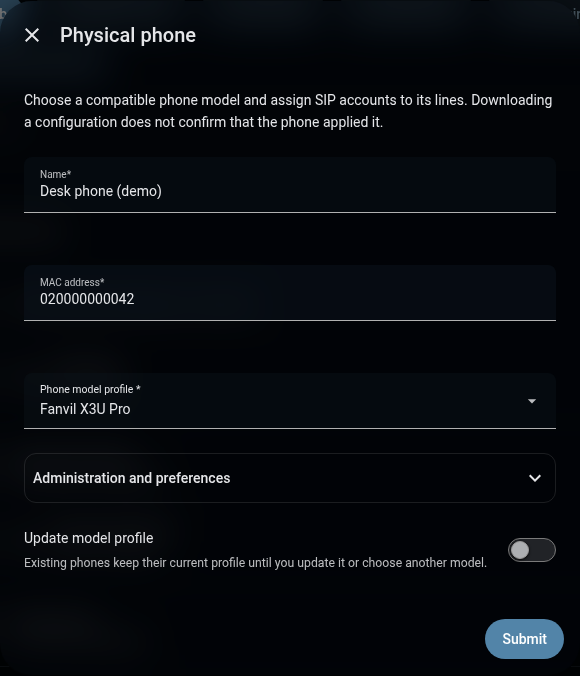
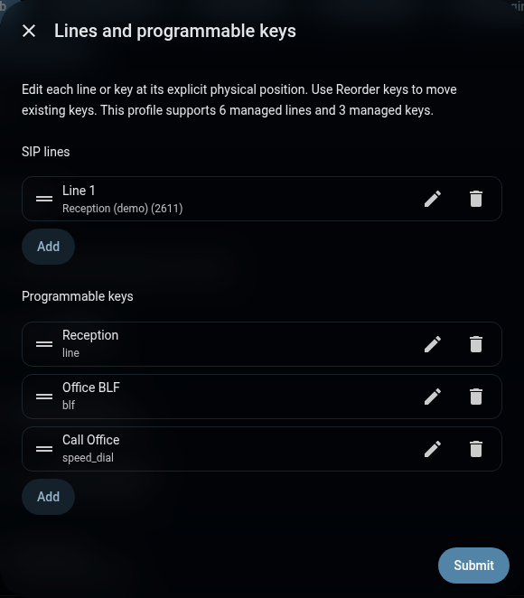
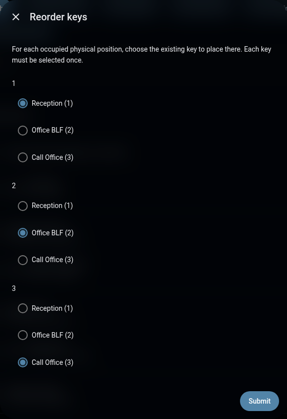

# Managed SIP phones

VoIP Stack can keep an inventory of physical SIP phones and generate their
configuration from an optional, separately distributed profile catalog.
ESPHome provisioning remains independent and does not require this feature.

## Choose discovery and provisioning separately

Open **Settings > Devices & services > VoIP Stack > Reconfigure > Phone discovery and provisioning**.
Discovery listens for SIP PnP announcements by default and offers each new
phone in Home Assistant. It needs no profile catalog. To hide these suggestions,
turn off phone discovery. You can still manage an adopted phone manually.

Provisioning is off by default. Enabling provisioning downloads the catalog index from
[`voip-stack-phone-profiles`](https://github.com/n-IA-hane/voip-stack-phone-profiles/tree/dev).
A model bundle is downloaded only when that model is selected. Each phone keeps
an immutable catalog commit, with schema and SHA256 checks. Editing an existing
phone does not silently update its model profile. Select **Update profile** to
adopt a newer catalog revision explicitly.

While the feature is off, ordinary account edits do not construct a catalog or
download model assets. Existing physical associations can be preserved without
enabling provisioning; changing those associations requires enabling it first.

Disabling provisioning stops configuration updates, releases generated files
and removes downloaded catalog assets. The discovery setting controls whether
new phones appear in the Discovered list. It preserves phone inventory,
line associations and ordinary SIP operation. The integration distribution
contains no imported template archive.

Configure an HTTPS origin reachable by the phones. A local network deployment
may explicitly allow HTTP for older models. Its private provisioning URL contains
a dedicated device credential. It does not contain a Home Assistant access token.
Keep the URL private and rotate its credential if it is disclosed.

## Physical phone, line and extension

Choose **Add physical phone**, or **Configure** on its native HA discovery card.
The adoption form asks for its name, MAC, model profile and an optional first SIP
account. Discovery fills the known identity fields. Leave the account empty to
adopt an unassigned phone, then configure its lines and keys later.

The collapsed **Administration and preferences** section contains area, person, language preferences,
the management host hint and optional administrative credentials. A person is
descriptive; it does not grant SIP or queue permissions or affect presence.
If the profile cannot represent the HA language, select a supported override.

A physical phone and a SIP account have separate native HA devices. The account
owns the extension, credentials, DND, routing, queues and calls. The physical
device owns its model, managed line positions and programmable keys. Its lines
refer to accounts; an account may also be used by another handset or an HA card.
These clients share the account's call and busy state.

On the integration page, the upper row is labelled as configuration and its
gear opens the corresponding editor. The device row underneath opens its state
and controls. These are two views of the same configured item; custom names are
preserved. The central VoIP Stack device is identified as the PBX.

Account assignment is optional during adoption. An unassigned phone is labelled
accordingly and can be assigned later from either its Lines editor or the SIP
account's Associated physical phones selector. See
[one account and its clients](ACCOUNTS_AND_CLIENTS.md).

In **Associated physical phones**, choose a named phone and line position,
such as **Desk phone (1)**. Choices follow each phone's pinned profile and exclude
positions occupied by another account. The account editor and the physical
phone's line editor change the same line list. An occupied position cannot
silently replace another account.
Reassign or remove keys that use a line before removing that association.
Removing the last line keeps the physical inventory and private URL, invalidates
old account-bearing output and prepares only hardware settings and owned line
disables, without SIP or LDAP account passwords. It does not delete or disable
the shared account. A profile without the required disable capability refuses
that removal before saving.

After adoption, **Reconfigure** separates **Properties and profile**, **Lines and
key properties**, and **Reorder keys**. The line editor supports adding, modifying
and deleting associations. It can create an account through the existing account
editor. That account stays a draft until the complete binding passes validation;
confirmation retains the native HA reference allocated for the draft. Cancelling
does not leave an additional account behind. Managed line transports match the
PBX UDP/TCP listeners. Removing a physical phone preserves its shared accounts.

<table>
  <tr>
    <td></td>
    <td></td>
  </tr>
</table>

_Actual Home Assistant forms with demonstration data. The line summary shows
the selected account's name and extension. Changing its label does not create
another account or change the stored association._

**Follow Home Assistant language** uses the instance language. Otherwise select
one of the model profile's supported languages. Profiles without a verified
language parameter leave that setting untouched. An unsupported instance locale
does not block unrelated line/key updates; an already supported language is kept
when available.

Profiles with a verified `time_zones` mapping also inherit the instance's IANA
time zone when generating their configuration. The X3U Pro mapping supports
`Europe/Rome`, `UTC` and `Etc/UTC`. Rome uses the standard UTC+1 base with the
phone's automatic daylight-saving mode for Italy, rather than fixing today's
summer or winter offset. Language and time-zone changes schedule preparation
through the existing HA configuration events. Delivery and application follow
the rules below; changing an HA setting does not itself prove that the phone
adopted it. Unsupported zones or profiles leave the
phone's clock configuration untouched. NTP servers, synchronization settings and
date/time display formats remain independently configured on the phone.

## Keys and directory

The native key editor provides functions supported by the selected profile:
line, speed dial, internal BLF, queue login/logout, queue pause and parking.
Key destinations use stable endpoint, queue or directory-contact references.
External contacts are available for speed dial, not BLF. Their keys follow the
contact's canonical directory route after renaming or changing its number,
without copying another address book into the phone configuration. A contact
with a SIP destination keeps that same routing priority. Free dial numbers
remain available. Targets and labels must fit the profile's byte limits; they
are never silently truncated.

### Parking monitor and action

Choose the function and target independently in the physical phone's key editor:

| Function | Example target with default PBX settings | Purpose |
| --- | --- | --- |
| **Monitor/retrieve parking** (`park`) | `701` | Monitor an existing parking slot and call that slot to retrieve its conversation. |
| **Park current call** (`park_call`) | `700` | Ask the phone to park its established conversation through the configured parking access number. |

If parking numbers were changed, use those configured values. A key target is
never automatically rewritten between an access number and a slot. A monitor
key is not an instruction to transfer the current conversation. Existing saved
`park` keys retain their original monitor/retrieve semantics.

For Fanvil source profiles, both are Memory Key Type1 on the selected line, but
their configuration values differ: `701@1/bc` is BLF New Call for the slot on
line1; `700@1/c` is the explicit Call Park action. These are generated profile
values, not new SIP URIs to type into an automation. Other models expose the
action only when their profile declares it. Model/firmware keypress behavior
requires separate physical qualification.

To move a handset conversation to its associated HA card, park it and dial the
reported slot from that card using the same account. See
[parking and pickup](USER_GUIDE.md#parking-and-picking-up-calls).

### Managed positions and queue keys

Each key has an explicit physical position. Changing the order of editor rows
does not move keys between those positions. Use **Reorder keys** to choose which
existing key belongs at each occupied position. Every key must be selected once;
duplicate or incomplete selections are rejected before saving. The saved list
is in physical position order. This operation preserves unmanaged positions,
line associations and the phone's identity and private credential.

Removing a managed key means clearing it on the phone, not just omitting it
from the next file. Successfully prepared configurations claim only their
declared key/line positions. Those positions are recorded persistently before
files become available. A removed position stays managed and empty until it is
assigned again through HA. Positions never managed by this integration are
omitted and preserved. Managed line retirement waits for calls on the former
binding as well as calls on the current bindings.

Clearing requires the selected profile's explicit `clear_keys` or
`disable_lines` capability. If absent, the editor refuses the removal before
saving; update the profile when a supported revision becomes available. No
global overwrite or reset is used. During upgrade, existing declared positions
form the initial managed set; previously deleted positions cannot be inferred.
Replacing a physical MAC requires a separate adoption, and changing profiles
cannot silently discard positions already managed. Removing the entire physical
inventory device stops management; it does not reset that phone or delete its
logical SIP accounts.

Queue keys require that their selected line is already a queue member. Logging
out preserves membership. For queue login BLF, idle/green means logged in,
including a paused member; confirmed/red means logged out. A separate pause key
is confirmed/red while paused. Other BLF resources keep their usual meanings.

When LDAP phone services are enabled, the same directory and account
authentication are used. See [LDAP on desk phones](LDAP_PHONES.md).
No separate address-book database is created.

Current LDAP model projections declare plain LDAP. If the server uses implicit
TLS and the selected profile has no verified LDAPS mapping, preparation reports
`phone_ldap_mode_unsupported` and refuses to publish a plain configuration for
that listener. StartTLS is not advertised as a managed phone-profile mode.
The integration never silently downgrades a requested secure mode.

## Account DND synchronization

DND is one account policy shared by its handsets and HA cards. Profiles declaring
`dnd_sync` enable the phone's per-line feature synchronization. The current X3U
Pro source projection enables `FeatureSync`; the PBX handles authenticated
`as-feature-event` subscriptions, explicit DND ON/OFF requests and state NOTIFY
updates through the existing SIP event owner. A request for another account or
an unauthenticated source cannot change that policy.

An existing phone may be pinned to a profile revision that predates this
capability. Updating the integration or refreshing the catalog does not change
that pin. Use **Properties and profile > Update profile**, then deliver and apply
the generated configuration before expecting the handset's DND button to sync.

Support is limited to the declared model/protocol subset. On the Fanvil X3U Pro
with firmware 2.12.20, both phone-to-HA and HA-to-phone changes have been verified
against the native DND indication with a current SIP subscription. Automatic
subscription recovery after a PBX restart is not qualified. A `486` or `603`
call response never changes persistent account DND. Profiles without this capability preserve
the handset's local behavior. Browser Auto Answer remains a browser preference,
independent of hardware auto-answer and the per-call announcement request.

## Discovery and delivery

With discovery enabled, compatible SIP PnP phones announce `Event: ua-profile`
on multicast `224.0.1.75:5060`. They appear in Home Assistant's **Discovered** list
with Configure and Ignore. A discovery announcement is an untrusted inventory
candidate. It does not create accounts, grant permissions, adopt a logical phone
or expose its configuration before an administrator confirms the binding.
A Snom 360 can also appear from Home Assistant's native DHCP discovery. When
HA knows the Snom MAC prefix and a matching hostname such as
`snom360-123456`, VoIP Stack offers the phone even if its SIP multicast never
reaches the PBX. It also checks HA's existing DHCP discoveries when detection
starts. A later SIP announcement joins the same proposal by MAC.

The handset's SIP announcement identifies itself as `snom360` and uses a
percent-encoded `MAC:` prefix. A DHCP sighting only identifies a candidate.
It never authorizes delivery of a provisioning address. If HA has neither a
matching DHCP record nor an incoming SIP announcement, there is no candidate
to display yet.

An existing private URL is not recovered from a MAC-only announcement after a
service restart or credential rotation. Its administrator can retrieve it through
the authenticated state action below.

An unknown phone receives no provisioning URL. After you enable provisioning
and explicitly finish adding the phone, its next eligible PnP request can
receive its private URL. Phones that announce only at boot may need an ordinary
restart at that point. A factory reset is unnecessary. Before adoption you
can simply leave the discovery card in place or choose **Ignore**.

Provisioning can also use a manually configured URL or a DHCP provisioning URL
provided by your existing DHCP server. VoIP Stack does not change the router or
DHCP server. Manufacturer RPS delivery is not implemented.

To obtain a manual URL, call `voip_stack.get_phone_provisioning_state` as an
administrator with the physical `device_id` and `include_url: true`. Copy the
returned private `provisioning_url` into the phone's provisioning server field.
This field is deliberately absent from entity attributes and ordinary state
responses. Configure a directory-style URL including its trailing slash. The
phone requests the model's expected filename from that directory.

`voip_stack.provision_phone` queues preparation and can explicitly retry an
eligible application request. Preparation and application wait while current or
retired bound lines own a call. The HTTP route serves only declared generated
outputs, never templates, original sources or bundle archives.

`voip_stack.refresh_phone_profiles` refreshes the index. It does not move the
revision pinned to existing phones. `voip_stack.rotate_phone_provisioning_token`
invalidates an old private URL; obtain and configure its replacement afterward.

### Automatic application

Saving managed settings schedules the existing provisioning worker. A new
revision can request application automatically when the profile declares a
qualified method, administrative credentials have been explicitly configured,
the target identity is verified and the phone is idle. There is no additional
browser runtime in HA. Administrative credentials stay private and never enter
the rendered phone file, public entity attributes or diagnostics.
The password field is never prefilled. Leave it blank to retain the stored
password, or clear the administrator username to remove both credentials.

The catalog qualifies automatic application for **Fanvil X3U Pro firmware
2.12.20**. Saving the physical key positions has been verified to trigger a
phone download and update its native BLF positions without a manual provisioning
command or reboot. Existing phones must update their pinned profile to receive
this capability. Profiles without a qualified method continue to use the phone's
configured download mechanism or its native manual provisioning control.

For a qualified method, repeated changes are coalesced to the latest revision.
A stale revision cannot issue the configuration command. An authentication or
transport failure is surfaced without a repeated login loop; correct the
credentials or explicitly retry preparation. A host hint or a reachable IP is
not proof of registration or device identity. The adapter checks the expected
MAC, model and firmware before sending its native command and can follow a
previously paired SIP registration instance when its address changes.

The Fanvil native method uses its documented Active URI command
`GET /cgi-bin/ConfigManApp.com?key=AutoP`, authenticated with the configured
administrator credentials after the MAC, model and firmware have been checked.
The native read pages may require GUI login; that session does not authorize the
command, which uses separate HTTP authentication on the same phone origin.
Call-count and provisioning-server checks remain in place, with an idle check
immediately before dispatch. Native read compatibility stays local to this
adapter and does not relax HA's HTTP parser or TLS settings.

Although the vendor command uses GET, it changes device state. The adapter
therefore suppresses both application retries and aiohttp's normal connection
retry for GET. A command whose response is lost remains uncertain and requires
an explicit administrative decision. No alternate GUI POST is attempted.
Fanvil documents AutoP separately from its reboot and factory-reset commands.
See [Active URI specification, sections 3.3 and 3.4](https://www.fanvil.com/Uploads/Temp/download/20200717/5f1124d378924.pdf).
Actual download, setting readback and uptime continuity are still required to
qualify a model and firmware; command acceptance alone does not establish them.

## State and evidence

The physical phone device exposes provisioning state and administrative buttons.
Prepared files are tied to the current phone, account lifetimes, model bundle,
effective language, provisioning origin, SIP/LDAP settings and resolved keys.
Changing a shared setting schedules only affected configurations and prevents
delivery of the old bytes; it does not reload the SIP transport. A render that
finishes after its dependencies change cannot replace the current files.
`ready` means generated files are available. `downloaded` means a file was served.
`waiting_idle` means an associated line is in use. A successful download does not
prove every setting was applied.

Application metadata is separate: `apply_status: requested` means the native request was
accepted, not that the phone applied the revision. `apply_status: uncertain` means
that the command may already have reached the phone but its acceptance could not
be confirmed. The attempted revision is retained and is not sent automatically
again; check the phone and use the existing application action to retry explicitly.
An acknowledged or uncertain older request never marks a newer revision applied. Changing only the
administrator username or password does not alter the rendered revision or
prevent an already-sent request from settling. An explicit retry consults the
worker's actual active attempt; a stored requesting label alone cannot keep an
inactive operation locked. Requests with an uncertain result still require
an explicit retry.

A pending command waits for all managed lines to become idle. HA call events
wake the existing worker immediately. If the phone reports a call on another
line, one shared 60-second timer rechecks only unsent pending updates until the
phone becomes idle. Requests are coalesced to the latest revision. The timer is
cancelled when no such requests remain, on phone removal and on integration
unload. It does not poll language, time zone or idle phone configurations, and
it does not repeat commands with uncertain outcomes.

A file request made by a diagnostic client is also a download, so it is not independent physical evidence.
Actual key/LCD readback and an appropriate uptime observation establish adoption
and whether a particular application occurred without rebooting.

An account may have several live SIP Contacts. Account registration is shown
separately and is not claimed as proof that a specific physical phone registered.
Model profiles distinguish imported source from software validation and actual
protocol or hardware qualification. Generic profile limits describe the subset
that can be generated, not the manufacturer's hardware maximum.

The four catalog families are Fanvil, Yealink, Snom and Grandstream. Unsupported
source constructs remain listed as imported with a reason, without a usable
bundle. Imported and derived sources retain their MPL 1.1 license, originals,
notices and provenance. The integration never downloads or executes PHP, Smarty
or Python from a profile bundle.

## Call control

An existing PBX-owned call can be declined or hung up through the existing
VoIP Stack phone services using the physical device. Select `line_id` explicitly
when more than one logical account is possible, or provide the exact `call_id`.
A source/connected phone closes its call. An unanswered recipient closes only its
own offer, preserving other group or queue recipients. Ending an already ended
owned call is idempotent. Hardware answer/originate actions are not inferred from
an HTTP success response and are not provided as generic SIP-device controls.
