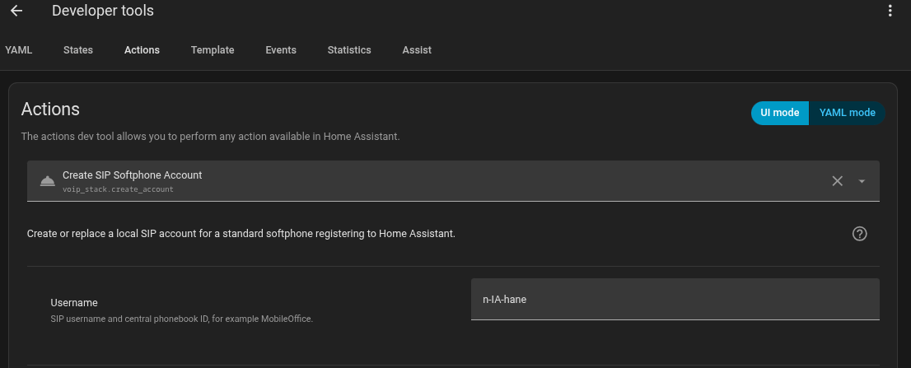
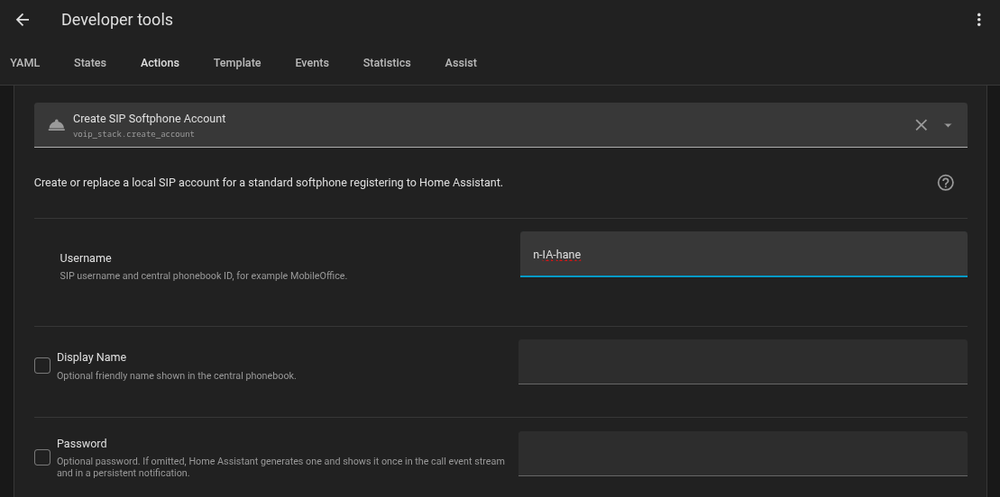

# Home Assistant services

The `voip_stack.*` services are the public control surface for the HA
softphone, central phonebook, local SIP endpoint accounts and automation
fallback routing.

The card uses these services too. The card does not implement private routing
logic.

## Start in the visual editor

This page is the detailed action reference. For ordinary use, add an action in
HA's automation editor or **Developer tools > Actions**, choose **VoIP Stack**,
and fill its named fields. Phone and trunk pickers save their identifiers for
you. See the [illustrated Call action](USER_GUIDE.md#choose-the-calling-phone-in-the-editor).

Use [phone defaults](PHONE_ROUTING.md) for a persistent rule such as a ringing
timeout. Use a [call automation](AUTOMATION_DIALPLAN.md) when the result depends
on time, presence or keypad input. The reference below explains exact fields,
call context and failure behavior for more complex sequences.

## Phone state and pickup

### `voip_stack.get_phone_state`

Choose **Phone** in the action editor and name a response variable. This read-only
action returns that phone's current state, its calls and its mailbox counts.
The required `device_id` comes from the picker; there is no need to copy an ID
from the device registry.

The response contains `schema_version`, `endpoint_id`, `device_id`, `name`,
`extension`, `kind`, `availability`, `dnd`, `state`, `calls` and `mailbox`.
`state` is `idle`, `unavailable`, `calling`, `ringing`, `in_call` or `held`.
DND is separate from availability and call state. Each call includes the logical
`call_id`, `generation`, `leg_id`, peer identity and `pickup_available`.
`sip_call_id` identifies the SIP dialog, not the call token used by HA actions.
The mailbox has `enabled`, `waiting`, `new` and `old` fields.

For ordinary automations, use the native **Phone state changed** or **Mailbox
changed** trigger and the **Phone state**, **Has ringing call** or **Has voicemail**
condition instead of parsing this response with templates. These features read
the same backend state used for SIP dialog notifications and the card.

### `voip_stack.pickup`

Choose **Recovering phone**, then either **Ringing phone** or **Parking slot**.
The recovering phone must be available. For a SIP or ESPHome phone, the PBX calls
that phone and connects the caller when it answers. A browser softphone needs
its active audio connection. **Wait for answer** is 1 to 120 seconds, default 30.

The fields are `device_id`, either `target_device_id` or `slot`, and optional
`answer_timeout`. Advanced `call_id`, `expected_generation` and `leg_id` identify
one particular ringing call. If several eligible calls are present, select one
explicitly: pickup never guesses from whichever call was displayed most recently.
A native call trigger can supply call context, but the recovering phone is always
an explicit choice.

The optional response contains `schema_version`, `call_id`, `generation`,
`endpoint_id` and `state`. A successful pickup also produces the native
**Call picked up** trigger. An already answered, ended or replaced call cannot
be recovered using an old call token. For parking setup and slot dialing, see
[Call parking](CALL_PARKING.md).

## External call permissions

### `voip_stack.set_external_call_access`

Choose a **Phone** and switch **Allow external calls** on or off. The phone
can be a browser softphone, a configured SIP account, or a discovered ESPHome
phone. Every phone is allowed initially. Both `device_id` and `allowed` are
required, so the action never silently applies a restriction to another phone.

The setting is saved in the integration configuration and follows the phone's
stable identity through renaming and Home Assistant restarts. Removing and
recreating a phone creates a new identity with the default permission.
Administrators and automations can change this setting; ordinary users cannot
restore their own access through the service.

Blocking external access prevents new trunk legs from that phone, including
forwards and transfers through HA. An already established call continues.
Internal calls and incoming calls remain available. A restricted phone taking
part in a call cannot use that call to create a new external trunk leg.

A restricted call can still transfer to a known internal phone. SIP REFER to
an HA group or Automation contact is rejected for restricted calls: the other
phone would start a new call under its own identity, losing the original
permission. Ordinary calls to groups and Automation contacts retain their
origin in HA and remain subject to the checks on each outgoing leg.

This controls routes handled by VoIP Stack in Home Assistant. It cannot prevent
a physical phone from calling another SIP server directly outside HA. Configure
that phone and your network accordingly if you need a security boundary.

See the [editor walkthrough](AUTOMATION_DIALPLAN.md#control-external-calls-per-phone).

## Softphone services

A native VoIP trigger supplies the current call to call-handling actions,
including across waits and synchronous scripts. You do not enter its ID.
The optional Phone selector is mainly useful when starting a call or applying
a setting outside a call-triggered automation. It identifies the local phone,
never the remote destination.

For phone settings and phone-originated calls, omitted phone selectors use the
configured preferred phone or the sole compatible phone. Automation media and
Hang up instead require their execution's call or an explicit phone/call selection.
Ambiguous requests fail explicitly.
Advanced explicit-call fields remain available for legacy automations.

### `voip_stack.call`

Originate a call from Home Assistant.

For a backend announcement, set `source_automation` to an enabled Automation
contact's name or extension instead of selecting `device_id`. Set
`answer_timeout` (default 30 seconds). After the destination answers and media
is ready, the next `tts_say`, `play_media` or `hangup` automatically selects this
execution's outgoing call. No `response_variable` or call identifiers are needed
for a single-call sequence. Advanced workflows may still capture the response
and pass `call_id` and `expected_generation` explicitly. Multiple live calls in
the same execution require that explicit selection. A missing or ended implicit
call raises an error, never a fallback to another phone.
See the [complete scheduled-call recipe](AUTOMATION_DIALPLAN.md#place-a-scheduled-announcement-call)
for lifecycle, supported destinations and failure behavior.

`destination` is the only destination field. Its value can be a roster name,
extension, group name, public number, `user@host` or `sip:user@host`.
The central phonebook resolves that value; no destination Device ID is needed.

Optional:

- `send_video`: offer the selected browser phone's camera when SIP video is
  enabled. Receiving video does not require this flag.
- `ha_bridge`: force HA to anchor the route when that is valid.

`voip_stack.call` supports Home Assistant's optional action response. When a
caller requests a response, it receives the authoritative logical-phone
snapshot after origination, including `call_id`, `state`, endpoint identity and
the negotiated media fields already available at that point. The Lovelace card
uses the standard Home Assistant `call_service` WebSocket command with
`return_response: true`; there is no parallel private start command.

### `voip_stack.forward`

With `call_id`, moves an HA-owned pending, ringing or remotely ringing call to
another dial-plan destination. Repeated forwarding cancels the previous
ringing SIP leg before starting the replacement.

If `call_id` is omitted, HA infers it only when exactly one call is forwardable
for the selected logical phone. Use `voip_stack.call` to originate a new call.

Important rule: forwarding to a registered SIP endpoint keeps that endpoint's
current registration Contact as the destination. It must not rewrite to
`sip:<target>@<ha-ip>`.

Optional stale-decision guards:

- `expected_state`: state copied from `event.voip_stack_call`.
- `expected_sequence`: sequence copied from the same occurrence.
- `on_failure`: `resume` (default), `terminate`, or `busy`.

These choices also apply while an Automation contact's outgoing announcement
is waiting for an answer. `resume` starts a fresh SIP attempt to the previous
destination using its previous trunk; the automation keeps its original call
reference. `trunk_id` can select another configured line for the forwarded
destination. The original `answer_timeout` remains the total answer deadline
and is not restarted by forwarding.

See [Automation Dial Plan](AUTOMATION_DIALPLAN.md) for complete examples.

### `voip_stack.transfer`

Transfer an established call through its existing backend owner. SIP peers use
the standard REFER subscription where appropriate.
`call_id` identifies the active call. For a blind transfer, set `destination`
to a configured phone, extension, `user@host` or `sip:user@host`. For an
attended transfer, set `replaces_call_id` to the established consultation call;
VoIP Stack derives the RFC 3891 dialog tags and sends them in `Refer-To`.

For a call between two HA browsers, a blind transfer can select another browser
or route the remaining participant to a SIP phone or trunk. The latter reuses
the ordinary forwarding and RTP bridge, with a 30-second operation deadline.
A failure or cancellation before the handoff commits restores the original
conversation. For browser-to-SIP/trunk handoffs, turn off both local cameras first. A local
call with an active video sender is rejected without changing it; merely having
video capability does not prevent an audio transfer.
Attended transfers require the corresponding SIP consultation dialogs.

For a local Automation contact, a name or extension resolves to HA's reachable
SIP listener, using the contact's extension when assigned. It is not addressed
to the remote phone's SIP host. Explicit `sip:` and `sips:` URIs retain their
supplied destinations. A successful target resolution does not establish that
the receiving phone supports REFER; verify its SIP response and NOTIFY result.

The optional action response reports whether the transfer completed. For a
transfer delegated with REFER, its status comes from the final `message/sipfrag`
notification; a locally controlled handoff reports the backend outcome. This is distinct from
`voip_stack.forward`, which moves a pending or ringing HA-owned route before
the call is established.

### `voip_stack.answer`

Answer the pending call on the selected phone. The Device picker supports
integration-owned HA phones and compatible ESPHome mirror phones.

If `call_id` is omitted and exactly one call is pending, that call is answered.
Set `send_video: true` to send that browser phone's camera when SIP video is
enabled and the negotiated call permits it.

For conference calls, `call_id: conference:<room>` joins the HA softphone to
the room.

### `voip_stack.decline`

Reject the pending call on the selected phone.

Fields:

- `call_id`: optional when only one call is pending.
- `status`: SIP final status, default `603` for this action. Automatic busy and
  DND routing decisions use `486` independently.
- `reason`: SIP reason phrase.
- `decline_reason`: application terminal reason propagated in Reason headers
  and state.

### `voip_stack.hangup`

Hang up the selected phone's active call or a specific `call_id`.

It stops SIP client legs, relay/media reservations, pending invites and HA
softphone media where applicable.

### `voip_stack.set_dnd`

Enable or disable DND on the selected HA softphone.

When DND is enabled, calls targeting HA return `486 Busy Here` with terminal
reason `dnd`.

### `voip_stack.set_auto_answer`

Enable or disable Auto Answer on the selected logical HA phone. The value is
persisted in that phone's config subentry and exposed by its native **Auto
answer** switch. Every card bound to the phone sees the same setting; clearing
one browser's cache does not reset it. A browser still needs persistent
microphone permission before it can answer automatically. The receiving card
must also remain loaded in a running browser/app view. If opening its dashboard
view loads the card, that can be the moment it answers the waiting call.

### `voip_stack.set_send_video`

Enable or disable default camera transmission on the selected logical HA
phone. The value is persisted in that phone's config subentry and exposed by
its native **Send video** switch. Every card bound to the phone sees the same
setting. Camera permission remains local to whichever browser wins media
ownership for the call.

### `voip_stack.set_phone_settings`

Set persistent routing defaults for a selected browser, SIP-account or ESPHome
phone. Select the Phone in the HA action editor; it supplies `device_id`.

- `forward_to`: always forward future calls to this contact, extension or SIP URI.
- `busy_to`: forward when busy or Do not disturb is enabled.
- `unavailable_to`: forward when the destination is unavailable, for example a
  SIP phone without a reachable registration. An enabled browser phone can ring
  without an attached card; use its no-answer policy for that case.
- `ringing_timeout`: seconds before the no-answer action; zero disables the limit.
- `no_answer_action`: `hangup`, `forward` or `voicemail`, required when enabling a new timeout.
- `no_answer_to`: destination required for `forward`; for `voicemail`, an enabled phone mailbox, defaulting to this phone when empty.

Omitted fields retain their current values. An empty string clears that rule.
Known phone destinations are stored by identity, so renaming the destination
does not break the rule. Self-forwarding and unconditional cycles are rejected.
These settings do not move a call already in progress. Explicit automation
routing decisions take precedence; external-call restrictions still apply.

Ringing has no application timeout unless configured. A `call_unanswered`
trigger without `for` follows this phone's timeout. With an explicit `for`, the
automation retains its own duration. At the phone deadline, matching automations
have the existing 1.5-second routing decision window before the configured
fallback is committed. A notification alone leaves the fallback in effect;
answering or handing the call to another owner supersedes it. SIP transaction
timeouts and an outgoing action's answer deadline remain separate.

The shared roster marks policy-controlled destinations for HA routing. Calls
made directly to a physical phone's IP bypass Home Assistant and its policies.
An unavailable forwarding destination produces the normal routing error; it
does not silently fall back to another phone or operator.

For an outgoing Automation announcement, a configured no-answer contact can
redirect the attempt to another supported SIP or ESPHome phone. The `call`
action still returns the same application call reference, so the following
`tts_say` and `hangup` need no changes. Its `answer_timeout` covers all attempts
together. Synthesis starts only after the selected phone answers; a failed
replacement ends the action and releases both attempts. This development path
does not yet resume a cancelled destination or support a mailbox replacement.

### `voip_stack.set_ha_softphone_settings`

Publish HA softphone identity and group membership.

Fields:

- `extension`: internal extension published in the central roster.
- `ring_group`: comma-separated ring group memberships.
- `conference_group`: comma-separated conference group memberships.
- `conference_ring`: whether HA rings when another participant starts one of
  its conference groups.
- `auto_answer`: persistent Auto Answer preference.
- `send_video`: persistent default camera-transmission preference.

Changing these settings updates HA's virtual endpoint sensor. The phonebook
sensor observes that change, rebuilds the central roster and pushes updates to
online ESP devices. The same values are editable directly from each browser
phone Device through native Extension, Ring groups, Conference groups and Ring
for conference calls entities, plus Auto answer and Send video switches. The
Device entities, this action and the card all use the same persisted phone
configuration.

## Phonebook services

### `voip_stack.add_contact`

Ordinary SIP contacts also accept `sip_profile` (`auto` or `dahua`) and
`dahua_audio` (`auto`, `standard`, `pcm` or `symmetric`). The same choices appear in the
contact editor. Explicit audio choices require the Dahua profile. They do not
alter registration state or fabricate a User-Agent. See the
[Dahua setup and comparison guide](DAHUA.md) for direct and trunk examples.

Add or replace one manual central contact.

Useful fields:

- `name`: required.
- `id`: optional stable ID, defaults to name.
- `address`: direct endpoint host/IP.
- `sip_uri`: complete SIP URI.
- `extension`: internal dial-plan alias.
- `number`: external trunk number.
- `ha_bridge`: force HA routing.
- `transport`, `port`, `rtp_port`: direct SIP/RTP endpoint metadata.
- `tx_formats`, `rx_formats`, `max_payload_bytes`: optional media metadata.
- `ring_group`, `conference_group`, `conference_ring`: group membership.

### `voip_stack.remove_contact`

The action exposes one required field named `name`; its value may match the
manual contact's name, stable ID, extension or number.

### `voip_stack.set_contacts`

Replace all manual contacts with a JSON roster document.

Dynamic ESP, HA and registered SIP endpoint entries are not manual contacts and
are rebuilt from their live sources.

### `voip_stack.clear_contacts`

Clear manual contacts only.

### `voip_stack.export_phonebook`

Return the current central JSON phonebook in the administrator-only service
response. The roster is never broadcast on the Home Assistant event bus.

### `voip_stack.push_phonebook`

Push the current central JSON phonebook to online ESP devices.

The normal path is automatic: phonebook changes trigger a rebuild and push.
Home Assistant also refreshes and pushes again when an ESPHome
`*_set_roster_json` service is registered, so rebooting ESPs receive the roster
after their action surface is ready. Use this service for diagnostics or manual
recovery.

### `voip_stack.purge_devices`

This legacy action is disabled. VoIP Stack does not own ESPHome Device
Registry entries and therefore never removes them. Home Assistant returns a
translated error for every invocation.

## Local SIP endpoint account services

These accounts are for standard SIP endpoints registering to HA: phones,
softphones, ATAs, baresip, pjsua and similar clients.

<table>
  <tr>
    <td></td>
    <td></td>
  </tr>
</table>

### `voip_stack.create_account`

Create or replace a local SIP endpoint account.

Fields:

- `username`: SIP username and roster ID.
- `display_name`: optional friendly name.
- `password`: optional. If omitted, HA generates one and returns it once in the
  administrator-only action response.
- `enabled`: default true.
- `replace`: allow replacing an existing account.
- `extension`: optional internal extension. When set, the endpoint can be
  called by name or extension.
- `ring_group`, `conference_group`, `conference_ring`: group membership.

If a manual password is provided, HA preserves it exactly without echoing the
password in the response, logs or events.

### `voip_stack.remove_account`

Remove a local SIP endpoint account and active registration.

### `voip_stack.enable_account`

Enable an account.

### `voip_stack.disable_account`

Disable an account and clear active registration.

### `voip_stack.rotate_account_password`

Generate a new password, clear active registration and return the replacement
once in the administrator-only action response.

### `voip_stack.list_accounts`

Return configured accounts without passwords in the administrator-only action
response.

## Automation route service

### `voip_stack.set_deadline` / `voip_stack.cancel_deadline`

Arm or cancel an explicit per-call `calling` or `ringing` deadline. Expiry
publishes `calling_timeout_requested` or `ringing_timeout_requested` only when
the call is still in the same state and sequence. A deadline never changes the
route itself.

These call-global controls are administrator-only for authenticated service
callers. Internal Home Assistant automations remain allowed.

Fields for `set_deadline`:

- `call_id`, `phase`, `timeout`.
- optional `expected_state` and `expected_sequence` stale-decision guards.

### `voip_stack.route`

Apply a decision to a pending inbound SIP route request.

This call-global control is administrator-only for authenticated service
callers. Internal Home Assistant automations remain allowed.

Fields:

- `call_id`: supplied by a native VoIP trigger; required for legacy explicit routing actions.
- `action`: `answer_ha`, `decline`, `busy`, `forward`, `bridge`, `default`,
  `cancel`.
- `destination`: forward/bridge destination.
- `status`, `reason`, `decline_reason`: optional terminal response metadata.

Use this while an initial routing decision is pending. A matching native
routing trigger opens that decision window. Without an applicable automation,
the phonebook continues to select the destination.

### `voip_stack.select_inbound_destination`

Select the initial destination while an inbound `route_requested` decision is
pending. This is the normal automation action for initial trunk routing.

- `destination`: required phonebook name, group, extension, registered phone,
  Assist extension, SIP URI or routable number.
- `call_id`: supplied by a native VoIP trigger, including concurrent calls.
  Legacy actions may omit it only when exactly one inbound route is pending.
- `expected_state` / `expected_sequence`: optional stale-event guards.

This action does not forward an already-ringing call. Use
`voip_stack.forward` for that later lifecycle operation.

## Native call event entity

`event.voip_stack_call` is the browsable automation surface for call lifecycle,
routing deadlines and in-call DTMF. Its state is the last occurrence timestamp;
the occurrence type and call envelope are attributes. Raw event-bus messages
are internal transport between the integration and its Event Entities, not a
second public automation API.

Each integration-owned phone Device also exposes a scoped call Event Entity
and an enum call-state Sensor Entity. Those entities remain available for automations
about one room/handset, such as "Casa has rung for 30 seconds" or "Test missed
an incoming call". Use the aggregate entity for PBX-wide logic and
`route_requested`. Every phone has its own Device-owned call-state sensor.

The call-state sensor is durable and therefore supports native state triggers
with `for:`. Its attributes include `call_id`, `direction`, `ingress`,
`peer_name` and `terminal_reason`; `ingress` is `trunk` for provider/PBX calls
and `extension` for locally originated calls. The selected sensor identifies
the phone: an automation on Casa's sensor does not apply to every logical
phone.

## In-call DTMF event entity occurrence

For new rules, prefer the native `voip_stack.dtmf_received` trigger. Automations that operate
gates, locks or other security-sensitive devices must validate the expected
caller/source and digit rather than matching the digit alone.

During an established call bridged by HA, each negotiated RFC 4733
`telephone-event` key or compatible in-dialog SIP INFO key produces a `dtmf`
occurrence on the involved phone Event Entity and on
`event.voip_stack_call`. This does not invoke the initial trunk extension
router and does not transfer the active call.
Detection and event publication are HA-backend features; they add no DTMF
parser, callback or media-loop work to ESP endpoints.

```yaml
triggers:
  - trigger: event.received
    target:
      entity_id: event.casa_call
    options:
      event_type:
        - dtmf
conditions:
  - condition: state
    entity_id: event.casa_call
    attribute: source
    state: Cordless
  - condition: state
    entity_id: event.casa_call
    attribute: digit
    state: "1"
actions:
  - action: lock.unlock
    target:
      entity_id: lock.gate
```

The event carries one key at a time plus both call IDs, caller, callee,
`source`, `source_leg`, diagnostic `side`, and the transport (`rtp_event` or
`sip_info`). It is available only for calls that pass through VoIP Stack in
HA; direct peer-to-peer ESP calls remain invisible to HA.

See the complete
[in-call DTMF recipe](AUTOMATION_DIALPLAN.md#open-a-gate-with-in-call-dtmf)
for source-leg filtering and security notes.

## SIP diagnostics

### `voip_stack.capture_sip`

Administrator action to record this integration's SIP signaling without SSH,
tcpdump or extra HA OS tools. Required `operation` is `start`, `stop`, `status`
or `clear`. Optional `duration` is 10 to 300 seconds (default 120), used only
for `start`. The action returns a response with capture status, message and
drop counts, size, stop reason and a short-lived `download_url`.

Start before the call and stop after reproducing the failure. Open the returned
`download_url` in your browser to download a Wireshark-readable Upper PDU PCAP. The
capture is bounded to 4 MiB or 20,000 messages and deleted 15 minutes after
stopping. Authorization values are redacted; phone numbers and addresses are
not. A start while active is rejected; a new start after stopping replaces the
previous capture. This records application SIP I/O, not RTP or kernel packets.
See [the capture instructions](troubleshooting.md#capture-sip-signaling-from-home-assistant-including-ha-os)
for the complete procedure and diagnostic limits.

## Announcements in automation calls

`voip_stack.tts_say` speaks to the caller of a contact with `type: automation`.
Choose a `tts_entity_id` (such as a configured Piper or xTTS entity) and
`message`; `language` and provider `options` are optional. `timeout` limits
synthesis and playback together, defaults to 120 seconds and accepts 1-600 seconds.
The action answers the call if needed and waits for the audio to be sent before
returning. It does not play on a room speaker or start Assist.

Native VoIP triggers and a preceding Automation-source Call in the same execution
supply the call identity automatically. Legacy event-based
automations can keep passing `call_id` and `expected_generation` from their
triggering event.
A different automation cannot take over an already claimed call. A stale event
cannot control a later call, even if a SIP Call-ID is reused.

`voip_stack.add_contact` accepts `type: automation`, a required `name`, optional
numeric `extension`, optional `fallback_destination` and `timeout` (inactivity,
1-300 seconds, default 30). Do not provide an address, SIP URI or external number.
For native triggers this limits the initial wait for an automation to take
control. Legacy event-based automations also use it between actions, but not
while TTS is running. With no fallback, the call ends on timeout. A TTS error stops the
HA action sequence unless its standard `continue_on_error` option is enabled.

See [automation contacts](AUTOMATION_DIALPLAN.md#automation-contacts) for examples.

## Native call automations

Native VoIP triggers bind each action to the call that triggered that execution.
`voip_stack.call_received`, for example, can filter `destination: Welcome`
directly. In that automation, omit `call_id` and `expected_generation` from
`voip_stack.tts_say` and `voip_stack.forward`. The binding also survives normal
HA waits and synchronous script calls. Separate calls never share this binding.
Legacy event-based automations can continue supplying explicit identifiers.

When a native automation finishes, an automation contact still controlled by
that execution ends its call. A successful forward hands the call to the new
destination instead. Observational automations, such as notifications, do not
end calls merely because their action sequence finished.

An unanswered Home Assistant phone call can also be taken over by its native
`call_unanswered` automation. For an incoming SIP caller or a browser calling
another HA phone, `tts_say` answers the original caller and releases the ringing
phone. Subsequent actions use that same call. A notification alone leaves the
phone ringing and does not acquire control. The caller can still hang up.

For example, this branch supports the following rule for an HA phone named
`Kitchen`. The explicit duration works even without a timeout configured on
the phone:

```yaml
alias: Kitchen unanswered greeting
triggers:
  - trigger: voip_stack.call_unanswered
    options:
      destination: Kitchen
      for:
        seconds: 30
actions:
  - action: voip_stack.tts_say
    data:
      tts_entity_id: tts.piper
      message: "Nobody is available in the kitchen. Please try again later."
  - action: voip_stack.hangup
mode: parallel
```

Use your own TTS entity. A phone answer that wins the race invalidates the
unanswered trigger's control, so the automation cannot interrupt that answer.
A browser call whose SIP destination is still ringing can use this same rule:
the outstanding SIP attempt is cancelled before the automation takes over the
browser caller. The browser keeps its call identity and hangup control. This
does not take over an already answered conversation or an outgoing Automation
announcement, whose application owner is already established.

### `voip_stack.wait_unanswered`

**Wait without answering** keeps an unanswered Automation contact call in its
existing ringing state. `duration` is the number of seconds to wait (default
60, range 1-3600). The contact route sends SIP `180 Ringing`; this action sends
no `200 OK` to the INVITE and starts no audio stream, TTS or physical ringtone.
It rejects an already answered call. Put it before any TTS or keypad action.

The native VoIP trigger supplies the Call-ID automatically. The action claims
that execution's call and suspends the contact's initial inactivity timer while
waiting. Caller cancellation cancels the wait through the existing call owner.
At expiry the next action runs, for example `voip_stack.forward`. If the native
automation ends with the call still unanswered, it ends with SIP `480`, not BYE.
Errors or automation cancellation use the contact's normal fallback policy.

For provider no-answer forwarding, choose a duration longer than the provider's
configured forwarding interval and leave the contact fallback empty. The
provider must implement that forwarding; HA cannot guarantee its policy.
See [the no-answer recipe](AUTOMATION_DIALPLAN.md#leave-an-incoming-call-unanswered).

### `voip_stack.wait_for_dtmf`

Wait for keypad input from the caller of an automation contact. The call is
answered if needed. `timeout` is the time to wait for input after answering,
in seconds (default 10, range 0.1-300). A timeout returns a result and lets the
next HA action run; it is not a SIP failure or a ringing timeout.

Advanced options are `max_digits` (default 1, range 1-32) and `terminator`
(default `#`, or `*`, or an empty string to disable it). The terminator ends
input and is not included in the result. Use the native condition
`voip_stack.is_dtmf_result` to check `status: received` with optional `digits`,
or `status: timeout`, without templates. An optional HA response variable
receives `{status: received|timeout, digits: "..."}` for advanced scripts.

The wait belongs to the current call and accepts only its caller's digits.
Ending the call cancels the wait. Digits entered before this action starts
are not collected. For an IVR, first speak the choices, then wait for a key,
then use HA's Choose action to forward to the selected destination.


### `voip_stack.play_media`

Play a recorded audio file to an Automation call. The **Audio file** field uses
Home Assistant's Media picker; it supplies `media.media_content_id` and
`media.media_content_type`. Choose an uploaded file or a direct HTTP(S) audio
URL. HA retrieves and decodes the file, then sends it over the call's existing
RTP channel. The remote phone does not fetch the file.

Like `tts_say`, this action uses the call selected by the native VoIP trigger.
For an outgoing scheduled call, the preceding `call` in the same execution
selects the call automatically; explicit references are optional. The action waits for transmission to finish and
does not hang up automatically. `timeout` defaults to 120 seconds and accepts
1-600 seconds, including download and decoding. Admin users and automations
can invoke it, subject to the existing call owner/controller checks.

See the [recorded announcement recipe](AUTOMATION_DIALPLAN.md#play-a-recorded-announcement)
for a complete script, supported media and cancellation behavior.

### `voip_stack.set_voicemail_settings`

Configure a phone's mailbox. Select the phone with the native **Phone** device
picker (`device_id` in YAML). `enabled` defaults to false for a new mailbox;
turning it on does not enable call forwarding. Omitted fields retain their
current values, and renaming the phone preserves the mailbox identity.

`max_seconds` limits each message, from 1 to 3600 seconds (default 180).
`greeting_media` uses Home Assistant's Media picker and must identify a
`media-source://` item. `clear_greeting: true` removes that selection. A missing
or unavailable greeting falls back to the recording tone. Messages are stored
in HA's media directory, with a combined archive quota of 1 GiB and no automatic
deletion. An empty recording creates no message.

`pin` accepts 4 to 10 digits, or an empty value to disable access from another
mailbox. Only a salted PIN hash is persisted. The shared menu voice and language
are configured once in the integration's native reconfiguration flow, not in
each mailbox. Enabling the global voicemail feature requires an available TTS
entity and a supported prompt language. Current prompt translations cover
English, Italian, German and Portuguese, filtered against the selected engine's
supported languages.

Dial `*97` or `mailbox` to access the calling phone's own mailbox without a PIN.
`*98` asks for a mailbox extension; `mailbox.<phone>` selects one explicitly.
Another mailbox requires its configured PIN. Dial `voicemail.<phone>` or
`*60<extension>` to leave a message. During access, 1 selects the next message,
2 deletes the selected message, 3 repeats it, and # ends the call. To select
message 1 directly, send the DTMF sequence `01#` after answer. The initial 0
starts message selection and # terminates the number. Any key interrupts the
prompt without losing that key. Message numbers remain fixed for the call.

SIP phones can subscribe to `message-summary` for their account. The PBX sends
RFC 3842 MWI notifications containing new/old counts. The HA softphone's state
reflects the same mailbox counts. Removing a phone permanently removes its
mailbox; temporary disconnection or registration expiry does not.

The HA softphone card shows **Voicemail** when the phone has messages. Open it
to see the caller and reception date. Selecting a row calls `*97` from that
phone and sends the message-selection digits over the ordinary call. **Delete**
uses the same call and the menu's delete command, waits for confirmation, then
hangs up. The list remains open. An unrelated active call is never replaced.
Message selection uses the numbering frozen by that mailbox call, so a newly
received message cannot shift the selected row to a different recording.

### `voip_stack.send_to_voicemail`

Transfer the automation's current call to a phone's enabled mailbox. Choose
**Mailbox** with the native device picker (`mailbox` in YAML). Like `tts_say`,
this action uses the call bound to the native VoIP trigger or to the preceding
outgoing `call` action in the same script execution. An explicit `call_id` and
`expected_generation` remain available for deliberately correlated scripts.

The selected mailbox can belong to a different phone. `skip_greeting: true`
skips its configured audio greeting; the recording tone still plays. For
example, a native unanswered-call automation can run `tts_say` first, then this
action with `skip_greeting: true`.

The action returns after handing the call to the mailbox application. That
application answers if necessary, plays the greeting/tone, records the caller,
and ends the call when its recording limit expires. A remote hangup saves the
message immediately. Completing the originating automation does not cut off
the recording. Do not add `hangup` after this transfer: that execution no longer
owns the mailbox call.

`voip_stack_voicemail_received` reports a saved message's stable `mailbox_id`,
opaque `message_id`, caller, duration and whether it is partial. It contains no
public download URL. A recording or storage failure ends the mailbox deposit
and uses the existing call cleanup; it does not leave a hidden media session.

### `voip_stack.transcribe_voicemail` and `voip_stack.get_voicemail`

Both actions select the message associated with the native
`voip_stack.voicemail_received` trigger. Outside that execution, supply both
`mailbox` (the phone's device picker) and `message_id`. Both return response
data, so set `response_variable` in an automation.

`transcribe_voicemail` requires `stt_entity_id` and `language`. It sends a bounded
PCM stream to the existing HA STT entity and returns text and message identity.
`timeout` defaults to 120 seconds. It does not mark the message read or change
its recorded format.

`get_voicemail` returns `file_path` and `media_source_id` for the saved message
in HA's media directory. It creates no copy and does not mark the message read.
The native trigger already supplies these same references in `trigger.voicemail`.
Deleting a message or its phone removes this same audio file.

See [Voicemail](VOICEMAIL.md#process-a-received-message-in-an-automation) for
complete examples, supported STT input and attachment handling.


## Park an established call

`voip_stack.park` parks the selected phone's current audio call. `device_id`
selects the phone, `slot` optionally selects a configured parking slot, and
`call_id` / `expected_generation` can identify a specific current call. The
optional action response contains `slot`, `call_id` and `generation`.
The selected phone must own the call. Parking is available by default; configure
its numbers and resolve any reported dial-plan conflicts. Retrieve the caller through the normal call action or SIP dialer
using the slot number. See [Call parking](CALL_PARKING.md) for configuration,
examples and the current development verification boundary.


## Conversation recording

`voip_stack.start_recording` records the selected phone's established call,
with an optional `max_seconds` limit (1 through 3600). `voip_stack.stop_recording`
finishes that recording without hanging up. Both accept `device_id`, optional
`call_id` and `expected_generation`; native call triggers supply call identity.
`voip_stack.get_recording` takes `device_id` and `recording_id` and returns the
saved file's `file_path` and `media_source_id`, without copying it. The normal
HA event `voip_stack.recording_finished` identifies completed or partial files.
See [Record a conversation](CALL_RECORDING.md) for examples and media scope.

`voip_stack.delete_recording` accepts the same `device_id` and `recording_id`
and removes the recording together with its metadata.
