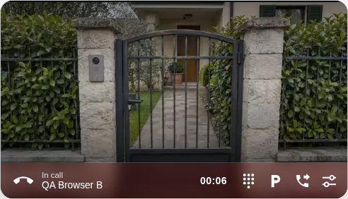

# SIP video

VoIP Stack can optionally turn the Home Assistant softphone card into a SIP
video phone for standard SIP phones, softphones and door stations. SIP video
is available to compatible endpoints. ESPHome profiles remain audio-only unless
a video source or sink is configured. A supported ESP32-S3 camera can transmit
RTP/JPEG; a supported S3 display can receive JPEG through `esp_video_renderer`.
These are independent roles, so a receive-only display does not gain a camera.
ESP32-S3 does not decode H.264. P4 profiles select JPEG or H.264 transmit and
receive paths without replacing their audio contract.

Video is disabled by default and does not alter an audio-only installation.
Open the VoIP Stack integration, choose **Reconfigure**, then enable
**SIP video for the Home Assistant softphone**. A second step
offers two independent capabilities:

- **Enable video transcoding** lets VoIP Stack use the FFmpeg binary already
  available to Home Assistant when two negotiated video legs have no direct
  codec match. This covers legacy receive codecs for the HA softphone and
  H.264/JPEG conversion between HA-owned SIP legs.
- **Allow browser camera transmission** exposes a **Send Camera** control in
  the card. The logical Home Assistant phone stores that choice in its config
  subentry and exposes it as a native switch; each attached browser still asks
  for its own camera permission. Receiving video never requires camera access.

If video setup, decoding, camera permission or transcoding fails, the SIP
dialog and browser audio remain active whenever audio negotiation succeeded.

The S3 receive renderer and current managed account/directory paths belong to
the coordinated preview. Stable camera-only firmware does not gain a receive
display through a HACS update. Follow
[preview source selection](DEPLOYMENT_GUIDE.md#development-preview-firmware).

## Start with one picture

1. Make a working audio call between the two endpoints first.
2. Enable SIP video in the integration and allow the required codecs on a trunk
   if the call uses one.
3. Turn **Send Camera** on only on the side that should transmit its camera.
   Grant that browser camera permission. The other side can receive without
   sending its own camera.
4. During the call, turn either camera off to stop that direction. Turning your
   camera off does not prohibit receiving the other party's video.



_Dashboard doorbell-call demonstration using an illustrative gate-camera feed._

For a door station, the common goal is two-way audio with video only from the
station. Use the [Dahua guide](DAHUA.md) for its explicit compatibility settings.
The codec matrix below explains what happens when endpoints support different
formats; it is not a checklist you must complete for every call.

## Direct media and conversion

Each leg negotiates its codec, direction, dimensions and cadence through SDP.
A compatible encoded path is preferred even when transcoding is enabled.
Conversion is used when the negotiated codec or image constraints require it;
it is not enabled merely because a phone registered or lacks legacy discovery
metadata. A JPEG browser frame may also require Huffman-table normalization
before RFC 2435 packetization.

For example, a compatible JPEG call can pass through HA without video decode
and re-encode. An upstream H.264 call can be converted by HA to JPEG for an S3
sink when video transcoding is enabled. Disabling conversion does not authorize
an incompatible video contract; audio can remain active when video is rejected.

## Capability matrix

The browser path keeps H.264 and VP8 encoded media off the HA decoder. JPEG
camera frames are encoded in a browser worker. If a browser emits Huffman
tables that RFC 2435 cannot carry, HA lazily normalizes those JPEG frames with
one bounded FFmpeg worker before RTP packetization.

| Negotiated SIP codec | Receive in card | Send browser camera | Server transcode |
| --- | --- | --- | --- |
| H.264 Baseline, Main or High | Direct when supported by the browser | Direct for packetization mode 1 | To H.264 or JPEG only when the other SIP leg requires it |
| VP8 | Direct | Direct | To H.264 or JPEG only when the other SIP leg requires it |
| JPEG over RTP | Direct | Direct, with bounded normalization when required | To H.264 or JPEG only when the other SIP leg requires it |
| H.263 | Optional | No | To VP8 for the browser, or H.264/JPEG for a SIP leg |
| H.263-1998 / H.263-2000 | Optional | No | To VP8 for the browser, or H.264/JPEG for a SIP leg |
| H.265 / HEVC | Optional | No | To VP8 for the browser, or H.264/JPEG for a SIP leg |
| Audio-only or unsupported video | Audio continues | No | No |

## ESP32-S3 camera preview and SIP video

Adding `esp32_camera` exposes a Home Assistant camera entity. Seeing that
entity in the call card does not mean the SIP call contains video. RTP/JPEG
requires a camera source configured on the ESP's VoIP component as well:

```yaml
voip_stack:
  # Keep the existing audio configuration.
  video:
    codec: jpeg
    camera_id: esp32_cam
    width: 640
    height: 480
    framerate: 10
```

The board's existing `esp32_camera` configuration must declare `id: esp32_cam`
and produce JPEG at the configured dimensions. Keep its board-specific pins.
The device's VoIP endpoint sensor should advertise `video=jpeg`; a camera
entity alone is not an advertised SIP video capability.

For a direct call from the HA phone to the S3, enable SIP video in HA and use
an HA integration version that negotiates reception independently from
**Send Camera**. Stable `2026.10.1` still ties the outgoing video offer to that
switch; 2026.11.0 removes that dependency. Updating only the
ESP external component does not update the HA integration.

With the browser camera off, HA offers JPEG as `recvonly`. A camera-only S3
can answer `sendonly`, keeping audio bidirectional. No server video transcoding
is needed for this matching JPEG path. Conference rooms remain audio-only;
calling a conference is not equivalent to calling one HA phone directly.

[Community testing](https://github.com/n-IA-hane/esphome-voip-stack/pull/6#issuecomment-6122628313)
confirmed S3-originated video, immediate redial and preservation of a
simultaneous camera web stream. A later [HA-to-S3 retest by @jayfan0](https://github.com/n-IA-hane/esphome-voip-stack/pull/6#issuecomment-6172662217)
confirmed immediate S3 camera video after updating the HA integration. That
reported call lasted 64 minutes before an unexplained disconnect without debug
logs, so it is not evidence of unrestricted long-uptime behavior. Both reports
concern the S3's outgoing camera stream, independently of which side dialed.
S3 receive display support is provided separately by the JPEG renderer
described below.

If a camera call remains without video, collect one HA-to-S3 SIP capture and the ESP diagnostic log:
check the INVITE's `m=video` and direction, the answer's video port and direction,
then RTP delivery. See [Testing and debugging](TESTING_AND_DEBUG.md).

## ESP32-S3 receive display

The maintained S3 JPEG receive package connects the standalone
[`esp_video_renderer`](https://github.com/n-IA-hane/esphome-video-renderer) to the
existing VoIP video sink and LVGL call surface. It decodes complete JPEG images
and returns the display to its ordinary UI after the video session ends.
A board may configure a camera source independently if it has one.

Spotpear FULL configures a 240x240 receive envelope; Box V2 FULL configures
320x240. Their device packages currently request up to 10 FPS, while the generic
receive package has its own conservative defaults. Display plus VoIP selects
this receive path on those supported FULL boards; no camera is inferred.

The selected dimensions and `framerate` bound resource use and admission; they
do not guarantee an achieved panel frame rate. A camera-only S3 installation
needs the receive renderer and a suitable display to show incoming video.
An H.264 upstream leg requires HA conversion to JPEG, not an H.264 decoder on S3.

## ESP32-P4 video endpoints

P4 video is compile-gated. A firmware includes exactly one SIP video codec:

- the VoIP-only JPEG profile uses the hardware JPEG camera path and the P4 JPEG
  decoder;
- the VoIP-only H.264 profile uses the P4 hardware encoder and the maintained
  receive decoder path;
- the canonical full-experience profile uses JPEG so video can coexist with AFE,
  Voice Assistant, Micro Wake Word and the landscape UI.

The full profile also publishes the same JPEG source as a standard ESPHome
camera entity. Home Assistant can render that entity through its normal camera
platform, while negotiated calls use RTP/JPEG in both directions without a
second capture pipeline.

Maintained FULL profiles pause Micro Wake Word during negotiated video without
changing its saved enable setting. The usual startup/readiness guards decide
whether recognition resumes after video ends. Assist, music, TTS and calls keep
their existing application and audio bindings.

### What the P4 sends and displays

The two video directions are independent and can run at the same time:

1. In the outgoing direction, `esp_video` owns camera capture. The JPEG profile
   forwards the camera's encoded JPEG frame into RTP without capturing or
   encoding a duplicate image. The H.264 profile converts the camera frame and
   uses the ESP32-P4 hardware encoder.
2. In the incoming direction, the VoIP component receives RTP packets,
   reorders the bounded packet window and reconstructs one complete JPEG or
   H.264 access unit. Damaged or incomplete frames are discarded instead of
   being shown later.
3. The codec-specific renderer uses the P4 hardware JPEG decoder for JPEG or
   Espressif's H.264 software decoder for H.264. PPA performs scaling, rotation
   and pixel-format conversion where required.
4. The resulting frame is presented on the physical MIPI DSI panel. This is a
   real receive display path, not the ESPHome camera entity and not evidence
   inferred from RTP counters.

Presentation follows the video media clock. Capture, decode and display use
bounded queues, persistent workers and reusable buffers so that a slow frame
cannot create an ever-growing delay. Video work is kept out of the ESPHome main
loop, and JPEG and H.264 dependencies remain gated by the selected firmware
profile.

The renderer also owns the transition between the normal LVGL interface and
the call image. It enters the video view only for an accepted receive stream,
can return to audio-only during the same dialog, and restores the idle page and
navigation controls after hangup. Qualification therefore checks signaling,
RTP/codec processing and physical-panel presentation separately.

Do not enable both JPEG and H.264 in one P4 firmware. The YAML codec choice
gates the unused source, decoder, buffers and managed libraries at compile
time.

H.264 receive uses the P4 direct display path. `display_id` is therefore
required on `p4_video_renderer` when `codec: h264`; ESPHome rejects the YAML at
validation time if it is missing. JPEG can present through the LVGL image path
or an optional direct display. In either case, receiving RTP packets or
decoding frames is not considered display success: the presentation counter or
a synchronized [screenshot](ESP_SCREENSHOT.md) must demonstrate presentation
through that path. A driver framebuffer capture is not independent proof that
the physical panel received every transfer.

## Home Assistant video capabilities

The following list describes HA browser and SIP bridge behavior, not additional
P4 decoder codecs. P4 remains limited to its selected JPEG or H.264 profile.

The HA profile supports:

- incoming and outgoing calls owned by the Home Assistant softphone;
- `sendrecv`, `sendonly`, `recvonly` and `inactive` SDP directions;
- one negotiated video stream, using the first accepted `m=video` section;
- H.264 single NAL units, STAP-A and FU-A;
- VP8 RTP payloads and RFC 2435 JPEG reassembly;
- sequence reordering with bounded queues and damaged-access-unit rejection;
- RTP/AVP by default and RTP/AVPF when offered by the remote endpoint;
- compound RTCP receiver reports, plus negotiated AVPF PLI or FIR key-frame
  requests;
- symmetric RTP source latching for ordinary SIP devices behind NAT;
- one authenticated browser media owner for the active HA call;
- exact-codec RTP and RTCP relay between two HA-owned standard SIP legs.

The direct bridge changes only the leg-local RTP payload type. Encoded payload,
timestamp, sequence, marker, SSRC and RTP extensions remain intact. H.264
packetization mode, profile and RTP transport profile must match, and other
codecs must have matching normalized format parameters.

When direct relay is impossible and transcoding is enabled, each active media
direction is evaluated independently. HA converts only the incompatible
direction to the format negotiated by that receiver. Direct media on the
opposite direction stays encoded and unchanged. A known P4 target is offered
only its compile-time H.264 or JPEG codec, so its SDP never claims support for
the other path.

## Direct, trunk and PBX calls

SIP video is not limited to LAN or VPN SIP URIs. The HA softphone
offers and accepts the same video profile when a call uses a configured SIP
trunk or a video-capable PBX. An authenticated `401` or `407` retry preserves
the complete audio/video SDP offer, including media direction and codec
parameters.

For inbound trunk video, **Direct to default destination** reaches the selected
phone without digit-collection delay. **DTMF extension selection** can also
preserve video when the initial trunk offer contains a compatible video stream:
HA pre-binds and advertises the audio/video ports while collecting digits, then
hands those exact sockets to the selected HA browser phone. Selecting an
audio-only destination releases the unused video resources.

With RTP/AVP there may be no negotiated key-frame feedback. A browser that
attaches after DTMF collection can therefore wait until the remote sender's
next natural keyframe. VoIP Stack deliberately does not send unnegotiated PLI,
FIR or proprietary SIP picture-update messages.

End-to-end success still depends on every provider or PBX in the route keeping
the `m=video` section and forwarding the negotiated RTP/RTCP ports. A normal
PSTN leg or an audio-only ITSP may remove video while leaving audio usable.
When a PBX bridges two HA instances, exact-codec H.264, VP8 or JPEG can remain
passthrough; this integration does not require both homes to share one HA
instance.

### External media address on a trunk

The trunk's **Media NAT mode** (`trunk_media_nat`) controls the media destinations
advertised to that PBX on outgoing calls:

- **Automatic** (`auto`, the default for new trunks) uses Home Assistant's
  configured STUN servers for a public IPv4 peer. It sends Binding requests on
  the actual bound media sockets before their media readers
  start, then advertises each validated address and port separately. Translated
  RTP and RTCP ports need not be consecutive. Private LAN/VPN peers retain the
  local media destinations without contacting an Internet STUN server.
- **Direct** (`direct`) keeps the local media address and ports, without STUN.
  Use it when the peer can already route to HA's advertised media sockets.
- **Manual** (`manual`) requires **Outbound media IPv4 address**
  (`trunk_outbound_media_address`). It must be HA's actual reachable address,
  not the provider's address, and the advertised RTP/RTCP port numbers must be
  reachable unchanged. Existing saved address overrides retain this manual
  behavior. Update the override if the public egress address changes.

Automatic discovery validates every required socket and does not substitute a
guessed public address or port when discovery fails. STUN mapping discovery is
not ICE connectivity negotiation or a TURN relay, and does not configure router
port forwarding or guarantee reachability through every NAT/firewall. Working
audio through symmetric RTP does not establish that an independent receive-only
video stream can reach its advertised destination. These per-trunk settings do
not change ordinary LAN calls.

### Dahua door-station interoperability

Dahua UAC firmware commonly advertises `PCM/16000` for audio. This is not the
network-byte-order `L16` payload defined by the RTP standards: captures and
existing integrations show signed 16-bit **little-endian**, mono, 20 ms frames
on a dynamic payload type. VoIP Stack recognizes the narrow `Dahua UAC/...`
User-Agent profile and applies that contract only to that peer. It never treats
generic `PCM` as an alias for standard `L16`.

The same profile is used in both directions:

- a Dahua INVITE can negotiate its exact PCM audio alongside compatible SIP
  video;
- an HA call to a Dahua endpoint registered over TCP reuses the live REGISTER
  connection and offers the vendor PCM format first;
- a repeated digest refresh with a stale nonce receives a fresh challenge
  with `stale=true`, without weakening replay protection;
- a compatible audio call may add video later with an in-dialog re-INVITE.

There is no public Dahua switch and no ESPHome firmware change. Detection,
offer/answer and RTP conversion remain internal to the HA SIP leg. The profile
has been qualified against public wire captures and an exact simulated peer,
including bidirectional audio/video, re-INVITE and teardown; real-device
firmware variants still need user feedback.

## Card behavior and privacy

Received video becomes the background of the in-call card. The caller,
duration and call state move into a full-width hang-up bar at the bottom so the
picture remains the primary content. The layout follows Home Assistant
Sections sizing from compact 6-column cards through wide and tall cards.
Long caller names are truncated inside the bar rather than widening the page.

Detailed codec, packet and frame counters appear only when VoIP Stack debug
mode is enabled. The normal card does not cover the picture with diagnostics.

The tune button beside Hangup selects the microphone, audio output and camera
owned by the current browser or Companion App session. Camera replacement is
atomic: the existing sender remains active until the replacement track and
encoder are ready. Hangup remains the explicit call-termination control;
audio-reactive decoration is separate from whether that action works and is
not a measurement of audible playback.

Camera transmission has two gates. The integration-level option must first be
enabled, then **Send Camera** must be enabled on that logical HA phone. The
preference survives cache clearing and is shared by every card bound to the
same phone; camera permission remains local to the browser that owns media.
Permission denial stops only the outgoing camera track. Incoming video, audio
and call controls continue independently. The page/window owns browser media
and shares it across its cards, Dashboard and popup. Changing views does not
create a second call; an ordinary reload can recover the same window's call.
A new window or duplicated tab has its own media identity. Keep the receiving
frontend running and respect mobile background-suspension limits.

## Direct and transcoded media paths

Direct receive path:

```text
SIP peer RTP -> bounded RTP reorder/depacketizer -> authenticated HA WebSocket
             -> browser WebCodecs or JPEG decoder -> card canvas
```

Direct camera path:

```text
browser camera -> WebCodecs H.264/VP8 encoder -> authenticated HA WebSocket
               -> RTP packetizer -> SIP peer

browser camera -> browser JPEG worker -> authenticated HA WebSocket
               -> optional bounded JPEG normalizer -> RTP/JPEG packetizer
               -> SIP peer
```

Optional legacy-codec receive path:

```text
SIP H.263/H.263-1998/H.265 RTP -> local FFmpeg subprocess -> VP8 RTP
                                -> authenticated HA WebSocket -> browser
```

Optional SIP bridge fallback:

```text
SIP peer A RTP -> local FFmpeg subprocess -> receiver codec RTP -> SIP peer B
SIP peer B RTP -> local FFmpeg subprocess -> receiver codec RTP -> SIP peer A
```

The second process exists only when the reverse direction is also incompatible.
If one direction already has an exact codec contract, that direction remains a
direct RTP/RTCP relay.

### Adding video to an established audio call

A standard SIP endpoint may begin with audio and later add video with an
in-dialog re-INVITE. For a SIP-to-SIP bridge, HA acts as the B2BUA for both
dialogs:

1. HA validates the source offer without changing the active audio relay.
2. HA sends a full audio/video re-INVITE to the destination dialog.
3. The destination answer selects its own video codec and direction.
4. HA prepares a direct relay when the codecs match, or the bounded FFmpeg
   fallback when transcoding is enabled and required.
5. HA answers the source and commits both dialog and relay generations.

If the destination rejects video or preparation fails, HA returns `488 Not
Acceptable Here` to the new offer and keeps the original audio call. A BYE
during setup remains authoritative and releases the staged ports, sockets and
transcoder slot. Immediate redial waits for an already stopping transcoder to
release that single slot instead of failing the next video offer.

There is no intermediate recording or complete video file. FFmpeg receives
and emits RTP continuously on loopback. The transcode path is intentionally
bounded to one active call and at most one subprocess per incompatible active
direction. Every subprocess uses one encoder thread. VP8 output uses at most
1280x720, a 700 kbit/s target and 900 kbit/s maximum. SIP H.264 output follows
the receiver's level envelope and uses a bounded low-latency baseline profile.
SIP JPEG output uses at most 800x800. Cadence follows the negotiated receiver
and codec limits; transcoding does not invent frames to meet a fixed rate.
A second simultaneous transcode call remains audio-only
instead of starting unbounded codec workers.

VoIP Stack first uses the FFmpeg binary configured by Home Assistant and then
falls back to `ffmpeg` on the host path. Home Assistant OS and Home Assistant
Container already include FFmpeg. Home Assistant Core installations must make
it available separately, as described by the
[Home Assistant FFmpeg integration](https://www.home-assistant.io/integrations/ffmpeg/).

VoIP Stack does not bundle, modify or redistribute FFmpeg or codec libraries.
It starts the installation's existing executable only when transcoding was
explicitly enabled and is required by a call. FFmpeg builds can be LGPL or GPL
depending on their enabled components; distributors of a custom binary remain
responsible for that binary under the
[FFmpeg licensing guidance](https://ffmpeg.org/legal.html). This paragraph is
informational, not legal advice.

## Browser and network requirements

- Use Home Assistant through HTTPS or a browser-recognized secure local
  context. WebCodecs and camera capture are secure-context features.
- Use a current browser. Codec availability is checked at runtime because it
  can depend on the browser, operating system and installed media support.
- Permit camera access only when HA must transmit video. A remote `sendonly`
  door station needs no HA camera permission.
- Keep SIP and RTP on a trusted LAN or VPN. This profile uses unencrypted
  SIP/RTP. Existing keepalives do not provide SRTP, ICE, TURN or automatic
  router configuration.
- Allow the configured HA RTP range through local firewalls. A video call
  reserves an additional even RTP/odd RTCP pair alongside audio media.

## Deliberate limits

This profile does not claim support for:

- general hardware qualification of ESP32-S3 camera/display boards; the
  identified community results and their remaining limits are described above;
- video through Assist, conference rooms or ring-group legs that traverse
  standard SIP/RTP endpoints (a local HA browser caller can retain direct
  browser video when another local browser phone wins the ring group);
- SIP bridge transcode output other than H.264 or JPEG;
- VP9, AV1, MxPEG or other proprietary payloads;
- more than one simultaneous server-side transcode;
- more than one browser owning the same active HA video stream;
- SRTP, DTLS, ICE or TURN;
- RTCP multiplexing, generic NACK retransmission or bandwidth adaptation;
- video recording or a generic call-snapshot service. [Audio recording](CALL_RECORDING.md)
  is separate. Supported ESP profiles may expose their camera normally or use
  the independent [screenshot diagnostic](ESP_SCREENSHOT.md);
- arbitrary codec replacement on an established video stream. Compatible
  audio-to-video add/remove is negotiated transactionally through re-INVITE;
- IPv6 RTP media.

Unsupported video is rejected in the SDP answer with a zero media port while
a compatible audio section remains active. HA-owned dialogs stage and commit a
compatible video add/remove only after every affected dialog accepts it;
rejected or stale updates preserve the previous media contract. SIP REFER call
transfer is independent of the video codec and uses the normal established-call
service.

## Qualification

SIP video is covered by the maintained test matrix and has been exercised on
real browser-to-browser, HA-to-HA and video-capable trunk calls, including
bidirectional media, re-INVITE and cleanup. ESP profile and cross-codec results
apply to the exact boards, firmware and routes used for each qualification.
They do not establish a guaranteed panel frame rate or universal PBX support.
Compatibility with a particular phone or door station depends on its codec,
SDP, media-address configuration and actual RTP/RTCP delivery.

The protocol work follows
[RFC 3264 offer/answer](https://www.rfc-editor.org/rfc/rfc3264),
[RFC 3550 RTP/RTCP](https://www.rfc-editor.org/rfc/rfc3550),
[RFC 4585 RTP/AVPF](https://www.rfc-editor.org/rfc/rfc4585),
[RFC 6184 H.264 RTP](https://www.rfc-editor.org/rfc/rfc6184),
[RFC 7741 VP8 RTP](https://www.rfc-editor.org/rfc/rfc7741),
[RFC 2435 JPEG RTP](https://www.rfc-editor.org/rfc/rfc2435),
[RFC 4629 H.263 RTP](https://www.rfc-editor.org/rfc/rfc4629),
[RFC 7798 HEVC RTP](https://www.rfc-editor.org/rfc/rfc7798) and
[RFC 4961 symmetric RTP](https://www.rfc-editor.org/rfc/rfc4961).
Browser media uses the
[W3C WebCodecs API](https://www.w3.org/TR/webcodecs/) and the
[AVC Annex B registration](https://www.w3.org/TR/webcodecs-avc-codec-registration/).

## Calls through FreeSWITCH or FusionPBX

See the [FreeSWITCH interoperability guide](FREESWITCH.md) for the tested media
policy, mid-call re-INVITE propagation and the distinction between PBX
configuration, RTP reachability and browser decoding.
