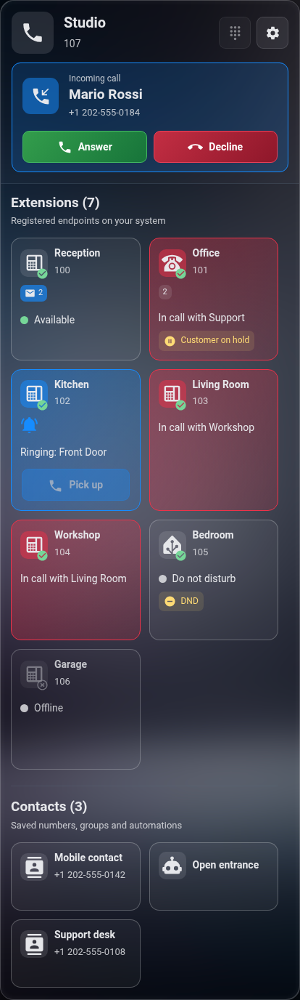

# VoIP Stack 2026.11.1-dev

Changes since stable **2026.11.0**.

> **Generic Full Lite 4 MB migration:** download the companion
> [partition CSV](../yamls/full-experience/single-bus/partitions_4mb_lite_dual_ota.csv)
> beside your main YAML. This profile has larger OTA slots and 192 KiB NVS.
> Existing stock-layout devices require flash erase and serial factory upload,
> which resets stored preferences. Preserve your YAML, wiring and calibration
> values first. [Migration steps](BREAKING_CHANGES.md#2026111-preview-4-mb-lite-flash-layout).
> Other board profiles keep their current partition layouts.

## Your phone system, on one dashboard

The new **VoIP Dashboard** brings your extensions and saved contacts into a
single operator view. See who is available, who is calling and which
conversations are on hold, then call or pick up directly from the same card.

Illustrative snapshot with voicemail, Do not disturb and an offline phone.

Mobile portrait layout

Glass surfaces follow your Home Assistant theme. The responsive grid adapts
from a narrow phone screen to a full-width operator console, with separate
sections for internal phones and external contacts. Give the card more space
in the dashboard layout editor to display more columns and rows.

- **Live extension tiles:** browser phones, ESP phones and registered SIP
  accounts share one view of availability and call state.
- **Recognizable destinations:** icons distinguish phone types, saved
  contacts and automation destinations, with separate availability indicators.
- **Call details:** ringing tiles show the caller; busy tiles expose active
  and held conversations as separate entries.
- **Directed pickup:** recover an eligible ringing call on your selected
  browser or ESP phone.
- **Phone controls:** answer, decline and hang up from the selected phone's
  header. The calling-phone selector stays in the visual editor.
- **The same phone options:** auto-answer, ringtone, Do not disturb and media
  device preferences open directly beneath the dashboard's header, using the
  familiar softphone controls.
- **Native keypad:** open the dialpad icon to enter a number or SIP address,
  then use the same keypad for browser-call DTMF, including video calls.
  The gear icon opens and closes the familiar phone options.
- **Video calls:** choose video or audio-only when answering a video offer.
  The first received video frame opens the full-card call view, with the
  familiar red call bar and phone controls. The tiles return after hangup.
- **DND and voicemail:** see Do not disturb, mailbox waiting status and the
  count of new messages alongside each phone.
- **Saved contacts:** call external destinations from their own section.

The header belongs to the phone selected for this card. It keeps that phone's
identity, status and call controls together while the grid shows the rest of
the system.

Leave the optional title empty to use the selected phone's name as the heading,
with its extension underneath when available. A custom title keeps the phone's
identity below it.

Add **VoIP Dashboard** from Home Assistant's card picker and choose its calling
phone in the visual editor. The card loads through the existing VoIP Stack
resource. See the [dashboard guide](USER_GUIDE.md#use-the-voip-dashboard) for
layout, controls and supported phone types.

## The same calls and media engine

The dashboard and the familiar softphone card share the page-level media
engine. A call continues when you leave its card or dashboard view, with its
browser presence and keepalive maintained until the call ends. Opening both
cards on one view uses that same call owner.

Selecting an ESP phone keeps audio on the ESP. Selecting a browser phone uses
the browser microphone and speaker, with microphone permission requested when
placing or answering a call. Browser video uses the same media engine and
controls as the existing phone card. A video offer alone keeps the tiles
visible until a remote frame arrives.

Enabled browser phones remain available in the directory and BLF even when
their cards are closed. They can ring logically, run call automations and
accept an answer from a card opened during the ringing window. Attached
browser clients and the active media owner are tracked separately.

- **Independent browser windows:** opening or cloning another window gives it
  its own media identity, preserving the current window's call audio. A page
  reload reuses that document's identity to recover its session.
- **Clear voicemail identity:** mailbox access displays **Voicemail: Reception**,
  for example, through answer and connected-party updates.
- **Mailbox updates:** message changes schedule managed ESP configuration on
  Home Assistant's event loop, keeping automatic phone updates responsive.
- **Controls after navigation:** returning to the Dashboard or reconnecting to
  Home Assistant restores its phone list and call actions, including when a
  command was pending as the card left the page.

Video call layouts on desktop and mobile

Browser call screenshots with a synthetic camera source.

Registered SIP phones appear as monitored and callable destinations. Choose a
browser or ESP phone as the dashboard's calling phone. Multiple and held calls
are displayed from the backend's actual call records, preserving their
individual identities.

## Live updates from the PBX

The dashboard shares the authoritative phone-state observer used by SIP busy
lamps. It receives an initial WebSocket snapshot followed by changed or
removed endpoints, with a fresh snapshot after reconnecting.

Endpoint permissions apply to the subscription and are reconciled when access
changes. Monitoring a phone is passive: its presence, microphone and media
ownership stay with their existing owners. Closing a view releases its
display listeners, and connection cleanup follows Home Assistant's
subscription lifecycle.

## Interoperability and regression coverage

The accompanying qualification tools exercise SIP BLF subscriptions through
PJSIP over UDP and TCP. The regression suite covers snapshot and delta
delivery, endpoint removal, permission changes, held calls, multiple calls and
WebSocket cleanup. Browser scenarios check the dashboard controls against real
call states and verify that call resources are released after hangup.

Parking cleanup also handles a caller hanging up while the previous phone leg
or media relay is being retired. The existing call owner finishes cleanup and
releases the parking slot and audio resources for the next call.

The [testing tools guide](../tools/README.md) describes the reproducible lab
workflow and its evidence. Software and browser checks cover their respective
layers; physical audio quality remains a separate device test.

## Optional ESP firmware extensions

These features run on the ESP. Enable the corresponding component or package
in its YAML, then rebuild and upload the firmware. The Home Assistant
integration and Dashboard update independently of these device-side options.

### Capture the display on demand

`esp_screenshot` captures supported LVGL displays and the P4 MIPI DSI
framebuffer. Its optional diagnostics package exposes a **Take screenshot**
button and native ESPHome action in Home Assistant, with optional screenshot ID
and status sensors.

The guide pairs these with Home Assistant's built-in Template Image helper and
a Picture Glance card: press the capture button to update the displayed image.
The capture ID changes when a new JPEG is ready; reading the image URL serves
that saved screenshot. Status reports progress or a failure while preserving
the last successful image. P4 screenshots can be rotated independently of the
display layout. Compression uses a persistent worker with bounded buffers, and
HTTP readers keep a consistent image during downloads.

[Screenshot setup and Home Assistant example](ESP_SCREENSHOT.md)

### Receive JPEG video on an S3 display

The optional `esp_video_renderer` presents incoming baseline JPEG images
through LVGL. Its VoIP adapter connects to the existing video receiver; other
producers can feed the standalone component too. A display-equipped board can
receive video, with a separate camera required to send its own image.

The default display surface is 320x240, with up to two admitted frames per second.
Larger JPEG frames use bounded half-size or quarter-size decoding to fit that
surface. Bounded buffers keep the latest queued image. The existing P4 renderer
retains its hardware decoding path.
The shared FULL video policy suspends MWW during video and restores listening
according to the user's Wake Word setting when video ends.

JPEG calls can negotiate image dimensions with standard SDP `imageattr`.
Compatible browser senders fit the camera picture to the receiver's preferred
size before compression, preserving proportions and reducing decoding work on
the ESP. Peers without this optional attribute keep the existing video path.
The maintained Spotpear display profile now advertises a 10 FPS budget.

Renderer and screenshot workers expose `task_core`, `task_priority`,
`task_stack_size`, `task_stack_in_psram` and `buffer_in_psram` for explicit
execution and memory placement.

[ESP video renderer guide](https://github.com/n-IA-hane/esphome-voip-stack/blob/dev/docs/ESP_VIDEO_RENDERER.md)

### Register the ESP with a PBX

ESP VoIP Stack adds optional SIP accounts alongside the existing direct Home
Assistant route. Configure accounts in YAML or through native ESPHome actions,
select the outgoing line and keep runtime changes temporary or save them
explicitly. UDP/TCP, Digest authentication and automatic binding renewal share
the existing signaling worker.

SIP MWI reports mailbox waiting status and counts to YAML triggers and
conditions, for both VoIP Stack HA and other registered PBX accounts.
The maintained display packages show an unread-message envelope on their idle
Assist and telephone views.

[PBX accounts and actions](https://github.com/n-IA-hane/esphome-voip-stack/blob/dev/docs/SIP_REGISTRATION.md)
and [message waiting](https://github.com/n-IA-hane/esphome-voip-stack/blob/dev/docs/SIP_MWI.md).

### One account, a live directory and your messages

Maintained ESP packages now obtain their account from Home Assistant through
the existing ESPHome API. HA generates the password once; SIP registration,
LDAP directory access and mailbox calls share that identity. The friendly
device name is presented as the caller's name.

- **Live extension changes:** changing an ESP's extension while it is online
  refreshes its Home Assistant routing and directory entry. Conflicting aliases
  are rejected before the managed account is updated.
- **LDAP phonebook:** HA assembles the common routing directory directly. ESP
  phones fetch names and addresses with the same standard service available
  to traditional desk phones.
- **Scrolling BLF contacts:** type icons and live call-state indicators replace
  the contact carousel. Tap a ringing contact to perform directed pickup.
  Reachability is shown separately through standard PIDF presence, so an
  offline phone stays unavailable even when its last call is idle.
  Automatic watches cover phone endpoints; saved contacts and groups remain
  callable without consuming SIP subscription slots.
- **Readable contact details:** saved contacts show their telephone number;
  idle phones show their extension when available. Assist and call groups omit
  the inapplicable Unknown status.
- **Registered audio negotiation:** SIP registration preserves known audio
  capabilities. Directional phones whose OPTIONS omit packet times negotiate
  from Home Assistant's supported PCM offer and their actual SDP answer.
- **Mailbox shortcut and DTMF:** SIP MWI shows an envelope when messages wait.
  Tap it to call the PBX's mailbox menu and use the regular in-call keypad to
  listen, repeat or delete messages. The same SIP audio path serves calls and
  mailbox conversations. A dialpad icon opens the existing keypad during a
  call, showing the contact, elapsed time and red hangup control.
  Switching voicemail off and on retains the account's MWI resource.
- **Connected names after pickup:** the call screen and keypad follow the
  PBX's connected-party identity, including updates received after answer.
  Custom displays can use `get_active_peer_name()` and the optional
  `on_peer_changed` callback. Connection setup stays in `on_in_call`.
- **More room on round displays:** contacts show four complete rows, or three
  when voicemail needs space. A smaller call and hangup control leaves room
  for larger number keys. Returning to idle clears the editable number for
  the next call, including after pickup.
- **Options gestures:** scrolling reaches the complete controls list, and
  swiping down from its top returns to the previous screen. The controls'
  background no longer traps that navigation gesture.
- **Independent firmware choices:** select `directory`, `blf` and `mwi` in
  `firmware_features`. BLF also works with static contacts and without a display.
  Omitted features remove their client code and reserved pools from the firmware.
- **Automatic cleanup:** permanent ESPHome removal revokes credentials and deletes
  the managed directory/mailbox data. Offline and reload cycles retain them.
- **Lower directory memory peaks:** LDAP maps one entry at a time into a
  reusable staging table. Contact storage can use PSRAM independently of the
  audio buffers, and workers retain their allocated stacks between operations.
  Contact lookups avoid temporary allocations, and repeated state notifications
  share one display refresh per loop iteration. Contact rows also retain
  unchanged geometry and styles, avoiding redundant LVGL layout work.
- **Compact discovery:** managed phones negotiate through SIP OPTIONS/SDP,
  replacing the lengthy Endpoint sensor with their native device/account owner.

Read the [standard phone services guide](ESP_PHONE_SERVICES.md) for ports,
authentication, standalone PBX options, memory controls and migration.

## Updating from 2026.11.0

This prerelease updates the Home Assistant integration and frontend. Existing
phone-card configurations remain usable; add the dashboard as a separate card
where you want the operator view.

**Browser-phone migration:** end active browser calls before the first
dashboard refresh after updating. That refresh replaces legacy shared media
identities; subsequent reloads preserve the updated window identity for
session recovery. [Migration details](BREAKING_CHANGES.md#2026111-preview-browser-media-identity).

Keep your existing ESP firmware for the Dashboard update. To try the ESP extensions above, use the current maintained board YAML and
coordinated `dev` component sources and packages,
then rebuild with ESPHome **2026.10.0 or newer**. Use the matching Audio Stack,
ESP VoIP Stack and Runtime Controller sources selected by that package.

Home Assistant **2026.7.0 or newer** remains the integration requirement.
