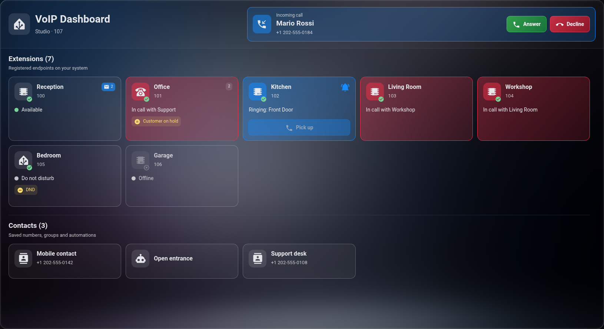

# Your PBX should be nervous.

2026.12.0-dev development preview. Changes since stable **2026.11.0**.

After updating VoIP Stack at the company where I work, I started looking at our
FreeSWITCH installation a little differently. More and more of what I needed
was already sitting in Home Assistant.

Eventually, one question stopped leaving me alone: could VoIP Stack replace our
office PBX? We already run Home Assistant. What is actually missing?

Apparently, asking that question was enough to ruin another perfectly good
development schedule.

With SIP BLF and the VoIP Dashboard card, the operator console is already taking
shape. This preview adds call queues with operator login, logout and pause,
alongside paging and more explicit incoming-number routing.

The [VoIP Dashboard](../README.md#use-the-voip-dashboard) brings these jobs into
one view, with extension states, incoming callers, active and held conversations,
pickup and the selected phone's controls.

Look how great it turned out. I personally love it.

_Existing Dashboard demonstration. Its illustrative call states are not a new
qualification capture for this update._

Looking back, exposing dialplan operations through Home Assistant automations
keeps proving its worth. Office hours, on-call rotations, presence, door controls
and custom call flows can use the same tools you already use to run everything
else.

Desk-phone provisioning is now part of the preview too: adopt a supported
model, assign an existing SIP account and manage its lines, keys and directory
from Home Assistant. The ideas, unfortunately, show no sign of stopping.

The intercom wants the whole damn office.

## One SIP account, several clients

Existing HA/browser phones become shared SIP accounts in place, preserving
their names, extensions, cards and existing credentials. The component creates
missing SIP credentials during migration. A registered handset and an HA card
can use the same account without creating another extension or queue agent.
The first client to answer owns the media; opening another card observes that
call without taking over its microphone or speaker.

A saved card association keeps the account callable with every browser closed.
An HA automation can notify you, then opening the card recovers the current
ringing call while its configured timeout still allows an answer.

An account and a physical phone have separate HA devices. The account owns its
extension, DND, routing, mailbox and queue state. The physical phone owns its
model, managed line positions and programmable keys. See
[accounts and clients](ACCOUNTS_AND_CLIENTS.md) for migration and reception with
closed browsers.

Managed ESPHome phones now use ordinary SIP REGISTER too. With automatic
registration enabled, HA provisions its named line through the existing native
API. A manually configured ESP line can share a user-created account with a
handset and card, or register to a different compatible PBX. One ESP can keep
several registrations but still handles one call at a time. Its ESP mirror
controls the physical microphone and speaker. See [ESP registration](ESP_REGISTRATION.md).

## Optional desk-phone provisioning

Enable **Phone provisioning** only when needed. Adopt a discovered or manually
entered phone using its MAC and supported model profile, optionally assigning
its first SIP account. Native HA editors manage its properties, line
associations and physical key order. The account and line editors update the
same association; removing a handset does not delete its shared accounts.

Each phone pins its catalog profile. Profiles declare the line positions, key
functions and configuration-application methods they support. Preparing a file,
delivering it and the phone applying it are separate observations. Models
without a qualified application method retain their manual path. See
[managed phones](PHONE_PROVISIONING.md) for setup and model-specific limits.

## Group devices and queues

Ring groups and queues are now configurable VoIP Stack service devices. Create
one manually, or type a new name in a phone's group settings. Another phone
declaring the same name joins the existing group. The central member selection
and phone settings modify the same membership.

Automatic groups disappear after their last configured membership is removed.
Manual groups can remain empty. Renaming a group preserves its stable identity.
Offline ESP changes are persisted and synchronized without registering the SIP
account again; reconnect snapshots cannot undo a pending HA edit.

Queues keep callers in FIFO order and select operators with ring-all,
round-robin, ordered or longest-idle strategies. Waiting time, answer windows,
retries, post-call wrap-up, optional waiting audio and fallback are configurable.
Login, logout and pause persist separately from membership. SIP keys use the
existing authenticated dialog-info BLF owner.

See [group and queue setup](GROUPS_AND_QUEUES.md).

## Incoming calls, directly or with a menu

Open the named trunk's configuration and select its incoming destination. A
new trunk proposes the preferred HA account. Keep it to ring that account, use
the VoIP Stack device or entity choices, or enter a name, extension or SIP URI.
Existing explicit destinations are retained. DID matches and applicable routing
automations keep their precedence. Ordinary incoming calls have no automatic
keypad collector or spoken-menu delay.

For reception, create an Automation contact named `Welcome` and select it as
the destination. That contact has its own HA device and call-event entity.
Choose one in **VoIP call received**, play TTS or a recorded greeting, collect
the caller's input and forward the same call. The complete recipe supports
`1` for Reception, `2` for Support or a full extension such as `667`. A pause
between digits ends the input; `#` can be enabled as an optional confirmation.
The menu compares the whole entry, so `111` is not mistaken for choice `1`.
See [the Welcome recipe](AUTOMATION_DIALPLAN.md#build-a-small-keypad-menu) and
[trunk migration](BREAKING_CHANGES.md#retired-trunk-extension-menu).

## Keep the call, move the conversation

Pick up an eligible ringing extension from another phone, transfer an answered
call, or park it and retrieve the reported slot elsewhere. Shared-account clients
still have one media owner: opening another card observes the conversation;
parking and retrieval deliberately move it. Compatible SIP handsets can use
attended REFER/Replaces transfer; the card offers blind transfer. BLF shows
phone status, LDAP supplies contacts and MWI reports voicemail counts.

Optional conversation recording captures supported two-party audio through HA.
Voicemail belongs to the account and can be processed with native triggers,
HA media and an installed STT provider. Conference recording and direct calls
bypassing HA are outside this recorder. See [PBX workflows](PBX_WORKFLOWS.md).

Parking residence, queue maximum wait, conversation recording duration and
voicemail message duration now accept explicit `0` for no deadline of that
kind. Finite prefills and existing positive limits are retained. Hangup, storage
quotas, queue no-agent policies and the finite waits for input, preparation and
retries still apply. See [duration settings](RINGING_POLICY.md#unlimited-duration-outside-ringing).

## Video and progress before answer

Keep one **Call** action. Supported phones open remote video automatically when
the peer sends it; **Send video** controls only the local camera. Supported trunk
routes can carry early media before answer, including a provider announcement.
That audio does not mark the call answered, and cancellation remains possible.
JPEG reception on maintained S3 displays and the P4 FULL JPEG path retain their
board and route limits; H.264 uses its separate supported profile. See
[video compatibility](SIP_VIDEO.md) and [trunks](SIP_TRUNK.md).

## Paging, including ordinary desk phones

The new `announce` action sends a TTS message or recording to one or several
phones, optionally through a saved paging group. TTS is generated once, then
distributed to the recipients with bounded queues. Busy phones are skipped and
results identify each target. `stop_announcement` stops only its own job.

SIP recipients receive a per-call `Answer-Mode` request. Updated ESP firmware
authorizes paging for the intended account without toggling global autoanswer.
A browser recipient receives audio without opening its microphone and must
confirm playback readiness. Calling a paging group's extension supports a live
one-way announcement.

Your phones can be your announcement speakers. A separate smart speaker is
optional. See [paging](PAGING.md) for setup and browser limitations.

## Incoming numbers belong to the call

Named trunks can select the called number from Request-URI, To,
P-Called-Party-ID, an explicit custom header or a fixed value. Ordered fallback
sources and prefix replacements are configurable rather than provider-specific.

Native automation triggers expose the original and normalized called number,
its provenance, caller identity and stable incoming line. That initial identity
survives forwarding and termination. A native line-device selector makes it
possible to distinguish trunks without depending on their display names.

The qualification bank exercises 100 mapped public numbers, exceptions and
unknown-number fallback through HA automations and real SIP recipients. It does
not register with your production carrier or certify every provider's format.
See [DID and number blocks](INBOUND_NUMBERS.md).

## Assist and desk-phone directory

The callable Assist endpoint gains tools scoped to its current telephone call:
inspect, transfer to permitted internal destinations, resume a pending transfer
and hang up. A failed transfer retains the conversation. Tools cannot select an
arbitrary Call-ID, external number or unrelated user's call.

The new [LDAP phone guide](LDAP_PHONES.md) covers the actual server settings,
Bind identity, filters, returned attributes and TLS. It distinguishes protocol
qualification from a physical phone's implementation. The
[office automation examples](OFFICE_AUTOMATIONS.md) cover on-call routing and
door-command ownership without creating another dialplan engine.

## Upgrade and preview limits

Update both the HA integration and ESP VoIP component for the new firmware
features. Existing ring-group declarations are retained. Queue declarations and
their optional native text control are additive. Changing memberships does not
require a transport reload or another REGISTER.

Migration corrections handle empty legacy parent settings. Pending retired-menu
notices survive an interrupted Repair save. Existing account records retain
their HA subentry, device and entity IDs, SIP credentials, extensions, mailbox references, cards and popup
associations remain on their original identities. Completed retry Repairs are
cleared; actionable Repair guidance excludes credential values and raw exception
text. A remaining conflict still needs correction and an explicit retry.

Legacy provider migration preserves the line's enabled state, credentials and
routing, without overwriting a distinct configured provider. An explicit default
or no-default choice remains the user's choice. Check the named trunk entries
and outgoing selection after upgrading.

This remains a development prerelease. The new paths have software and real
SIP/RTP laboratory coverage, including media content and teardown. That is
distinct from physical qualification on every desk phone, ESP board and carrier.
The Fanvil hardware check and office cutover remain separate steps.

This release does not include another MWW or acoustic AFE tuning pass. The
current stable release and existing release tags remain available.

## Ringing policy and BLF consolidation

- General settings store a ringing duration, initially 120 seconds. Existing
  installations receive that stored value only after a successful account
  migration. Missing account/group values inherit it; explicit zero is unlimited.
- Existing group 30-second, queue 20-second and parking return 30-second values
  survive. No-answer destinations no longer require a separate account timeout.
  Without a fallback, deadline expiry ends explicitly with `no_answer`.
- Routing and forwarding actions can override the selected attempt's duration.
  Automation-originated calls inherit the same policy when `answer_timeout` is
  omitted. An explicit action duration is an override; each later forward has
  its own resolved budget. A final answer ends ringing before media preparation.
- Maintained ESP packages declare a configurable 120-second outgoing limit.
  The P4 phone retains its separate 30-second incoming limit. REFER uses the
  configured outgoing budget, including unlimited zero.
- The shared SIP event budget is 2048, with 132 per authenticated principal.
  Repeated refusals advertise 5/10/20/40/60-second retry delays. Idle leases use
  timer handles, and renewal avoids a full installation quota scan.
- BLF lease caps remain 60 seconds by default; Reconfigure can explicitly select
  up to 3600 seconds. This controls renewal traffic and full-snapshot recovery,
  independently of SIP registration and phone availability.

See [ringing policy](RINGING_POLICY.md) and
[notification recovery](NOTIFY_TRANSPORT_RECOVERY.md) for configuration details.
